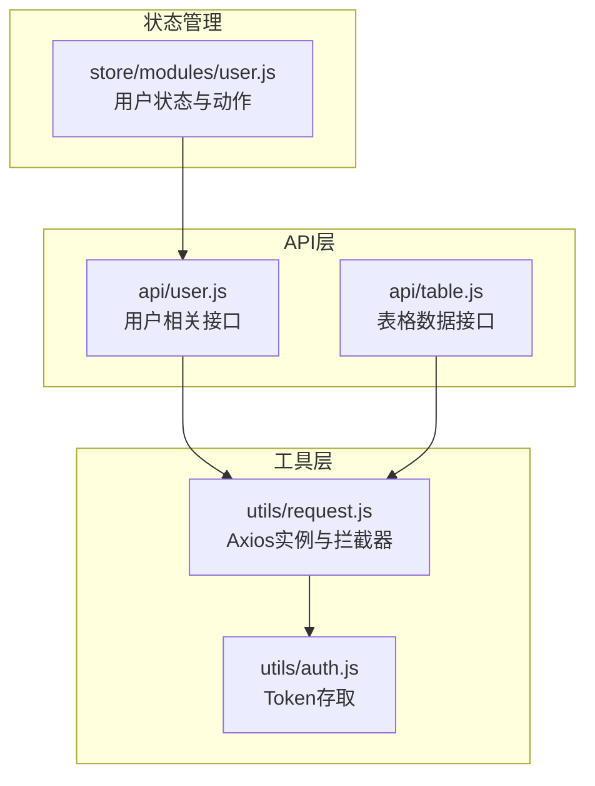
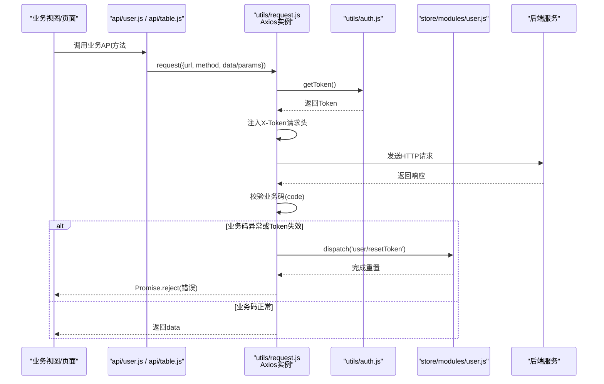
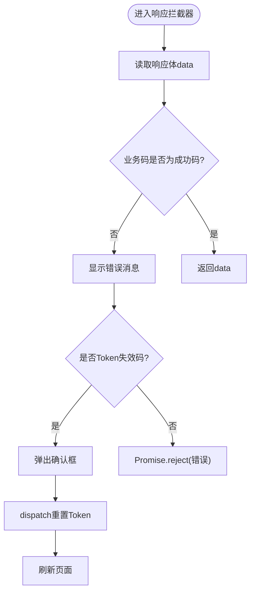
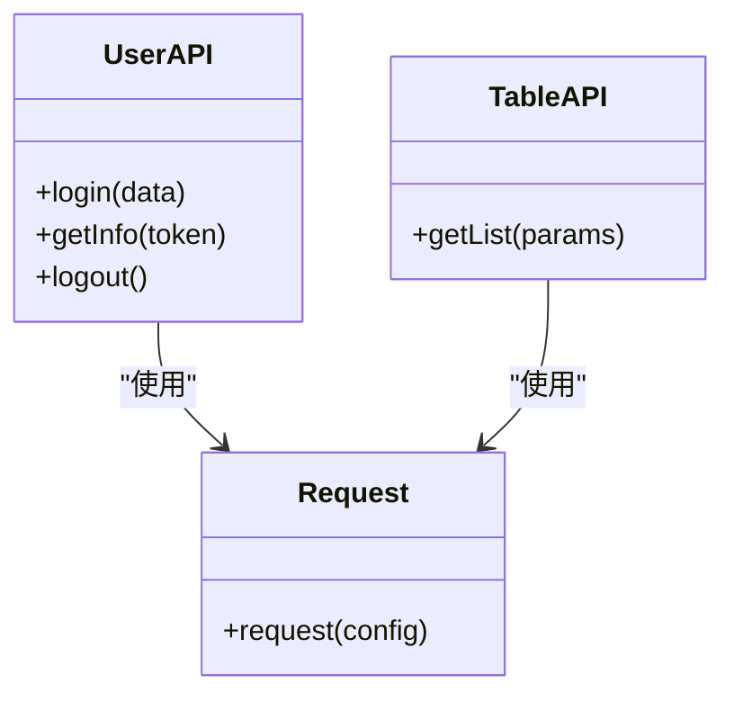
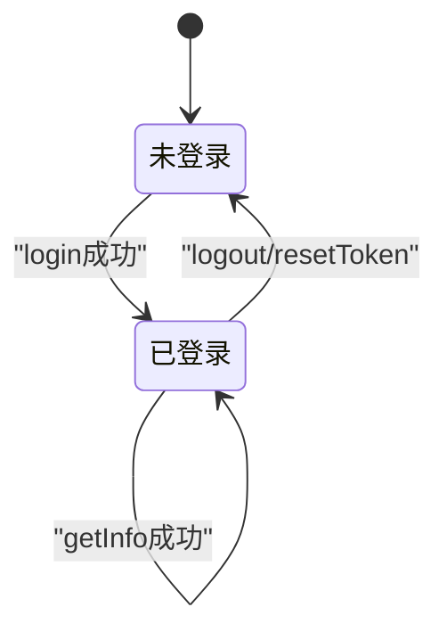
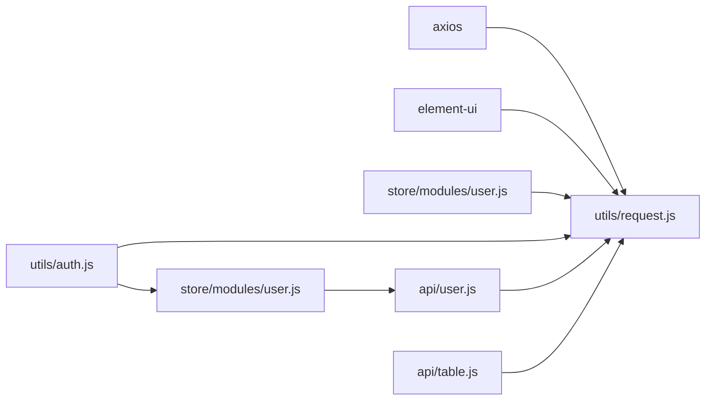

# HTTP请求封装

<cite>
**本文引用的文件**   
- [src/utils/request.js](file://src/utils/request.js)
- [src/utils/auth.js](file://src/utils/auth.js)
- [src/store/modules/user.js](file://src/store/modules/user.js)
- [src/api/user.js](file://src/api/user.js)
- [src/api/table.js](file://src/api/table.js)
</cite>

## 目录
1. [简介](#简介)
2. [项目结构](#项目结构)
3. [核心组件](#核心组件)
4. [架构总览](#架构总览)
5. [详细组件分析](#详细组件分析)
6. [依赖关系分析](#依赖关系分析)
7. [性能与可靠性](#性能与可靠性)
8. [故障排查指南](#故障排查指南)
9. [结论](#结论)

## 简介
本章节面向需要理解并复用项目中HTTP请求封装的开发者。文档聚焦以下目标：
- Axios实例的创建与配置（基础URL、超时、请求头等）
- 请求拦截器与响应拦截器的实现原理（Token自动注入、错误统一处理、登录态失效处理等）
- 业务API调用示例（以用户模块和表格模块为例）
- 错误处理策略与重试机制说明

## 项目结构
本项目采用“工具层 + API层 + 视图层”的分层组织方式，HTTP请求封装位于工具层，被API层统一调用，从而在业务代码中屏蔽底层网络细节。

**图表来源**
- [src/utils/request.js:1-86](file://src/utils/request.js#L1-L86)
- [src/utils/auth.js:1-16](file://src/utils/auth.js#L1-L16)
- [src/api/user.js:1-25](file://src/api/user.js#L1-L25)
- [src/api/table.js:1-10](file://src/api/table.js#L1-L10)
- [src/store/modules/user.js:1-98](file://src/store/modules/user.js#L1-L98)

**章节来源**
- [src/utils/request.js:1-86](file://src/utils/request.js#L1-L86)
- [src/utils/auth.js:1-16](file://src/utils/auth.js#L1-L16)
- [src/api/user.js:1-25](file://src/api/user.js#L1-L25)
- [src/api/table.js:1-10](file://src/api/table.js#L1-L10)
- [src/store/modules/user.js:1-98](file://src/store/modules/user.js#L1-L98)

## 核心组件
- Axios实例与拦截器：集中管理基础URL、超时、请求头、全局错误提示与登录态处理
- Token存取：基于Cookie的Token读写方法
- API封装：将具体业务接口以函数形式暴露，内部通过Axios实例发起请求
- 用户状态管理：负责登录、获取用户信息、登出、重置Token等流程

**章节来源**
- [src/utils/request.js:1-86](file://src/utils/request.js#L1-L86)
- [src/utils/auth.js:1-16](file://src/utils/auth.js#L1-L16)
- [src/api/user.js:1-25](file://src/api/user.js#L1-L25)
- [src/api/table.js:1-10](file://src/api/table.js#L1-L10)
- [src/store/modules/user.js:1-98](file://src/store/modules/user.js#L1-L98)

## 架构总览
下图展示了从业务调用到服务端响应的完整链路，包括拦截器对Token的注入与错误处理。

**图表来源**
- [src/utils/request.js:14-83](file://src/utils/request.js#L14-L83)
- [src/utils/auth.js:5-7](file://src/utils/auth.js#L5-L7)
- [src/store/modules/user.js:81-88](file://src/store/modules/user.js#L81-L88)
- [src/api/user.js:3-24](file://src/api/user.js#L3-L24)
- [src/api/table.js:3-9](file://src/api/table.js#L3-L9)

## 详细组件分析

### Axios实例与拦截器（utils/request.js）
- 实例创建
  - 基础URL：取自环境变量，便于多环境切换
  - 超时：默认5秒
  - 跨域Cookie：已注释，可按需开启
- 请求拦截器
  - 若存在Token，则自动注入自定义请求头X-Token
  - 请求失败时打印日志并拒绝Promise
- 响应拦截器
  - 根据业务码判断成功与否；非成功时统一消息提示
  - 针对特定Token失效码进行二次确认并触发重新登录流程
  - 网络或业务错误统一抛出，供上层捕获

**图表来源**
- [src/utils/request.js:45-82](file://src/utils/request.js#L45-L82)

**章节来源**
- [src/utils/request.js:7-11](file://src/utils/request.js#L7-L11)
- [src/utils/request.js:14-31](file://src/utils/request.js#L14-L31)
- [src/utils/request.js:34-83](file://src/utils/request.js#L34-L83)

### Token存取（utils/auth.js）
- 提供getToken/setToken/removeToken三个方法，基于Cookie持久化Token
- 与请求拦截器配合，实现无感鉴权

**章节来源**
- [src/utils/auth.js:1-16](file://src/utils/auth.js#L1-L16)

### API封装（api/user.js、api/table.js）
- user.js
  - login：POST提交用户名密码
  - getInfo：GET获取用户信息，携带token参数
  - logout：POST执行登出
- table.js
  - getList：GET获取表格数据，支持分页等查询参数

**图表来源**
- [src/api/user.js:3-24](file://src/api/user.js#L3-L24)
- [src/api/table.js:3-9](file://src/api/table.js#L3-L9)
- [src/utils/request.js:7-11](file://src/utils/request.js#L7-L11)

**章节来源**
- [src/api/user.js:1-25](file://src/api/user.js#L1-L25)
- [src/api/table.js:1-10](file://src/api/table.js#L1-L10)

### 用户状态管理（store/modules/user.js）
- 登录成功后保存Token到本地存储与Vuex状态
- 获取用户信息后更新名称与头像
- 登出时清理Token、重置路由与状态
- 提供resetToken用于Token失效后的清理流程

**图表来源**
- [src/store/modules/user.js:30-88](file://src/store/modules/user.js#L30-L88)

**章节来源**
- [src/store/modules/user.js:1-98](file://src/store/modules/user.js#L1-L98)

## 依赖关系分析
- utils/request.js依赖
  - axios：HTTP客户端
  - element-ui：Message/MessageBox用于全局提示与确认
  - store：访问当前Token与触发重置Token动作
  - utils/auth：读取Token
- api/*依赖
  - utils/request：统一发起请求
- store/modules/user.js依赖
  - api/user：调用登录、获取信息、登出接口
  - utils/auth：读写Token
  - router：登出后重置路由

**图表来源**
- [src/utils/request.js:1-4](file://src/utils/request.js#L1-L4)
- [src/api/user.js:1-25](file://src/api/user.js#L1-L25)
- [src/api/table.js:1-10](file://src/api/table.js#L1-L10)
- [src/store/modules/user.js:1-4](file://src/store/modules/user.js#L1-L4)

**章节来源**
- [src/utils/request.js:1-4](file://src/utils/request.js#L1-L4)
- [src/api/user.js:1-25](file://src/api/user.js#L1-L25)
- [src/api/table.js:1-10](file://src/api/table.js#L1-L10)
- [src/store/modules/user.js:1-4](file://src/store/modules/user.js#L1-L4)

## 性能与可靠性
- 性能
  - 合理设置超时时间，避免长时间阻塞
  - 按需开启跨域Cookie，减少不必要的请求开销
  - 建议结合CDN与Gzip提升静态资源加载速度（与HTTP封装无关，但影响整体体验）
- 可靠性
  - 统一错误提示，提升用户体验
  - Token失效场景下自动引导重新登录，降低脏状态
- 重试机制
  - 当前实现未内置重试逻辑
  - 如需重试，可在响应拦截器中对特定错误码进行条件重试，或使用axios-retry库扩展

[本节为通用指导，不直接分析具体文件]

## 故障排查指南
- 常见问题
  - 401/Token失效：检查后端返回的业务码是否命中Token失效分支，确认后是否触发重新登录
  - 跨域问题：如需携带Cookie，请取消跨域Cookie相关注释并配置后端CORS
  - 超时错误：适当增大timeout或优化后端接口响应时间
- 定位步骤
  - 打开浏览器控制台，查看Network面板的请求头是否包含X-Token
  - 检查Element UI的消息提示内容，定位业务码与错误信息
  - 在响应拦截器处打断点，观察res.code与error对象

**章节来源**
- [src/utils/request.js:45-82](file://src/utils/request.js#L45-L82)
- [src/utils/request.js:14-31](file://src/utils/request.js#L14-L31)

## 结论
该HTTP请求封装通过Axios实例与拦截器实现了统一的鉴权注入、错误提示与登录态管理，API层保持简洁清晰，便于业务快速接入。建议在后续迭代中补充重试机制、更完善的错误分类与埋点统计，进一步提升健壮性与可观测性。