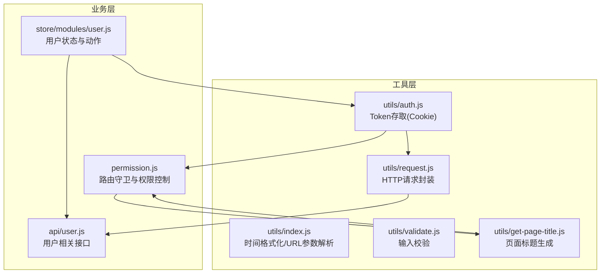
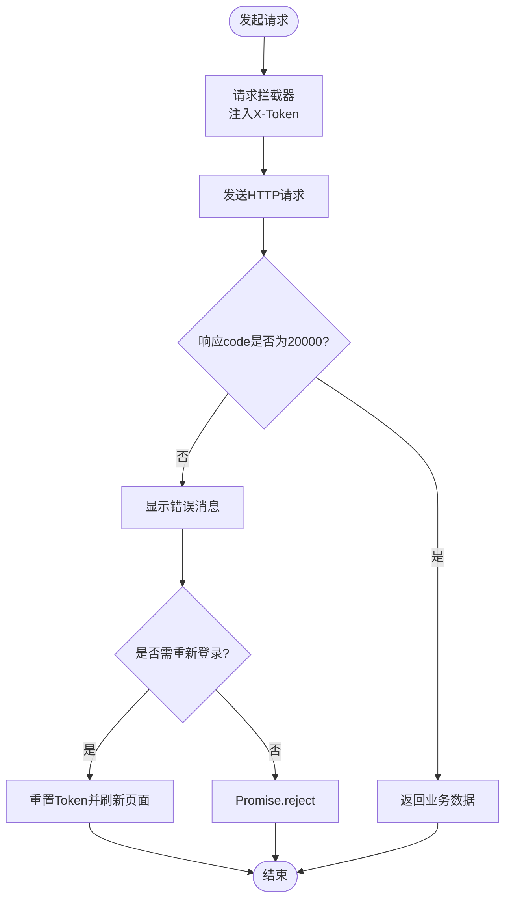
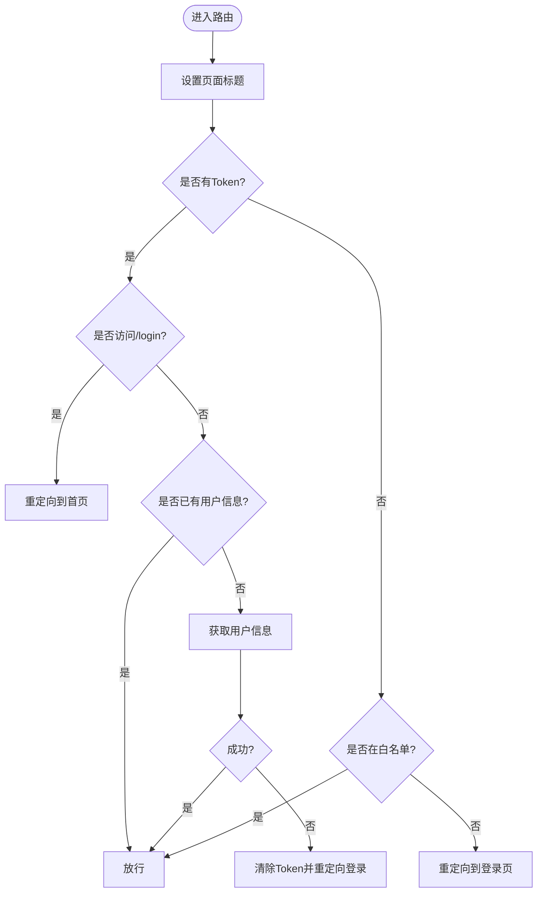
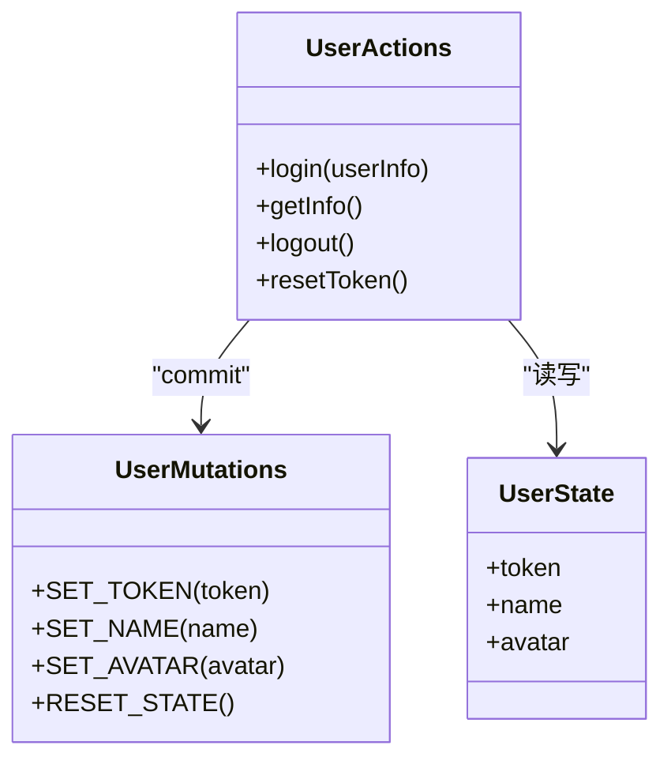
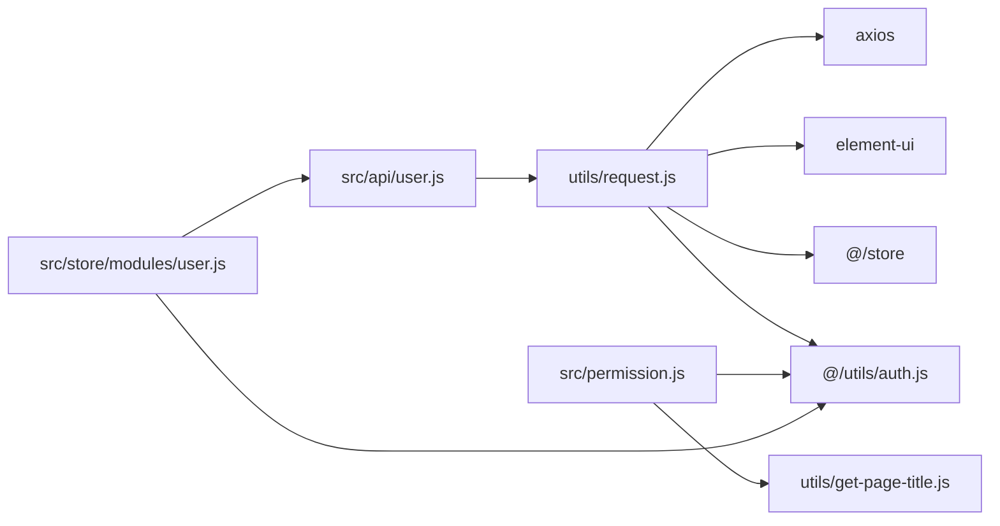

# 工具函数库

<cite>
**本文引用的文件**   
- [src/utils/index.js](file://src/utils/index.js)
- [src/utils/request.js](file://src/utils/request.js)
- [src/utils/validate.js](file://src/utils/validate.js)
- [src/utils/auth.js](file://src/utils/auth.js)
- [src/utils/get-page-title.js](file://src/utils/get-page-title.js)
- [src/api/user.js](file://src/api/user.js)
- [src/store/modules/user.js](file://src/store/modules/user.js)
- [src/permission.js](file://src/permission.js)
</cite>

## 目录
1. [简介](#简介)
2. [项目结构](#项目结构)
3. [核心组件](#核心组件)
4. [架构总览](#架构总览)
5. [详细组件分析](#详细组件分析)
6. [依赖关系分析](#依赖关系分析)
7. [性能与可维护性](#性能与可维护性)
8. [故障排查指南](#故障排查指南)
9. [结论](#结论)
10. [附录：开发规范与最佳实践](#附录开发规范与最佳实践)

## 简介
本文件系统化梳理项目中工具函数库的设计与实现，覆盖以下通用能力：
- HTTP 请求封装（基于 axios 的拦截器、鉴权注入、统一错误处理）
- 表单与输入校验（外部链接判断、用户名白名单校验）
- 权限与路由守卫（登录态检查、用户信息获取、页面重定向）
- 页面标题管理（根据配置与路由元信息动态设置标题）
- 时间格式化与 URL 参数解析等常用工具方法

目标是帮助开发者快速理解各工具函数的职责边界、调用方式与扩展点，并给出自定义工具函数的开发规范与最佳实践。

## 项目结构
工具函数主要位于 src/utils 目录，配合 api、store、permission 等模块共同完成业务闭环。



图表来源
- [src/utils/index.js:1-118](file://src/utils/index.js#L1-L118)
- [src/utils/request.js:1-86](file://src/utils/request.js#L1-L86)
- [src/utils/validate.js:1-21](file://src/utils/validate.js#L1-L21)
- [src/utils/auth.js:1-16](file://src/utils/auth.js#L1-L16)
- [src/utils/get-page-title.js:1-11](file://src/utils/get-page-title.js#L1-L11)
- [src/api/user.js:1-25](file://src/api/user.js#L1-L25)
- [src/store/modules/user.js:1-98](file://src/store/modules/user.js#L1-L98)
- [src/permission.js:1-65](file://src/permission.js#L1-L65)

章节来源
- [src/utils/index.js:1-118](file://src/utils/index.js#L1-L118)
- [src/utils/request.js:1-86](file://src/utils/request.js#L1-L86)
- [src/utils/validate.js:1-21](file://src/utils/validate.js#L1-L21)
- [src/utils/auth.js:1-16](file://src/utils/auth.js#L1-L16)
- [src/utils/get-page-title.js:1-11](file://src/utils/get-page-title.js#L1-L11)
- [src/api/user.js:1-25](file://src/api/user.js#L1-L25)
- [src/store/modules/user.js:1-98](file://src/store/modules/user.js#L1-L98)
- [src/permission.js:1-65](file://src/permission.js#L1-L65)

## 核心组件
本节对工具层的关键模块进行概览说明，后续章节将深入展开。

- utils/index.js
  - 提供 parseTime、formatTime、param2Obj 三个通用工具方法，用于时间格式化与 URL 查询参数解析。
- utils/request.js
  - 基于 axios 创建实例，统一配置 baseURL、超时；通过请求/响应拦截器注入 Token、统一错误提示与异常处理。
- utils/validate.js
  - 提供 isExternal、validUsername 两个校验函数，分别用于外链判断与用户名白名单校验。
- utils/auth.js
  - 基于 js-cookie 封装 getToken/setToken/removeToken，统一管理 Token 的 Cookie 读写。
- utils/get-page-title.js
  - 读取默认站点标题配置，结合路由 meta.title 生成最终 document.title。

章节来源
- [src/utils/index.js:1-118](file://src/utils/index.js#L1-L118)
- [src/utils/request.js:1-86](file://src/utils/request.js#L1-L86)
- [src/utils/validate.js:1-21](file://src/utils/validate.js#L1-L21)
- [src/utils/auth.js:1-16](file://src/utils/auth.js#L1-L16)
- [src/utils/get-page-title.js:1-11](file://src/utils/get-page-title.js#L1-L11)

## 架构总览
下图展示从页面导航到数据请求再到状态更新的完整链路，体现工具函数在各环节的作用。

```mermaid
sequenceDiagram
participant Router as "路由(permission.js)"
participant Title as "标题(get-page-title.js)"
participant Auth as "鉴权(auth.js)"
participant Store as "用户状态(store/modules/user.js)"
participant API as "用户接口(api/user.js)"
participant HTTP as "HTTP封装(utils/request.js)"
Router->>Title : 计算页面标题
Router->>Auth : 读取Token
alt 已登录
Router->>Store : 获取用户信息(如未获取)
Store->>API : getInfo(token)
API->>HTTP : GET /user/info
HTTP-->>API : 返回业务数据或错误
API-->>Store : 更新name/avatar
Store-->>Router : 允许访问
else 未登录
Router->>Router : 重定向至/login
end
```

图表来源
- [src/permission.js:1-65](file://src/permission.js#L1-L65)
- [src/utils/get-page-title.js:1-11](file://src/utils/get-page-title.js#L1-L11)
- [src/utils/auth.js:1-16](file://src/utils/auth.js#L1-L16)
- [src/store/modules/user.js:1-98](file://src/store/modules/user.js#L1-L98)
- [src/api/user.js:1-25](file://src/api/user.js#L1-L25)
- [src/utils/request.js:1-86](file://src/utils/request.js#L1-L86)

## 详细组件分析

### HTTP 请求封装（utils/request.js）
- 设计要点
  - 使用 axios.create 创建独立实例，集中配置 baseURL 与 timeout。
  - 请求拦截器：若 store.getters.token 存在，则向请求头注入 X-Token。
  - 响应拦截器：根据后端约定 code !== 20000 视为错误，统一弹出 Message 提示；针对特定错误码触发重新登录流程（重置 token 并刷新）。
  - 网络异常时同样弹出错误提示并拒绝 Promise。
- 关键行为
  - 自动携带 Token：通过 getToken() 从 Cookie 中读取并注入请求头。
  - 统一错误处理：非 20000 的错误码会显示 message 并 reject。
  - 会话失效处理：当 code 为 50008/50012/50014 时，弹窗确认后执行 resetToken 并 location.reload。
- 使用示例（概念性）
  - 在业务 API 文件中直接 import service 并传入 { url, method, data/params } 即可。
  - 例如用户登录、获取用户信息、退出登录等接口均通过该封装发起。



图表来源
- [src/utils/request.js:14-82](file://src/utils/request.js#L14-L82)

章节来源
- [src/utils/request.js:1-86](file://src/utils/request.js#L1-L86)

### 表单与输入校验（utils/validate.js）
- isExternal(path)
  - 作用：判断字符串是否为外链协议（http/https/mailto/tel）。
  - 输入：string
  - 输出：boolean
  - 适用场景：菜单外链渲染、链接安全校验。
- validUsername(str)
  - 作用：校验用户名是否在白名单内（admin/editor）。
  - 输入：string
  - 输出：boolean
  - 适用场景：演示环境下的简易权限控制或表单校验。

章节来源
- [src/utils/validate.js:1-21](file://src/utils/validate.js#L1-L21)

### 权限与路由守卫（src/permission.js）
- 功能概述
  - 全局前置守卫：启动进度条、设置页面标题、判断登录态、必要时拉取用户信息、按白名单放行或跳转登录页。
  - 全局后置钩子：关闭进度条。
- 关键逻辑
  - 已登录且访问 /login：重定向到首页。
  - 已登录但未获取用户信息：调用 store.dispatch('user/getInfo') 拉取后放行。
  - 未登录且不在白名单：重定向到 /login?redirect=目标路径。
  - 白名单：/login。
- 与工具函数的协作
  - 使用 getPageTitle(to.meta.title) 设置 document.title。
  - 使用 getToken() 判断登录态。



图表来源
- [src/permission.js:13-58](file://src/permission.js#L13-L58)
- [src/utils/get-page-title.js:5-10](file://src/utils/get-page-title.js#L5-L10)
- [src/utils/auth.js:5-15](file://src/utils/auth.js#L5-L15)

章节来源
- [src/permission.js:1-65](file://src/permission.js#L1-L65)
- [src/utils/get-page-title.js:1-11](file://src/utils/get-page-title.js#L1-L11)
- [src/utils/auth.js:1-16](file://src/utils/auth.js#L1-L16)

### 页面标题管理（utils/get-page-title.js）
- 功能：根据路由 meta.title 与默认站点标题拼接最终标题。
- 行为：
  - 若传入 pageTitle，返回 “pageTitle - 默认标题”。
  - 否则仅返回默认标题。
- 集成点：在路由守卫 beforeEach 中设置 document.title。

章节来源
- [src/utils/get-page-title.js:1-11](file://src/utils/get-page-title.js#L1-L11)
- [src/permission.js:17-18](file://src/permission.js#L17-L18)

### 时间格式化与 URL 参数解析（utils/index.js）
- parseTime(time, cFormat)
  - 作用：将时间对象/毫秒/字符串格式化为指定模板字符串。
  - 支持占位符：y/m/d/h/i/s/a（星期）。
  - 兼容 Safari 日期解析差异与秒级时间戳。
- formatTime(time, option)
  - 作用：以“相对时间”形式展示（刚刚/分钟前/小时前/天前），或回退为固定格式。
  - 当传入 option 时，内部委托 parseTime 进行格式化。
- param2Obj(url)
  - 作用：解析 URL 查询串为键值对象。
  - 处理 + 空格解码与空查询情况。

章节来源
- [src/utils/index.js:11-52](file://src/utils/index.js#L11-L52)
- [src/utils/index.js:59-95](file://src/utils/index.js#L59-L95)
- [src/utils/index.js:101-117](file://src/utils/index.js#L101-L117)

### Token 存取（utils/auth.js）
- 封装 getToken/setToken/removeToken，统一操作名为 vue_admin_template_token 的 Cookie。
- 被 request 拦截器与 permission 守卫、store/user 模块广泛引用。

章节来源
- [src/utils/auth.js:1-16](file://src/utils/auth.js#L1-L16)

### 用户接口与状态（api/user.js 与 store/modules/user.js）
- api/user.js
  - 暴露 login/getInfo/logout 三个接口，全部基于 utils/request.js 发起。
- store/modules/user.js
  - 维护 token/name/avatar 状态。
  - actions：login（写入token并持久化）、getInfo（拉取用户信息）、logout（清理token并重置路由与状态）、resetToken（仅清理token并重置状态）。
  - mutations：SET_TOKEN/SET_NAME/SET_AVATAR/RESET_STATE。



图表来源
- [src/store/modules/user.js:5-28](file://src/store/modules/user.js#L5-L28)
- [src/store/modules/user.js:30-88](file://src/store/modules/user.js#L30-L88)

章节来源
- [src/api/user.js:1-25](file://src/api/user.js#L1-L25)
- [src/store/modules/user.js:1-98](file://src/store/modules/user.js#L1-L98)

## 依赖关系分析
- utils/request.js
  - 依赖：axios、element-ui（MessageBox/Message）、store、utils/auth.getToken。
  - 被依赖：api/* 所有接口模块。
- utils/auth.js
  - 依赖：js-cookie。
  - 被依赖：request 拦截器、permission 守卫、store/user。
- utils/get-page-title.js
  - 依赖：@/settings（默认站点标题）。
  - 被依赖：permission 守卫。
- utils/index.js
  - 无内部依赖，纯工具函数。
- utils/validate.js
  - 无内部依赖，纯工具函数。



图表来源
- [src/utils/request.js:1-86](file://src/utils/request.js#L1-L86)
- [src/utils/auth.js:1-16](file://src/utils/auth.js#L1-L16)
- [src/utils/get-page-title.js:1-11](file://src/utils/get-page-title.js#L1-L11)
- [src/api/user.js:1-25](file://src/api/user.js#L1-L25)
- [src/store/modules/user.js:1-98](file://src/store/modules/user.js#L1-L98)
- [src/permission.js:1-65](file://src/permission.js#L1-L65)

章节来源
- [src/utils/request.js:1-86](file://src/utils/request.js#L1-L86)
- [src/utils/auth.js:1-16](file://src/utils/auth.js#L1-L16)
- [src/utils/get-page-title.js:1-11](file://src/utils/get-page-title.js#L1-L11)
- [src/api/user.js:1-25](file://src/api/user.js#L1-L25)
- [src/store/modules/user.js:1-98](file://src/store/modules/user.js#L1-L98)
- [src/permission.js:1-65](file://src/permission.js#L1-L65)

## 性能与可维护性
- 请求封装
  - 建议：合理设置超时时间，避免长连接阻塞；对大列表分页接口做好节流与取消重复请求。
  - 可扩展：增加重试机制、请求去重、缓存策略（如基于 URL 的简单缓存）。
- 时间格式化
  - 建议：大量渲染场景下优先使用 formatTime 的相对时间模式，减少复杂模板替换开销。
- 路由守卫
  - 建议：白名单尽量精简；用户信息拉取失败时尽快降级并提示，避免长时间等待。
- 代码组织
  - 建议：工具函数保持单一职责，命名清晰；对外暴露最小 API 集合，便于测试与维护。

[本节为通用指导，不直接分析具体文件]

## 故障排查指南
- 登录后仍频繁跳转登录页
  - 检查 Cookie 中是否存在正确的 token（utils/auth.js）。
  - 检查请求拦截器是否正确注入 X-Token（utils/request.js）。
  - 确认后端返回的 code 是否为 20000，以及错误码 50008/50012/50014 的处理逻辑。
- 页面标题未更新
  - 检查路由 meta.title 是否设置。
  - 检查 getPageTitle 是否被调用（permission.js）。
- 表单校验无效
  - 确认传入字符串是否包含空白字符（validUsername 内部 trim）。
  - 外链判断需确保协议前缀正确（isExternal）。
- 时间显示异常
  - 确认传入 time 类型（Date/毫秒/秒级时间戳/字符串）是否符合预期。
  - Safari 环境下注意日期字符串分隔符（parseTime 内部已做兼容）。

章节来源
- [src/utils/request.js:45-82](file://src/utils/request.js#L45-L82)
- [src/utils/auth.js:5-15](file://src/utils/auth.js#L5-L15)
- [src/permission.js:13-58](file://src/permission.js#L13-L58)
- [src/utils/validate.js:9-20](file://src/utils/validate.js#L9-L20)
- [src/utils/index.js:11-52](file://src/utils/index.js#L11-L52)

## 结论
本工具函数库围绕 HTTP 请求、校验、权限与标题管理等通用能力进行了良好封装，具备高内聚、低耦合的特点。通过统一的请求封装与拦截器，简化了鉴权与错误处理；通过路由守卫与标题工具，实现了一致的权限体验与页面标题规范。建议在后续迭代中持续完善错误分类、重试与缓存策略，并补充单元测试以提升稳定性。

[本节为总结性内容，不直接分析具体文件]

## 附录：开发规范与最佳实践
- 新增工具函数
  - 单一职责：每个函数只做一件事，参数与返回值明确。
  - 命名规范：动词+名词（如 parseTime、param2Obj），布尔型返回以 is/has/valid 开头。
  - 文档注释：标注参数类型、返回值类型与典型用法。
- HTTP 请求
  - 所有网络请求必须通过 utils/request.js 发起，禁止直接使用 axios。
  - 错误码由后端统一约定，前端仅在必要处做特殊处理（如会话失效）。
- 校验函数
  - 保持无副作用，纯函数优先；复杂规则可组合多个基础校验。
- 权限与路由
  - 白名单最小化；敏感路由需在服务端二次校验。
  - 页面标题统一通过 getPageTitle 生成，避免分散赋值 document.title。
- 可测试性
  - 工具函数应易于单测；对依赖外部资源（如 Cookie）的部分提供 mock。

[本节为通用指导，不直接分析具体文件]