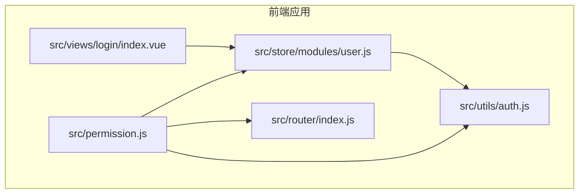
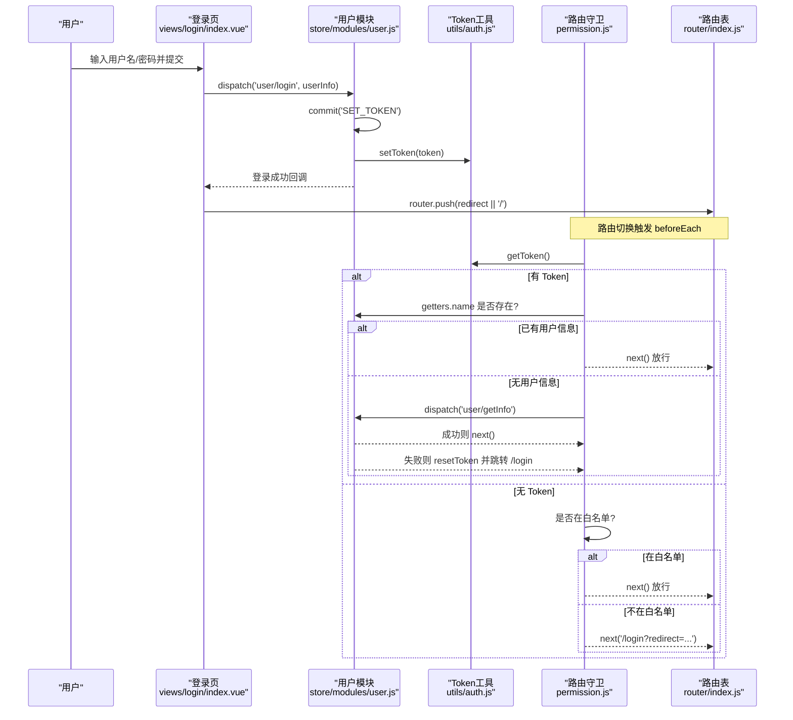
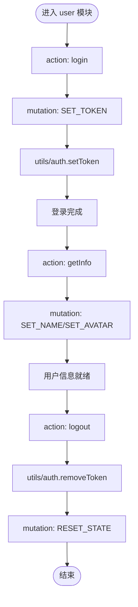
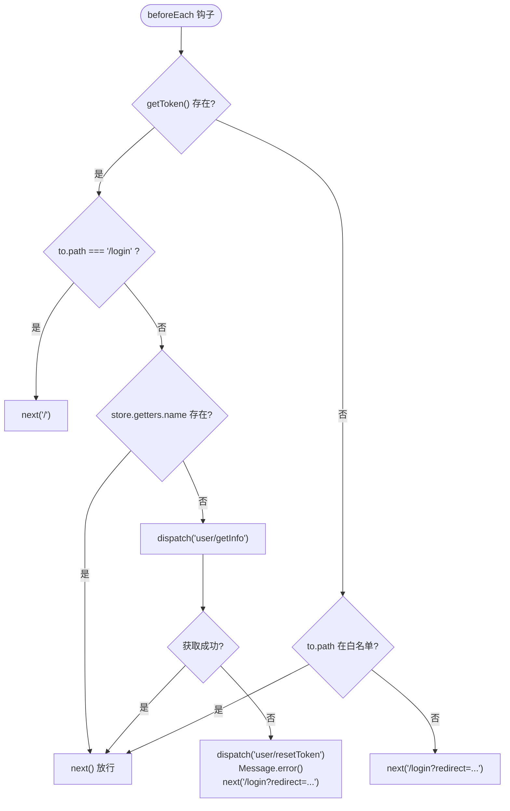
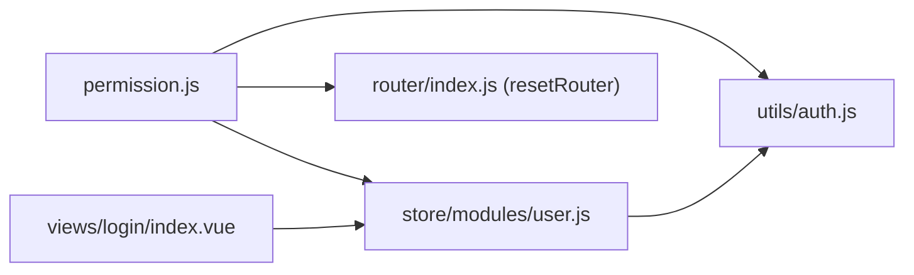

# 权限认证工具

<cite>
**本文引用的文件**   
- [src/utils/auth.js](file://src/utils/auth.js)
- [src/permission.js](file://src/permission.js)
- [src/store/modules/user.js](file://src/store/modules/user.js)
- [src/views/login/index.vue](file://src/views/login/index.vue)
- [src/router/index.js](file://src/router/index.js)
</cite>

## 目录
1. [简介](#简介)
2. [项目结构](#项目结构)
3. [核心组件](#核心组件)
4. [架构总览](#架构总览)
5. [详细组件分析](#详细组件分析)
6. [依赖关系分析](#依赖关系分析)
7. [性能考虑](#性能考虑)
8. [故障排查指南](#故障排查指南)
9. [结论](#结论)
10. [附录：使用示例与最佳实践](#附录使用示例与最佳实践)

## 简介
本文件围绕“权限认证工具”进行系统化说明，重点覆盖以下方面：
- Token 的存储、获取、删除实现（基于 Cookie）
- 用户登录状态判断逻辑与会话管理机制
- 路由守卫中的鉴权流程
- 如何在业务组件中使用权限判断函数
- 安全注意事项与最佳实践建议

本项目采用 Vue + Vuex + Vue Router 的前端架构，认证相关代码集中在 utils/auth.js、store/modules/user.js、permission.js 以及登录页面和路由配置中。

## 项目结构
与权限认证相关的核心文件分布如下：
- src/utils/auth.js：封装 Token 的存取方法（基于 js-cookie）
- src/store/modules/user.js：用户状态管理，包含登录、获取信息、登出、重置等动作
- src/permission.js：全局路由守卫，负责鉴权与跳转
- src/views/login/index.vue：登录页，触发登录流程
- src/router/index.js：路由定义与动态路由重置能力

图表来源
- [src/views/login/index.vue:108-123](file://src/views/login/index.vue#L108-L123)
- [src/store/modules/user.js:30-88](file://src/store/modules/user.js#L30-L88)
- [src/utils/auth.js:5-15](file://src/utils/auth.js#L5-L15)
- [src/permission.js:13-58](file://src/permission.js#L13-L58)
- [src/router/index.js:176-179](file://src/router/index.js#L176-L179)

章节来源
- [src/utils/auth.js:1-16](file://src/utils/auth.js#L1-L16)
- [src/permission.js:1-65](file://src/permission.js#L1-L65)
- [src/store/modules/user.js:1-98](file://src/store/modules/user.js#L1-L98)
- [src/views/login/index.vue:55-125](file://src/views/login/index.vue#L55-L125)
- [src/router/index.js:1-182](file://src/router/index.js#L1-L182)

## 核心组件
- Token 存取层（utils/auth.js）
  - 提供 getToken、setToken、removeToken 三个方法，底层通过 js-cookie 操作 Cookie。
- 用户状态层（store/modules/user.js）
  - 维护 token、name、avatar 等状态；提供 login、getInfo、logout、resetToken 等异步动作。
- 路由守卫（permission.js）
  - 在路由切换前检查 Token 与用户信息，决定放行或重定向到登录页。
- 登录页（views/login/index.vue）
  - 表单校验后调用 store 的 login 动作，成功后跳转到目标页面。
- 路由定义（router/index.js）
  - 定义常量路由，并提供 resetRouter 用于登出后重置路由表。

章节来源
- [src/utils/auth.js:5-15](file://src/utils/auth.js#L5-L15)
- [src/store/modules/user.js:5-28](file://src/store/modules/user.js#L5-L28)
- [src/store/modules/user.js:30-88](file://src/store/modules/user.js#L30-L88)
- [src/permission.js:13-58](file://src/permission.js#L13-L58)
- [src/views/login/index.vue:108-123](file://src/views/login/index.vue#L108-L123)
- [src/router/index.js:176-179](file://src/router/index.js#L176-L179)

## 架构总览
下图展示了从登录到鉴权的完整链路：用户在登录页提交表单，触发 Vuex action 登录并持久化 Token；随后路由守卫在每次导航时读取 Token 与用户信息，决定是否允许访问目标路由。

图表来源
- [src/views/login/index.vue:108-123](file://src/views/login/index.vue#L108-L123)
- [src/store/modules/user.js:30-44](file://src/store/modules/user.js#L30-L44)
- [src/utils/auth.js:9-11](file://src/utils/auth.js#L9-L11)
- [src/permission.js:13-58](file://src/permission.js#L13-L58)
- [src/router/index.js:176-179](file://src/router/index.js#L176-L179)

## 详细组件分析

### Token 存取层（utils/auth.js）
- 功能概述
  - 封装了 Token 的获取、设置、删除三个方法，统一通过 js-cookie 操作 Cookie。
- 关键方法
  - getToken：读取 Cookie 中的 Token
  - setToken：写入 Cookie 中的 Token
  - removeToken：删除 Cookie 中的 Token
- 复杂度与性能
  - 均为 O(1) 的简单读写，开销极低。
- 错误处理
  - 未捕获异常，依赖 js-cookie 内部行为；建议在调用方对可能的异常做兜底。
- 优化建议
  - 可结合业务增加 Token 有效性校验（如过期时间），或在读取时进行格式校验。

章节来源
- [src/utils/auth.js:1-16](file://src/utils/auth.js#L1-L16)

### 用户状态层（store/modules/user.js）
- 状态设计
  - state：token、name、avatar
  - mutations：RESET_STATE、SET_TOKEN、SET_NAME、SET_AVATAR
  - actions：login、getInfo、logout、resetToken
- 登录流程
  - 调用后端接口登录，成功后 commit SET_TOKEN 并通过 setToken 持久化 Token。
- 获取用户信息
  - 携带 Token 请求后端，成功后更新 name、avatar。
- 登出流程
  - 调用后端登出接口，先 removeToken，再重置路由与状态。
- 重置 Token
  - 仅清理本地 Token 与状态，便于鉴权流程重新进入登录态。

图表来源
- [src/store/modules/user.js:30-44](file://src/store/modules/user.js#L30-L44)
- [src/store/modules/user.js:46-65](file://src/store/modules/user.js#L46-L65)
- [src/store/modules/user.js:67-88](file://src/store/modules/user.js#L67-L88)
- [src/utils/auth.js:9-15](file://src/utils/auth.js#L9-L15)

章节来源
- [src/store/modules/user.js:5-28](file://src/store/modules/user.js#L5-L28)
- [src/store/modules/user.js:30-88](file://src/store/modules/user.js#L30-L88)

### 路由守卫（permission.js）
- 白名单机制
  - 将 /login 加入白名单，无需 Token 即可访问。
- 已登录且访问 /login
  - 直接重定向到首页。
- 已登录但缺少用户信息
  - 调用 getInfo 拉取用户信息，成功后放行；失败则重置 Token 并跳转登录页。
- 未登录
  - 若目标路由在白名单内，直接放行；否则重定向到登录页并附带 redirect 参数。

图表来源
- [src/permission.js:11-58](file://src/permission.js#L11-L58)
- [src/store/modules/user.js:46-88](file://src/store/modules/user.js#L46-L88)

章节来源
- [src/permission.js:1-65](file://src/permission.js#L1-L65)

### 登录页（views/login/index.vue）
- 表单校验
  - 用户名与密码校验通过后进入登录流程。
- 登录动作
  - 调用 store.dispatch('user/login')，成功后根据 redirect 参数或默认路径跳转。
- 交互细节
  - 支持密码可见性切换、回车提交、加载状态控制。

章节来源
- [src/views/login/index.vue:55-125](file://src/views/login/index.vue#L55-L125)

### 路由定义（router/index.js）
- 常量路由
  - 定义了基础路由，包括登录、404、仪表盘、示例、表单、嵌套菜单等。
- 动态路由重置
  - 提供 resetRouter 方法，用于登出后重建路由匹配器，避免残留动态路由。

章节来源
- [src/router/index.js:33-165](file://src/router/index.js#L33-L165)
- [src/router/index.js:176-179](file://src/router/index.js#L176-L179)

## 依赖关系分析
- 组件耦合
  - permission.js 依赖 utils/auth.js 与 store/modules/user.js，负责鉴权决策。
  - views/login/index.vue 依赖 store/modules/user.js，负责触发登录。
  - store/modules/user.js 依赖 utils/auth.js，负责 Token 持久化。
- 外部依赖
  - js-cookie：Cookie 操作
  - Element UI Message：提示消息
  - NProgress：进度条
- 潜在循环依赖
  - 当前结构未见循环引用；permission.js 不反向依赖 router/index.js 的具体路由定义，仅调用 resetRouter。

图表来源
- [src/permission.js:1-65](file://src/permission.js#L1-L65)
- [src/views/login/index.vue:108-123](file://src/views/login/index.vue#L108-L123)
- [src/store/modules/user.js:1-98](file://src/store/modules/user.js#L1-L98)
- [src/utils/auth.js:1-16](file://src/utils/auth.js#L1-L16)
- [src/router/index.js:176-179](file://src/router/index.js#L176-L179)

章节来源
- [src/permission.js:1-65](file://src/permission.js#L1-L65)
- [src/views/login/index.vue:108-123](file://src/views/login/index.vue#L108-L123)
- [src/store/modules/user.js:1-98](file://src/store/modules/user.js#L1-L98)
- [src/utils/auth.js:1-16](file://src/utils/auth.js#L1-L16)
- [src/router/index.js:176-179](file://src/router/index.js#L176-L179)

## 性能考虑
- Token 存取为轻量级 Cookie 操作，开销极小。
- 路由守卫仅在导航时执行，避免重复请求用户信息；首次进入需拉取用户信息，后续由 store 缓存。
- 建议：
  - 对 getInfo 请求增加重试与超时控制。
  - 对频繁访问的页面可考虑局部缓存用户信息，减少重复请求。

## 故障排查指南
- 登录后仍被重定向到登录页
  - 检查 getToken 是否能读到 Token；确认 setToken 是否成功写入 Cookie。
  - 检查 store.getters.name 是否为空；必要时手动触发 getInfo。
- 刷新页面后丢失用户信息
  - 确认 Token 仍存在；若存在，确保 getInfo 能正常返回用户信息。
- 登出后仍有动态路由
  - 确认 logout 流程调用了 resetRouter，以清空动态路由匹配器。
- 白名单配置问题
  - 如需新增免登录页面，请在白名单数组中添加对应路径。

章节来源
- [src/permission.js:11-58](file://src/permission.js#L11-L58)
- [src/store/modules/user.js:67-88](file://src/store/modules/user.js#L67-L88)
- [src/router/index.js:176-179](file://src/router/index.js#L176-L179)

## 结论
本项目通过 utils/auth.js 统一 Token 存取，store/modules/user.js 管理用户会话，permission.js 在路由层面实施鉴权，形成清晰的认证闭环。整体实现简洁可靠，适合中小型后台系统快速落地。建议在后续迭代中补充 Token 有效期校验、更完善的错误提示与日志记录，以提升安全性与可观测性。

## 附录：使用示例与最佳实践

### Token 存储、获取、删除策略
- 存储位置
  - 当前实现使用 Cookie（js-cookie），而非 localStorage 或 sessionStorage。
- 使用方法
  - 获取：调用 getToken
  - 设置：调用 setToken
  - 删除：调用 removeToken
- 何时使用 localStorage/sessionStorage
  - 若业务需要跨标签页共享 Token，建议使用 Cookie 或服务端 Session。
  - 若仅需单标签页短期会话，可使用 sessionStorage；注意关闭标签即失效。
  - 若需长期保存且不跨标签页，可使用 localStorage；注意清除时机与安全风险。

章节来源
- [src/utils/auth.js:1-16](file://src/utils/auth.js#L1-L16)

### 用户登录状态判断与会话管理
- 登录状态判断
  - 路由守卫通过 getToken 判断是否持有 Token。
  - 若已有 Token 但缺少用户信息，会调用 getInfo 拉取用户信息。
- 会话管理
  - 登录成功后持久化 Token，并在 store 中缓存用户信息。
  - 登出时移除 Token、重置路由与状态。

章节来源
- [src/permission.js:20-58](file://src/permission.js#L20-L58)
- [src/store/modules/user.js:30-88](file://src/store/modules/user.js#L30-L88)

### 权限判断函数的使用方式
- 路由守卫
  - 已在 permission.js 中内置 Token 校验与白名单机制，可直接复用。
- 业务组件
  - 可通过 store.getters.name 判断是否已登录，或结合后端返回的角色/权限字段进行细粒度控制。
  - 若需按钮级权限控制，可在组件中根据角色或权限列表渲染相应元素。

章节来源
- [src/permission.js:11-58](file://src/permission.js#L11-L58)
- [src/store/modules/user.js:5-28](file://src/store/modules/user.js#L5-L28)

### 安全考虑与最佳实践
- 传输安全
  - 所有接口必须使用 HTTPS，防止 Token 在传输过程中被窃听。
- 存储安全
  - 当前使用 Cookie，建议开启 HttpOnly 与 Secure 属性（由后端配合）。
  - 避免将敏感数据存入 localStorage。
- 令牌生命周期
  - 引入 Token 过期时间，前端定期检测并引导重新登录。
- 防 CSRF
  - 若使用 Cookie 传 Token，需在后端启用 CSRF 防护或使用 SameSite 策略。
- 最小权限原则
  - 前端仅做展示层控制，关键权限校验必须在后端执行。
- 错误处理
  - 对网络异常、接口错误进行统一处理与提示，避免泄露敏感信息。

[本节为通用安全建议，不直接分析具体文件]