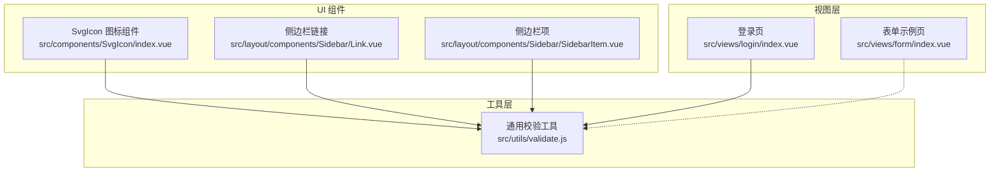
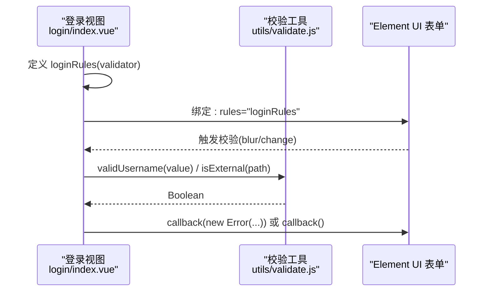
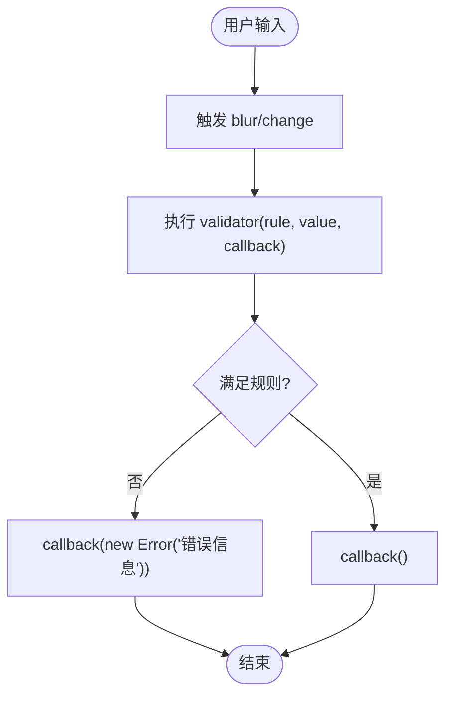
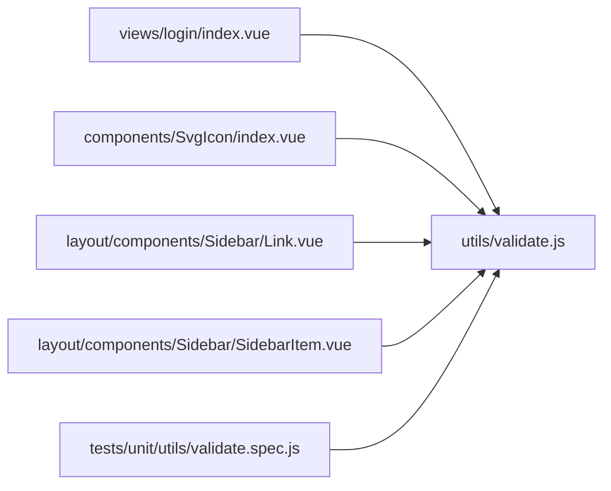

# 表单验证规则

<cite>
**本文引用的文件**   
- [src/utils/validate.js](file://src/utils/validate.js)
- [tests/unit/utils/validate.spec.js](file://tests/unit/utils/validate.spec.js)
- [src/views/login/index.vue](file://src/views/login/index.vue)
- [src/components/SvgIcon/index.vue](file://src/components/SvgIcon/index.vue)
- [src/layout/components/Sidebar/Link.vue](file://src/layout/components/Sidebar/Link.vue)
- [src/layout/components/Sidebar/SidebarItem.vue](file://src/layout/components/Sidebar/SidebarItem.vue)
</cite>

## 目录
1. [简介](#简介)
2. [项目结构](#项目结构)
3. [核心组件](#核心组件)
4. [架构总览](#架构总览)
5. [详细组件分析](#详细组件分析)
6. [依赖关系分析](#依赖关系分析)
7. [性能与优化建议](#性能与优化建议)
8. [故障排查指南](#故障排查指南)
9. [结论](#结论)

## 简介
本文件系统性梳理项目中“表单验证规则”的实现与使用方式，重点围绕以下目标：
- 说明现有验证函数的职责、参数格式、返回值类型与错误信息定义。
- 展示在 Element UI 表单中的集成用法，包括自定义校验器与错误提示。
- 给出可扩展的验证规则清单（邮箱、手机号、身份证、URL 等）以及实现建议。
- 提供性能优化与最佳实践，帮助在复杂表单中保持良好体验。

需要特别说明的是：当前仓库仅内置了少量通用校验工具函数，未直接包含邮箱、手机号、身份证等常见业务校验。文档将基于现有实现进行扩展指导，并给出可落地的方案。

## 项目结构
本项目为 Vue + Element UI 的管理后台模板，验证相关代码集中在 utils 层，并在视图层通过 Element UI 的 el-form 进行集成。

图表来源
- [src/views/login/index.vue:1-111](file://src/views/login/index.vue#L1-L111)
- [src/utils/validate.js:1-21](file://src/utils/validate.js#L1-L21)
- [src/components/SvgIcon/index.vue:10-10](file://src/components/SvgIcon/index.vue#L10-L10)
- [src/layout/components/Sidebar/Link.vue:8-8](file://src/layout/components/Sidebar/Link.vue#L8-L8)
- [src/layout/components/Sidebar/SidebarItem.vue:29-29](file://src/layout/components/Sidebar/SidebarItem.vue#L29-L29)

章节来源
- [src/utils/validate.js:1-21](file://src/utils/validate.js#L1-L21)
- [src/views/login/index.vue:1-111](file://src/views/login/index.vue#L1-L111)

## 核心组件
本节聚焦现有验证工具函数及其在视图层的集成方式。

- 通用校验工具（src/utils/validate.js）
  - isExternal(path): 判断字符串是否为外部链接（http/https/mailto/tel）。返回布尔值。
  - validUsername(str): 判断用户名是否在白名单内（admin/editor）。返回布尔值。

- 视图层集成（src/views/login/index.vue）
  - 在 data 中定义字段校验规则 loginRules，分别对 username 和 password 设置 required、trigger 与 validator。
  - validateUsername 调用 validUsername 完成业务校验；validatePassword 实现最小长度校验。
  - 提交时通过 this.$refs.loginForm.validate() 触发校验。

章节来源
- [src/utils/validate.js:9-20](file://src/utils/validate.js#L9-L20)
- [src/views/login/index.vue:58-87](file://src/views/login/index.vue#L58-L87)
- [src/views/login/index.vue:108-111](file://src/views/login/index.vue#L108-L111)

## 架构总览
下图展示了从视图到工具层的调用链，以及工具函数被其他 UI 组件复用的情况。

图表来源
- [src/views/login/index.vue:58-87](file://src/views/login/index.vue#L58-L87)
- [src/utils/validate.js:9-20](file://src/utils/validate.js#L9-L20)

## 详细组件分析

### 通用校验工具：isExternal
- 功能：判断输入是否为外部协议链接（http/https/mailto/tel）。
- 参数：path（string），待检测的字符串。
- 返回值：boolean，匹配成功返回 true，否则 false。
- 典型用途：外链跳转判定、路由渲染差异处理。
- 复杂度：正则一次匹配，时间复杂度 O(n)，空间 O(1)。

章节来源
- [src/utils/validate.js:9-11](file://src/utils/validate.js#L9-L11)
- [tests/unit/utils/validate.spec.js:9-16](file://tests/unit/utils/validate.spec.js#L9-L16)

### 通用校验工具：validUsername
- 功能：判断用户名是否属于允许列表（admin/editor）。
- 参数：str（string），用户输入的用户名。
- 返回值：boolean，在白名单内返回 true，否则 false。
- 典型用途：登录页用户名白名单校验。
- 复杂度：数组查找，时间复杂度 O(k)（k 为白名单大小），空间 O(1)。

章节来源
- [src/utils/validate.js:17-20](file://src/utils/validate.js#L17-L20)
- [tests/unit/utils/validate.spec.js:4-8](file://tests/unit/utils/validate.spec.js#L4-L8)

### 视图层集成：登录表单校验
- 校验规则定义位置：data.loginRules。
- 字段 username：
  - required: true
  - trigger: 'blur'
  - validator: validateUsername（内部调用 validUsername）
- 字段 password：
  - required: true
  - trigger: 'blur'
  - validator: validatePassword（内部实现最小长度校验）
- 提交校验：this.$refs.loginForm.validate(callback)

图表来源
- [src/views/login/index.vue:61-82](file://src/views/login/index.vue#L61-L82)

章节来源
- [src/views/login/index.vue:58-87](file://src/views/login/index.vue#L58-L87)
- [src/views/login/index.vue:108-111](file://src/views/login/index.vue#L108-L111)

### 其他组件复用 isExternal
- SvgIcon 组件根据 isExternal 结果决定外链行为。
- Sidebar Link/SidebarItem 同样使用 isExternal 控制外链渲染逻辑。

章节来源
- [src/components/SvgIcon/index.vue:10-10](file://src/components/SvgIcon/index.vue#L10-L10)
- [src/layout/components/Sidebar/Link.vue:8-8](file://src/layout/components/Sidebar/Link.vue#L8-L8)
- [src/layout/components/Sidebar/SidebarItem.vue:29-29](file://src/layout/components/Sidebar/SidebarItem.vue#L29-L29)

## 依赖关系分析
- 视图层依赖工具层：登录页依赖 validUsername；其他页面可通过引入 isExternal 进行外链判断。
- UI 组件依赖工具层：SvgIcon、Sidebar Link/SidebarItem 均依赖 isExternal。
- 测试覆盖：单元测试覆盖了 isExternal 与 validUsername 的核心分支。

图表来源
- [src/views/login/index.vue:56-56](file://src/views/login/index.vue#L56-L56)
- [src/components/SvgIcon/index.vue:10-10](file://src/components/SvgIcon/index.vue#L10-L10)
- [src/layout/components/Sidebar/Link.vue:8-8](file://src/layout/components/Sidebar/Link.vue#L8-L8)
- [src/layout/components/Sidebar/SidebarItem.vue:29-29](file://src/layout/components/Sidebar/SidebarItem.vue#L29-L29)
- [tests/unit/utils/validate.spec.js:1-1](file://tests/unit/utils/validate.spec.js#L1-L1)

章节来源
- [src/views/login/index.vue:56-56](file://src/views/login/index.vue#L56-L56)
- [tests/unit/utils/validate.spec.js:1-17](file://tests/unit/utils/validate.spec.js#L1-L17)

## 性能与优化建议
- 正则表达式优化
  - 将常用正则（邮箱、手机号、身份证、URL）预编译为常量，避免每次校验重复构建正则对象。
  - 对高频路径（如 isExternal）采用更短的正则分支，减少回溯。
- 校验触发策略
  - 合理使用 trigger：对于长文本建议使用 change，对必填字段使用 blur，避免频繁重渲染。
  - 对复杂校验（如远程查重）使用防抖/节流，降低请求频率。
- 异步校验
  - 使用 Promise 或 async/await 封装异步校验器，统一错误处理与加载状态。
- 规则组合与复用
  - 将通用规则抽离为独立模块，按领域拆分（如 identity.js、contact.js），便于维护与测试。
- 错误提示
  - 统一错误消息文案，支持国际化；对用户可见的错误信息进行本地化。
- 表单体积
  - 大表单分步校验，先做前端基础校验，再在提交时进行后端二次校验。

[本节为通用建议，不直接分析具体文件]

## 故障排查指南
- 校验不生效
  - 检查 el-form-item 是否正确绑定 prop。
  - 确认 rules 中 validator 是否调用 callback 且传入正确参数。
- 错误提示不显示
  - 确保 callback 传入 new Error('错误信息')，而非字符串。
- 外链判断异常
  - 检查 isExternal 输入是否包含协议头（http/https/mailto/tel）。
- 单元测试失败
  - 核对测试用例与工具函数签名一致，确保导入路径正确。

章节来源
- [src/views/login/index.vue:61-82](file://src/views/login/index.vue#L61-L82)
- [tests/unit/utils/validate.spec.js:1-17](file://tests/unit/utils/validate.spec.js#L1-L17)

## 结论
- 当前项目提供了两个通用校验工具：isExternal 与 validUsername，并通过登录页演示了如何在 Element UI 表单中集成自定义校验器。
- 针对邮箱、手机号、身份证、URL 等常见业务校验，建议在 utils 层新增对应函数，并在视图中以相同模式集成。
- 通过预编译正则、合理触发策略、异步校验与统一错误管理，可在保证用户体验的同时提升性能与可维护性。

[本节为总结性内容，不直接分析具体文件]