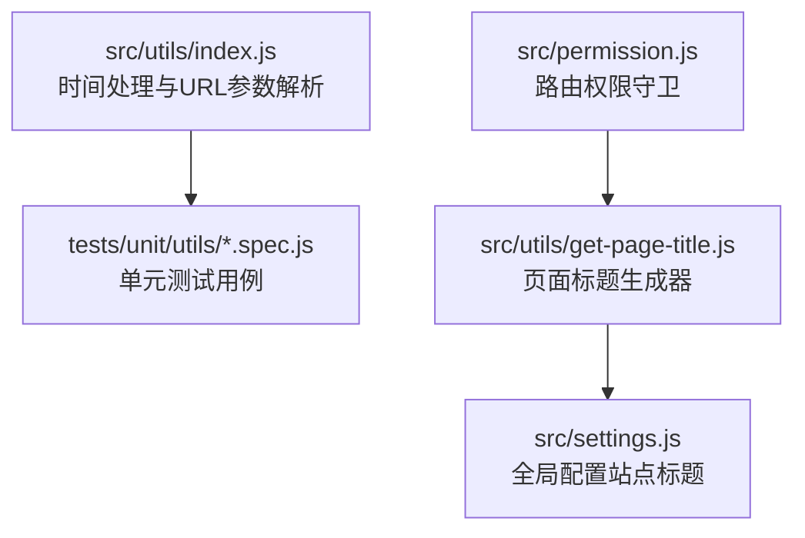
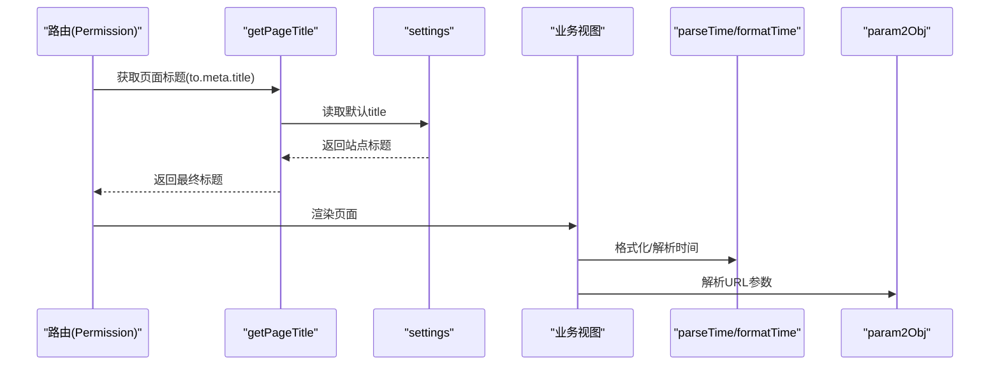
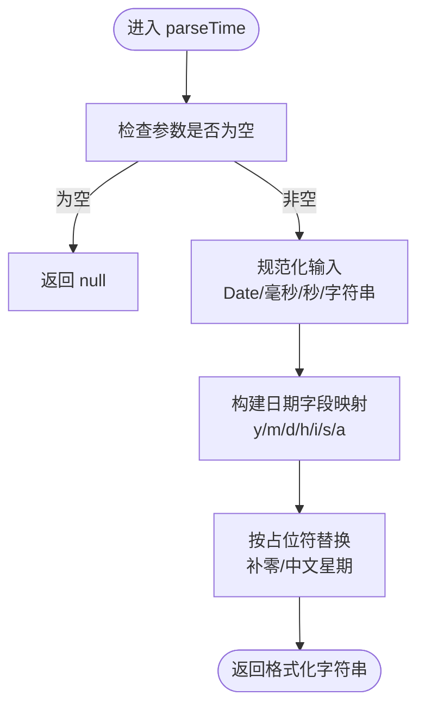
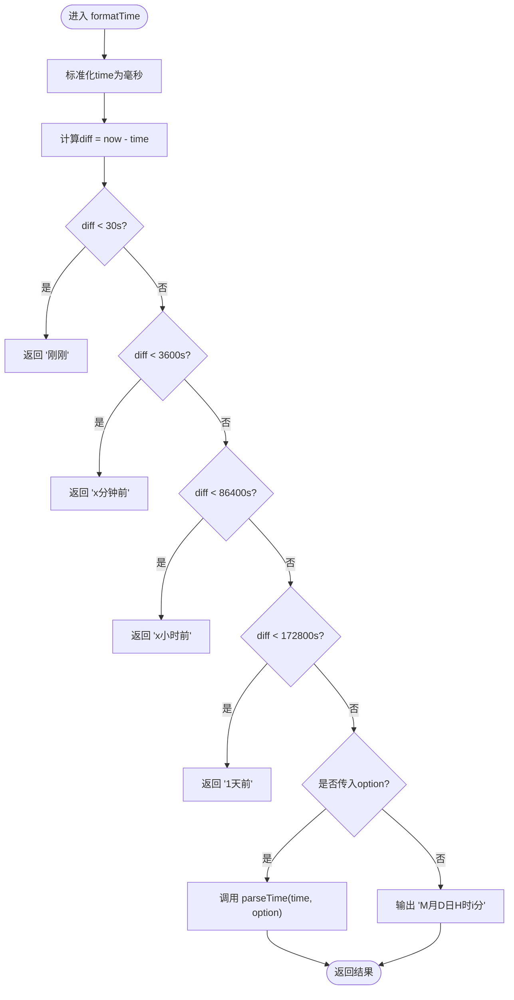
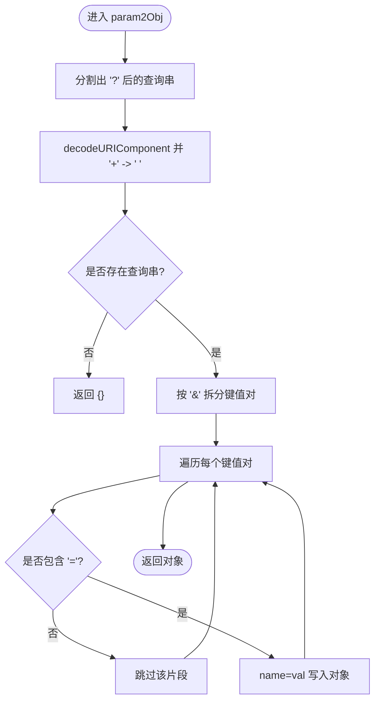
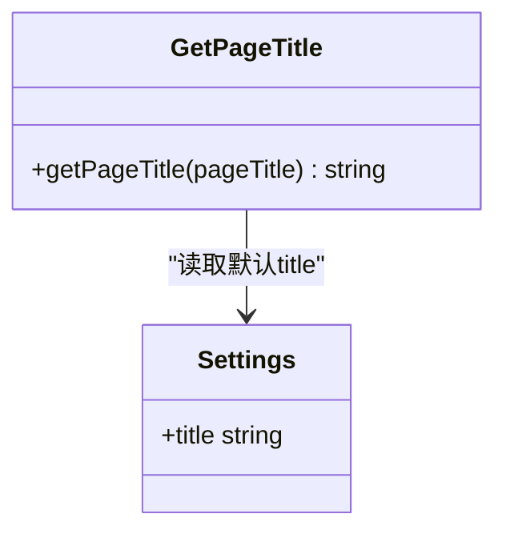
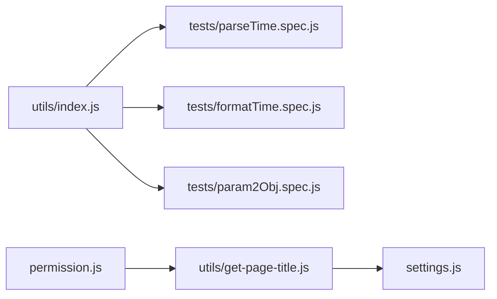

# 通用工具函数

<cite>
**本文引用的文件**   
- [src/utils/index.js](file://src/utils/index.js)
- [src/utils/get-page-title.js](file://src/utils/get-page-title.js)
- [src/settings.js](file://src/settings.js)
- [src/permission.js](file://src/permission.js)
- [tests/unit/utils/parseTime.spec.js](file://tests/unit/utils/parseTime.spec.js)
- [tests/unit/utils/formatTime.spec.js](file://tests/unit/utils/formatTime.spec.js)
- [tests/unit/utils\param2Obj.spec.js](file://tests/unit/utils\param2Obj.spec.js)
</cite>

## 目录
1. [简介](#简介)
2. [项目结构](#项目结构)
3. [核心组件](#核心组件)
4. [架构总览](#架构总览)
5. [详细组件分析](#详细组件分析)
6. [依赖关系分析](#依赖关系分析)
7. [性能与优化建议](#性能与优化建议)
8. [故障排查指南](#故障排查指南)
9. [结论](#结论)

## 简介
本文件面向前端开发者，系统化梳理并文档化本项目中的通用工具函数，重点覆盖：
- 时间处理：parseTime、formatTime
- URL 参数解析：param2Obj
- 页面标题管理：getPageTitle

内容包含函数说明、参数与返回值定义、使用示例、常见模式、性能优化建议以及基于单元测试的验证要点。

## 项目结构
与通用工具函数相关的代码主要位于 src/utils 目录下，并通过路由权限守卫在应用启动时设置页面标题。

图表来源
- [src/utils/index.js:1-118](file://src/utils/index.js#L1-L118)
- [src/utils/get-page-title.js:1-11](file://src/utils/get-page-title.js#L1-L11)
- [src/settings.js:1-17](file://src/settings.js#L1-L17)
- [src/permission.js:7-18](file://src/permission.js#L7-L18)

章节来源
- [src/utils/index.js:1-118](file://src/utils/index.js#L1-L118)
- [src/utils/get-page-title.js:1-11](file://src/utils/get-page-title.js#L1-L11)
- [src/settings.js:1-17](file://src/settings.js#L1-L17)
- [src/permission.js:7-18](file://src/permission.js#L7-L18)

## 核心组件
- parseTime：将时间对象或时间戳字符串/数字解析为指定格式的字符串。
- formatTime：以“相对时间”优先展示，支持自定义格式输出。
- param2Obj：从 URL 查询串中解析键值对为对象。
- getPageTitle：根据当前页面标题和全局配置拼接最终 document.title。

章节来源
- [src/utils/index.js:11-52](file://src/utils/index.js#L11-L52)
- [src/utils/index.js:59-95](file://src/utils/index.js#L59-L95)
- [src/utils/index.js:101-117](file://src/utils/index.js#L101-L117)
- [src/utils/get-page-title.js:1-11](file://src/utils/get-page-title.js#L1-L11)

## 架构总览
下图展示了工具函数在系统中的调用关系与数据流向。

图表来源
- [src/permission.js:7-18](file://src/permission.js#L7-L18)
- [src/utils/get-page-title.js:1-11](file://src/utils/get-page-title.js#L1-L11)
- [src/settings.js:1-17](file://src/settings.js#L1-L17)
- [src/utils/index.js:11-117](file://src/utils/index.js#L11-L117)

## 详细组件分析

### 时间处理：parseTime
- 功能概述
  - 将 Date 对象、时间戳（毫秒/秒）、时间字符串统一解析为指定格式的字符串。
  - 支持占位符：y/m/d/h/i/s/a，分别对应年、月、日、时、分、秒、星期（中文）。
- 参数说明
  - time: 可为 Date 对象、毫秒时间戳、秒级时间戳字符串、ISO-like 时间字符串等。
  - cFormat: 可选，格式模板；未提供时使用默认模板。
- 返回值
  - 成功：格式化后的字符串。
  - 失败或入参为空：null。
- 关键行为
  - 自动识别十位秒级时间戳并转换为毫秒。
  - 兼容 Safari 的时间字符串分隔符替换。
  - 星期映射为中文“日一二三四五六”。
- 使用示例（来自单元测试）
  - 传入 Date 对象，默认格式输出“YYYY-MM-DD HH:mm:ss”。
  - 传入十位时间戳字符串，同样可正确解析。
  - 自定义格式如“{y}-{m}-{d} {h}:{i}”、“{a}”等。
- 复杂度
  - 时间 O(n)，n 为格式模板长度；空间 O(1)。

图表来源
- [src/utils/index.js:11-52](file://src/utils/index.js#L11-L52)

章节来源
- [src/utils/index.js:11-52](file://src/utils/index.js#L11-L52)
- [tests/unit/utils/parseTime.spec.js:1-36](file://tests/unit/utils/parseTime.spec.js#L1-L36)

### 时间处理：formatTime
- 功能概述
  - 优先以人类可读的相对时间展示（刚刚、x分钟前、x小时前、1天前），超过一天则回退到固定格式或自定义格式。
- 参数说明
  - time: 时间戳（毫秒或十位秒数）。
  - option: 可选，当存在时作为 parseTime 的格式模板。
- 返回值
  - 相对时间字符串或具体日期时间字符串。
- 关键行为
  - 十位秒级时间戳自动转毫秒。
  - 相对时间阈值：30秒内显示“刚刚”，小于1小时显示分钟差，小于24小时显示小时差，次日显示“1天前”。
  - 超过一天且未传 option：输出“M月D日H时i分”。
  - 超过一天且传 option：委托 parseTime 进行格式化。
- 使用示例（来自单元测试）
  - 不同时间差下的相对时间输出。
  - 自定义格式输出与默认格式输出。
- 复杂度
  - 时间 O(1)；空间 O(1)。

图表来源
- [src/utils/index.js:59-95](file://src/utils/index.js#L59-L95)

章节来源
- [src/utils/index.js:59-95](file://src/utils/index.js#L59-L95)
- [tests/unit/utils/formatTime.spec.js:1-31](file://tests/unit/utils/formatTime.spec.js#L1-L31)

### URL 参数解析：param2Obj
- 功能概述
  - 从完整 URL 中提取查询串，解码后解析为键值对象。
- 参数说明
  - url: 完整 URL 字符串，包含 ?key=value&...。
- 返回值
  - 对象，键为查询参数名，值为对应的字符串值。
- 关键行为
  - 仅处理第一个 ? 之后的查询串。
  - 对 + 号替换为空格，并对 %xx 进行解码。
  - 忽略没有 = 的片段。
- 使用示例（来自单元测试）
  - 包含普通键值、Base64 编码值、中文编码值的 URL 均可正确解析。
- 复杂度
  - 时间 O(n)，n 为查询串长度；空间 O(k)，k 为参数个数。

图表来源
- [src/utils/index.js:101-117](file://src/utils/index.js#L101-L117)

章节来源
- [src/utils/index.js:101-117](file://src/utils/index.js#L101-L117)
- [tests/unit/utils\param2Obj.spec.js:1-15](file://tests/unit/utils\param2Obj.spec.js#L1-L15)

### 页面标题管理：getPageTitle
- 功能概述
  - 根据传入的页面标题与全局配置拼接最终的 document.title。
- 参数说明
  - pageTitle: 当前页面的标题文本（可为空）。
- 返回值
  - 若传入 pageTitle：返回 “pageTitle - 站点标题”。
  - 否则：直接返回站点标题。
- 数据来源
  - 站点标题取自 settings.js 的 title 字段，并提供默认值。
- 集成点
  - 在路由权限守卫中，每次路由切换时通过 getPageTitle 设置 document.title。

图表来源
- [src/utils/get-page-title.js:1-11](file://src/utils/get-page-title.js#L1-L11)
- [src/settings.js:1-17](file://src/settings.js#L1-L17)

章节来源
- [src/utils/get-page-title.js:1-11](file://src/utils/get-page-title.js#L1-L11)
- [src/settings.js:1-17](file://src/settings.js#L1-L17)
- [src/permission.js:7-18](file://src/permission.js#L7-L18)

## 依赖关系分析
- 模块内聚与耦合
  - index.js 同时封装了时间与 URL 工具，职责清晰但略有混合；可按需拆分为 time.js 与 url.js 提升内聚性。
  - get-page-title.js 仅依赖 settings.js，耦合度低。
- 外部依赖
  - 无第三方库依赖，全部基于原生 JavaScript API。
- 潜在循环依赖
  - 当前工具模块之间无相互引用，不存在循环依赖风险。

图表来源
- [src/utils/index.js:1-118](file://src/utils/index.js#L1-L118)
- [src/utils/get-page-title.js:1-11](file://src/utils/get-page-title.js#L1-L11)
- [src/settings.js:1-17](file://src/settings.js#L1-L17)
- [src/permission.js:7-18](file://src/permission.js#L7-L18)
- [tests/unit/utils/parseTime.spec.js:1-36](file://tests/unit/utils/parseTime.spec.js#L1-L36)
- [tests/unit/utils/formatTime.spec.js:1-31](file://tests/unit/utils/formatTime.spec.js#L1-L31)
- [tests/unit/utils\param2Obj.spec.js:1-15](file://tests/unit/utils\param2Obj.spec.js#L1-L15)

## 性能与优化建议
- parseTime
  - 正则匹配与字符串替换开销较小，适合高频调用；若频繁调用，可在外层缓存常用格式模板以减少重复创建。
  - 避免在循环中反复构造 Date 对象，必要时批量处理。
- formatTime
  - 相对时间判断分支少，性能稳定；注意避免在极高频场景下重复计算 Date.now()，可考虑局部缓存。
- param2Obj
  - 单次 URL 解析开销极低；若需要多次解析同一 URL，建议在调用方缓存结果。
- 通用建议
  - 将工具函数纯函数化（已满足），便于测试与缓存。
  - 在列表渲染中，尽量将时间格式化结果下沉至数据层，减少视图层重复计算。

[本节为通用指导，不直接分析具体文件]

## 故障排查指南
- parseTime 返回 null
  - 可能原因：未传入 time 或传入 null/undefined。
  - 排查：确认入参类型与有效性；参考单元测试中对空参数的断言。
- parseTime 输出不符合预期
  - 可能原因：时间字符串格式不被浏览器兼容（如横杠分隔），或传入的是十位秒级时间戳但未转换。
  - 排查：确认输入是否为 ISO-like 字符串或标准时间戳；参考单元测试中对十位时间戳与自定义格式的用例。
- formatTime 显示“1天前”而非期望的相对时间
  - 可能原因：时间差接近或超过 24 小时边界。
  - 排查：核对传入时间戳与当前时间的差值；参考单元测试中对“1天前”的断言。
- formatTime 未走自定义格式
  - 可能原因：未传入 option 参数。
  - 排查：确保传入 option 以启用 parseTime 的格式化逻辑。
- param2Obj 解析结果为空对象
  - 可能原因：URL 中没有查询串或查询串为空。
  - 排查：确认 URL 中确实包含 ?key=value 片段；参考单元测试中对含多种编码值的 URL 的断言。
- 页面标题未更新
  - 可能原因：路由元信息未设置 title，或 settings.title 未配置。
  - 排查：检查 to.meta.title 与 settings.js 的 title 字段；确认 permission.js 中调用了 getPageTitle。

章节来源
- [tests/unit/utils/parseTime.spec.js:1-36](file://tests/unit/utils/parseTime.spec.js#L1-L36)
- [tests/unit/utils/formatTime.spec.js:1-31](file://tests/unit/utils/formatTime.spec.js#L1-L31)
- [tests/unit/utils\param2Obj.spec.js:1-15](file://tests/unit/utils\param2Obj.spec.js#L1-L15)
- [src/permission.js:7-18](file://src/permission.js#L7-L18)
- [src/settings.js:1-17](file://src/settings.js#L1-L17)

## 结论
本仓库的通用工具函数提供了简洁稳定的时间处理、URL 参数解析与页面标题管理能力。它们均为纯函数、无外部依赖，易于测试与复用。结合单元测试覆盖，可放心在业务中直接使用。对于高频调用场景，建议在调用方做必要的结果缓存，以获得更佳的性能表现。