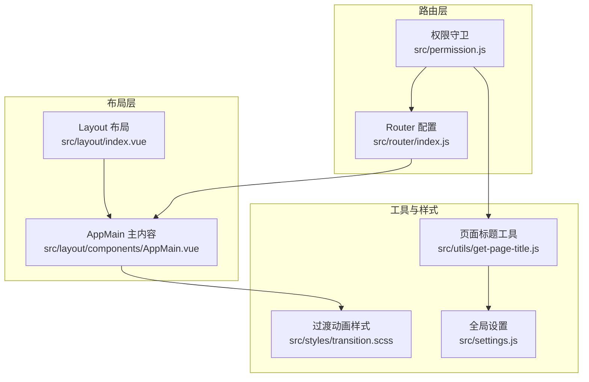
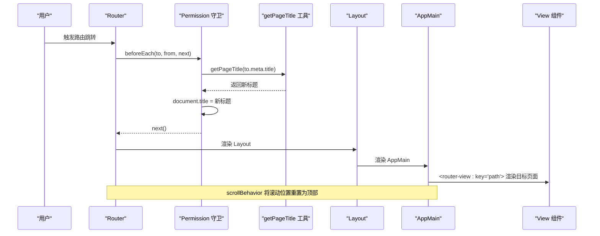
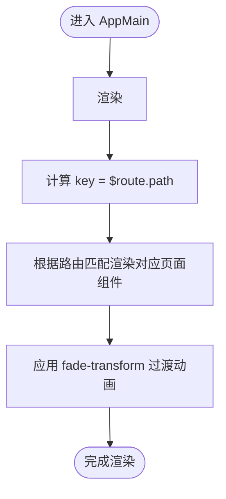
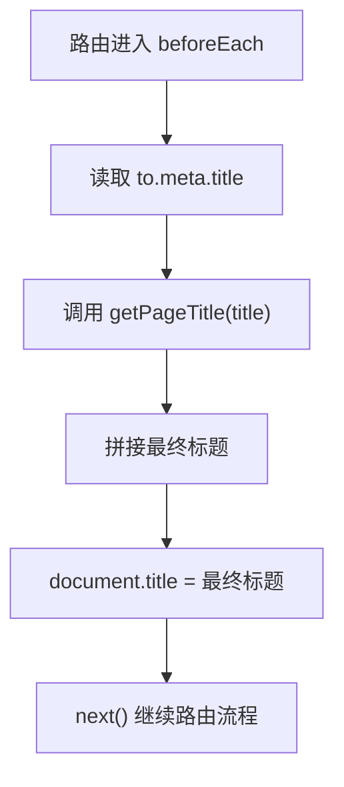
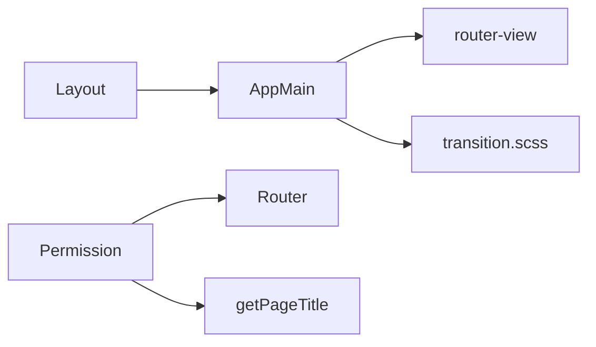

# 主内容区域

<cite>
**本文引用的文件**   
- [AppMain.vue](file://src/layout/components/AppMain.vue)
- [index.vue（布局）](file://src/layout/index.vue)
- [index.js（路由）](file://src/router/index.js)
- [get-page-title.js](file://src/utils/get-page-title.js)
- [permission.js](file://src/permission.js)
- [transition.scss](file://src/styles/transition.scss)
- [settings.js](file://src/settings.js)
</cite>

## 目录
1. [简介](#简介)
2. [项目结构](#项目结构)
3. [核心组件](#核心组件)
4. [架构总览](#架构总览)
5. [详细组件分析](#详细组件分析)
6. [依赖关系分析](#依赖关系分析)
7. [性能与优化建议](#性能与优化建议)
8. [故障排查指南](#故障排查指南)
9. [结论](#结论)
10. [附录：示例与最佳实践](#附录示例与最佳实践)

## 简介
本章节聚焦于主内容区域，围绕 AppMain 组件的路由视图渲染、过渡动画、滚动行为控制、页面标题动态设置以及样式规范进行系统性说明。同时给出 keep-alive 缓存策略的接入方式与多标签页扩展思路，并提供自定义内容布局与页面缓存配置的参考示例。

## 项目结构
主内容区域位于布局容器内部，由 Layout 组织导航栏与侧边栏，AppMain 作为内容区承载 router-view 的渲染与过渡效果。路由定义在 router/index.js，页面标题通过 permission.js 全局前置守卫结合 get-page-title.js 动态设置。过渡动画样式集中在 transition.scss。

图表来源
- [index.vue（布局）:1-12](file://src/layout/index.vue#L1-L12)
- [AppMain.vue:1-7](file://src/layout/components/AppMain.vue#L1-L7)
- [index.js（路由）:167-171](file://src/router/index.js#L167-L171)
- [permission.js:13-18](file://src/permission.js#L13-L18)
- [get-page-title.js:1-11](file://src/utils/get-page-title.js#L1-L11)
- [transition.scss:14-28](file://src/styles/transition.scss#L14-L28)
- [settings.js:1-17](file://src/settings.js#L1-L17)

章节来源
- [index.vue（布局）:1-12](file://src/layout/index.vue#L1-L12)
- [AppMain.vue:1-41](file://src/layout/components/AppMain.vue#L1-L41)
- [index.js（路由）:167-171](file://src/router/index.js#L167-L171)
- [permission.js:13-18](file://src/permission.js#L13-L18)
- [get-page-title.js:1-11](file://src/utils/get-page-title.js#L1-L11)
- [transition.scss:14-28](file://src/styles/transition.scss#L14-L28)
- [settings.js:1-17](file://src/settings.js#L1-L17)

## 核心组件
- AppMain：负责包裹 router-view，提供路由切换时的过渡动画，并通过 key 强制刷新以规避某些缓存问题；同时定义内容区域的自适应高度与固定头部适配样式。
- Layout：组合 Navbar、Sidebar 与 AppMain，并根据设备状态与固定头部开关调整布局类名与宽度。
- Router：集中式路由表，包含滚动行为（每次跳转滚动到顶部）。
- Permission：全局路由守卫，统一设置页面标题、进度条与鉴权流程。
- Transition 样式：定义 fade-transform 等过渡动画。
- Settings：全局应用配置项（如 fixedHeader）。

章节来源
- [AppMain.vue:1-41](file://src/layout/components/AppMain.vue#L1-L41)
- [index.vue（布局）:1-94](file://src/layout/index.vue#L1-L94)
- [index.js（路由）:167-171](file://src/router/index.js#L167-L171)
- [permission.js:13-18](file://src/permission.js#L13-L18)
- [transition.scss:14-28](file://src/styles/transition.scss#L14-L28)
- [settings.js:1-17](file://src/settings.js#L1-L17)

## 架构总览
下图展示从路由变更到页面渲染、标题更新与滚动重置的完整链路。

图表来源
- [permission.js:13-18](file://src/permission.js#L13-L18)
- [get-page-title.js:1-11](file://src/utils/get-page-title.js#L1-L11)
- [index.vue（布局）:1-12](file://src/layout/index.vue#L1-L12)
- [AppMain.vue:1-7](file://src/layout/components/AppMain.vue#L1-L7)
- [index.js（路由）:167-171](file://src/router/index.js#L167-L171)

## 详细组件分析

### AppMain 组件
职责与实现要点：
- 使用 transition 包裹 router-view，启用 name="fade-transform" 与 mode="out-in"，实现页面切换时的淡入淡出与位移过渡。
- 通过 computed key 绑定 this.$route.path，确保同一路径下组件实例被正确复用或重建，避免部分状态污染。
- 样式上保证最小高度为视口减去导航栏高度，并处理 fixed-header 场景下的内边距补偿。

图表来源
- [AppMain.vue:1-17](file://src/layout/components/AppMain.vue#L1-L17)
- [transition.scss:14-28](file://src/styles/transition.scss#L14-L28)

章节来源
- [AppMain.vue:1-41](file://src/layout/components/AppMain.vue#L1-L41)
- [transition.scss:14-28](file://src/styles/transition.scss#L14-L28)

### 路由与滚动行为
- 路由初始化时定义了 scrollBehavior，使每次路由切换后滚动位置回到页面顶部，提升交互一致性。
- 路由表采用懒加载（动态 import），有助于减少首屏体积。

章节来源
- [index.js（路由）:167-171](file://src/router/index.js#L167-L171)
- [index.js（路由）:33-165](file://src/router/index.js#L33-L165)

### 页面标题动态设置
- 全局 beforeEach 中调用 getPageTitle(to.meta.title)，并将结果赋给 document.title。
- getPageTitle 基于 settings.js 中的 title 默认值，若传入 meta.title 则拼接为“页面标题 - 站点标题”。

图表来源
- [permission.js:13-18](file://src/permission.js#L13-L18)
- [get-page-title.js:1-11](file://src/utils/get-page-title.js#L1-L11)
- [settings.js:1-17](file://src/settings.js#L1-L17)

章节来源
- [permission.js:13-18](file://src/permission.js#L13-L18)
- [get-page-title.js:1-11](file://src/utils/get-page-title.js#L1-L11)
- [settings.js:1-17](file://src/settings.js#L1-L17)

### 过渡动画与视觉体验
- AppMain 使用 fade-transform 过渡，配合 transition.scss 中定义的进入/离开样式，产生淡入与水平位移效果。
- 该动画适用于大多数页面级切换场景，兼顾性能与观感。

章节来源
- [AppMain.vue:1-7](file://src/layout/components/AppMain.vue#L1-L7)
- [transition.scss:14-28](file://src/styles/transition.scss#L14-L28)

### 内容区域自适应布局
- AppMain 的最小高度按视口减去导航栏高度计算，确保内容区始终填满可视区域。
- 当存在 .fixed-header 父级元素时，增加顶部 padding 以避免内容被固定头部遮挡。
- Layout 根据 fixedHeader 开关与侧边栏状态动态调整 header 宽度与定位。

章节来源
- [AppMain.vue:20-31](file://src/layout/components/AppMain.vue#L20-L31)
- [index.vue（布局）:6-10](file://src/layout/index.vue#L6-L10)
- [index.vue（布局）:77-92](file://src/layout/index.vue#L77-L92)
- [settings.js:5-10](file://src/settings.js#L5-L10)

### keep-alive 缓存策略
当前 AppMain 未直接使用 keep-alive。如需启用页面级缓存，可在 AppMain 中将 router-view 替换为 keep-alive 包裹，并结合路由 meta 字段控制缓存范围。

推荐方案：
- 在 AppMain 中使用 <keep-alive include="..."> 包裹 <router-view>，include 列表可动态维护已访问页面的 name。
- 在路由 meta 中声明需要缓存的页面名称，例如 meta.keepAlive = true。
- 在页面组件中使用 activated/deactivated 生命周期钩子处理数据预取与清理。

注意：
- 使用 key 与 keep-alive 时需权衡：key 变化会强制重建组件实例，可能绕过 keep-alive 缓存；建议在必要时才改变 key，或在不需要重建时移除 key。

章节来源
- [AppMain.vue:1-17](file://src/layout/components/AppMain.vue#L1-L17)
- [index.js（路由）:33-165](file://src/router/index.js#L33-L165)

### 多标签页支持（扩展思路）
当前仓库未内置多标签页。可扩展方向：
- 在 store 中维护已打开标签集合（路径、标题、是否缓存）。
- 在 AppMain 外层渲染标签栏，点击切换路由；对每个标签对应的页面使用 keep-alive 缓存。
- 关闭标签时销毁对应缓存实例，释放内存。

（本节为概念性扩展，不直接分析具体源码）

## 依赖关系分析
- AppMain 依赖 Router 提供的 <router-view> 与路由元信息。
- Layout 组合 AppMain、Navbar、Sidebar，并受 Store 状态影响（设备类型、侧边栏展开状态、固定头部开关）。
- Permission 守卫依赖 Router、Store、NProgress 与 getPageTitle 工具。
- 样式依赖 transition.scss 提供的过渡动画类名。

图表来源
- [AppMain.vue:1-7](file://src/layout/components/AppMain.vue#L1-L7)
- [index.vue（布局）:1-12](file://src/layout/index.vue#L1-L12)
- [permission.js:1-8](file://src/permission.js#L1-L8)
- [transition.scss:14-28](file://src/styles/transition.scss#L14-L28)

章节来源
- [AppMain.vue:1-41](file://src/layout/components/AppMain.vue#L1-L41)
- [index.vue（布局）:1-94](file://src/layout/index.vue#L1-L94)
- [permission.js:1-65](file://src/permission.js#L1-L65)
- [transition.scss:14-28](file://src/styles/transition.scss#L14-L28)

## 性能与优化建议
- 路由懒加载：路由组件使用动态 import，降低首屏体积。
- 合理使用 keep-alive：仅缓存必要页面，避免长列表或重型页面常驻内存。
- 控制过渡动画复杂度：fade-transform 已较轻量，避免在页面内叠加过多复杂动画。
- 滚动行为：保持 scrollBehavior 重置滚动位置，避免用户误操作导致错位。
- 条件渲染与按需加载：结合路由 meta 与权限守卫，减少不必要的请求与渲染。
- 样式作用域：尽量使用 scoped 样式，避免全局污染；对第三方组件样式覆盖需谨慎。

[本节为通用指导，不涉及具体源码片段]

## 故障排查指南
- 页面标题未更新：检查路由 meta.title 是否正确设置，确认 permission.js 中 beforeEach 是否执行且调用了 getPageTitle。
- 滚动位置异常：确认 scrollBehavior 是否生效，检查页面内是否存在自定义滚动容器导致的行为差异。
- 过渡动画不生效：确认 AppMain 中 transition name 与 transition.scss 中的类名一致。
- 固定头部遮挡内容：检查 .fixed-header 是否存在，确认 AppMain 的 padding-top 是否生效。
- keep-alive 缓存失效：检查是否在 AppMain 中使用了强制重建的 key，或页面 name 未在 include 列表中。

章节来源
- [permission.js:13-18](file://src/permission.js#L13-L18)
- [index.js（路由）:167-171](file://src/router/index.js#L167-L171)
- [AppMain.vue:1-7](file://src/layout/components/AppMain.vue#L1-L7)
- [AppMain.vue:20-31](file://src/layout/components/AppMain.vue#L20-L31)

## 结论
AppMain 作为主内容区域的核心，通过简洁的过渡动画与稳定的 key 机制保障路由切换体验；配合全局路由守卫与工具函数，实现了统一的页面标题管理与滚动行为控制。在此基础上，可按需引入 keep-alive 与多标签页能力，以满足更复杂的业务场景。样式层面遵循自适应布局原则，确保在不同设备与布局模式下均能稳定呈现。

[本节为总结性内容，不涉及具体源码片段]

## 附录：示例与最佳实践

- 自定义内容布局
  - 在 AppMain 中扩展容器类名，结合 Layout 的 fixed-header 状态，为不同业务模块提供差异化内边距与背景。
  - 针对弹窗场景，参考现有样式修复逻辑，确保弹出层出现时布局不被破坏。

- 页面缓存配置
  - 在路由 meta 中标记需要缓存的页面名称。
  - 在 AppMain 中使用 keep-alive 包裹 router-view，并通过 include 动态维护缓存列表。
  - 在页面组件中使用 activated 钩子拉取数据，deactivated 钩子清理定时器与事件监听。

- 滚动行为优化
  - 保持 scrollBehavior 默认行为，避免在页面内自行滚动容器造成不一致。
  - 对于需要局部滚动的区域，使用独立容器并限制高度，避免影响整体滚动。

- 过渡动画定制
  - 在 transition.scss 中新增或修改过渡类名，并在 AppMain 中同步更新 transition name。
  - 避免过度使用 transform 与 opacity 的组合，优先选择轻量动画以提升性能。

[本节为概念性示例，不直接分析具体源码片段]