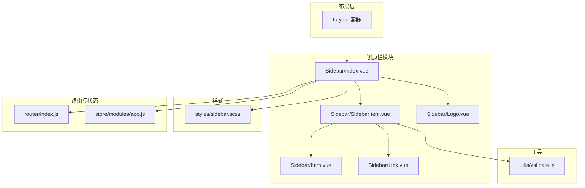
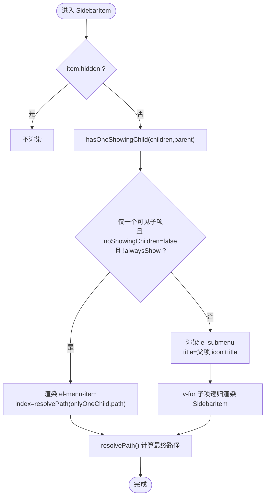
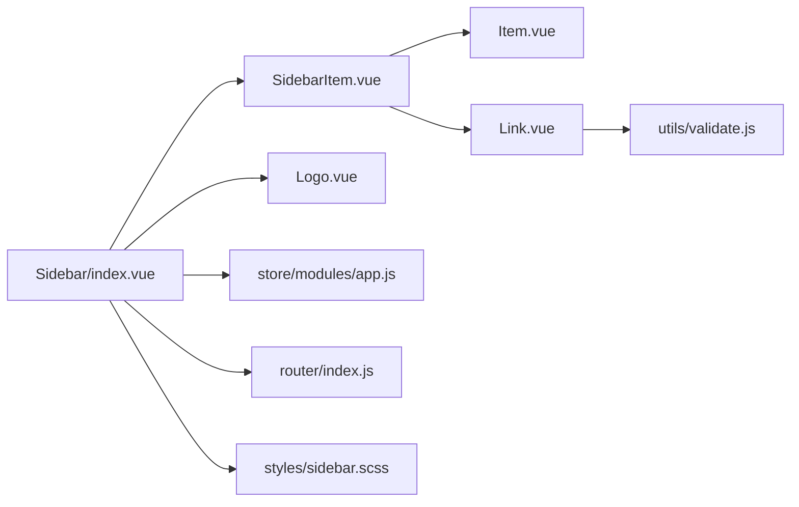

# 侧边栏组件

<cite>
**本文引用的文件**   
- [src/layout/components/Sidebar/index.vue](file://src/layout/components/Sidebar/index.vue)
- [src/layout/components/Sidebar/SidebarItem.vue](file://src/layout/components/Sidebar/SidebarItem.vue)
- [src/layout/components/Sidebar/Item.vue](file://src/layout/components/Sidebar/Item.vue)
- [src/layout/components/Sidebar/Link.vue](file://src/layout/components/Sidebar/Link.vue)
- [src/layout/components/Sidebar/Logo.vue](file://src/layout/components/Sidebar/Logo.vue)
- [src/styles/sidebar.scss](file://src/styles/sidebar.scss)
- [src/router/index.js](file://src/router/index.js)
- [src/store/modules/app.js](file://src/store/modules/app.js)
- [src/utils/validate.js](file://src/utils/validate.js)
</cite>

## 目录
1. [简介](#简介)
2. [项目结构](#项目结构)
3. [核心组件](#核心组件)
4. [架构总览](#架构总览)
5. [详细组件分析](#详细组件分析)
6. [依赖关系分析](#依赖关系分析)
7. [性能与体验优化](#性能与体验优化)
8. [故障排查指南](#故障排查指南)
9. [结论](#结论)
10. [附录：菜单配置与扩展示例](#附录菜单配置与扩展示例)

## 简介
本文件为侧边栏组件的详细技术文档，聚焦 Sidebar 组件的结构、递归菜单渲染、路由链接生成、图标显示、展开收起动画、移动端适配以及点击外部关闭机制。同时给出菜单项配置格式、权限控制思路与样式定制方法，并提供自定义菜单项与扩展功能的实践指引。

## 项目结构
侧边栏相关代码位于 layout/components/Sidebar 目录下，配合全局样式 sidebar.scss、路由定义 router/index.js、状态管理 store/modules/app.js 以及工具函数 utils/validate.js 共同实现完整功能。



图表来源
- [src/layout/components/Sidebar/index.vue:1-57](file://src/layout/components/Sidebar/index.vue#L1-L57)
- [src/layout/components/Sidebar/SidebarItem.vue:1-96](file://src/layout/components/Sidebar/SidebarItem.vue#L1-L96)
- [src/layout/components/Sidebar/Item.vue:1-42](file://src/layout/components/Sidebar/Item.vue#L1-L42)
- [src/layout/components/Sidebar/Link.vue:1-44](file://src/layout/components/Sidebar/Link.vue#L1-L44)
- [src/layout/components/Sidebar/Logo.vue:1-83](file://src/layout/components/Sidebar/Logo.vue#L1-L83)
- [src/styles/sidebar.scss:1-227](file://src/styles/sidebar.scss#L1-L227)
- [src/router/index.js:1-182](file://src/router/index.js#L1-L182)
- [src/store/modules/app.js:1-49](file://src/store/modules/app.js#L1-L49)
- [src/utils/validate.js:1-21](file://src/utils/validate.js#L1-L21)

章节来源
- [src/layout/components/Sidebar/index.vue:1-57](file://src/layout/components/Sidebar/index.vue#L1-L57)
- [src/styles/sidebar.scss:1-227](file://src/styles/sidebar.scss#L1-L227)
- [src/router/index.js:1-182](file://src/router/index.js#L1-L182)
- [src/store/modules/app.js:1-49](file://src/store/modules/app.js#L1-L49)

## 核心组件
- Sidebar/index.vue：侧边栏入口，负责挂载 Logo、滚动区域、Element UI el-menu 并遍历 routes 渲染子项；计算当前激活菜单、是否折叠、是否显示 Logo 等。
- Sidebar/SidebarItem.vue：递归渲染菜单树的核心组件，处理“单子节点直出”、“父级始终显示”、“嵌套子菜单”等逻辑，并解析路径（含外链）。
- Sidebar/Item.vue：菜单项的图标与标题渲染器，支持 Element 内置图标与 SVG 图标。
- Sidebar/Link.vue：统一封装内部路由跳转与外链跳转，自动选择 router-link 或 a 标签。
- Sidebar/Logo.vue：侧边栏头部 Logo 与标题，带折叠过渡动画。

章节来源
- [src/layout/components/Sidebar/index.vue:1-57](file://src/layout/components/Sidebar/index.vue#L1-L57)
- [src/layout/components/Sidebar/SidebarItem.vue:1-96](file://src/layout/components/Sidebar/SidebarItem.vue#L1-L96)
- [src/layout/components/Sidebar/Item.vue:1-42](file://src/layout/components/Sidebar/Item.vue#L1-L42)
- [src/layout/components/Sidebar/Link.vue:1-44](file://src/layout/components/Sidebar/Link.vue#L1-L44)
- [src/layout/components/Sidebar/Logo.vue:1-83](file://src/layout/components/Sidebar/Logo.vue#L1-L83)

## 架构总览
侧边栏通过读取 Vue Router 的 routes 配置进行渲染，结合 Vuex app 模块中的 sidebar.opened 控制折叠状态，并通过样式类名驱动展开/收起动画与移动端行为。

```mermaid
sequenceDiagram
participant App as "应用"
participant Router as "Vue Router"
participant Sidebar as "Sidebar/index.vue"
participant Item as "SidebarItem.vue"
participant Link as "Link.vue"
participant Store as "app.js"
App->>Router : 初始化 routes
App->>Store : 读取 sidebar.opened
Sidebar->>Router : 获取 $router.options.routes
Sidebar->>Store : 计算 isCollapse = !sidebar.opened
Sidebar->>Item : v-for 渲染每个 route
Item->>Item : hasOneShowingChild() 判断单子节点
Item->>Link : resolvePath() + isExternal()
alt 外链
Link-->>App : <a href target="_blank">
else 内部路由
Link-->>App : <router-link : to>
end
```

图表来源
- [src/layout/components/Sidebar/index.vue:21-54](file://src/layout/components/Sidebar/index.vue#L21-L54)
- [src/layout/components/Sidebar/SidebarItem.vue:59-92](file://src/layout/components/Sidebar/SidebarItem.vue#L59-L92)
- [src/layout/components/Sidebar/Link.vue:17-40](file://src/layout/components/Sidebar/Link.vue#L17-L40)
- [src/store/modules/app.js:3-28](file://src/store/modules/app.js#L3-L28)
- [src/utils/validate.js:9-11](file://src/utils/validate.js#L9-L11)

## 详细组件分析

### Sidebar/index.vue
- 职责
  - 渲染 Logo（可选）
  - 使用 el-scrollbar 包裹 el-menu，提供垂直滚动
  - 遍历 routes 渲染 SidebarItem
  - 根据当前路由高亮 activeMenu
  - 从 Vuex 读取 sidebar.opened 决定 collapse
  - 从 settings 控制是否显示 Logo
- 关键点
  - default-active 优先使用 meta.activeMenu，否则使用当前 path
  - background-color/text-color/active-text-color 来自变量文件
  - unique-opened=false 允许多个菜单同时展开
  - collapse-transition=false 由自身样式控制过渡

章节来源
- [src/layout/components/Sidebar/index.vue:1-57](file://src/layout/components/Sidebar/index.vue#L1-L57)

### Sidebar/SidebarItem.vue
- 职责
  - 递归渲染菜单树
  - 当只有一个可见子节点且未强制 alwaysShow 时，直接以 el-menu-item 展示（提升交互效率）
  - 否则以 el-submenu 展示子菜单
  - 解析最终跳转路径（resolvePath），支持外链与相对路径拼接
- 关键算法
  - hasOneShowingChild(children, parent)
    - 过滤 hidden 的子项
    - 仅有一个可见子项时返回 true，并将 onlyOneChild 指向该子项
    - 无可见子项时，将父项作为“虚拟子项”显示（noShowingChildren=true）
  - resolvePath(routePath)
    - 若 routePath 或 basePath 是外链，则直接返回
    - 否则使用 path.resolve(basePath, routePath) 拼接绝对路径
- 依赖
  - isExternal 工具函数用于外链判断
  - FixiOSBug mixin（修复 iOS 上某些交互问题）



图表来源
- [src/layout/components/Sidebar/SidebarItem.vue:1-96](file://src/layout/components/Sidebar/SidebarItem.vue#L1-L96)
- [src/utils/validate.js:9-11](file://src/utils/validate.js#L9-L11)

章节来源
- [src/layout/components/Sidebar/SidebarItem.vue:1-96](file://src/layout/components/Sidebar/SidebarItem.vue#L1-L96)
- [src/utils/validate.js:1-21](file://src/utils/validate.js#L1-L21)

### Sidebar/Item.vue
- 职责
  - 渲染菜单项的图标与标题
  - 支持两种图标来源：
    - Element 内置图标：class 包含 el-icon-*
    - 自定义 SVG 图标：调用 SvgIcon 组件
- 设计要点
  - 使用 render 函数提升性能
  - 对 el-icon 添加 .sub-el-icon 类以统一间距与颜色

章节来源
- [src/layout/components/Sidebar/Item.vue:1-42](file://src/layout/components/Sidebar/Item.vue#L1-L42)

### Sidebar/Link.vue
- 职责
  - 根据 to 是否为外链，动态选择渲染 <a> 或 <router-link>
  - 外链时设置 target="_blank" rel="noopener"
- 关键点
  - isExternal(to) 复用 validate.js 的正则判断
  - linkProps(to) 返回不同 props 集合

章节来源
- [src/layout/components/Sidebar/Link.vue:1-44](file://src/layout/components/Sidebar/Link.vue#L1-L44)
- [src/utils/validate.js:9-11](file://src/utils/validate.js#L9-L11)

### Sidebar/Logo.vue
- 职责
  - 渲染侧边栏顶部 Logo 或标题
  - 在折叠状态下切换不同的模板分支，并使用 transition 做淡入淡出
- 样式
  - 折叠态下隐藏文字、调整图片外边距

章节来源
- [src/layout/components/Sidebar/Logo.vue:1-83](file://src/layout/components/Sidebar/Logo.vue#L1-L83)

### 样式与动画（sidebar.scss）
- 侧边栏容器
  - 固定定位、全屏高度、z-index 层级
  - 宽度默认 $sideBarWidth，折叠态 width: 54px
- 菜单样式
  - 覆盖 Element 默认边框，设置背景色、悬停色、激活文本色
  - 嵌套子菜单与子项最小宽度一致，保证视觉对齐
- 折叠态
  - 隐藏箭头、隐藏标题文字、图标居中
  - 子菜单弹出框最大高度 100vh，可滚动
- 移动端适配
  - .mobile 下 main-container margin-left: 0
  - 侧边栏通过 transform translateX(-$sideBarWidth) 滑出/滑入
  - hideSidebar 时 pointer-events: none 防止误触
- 动画
  - 主容器与侧边栏宽度变化使用 transition
  - 可通过 .withoutAnimation 禁用过渡

章节来源
- [src/styles/sidebar.scss:1-227](file://src/styles/sidebar.scss#L1-L227)

### 状态与交互（store/modules/app.js）
- 状态
  - sidebar.opened：控制展开/收起
  - withoutAnimation：是否禁用动画
  - device：设备类型（desktop/mobile）
- 变更
  - TOGGLE_SIDEBAR：切换 opened 并持久化到 Cookie
  - CLOSE_SIDEBAR：关闭并可选择禁用动画
  - TOGGLE_DEVICE：切换设备类型

章节来源
- [src/store/modules/app.js:1-49](file://src/store/modules/app.js#L1-L49)

### 路由与菜单数据源（router/index.js）
- 常量路由 constantRoutes 定义了所有页面与菜单结构
- meta 字段约定
  - title：菜单标题
  - icon：图标（SVG 名称或 el-icon-*）
  - hidden：是否在侧边栏隐藏
  - alwaysShow：是否总是显示父级菜单
  - redirect：重定向目标
  - activeMenu：指定高亮的菜单路径
  - roles：角色权限（未在侧边栏直接使用，可在权限守卫中使用）

章节来源
- [src/router/index.js:1-182](file://src/router/index.js#L1-L182)

## 依赖关系分析
- 组件耦合
  - index.vue 依赖 SidebarItem、Logo、Vuex getters、variables 样式变量
  - SidebarItem 依赖 Item、Link、FixiOSBug、path 工具、isExternal
  - Link 依赖 isExternal
  - Item 依赖 SvgIcon（通过外部组件）
- 外部依赖
  - Element UI el-menu/el-submenu/el-menu-item
  - vue-router 的 <router-link>
  - js-cookie（在 app.js 中用于持久化）



图表来源
- [src/layout/components/Sidebar/index.vue:21-54](file://src/layout/components/Sidebar/index.vue#L21-L54)
- [src/layout/components/Sidebar/SidebarItem.vue:27-37](file://src/layout/components/Sidebar/SidebarItem.vue#L27-L37)
- [src/layout/components/Sidebar/Link.vue:7-8](file://src/layout/components/Sidebar/Link.vue#L7-L8)
- [src/utils/validate.js:9-11](file://src/utils/validate.js#L9-L11)
- [src/store/modules/app.js:1-49](file://src/store/modules/app.js#L1-L49)
- [src/router/index.js:1-182](file://src/router/index.js#L1-L182)
- [src/styles/sidebar.scss:1-227](file://src/styles/sidebar.scss#L1-L227)

## 性能与体验优化
- 渲染性能
  - Item.vue 使用 render 函数减少模板开销
  - unique-opened=false 避免频繁关闭其他菜单导致的重渲染
- 交互体验
  - 折叠态隐藏箭头与文字，保留图标，提升信息密度
  - 移动端使用 transform 滑动，GPU 加速更流畅
  - 子菜单弹出框限制最大高度并启用滚动，避免溢出
- 可访问性
  - 外链使用 target="_blank" rel="noopener" 提升安全性
  - 通过 meta.activeMenu 精确高亮，减少用户困惑

[本节为通用建议，无需列出具体文件]

## 故障排查指南
- 菜单不显示
  - 检查路由 meta.hidden 是否为 true
  - 确认 routes 已正确注册且未被权限守卫移除
- 外链无法打开
  - 确认路径符合 https?/mailto:/tel: 前缀
  - 检查 Link.vue 的 isExternal 判断逻辑
- 折叠后图标错位
  - 检查 .submenu-title-noDropdown 与 .el-submenu__title 的 padding/margin
  - 确认 .hideSidebar 下的样式覆盖生效
- 移动端侧边栏无法关闭
  - 检查 .mobile.hideSidebar 的 transform 与 pointer-events
  - 确认外层容器是否添加了 mobile 类名
- 高亮异常
  - 若页面存在多级嵌套，确保 meta.activeMenu 指向正确的叶子路径
  - 检查 $route.meta 是否存在 activeMenu

章节来源
- [src/layout/components/Sidebar/SidebarItem.vue:59-92](file://src/layout/components/Sidebar/SidebarItem.vue#L59-L92)
- [src/layout/components/Sidebar/Link.vue:17-40](file://src/layout/components/Sidebar/Link.vue#L17-L40)
- [src/styles/sidebar.scss:94-185](file://src/styles/sidebar.scss#L94-L185)
- [src/layout/components/Sidebar/index.vue:36-44](file://src/layout/components/Sidebar/index.vue#L36-L44)

## 结论
侧边栏组件通过简洁的递归渲染策略与统一的链接封装，实现了灵活的菜单结构与良好的用户体验。借助 Vuex 的状态管理与样式类的组合，完成了展开收起动画与移动端适配。通过合理的 meta 配置与工具函数，兼顾了外链处理、图标显示与路径解析。整体结构清晰、可扩展性强，适合在后台管理系统中复用与二次开发。

[本节为总结性内容，无需列出具体文件]

## 附录：菜单配置与扩展示例

### 菜单项配置格式（meta 字段）
- title：菜单显示标题
- icon：图标，支持 SVG 名称或 el-icon-*
- hidden：是否在侧边栏隐藏
- alwaysShow：是否总是显示父级菜单
- redirect：重定向目标
- activeMenu：指定高亮的菜单路径
- roles：角色权限（建议在权限守卫中使用）

章节来源
- [src/router/index.js:9-26](file://src/router/index.js#L9-L26)

### 权限控制思路
- 在路由守卫中根据用户角色过滤 routes，再注入到 Router
- 侧边栏直接从 $router.options.routes 渲染，天然具备权限隔离效果
- 若需前端按钮级权限，可在业务组件中基于 roles 判断

章节来源
- [src/router/index.js:167-181](file://src/router/index.js#L167-L181)

### 样式定制方法
- 主题色与文本色
  - 通过 variables.scss 中的 menuBg/menuText/menuActiveText 控制
- 折叠态样式
  - 调整 .hideSidebar 下的 padding、margin、display 等属性
- 移动端样式
  - 在 .mobile 下调整 transform、pointer-events 等
- 子菜单滚动条
  - 自定义 ::-webkit-scrollbar 相关伪元素

章节来源
- [src/styles/sidebar.scss:1-227](file://src/styles/sidebar.scss#L1-L227)

### 自定义菜单项与扩展功能示例（步骤说明）
- 新增菜单项
  - 在 router/index.js 中添加路由条目，设置 meta.title/icon/hidden 等
- 外链菜单
  - 将 children.path 设置为 https://... 或 mailto:/tel: 前缀
  - Link.vue 会自动渲染为 <a> 并在新窗口打开
- 自定义图标
  - 使用 SVG 图标：在 meta.icon 中填写 SVG 名称
  - 使用 Element 图标：在 meta.icon 中填写 el-icon-* 类名
- 高亮指定菜单
  - 在目标页面的 meta.activeMenu 中设置需要高亮的 path
- 控制折叠行为
  - 通过 store/modules/app.js 的 actions 控制 sidebar.opened
  - 在移动端通过 .mobile 与 .hideSidebar 类名控制滑出/滑入

章节来源
- [src/router/index.js:33-165](file://src/router/index.js#L33-L165)
- [src/layout/components/Sidebar/Link.vue:17-40](file://src/layout/components/Sidebar/Link.vue#L17-L40)
- [src/layout/components/Sidebar/Item.vue:15-30](file://src/layout/components/Sidebar/Item.vue#L15-L30)
- [src/layout/components/Sidebar/index.vue:36-44](file://src/layout/components/Sidebar/index.vue#L36-L44)
- [src/store/modules/app.js:11-40](file://src/store/modules/app.js#L11-L40)