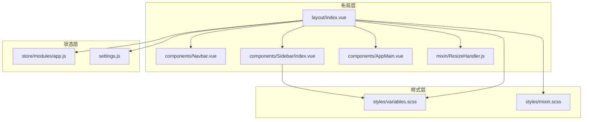
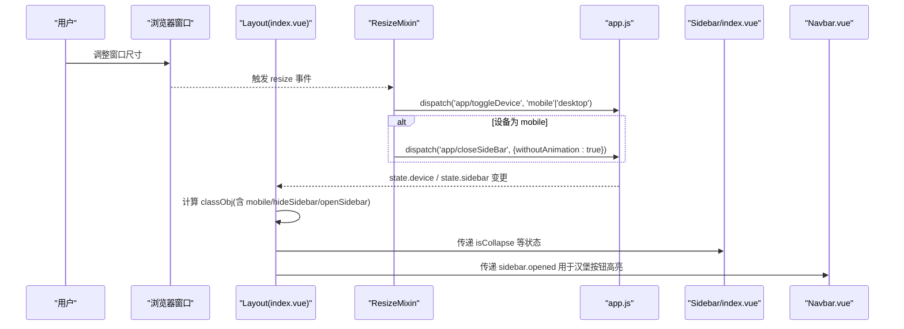
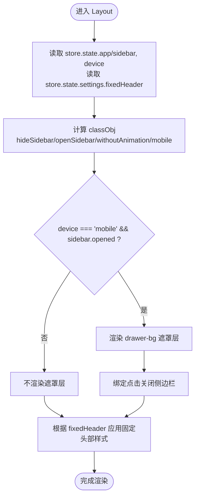
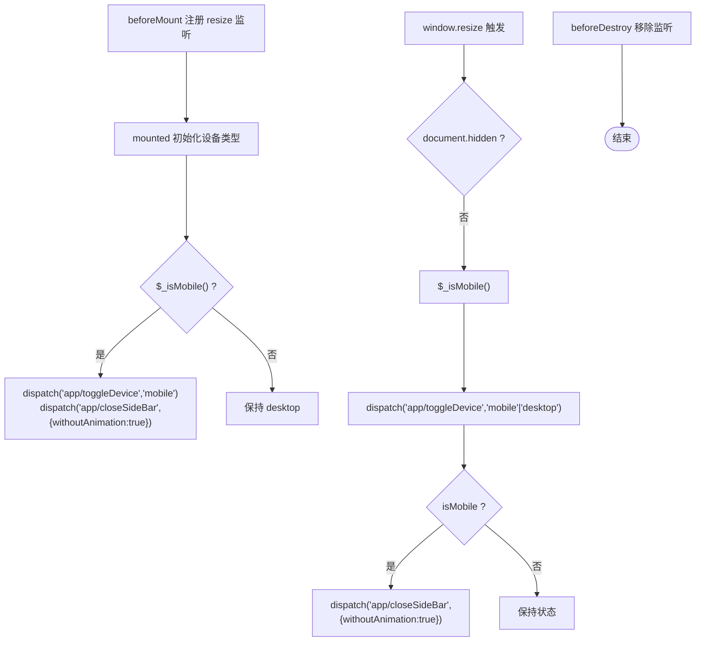
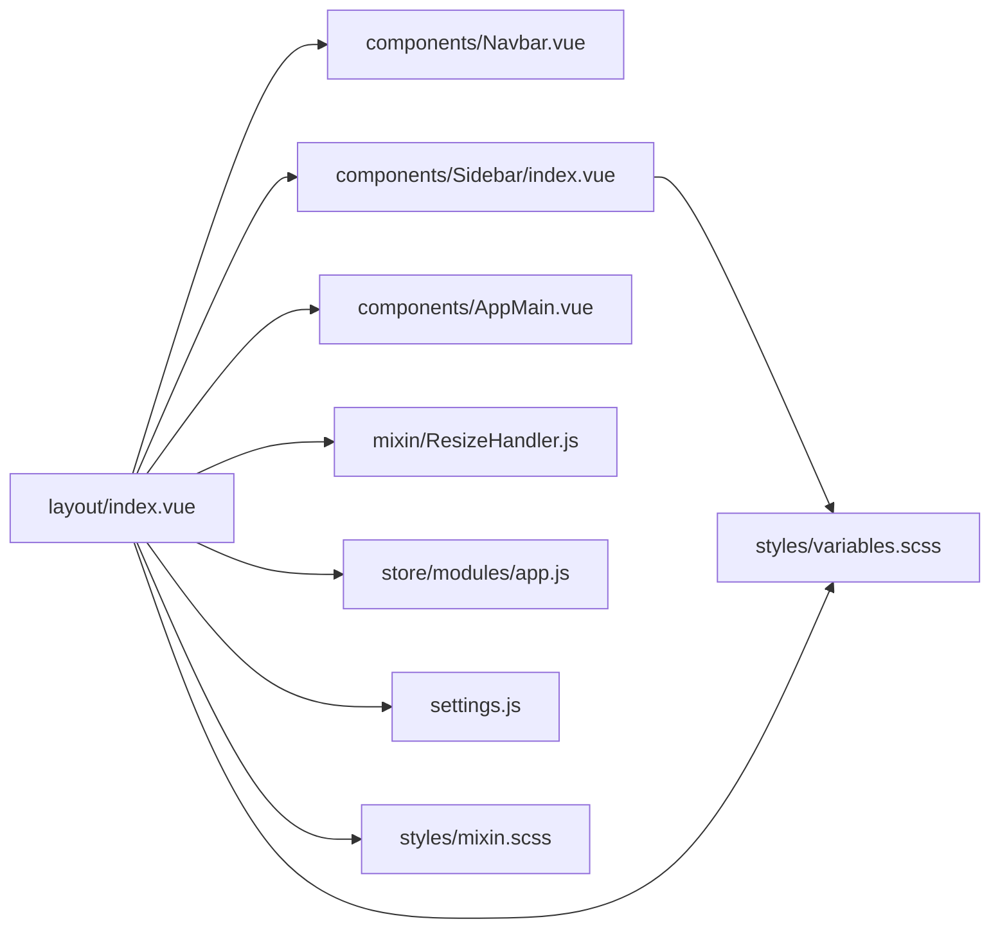

# 布局容器组件

<cite>
**本文引用的文件**   
- [src/layout/index.vue](file://src/layout/index.vue)
- [src/layout/mixin/ResizeHandler.js](file://src/layout/mixin/ResizeHandler.js)
- [src/store/modules/app.js](file://src/store/modules/app.js)
- [src/settings.js](file://src/settings.js)
- [src/layout/components/Sidebar/index.vue](file://src/layout/components/Sidebar/index.vue)
- [src/layout/components/AppMain.vue](file://src/layout/components/AppMain.vue)
- [src/layout/components/Navbar.vue](file://src/layout/components/Navbar.vue)
- [src/styles/variables.scss](file://src/styles/variables.scss)
- [src/styles/mixin.scss](file://src/styles/mixin.scss)
</cite>

## 目录
1. [简介](#简介)
2. [项目结构](#项目结构)
3. [核心组件与职责](#核心组件与职责)
4. [架构总览](#架构总览)
5. [详细组件分析](#详细组件分析)
6. [依赖关系分析](#依赖关系分析)
7. [性能与可维护性](#性能与可维护性)
8. [故障排查指南](#故障排查指南)
9. [结论](#结论)
10. [附录：配置项与使用示例](#附录配置项与使用示例)

## 简介
本文件面向“布局容器组件”，围绕 Layout 整体架构、响应式处理机制、设备检测、侧边栏状态管理、固定头部配置、移动端适配与抽屉背景遮罩等关键点进行系统化说明。文档同时解释 ResizeMixin 混入的工作原理与窗口大小监听实现，并提供配置选项与使用示例，帮助读者快速理解并扩展该布局体系。

## 项目结构
布局相关代码集中在 src/layout 目录，包含主布局容器、子组件（侧边栏、导航栏、内容区）、响应式混入以及样式变量。全局状态由 Vuex store 的 app 模块统一管理。

图表来源
- [src/layout/index.vue:1-50](file://src/layout/index.vue#L1-L50)
- [src/layout/components/Navbar.vue:1-60](file://src/layout/components/Navbar.vue#L1-L60)
- [src/layout/components/Sidebar/index.vue:1-57](file://src/layout/components/Sidebar/index.vue#L1-L57)
- [src/layout/components/AppMain.vue:1-41](file://src/layout/components/AppMain.vue#L1-L41)
- [src/layout/mixin/ResizeHandler.js:1-46](file://src/layout/mixin/ResizeHandler.js#L1-L46)
- [src/store/modules/app.js:1-49](file://src/store/modules/app.js#L1-L49)
- [src/settings.js:1-17](file://src/settings.js#L1-L17)
- [src/styles/variables.scss:1-26](file://src/styles/variables.scss#L1-L26)
- [src/styles/mixin.scss:1-29](file://src/styles/mixin.scss#L1-L29)

章节来源
- [src/layout/index.vue:1-50](file://src/layout/index.vue#L1-L50)
- [src/layout/mixin/ResizeHandler.js:1-46](file://src/layout/mixin/ResizeHandler.js#L1-L46)
- [src/store/modules/app.js:1-49](file://src/store/modules/app.js#L1-L49)
- [src/settings.js:1-17](file://src/settings.js#L1-L17)
- [src/layout/components/Sidebar/index.vue:1-57](file://src/layout/components/Sidebar/index.vue#L1-L57)
- [src/layout/components/AppMain.vue:1-41](file://src/layout/components/AppMain.vue#L1-L41)
- [src/layout/components/Navbar.vue:1-60](file://src/layout/components/Navbar.vue#L1-L60)
- [src/styles/variables.scss:1-26](file://src/styles/variables.scss#L1-L26)
- [src/styles/mixin.scss:1-29](file://src/styles/mixin.scss#L1-L29)

## 核心组件与职责
- Layout 容器（index.vue）
  - 组合 Navbar、Sidebar、AppMain
  - 根据设备类型渲染移动端遮罩层
  - 计算 classObj 控制侧边栏显隐、动画与移动端样式
  - 读取 fixedHeader 配置，控制头部固定行为
- Sidebar（components/Sidebar/index.vue）
  - 基于路由生成菜单项
  - 根据 store.sidebar.opened 决定折叠状态
  - 支持显示/隐藏 Logo
- Navbar（components/Navbar.vue）
  - 提供汉堡按钮切换侧边栏
  - 面包屑展示当前路径
  - 用户头像下拉菜单与退出登录
- AppMain（components/AppMain.vue）
  - 承载 router-view，配合过渡动画
  - 在固定头部模式下预留顶部间距
- ResizeMixin（mixin/ResizeHandler.js）
  - 监听 window.resize，判断移动端/桌面端
  - 路由变化时自动关闭移动端侧边栏
  - 通过 store 更新设备类型与侧边栏状态
- Store.app（store/modules/app.js）
  - 管理 sidebar.opened、withoutAnimation、device
  - 持久化侧边栏开关到 Cookie
- settings.js
  - 提供 fixedHeader、sidebarLogo 等全局配置

章节来源
- [src/layout/index.vue:1-50](file://src/layout/index.vue#L1-L50)
- [src/layout/components/Sidebar/index.vue:1-57](file://src/layout/components/Sidebar/index.vue#L1-L57)
- [src/layout/components/Navbar.vue:1-60](file://src/layout/components/Navbar.vue#L1-L60)
- [src/layout/components/AppMain.vue:1-41](file://src/layout/components/AppMain.vue#L1-L41)
- [src/layout/mixin/ResizeHandler.js:1-46](file://src/layout/mixin/ResizeHandler.js#L1-L46)
- [src/store/modules/app.js:1-49](file://src/store/modules/app.js#L1-L49)
- [src/settings.js:1-17](file://src/settings.js#L1-L17)

## 架构总览
Layout 作为根布局容器，负责装配页面骨架；ResizeMixin 注入设备检测与窗口监听能力；Store.app 集中管理侧边栏与设备状态；settings.js 提供布局级配置；各子组件仅关注自身职责并通过 store 与 props 协作。

图表来源
- [src/layout/mixin/ResizeHandler.js:14-43](file://src/layout/mixin/ResizeHandler.js#L14-L43)
- [src/store/modules/app.js:11-40](file://src/store/modules/app.js#L11-L40)
- [src/layout/index.vue:26-48](file://src/layout/index.vue#L26-L48)
- [src/layout/components/Sidebar/index.vue:29-53](file://src/layout/components/Sidebar/index.vue#L29-L53)
- [src/layout/components/Navbar.vue:44-53](file://src/layout/components/Navbar.vue#L44-L53)

## 详细组件分析

### Layout 容器（index.vue）
- 模板结构
  - 顶层容器根据 classObj 动态添加 hideSidebar、openSidebar、withoutAnimation、mobile 类名
  - 当 device 为 mobile 且侧边栏打开时，渲染 drawer-bg 遮罩层，点击调用 closeSideBar
  - 头部区域根据 fixedHeader 决定是否包裹固定样式
- 计算属性
  - sidebar/device/fixedHeader 从 store 读取
  - classObj 汇总侧边栏与设备状态，驱动样式与行为
- 方法
  - handleClickOutside 关闭移动端侧边栏
- 样式要点
  - .drawer-bg 全屏半透明遮罩，z-index 较高
  - .fixed-header 固定定位，宽度随侧边栏展开/收起动态变化
  - 移动端下固定头部宽度为 100%

图表来源
- [src/layout/index.vue:1-50](file://src/layout/index.vue#L1-L50)
- [src/layout/index.vue:53-93](file://src/layout/index.vue#L53-L93)

章节来源
- [src/layout/index.vue:1-50](file://src/layout/index.vue#L1-L50)
- [src/layout/index.vue:53-93](file://src/layout/index.vue#L53-L93)

### 响应式混入 ResizeMixin（ResizeHandler.js）
- 生命周期
  - beforeMount 注册 window.resize 监听
  - beforeDestroy 移除监听，避免内存泄漏
  - mounted 初始化设备类型，若为 mobile 则关闭侧边栏
- 方法
  - $_isMobile 基于 body.getBoundingClientRect().width 与阈值 WIDTH=992 判断移动端
  - $_resizeHandler 根据是否可见标签页执行设备切换与侧边栏关闭逻辑
- 路由监听
  - watch $route，当处于移动端且侧边栏打开时自动关闭

图表来源
- [src/layout/mixin/ResizeHandler.js:1-46](file://src/layout/mixin/ResizeHandler.js#L1-L46)
- [src/store/modules/app.js:31-40](file://src/store/modules/app.js#L31-L40)

章节来源
- [src/layout/mixin/ResizeHandler.js:1-46](file://src/layout/mixin/ResizeHandler.js#L1-L46)
- [src/store/modules/app.js:31-40](file://src/store/modules/app.js#L31-L40)

### 侧边栏（Sidebar/index.vue）
- 数据来源
  - routes 来自 this.$router.options.routes，按路由表渲染菜单
  - activeMenu 优先使用 meta.activeMenu，否则使用 path
  - showLogo 由 settings.sidebarLogo 控制
  - isCollapse 由 store.sidebar.opened 取反得到
- 交互
  - 通过 Element UI el-menu 渲染垂直菜单，禁用 collapse-transition，由父级控制折叠
- 样式
  - 颜色与宽度变量来自 styles/variables.scss

章节来源
- [src/layout/components/Sidebar/index.vue:1-57](file://src/layout/components/Sidebar/index.vue#L1-L57)
- [src/styles/variables.scss:1-26](file://src/styles/variables.scss#L1-L26)

### 导航栏（Navbar.vue）
- 功能
  - 汉堡按钮触发 toggleSideBar
  - 面包屑展示当前路由
  - 头像下拉菜单提供首页、文档、GitHub 链接与退出登录
- 状态
  - 通过 mapGetters 获取 sidebar 与 avatar

章节来源
- [src/layout/components/Navbar.vue:1-60](file://src/layout/components/Navbar.vue#L1-L60)

### 内容区（AppMain.vue）
- 功能
  - 使用 transition 包裹 router-view，key 为当前路由 path，确保切换路由时正确重建
- 样式
  - 在 fixed-header 存在时为内容区增加顶部内边距，避免被固定头部遮挡

章节来源
- [src/layout/components/AppMain.vue:1-41](file://src/layout/components/AppMain.vue#L1-L41)

### 状态管理（store/modules/app.js）
- 状态
  - sidebar.opened 默认值受 Cookie 影响
  - sidebar.withoutAnimation 控制关闭动画
  - device 初始为 desktop
- Mutations
  - TOGGLE_SIDEBAR 切换 opened，并写入 Cookie
  - CLOSE_SIDEBAR 关闭侧边栏，设置 withoutAnimation
  - TOGGLE_DEVICE 更新设备类型
- Actions
  - toggleSideBar、closeSideBar、toggleDevice 封装 mutations

章节来源
- [src/store/modules/app.js:1-49](file://src/store/modules/app.js#L1-L49)

### 配置中心（settings.js）
- 提供
  - title：站点标题
  - fixedHeader：是否固定头部
  - sidebarLogo：是否在侧边栏显示 Logo

章节来源
- [src/settings.js:1-17](file://src/settings.js#L1-L17)

## 依赖关系分析
- Layout 依赖
  - 子组件：Navbar、Sidebar、AppMain
  - 混入：ResizeMixin
  - 状态：store.app（sidebar、device）、store.settings（fixedHeader）
  - 样式：variables.scss、mixin.scss
- Sidebar 依赖
  - 路由表：this.$router.options.routes
  - 样式变量：variables.scss
- Navbar 依赖
  - 面包屑组件、汉堡按钮组件
  - store.getters（sidebar、avatar）
- ResizeMixin 依赖
  - store.app（toggleDevice、closeSideBar）
  - document.body 与 window 事件

图表来源
- [src/layout/index.vue:15-25](file://src/layout/index.vue#L15-L25)
- [src/layout/components/Sidebar/index.vue:21-25](file://src/layout/components/Sidebar/index.vue#L21-L25)
- [src/layout/components/Navbar.vue:34-48](file://src/layout/components/Navbar.vue#L34-L48)
- [src/layout/mixin/ResizeHandler.js:1-2](file://src/layout/mixin/ResizeHandler.js#L1-L2)
- [src/store/modules/app.js:1-9](file://src/store/modules/app.js#L1-L9)
- [src/settings.js:1-17](file://src/settings.js#L1-L17)
- [src/styles/variables.scss:1-26](file://src/styles/variables.scss#L1-L26)
- [src/styles/mixin.scss:1-29](file://src/styles/mixin.scss#L1-L29)

章节来源
- [src/layout/index.vue:15-25](file://src/layout/index.vue#L15-L25)
- [src/layout/components/Sidebar/index.vue:21-25](file://src/layout/components/Sidebar/index.vue#L21-L25)
- [src/layout/components/Navbar.vue:34-48](file://src/layout/components/Navbar.vue#L34-L48)
- [src/layout/mixin/ResizeHandler.js:1-2](file://src/layout/mixin/ResizeHandler.js#L1-L2)
- [src/store/modules/app.js:1-9](file://src/store/modules/app.js#L1-L9)
- [src/settings.js:1-17](file://src/settings.js#L1-L17)
- [src/styles/variables.scss:1-26](file://src/styles/variables.scss#L1-L26)
- [src/styles/mixin.scss:1-29](file://src/styles/mixin.scss#L1-L29)

## 性能与可维护性
- 事件监听
  - ResizeMixin 在 beforeMount 注册、beforeDestroy 移除，避免内存泄漏
- 条件渲染
  - 移动端遮罩层仅在 device==='mobile' 且 sidebar.opened 时渲染，减少不必要的 DOM
- 样式优化
  - 使用 CSS 变量与 SCSS mixin 统一样式，便于主题扩展
- 状态集中
  - 侧边栏与设备状态集中于 store，降低组件耦合度，提升可测试性

[本节为通用建议，不涉及具体文件分析]

## 故障排查指南
- 移动端侧边栏无法关闭
  - 检查 ResizeMixin 是否正确触发 closeSideBar
  - 确认 store.app.closeSideBar mutation 是否被调用
  - 查看移动端遮罩层是否存在且 z-index 足够高
- 固定头部错位或遮挡内容
  - 检查 settings.fixedHeader 是否为 true
  - 确认 AppMain 的 padding-top 是否与头部高度匹配
- 侧边栏宽度异常
  - 检查 variables.scss 中 sideBarWidth 变量
  - 确认 Layout 中 .fixed-header 宽度计算是否使用了正确的变量
- 路由切换后侧边栏未自动关闭
  - 检查 ResizeMixin 对 $route 的 watch 逻辑
  - 确认设备类型是否为 mobile

章节来源
- [src/layout/mixin/ResizeHandler.js:7-12](file://src/layout/mixin/ResizeHandler.js#L7-L12)
- [src/layout/index.vue:3-4](file://src/layout/index.vue#L3-L4)
- [src/layout/index.vue:77-92](file://src/layout/index.vue#L77-L92)
- [src/styles/variables.scss:12-12](file://src/styles/variables.scss#L12-L12)
- [src/layout/components/AppMain.vue:28-30](file://src/layout/components/AppMain.vue#L28-L30)

## 结论
Layout 容器通过简洁的组件拆分与集中的状态管理，实现了稳定的桌面与移动端布局体验。ResizeMixin 提供了可靠的设备检测与窗口监听能力，结合 store.app 的状态变更，保证了侧边栏在不同设备下的合理行为。settings.js 提供的配置项让固定头部与侧边栏 Logo 的显示策略易于扩展与维护。

[本节为总结性内容，不涉及具体文件分析]

## 附录：配置项与使用示例

### 配置项
- settings.js
  - title：站点标题
  - fixedHeader：是否固定头部（布尔）
  - sidebarLogo：是否在侧边栏显示 Logo（布尔）

章节来源
- [src/settings.js:1-17](file://src/settings.js#L1-L17)

### 使用示例
- 启用固定头部
  - 将 settings.js 中的 fixedHeader 设置为 true
- 显示侧边栏 Logo
  - 将 settings.js 中的 sidebarLogo 设置为 true
- 自定义侧边栏宽度
  - 修改 styles/variables.scss 中的 sideBarWidth 变量
- 调整响应式断点
  - 修改 layout/mixin/ResizeHandler.js 中的 WIDTH 常量（默认 992）

章节来源
- [src/settings.js:1-17](file://src/settings.js#L1-L17)
- [src/styles/variables.scss:12-12](file://src/styles/variables.scss#L12-L12)
- [src/layout/mixin/ResizeHandler.js:3-4](file://src/layout/mixin/ResizeHandler.js#L3-L4)