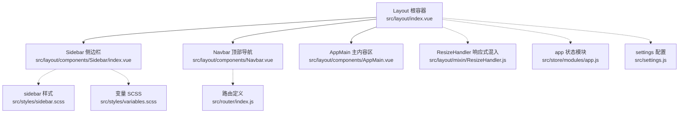
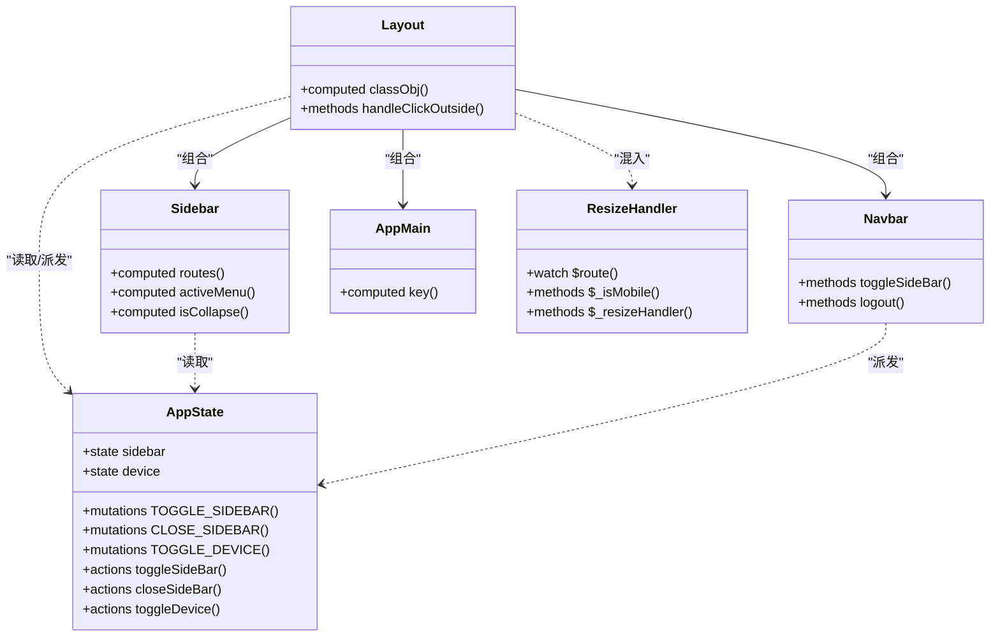
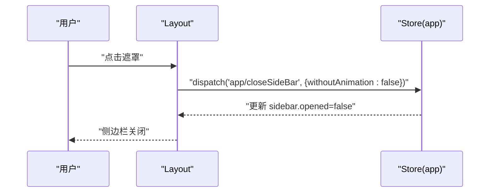
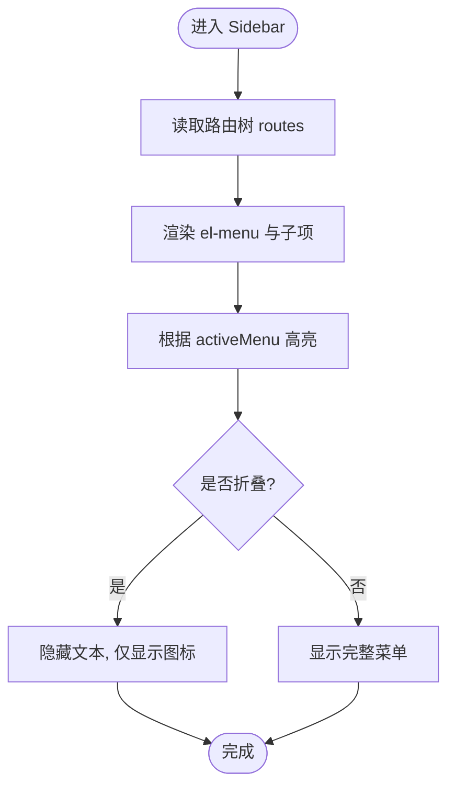
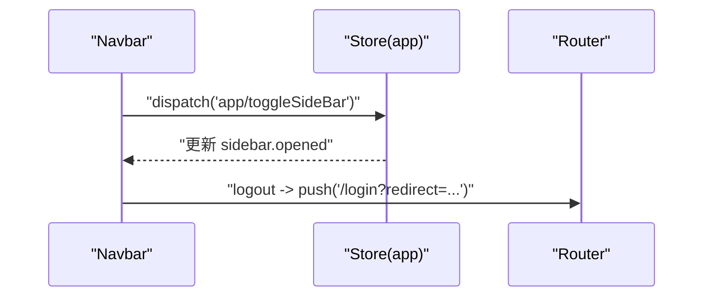
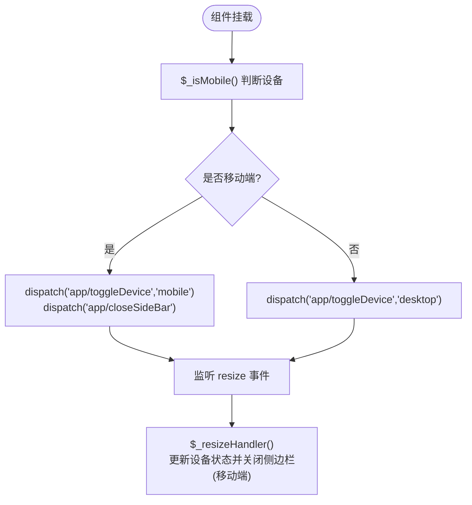
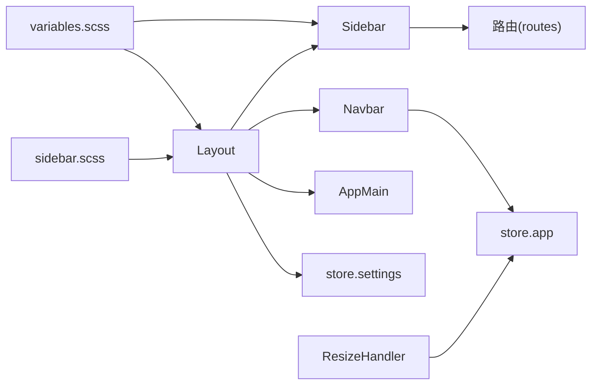

# 布局系统

<cite>
**本文引用的文件**   
- [src/layout/index.vue](file://src/layout/index.vue)
- [src/layout/components/Sidebar/index.vue](file://src/layout/components/Sidebar/index.vue)
- [src/layout/components/Navbar.vue](file://src/layout/components/Navbar.vue)
- [src/layout/components/AppMain.vue](file://src/layout/components/AppMain.vue)
- [src/layout/mixin/ResizeHandler.js](file://src/layout/mixin/ResizeHandler.js)
- [src/store/modules/app.js](file://src/store/modules/app.js)
- [src/settings.js](file://src/settings.js)
- [src/styles/variables.scss](file://src/styles/variables.scss)
- [src/styles/sidebar.scss](file://src/styles/sidebar.scss)
- [src/router/index.js](file://src/router/index.js)
</cite>

## 目录
1. [简介](#简介)
2. [项目结构](#项目结构)
3. [核心组件](#核心组件)
4. [架构总览](#架构总览)
5. [详细组件分析](#详细组件分析)
6. [依赖关系分析](#依赖关系分析)
7. [性能与可维护性](#性能与可维护性)
8. [故障排查指南](#故障排查指南)
9. [结论](#结论)
10. [附录：配置项与扩展指南](#附录配置项与扩展指南)

## 简介
本布局系统基于 Vue + Element UI，提供响应式后台管理界面骨架。整体由侧边栏、顶部导航、主内容区三大部分组成，通过 Vuex 管理设备状态与侧边栏开关，结合 ResizeMixin 实现移动端适配与断点切换。样式变量集中管理，支持主题化与宽度定制。路由以 Layout 为容器包裹业务页面，形成统一的布局体验。

## 项目结构
布局相关代码集中在 src/layout 下，包含根布局容器、子组件（侧边栏、导航、主内容）、响应式混入；全局样式在 styles 中按模块拆分；应用设置与路由定义分别位于 settings.js 与 router/index.js。

图表来源
- [src/layout/index.vue:1-50](file://src/layout/index.vue#L1-L50)
- [src/layout/components/Sidebar/index.vue:1-57](file://src/layout/components/Sidebar/index.vue#L1-L57)
- [src/layout/components/Navbar.vue:1-60](file://src/layout/components/Navbar.vue#L1-L60)
- [src/layout/components/AppMain.vue:1-41](file://src/layout/components/AppMain.vue#L1-L41)
- [src/layout/mixin/ResizeHandler.js:1-46](file://src/layout/mixin/ResizeHandler.js#L1-L46)
- [src/store/modules/app.js:1-49](file://src/store/modules/app.js#L1-L49)
- [src/settings.js:1-17](file://src/settings.js#L1-L17)
- [src/styles/sidebar.scss:1-186](file://src/styles/sidebar.scss#L1-L186)
- [src/styles/variables.scss:1-26](file://src/styles/variables.scss#L1-L26)
- [src/router/index.js:6-56](file://src/router/index.js#L6-L56)

章节来源
- [src/layout/index.vue:1-50](file://src/layout/index.vue#L1-L50)
- [src/layout/components/Sidebar/index.vue:1-57](file://src/layout/components/Sidebar/index.vue#L1-L57)
- [src/layout/components/Navbar.vue:1-60](file://src/layout/components/Navbar.vue#L1-L60)
- [src/layout/components/AppMain.vue:1-41](file://src/layout/components/AppMain.vue#L1-L41)
- [src/layout/mixin/ResizeHandler.js:1-46](file://src/layout/mixin/ResizeHandler.js#L1-L46)
- [src/store/modules/app.js:1-49](file://src/store/modules/app.js#L1-L49)
- [src/settings.js:1-17](file://src/settings.js#L1-L17)
- [src/styles/sidebar.scss:1-186](file://src/styles/sidebar.scss#L1-L186)
- [src/styles/variables.scss:1-26](file://src/styles/variables.scss#L1-L26)
- [src/router/index.js:6-56](file://src/router/index.js#L6-L56)

## 核心组件
- Layout 根容器：组合 Sidebar、Navbar、AppMain，处理移动端遮罩、固定头部、类名绑定与点击外部关闭侧边栏。
- Sidebar 侧边栏：渲染菜单树，支持折叠、Logo 显示控制、滚动条与高亮当前菜单。
- Navbar 顶部导航：汉堡按钮、面包屑、用户头像下拉菜单与退出登录。
- AppMain 主内容区：承载 <router-view>，配合过渡动画与固定头部时的内边距补偿。
- ResizeHandler 混入：监听窗口尺寸变化，根据断点切换设备类型并自动收起侧边栏。
- app 状态模块：管理 sidebar.opened、withoutAnimation 与 device 状态，持久化侧边栏开关到 Cookie。
- settings 配置：控制 fixedHeader、sidebarLogo 等布局开关。
- variables/sidebar 样式：集中定义侧边栏宽度、颜色与响应式样式。

章节来源
- [src/layout/index.vue:1-50](file://src/layout/index.vue#L1-L50)
- [src/layout/components/Sidebar/index.vue:1-57](file://src/layout/components/Sidebar/index.vue#L1-L57)
- [src/layout/components/Navbar.vue:1-60](file://src/layout/components/Navbar.vue#L1-L60)
- [src/layout/components/AppMain.vue:1-41](file://src/layout/components/AppMain.vue#L1-L41)
- [src/layout/mixin/ResizeHandler.js:1-46](file://src/layout/mixin/ResizeHandler.js#L1-L46)
- [src/store/modules/app.js:1-49](file://src/store/modules/app.js#L1-L49)
- [src/settings.js:1-17](file://src/settings.js#L1-L17)
- [src/styles/variables.scss:1-26](file://src/styles/variables.scss#L1-L26)
- [src/styles/sidebar.scss:1-186](file://src/styles/sidebar.scss#L1-L186)

## 架构总览
布局采用“容器 + 子组件”的组合模式，状态集中于 Vuex，样式变量集中管理，路由以 Layout 作为外层容器。

图表来源
- [src/layout/index.vue:14-50](file://src/layout/index.vue#L14-L50)
- [src/layout/components/Sidebar/index.vue:21-55](file://src/layout/components/Sidebar/index.vue#L21-L55)
- [src/layout/components/Navbar.vue:34-59](file://src/layout/components/Navbar.vue#L34-L59)
- [src/layout/components/AppMain.vue:9-17](file://src/layout/components/AppMain.vue#L9-L17)
- [src/layout/mixin/ResizeHandler.js:1-46](file://src/layout/mixin/ResizeHandler.js#L1-L46)
- [src/store/modules/app.js:1-49](file://src/store/modules/app.js#L1-L49)

## 详细组件分析

### Layout 根容器
- 功能要点
  - 根据设备类型与侧边栏状态动态绑定类名，驱动不同布局行为。
  - 移动端打开侧边栏时显示遮罩层，点击遮罩关闭侧边栏。
  - 根据 settings.fixedHeader 决定是否固定头部，影响主内容区上边距。
- 关键数据流
  - 从 store.app 读取 sidebar、device，从 store.settings 读取 fixedHeader。
  - 计算 classObj 用于条件样式控制。
- 交互流程
  - 点击遮罩触发 closeSideBar action，传入 withoutAnimation=false。

图表来源
- [src/layout/index.vue:1-50](file://src/layout/index.vue#L1-L50)
- [src/store/modules/app.js:21-25](file://src/store/modules/app.js#L21-L25)

章节来源
- [src/layout/index.vue:1-50](file://src/layout/index.vue#L1-L50)
- [src/store/modules/app.js:1-49](file://src/store/modules/app.js#L1-L49)

### Sidebar 侧边栏
- 功能要点
  - 使用 Element Menu 渲染路由树，支持多级嵌套。
  - 根据 meta.activeMenu 或当前路径高亮菜单项。
  - 支持 Logo 显示控制与折叠状态联动。
- 数据来源
  - 从 $router.options.routes 获取路由树。
  - 从 store.settings.sidebarLogo 控制 Logo 显示。
- 样式与交互
  - 通过 variables 注入颜色与宽度变量。
  - 折叠时隐藏文字，仅保留图标。

图表来源
- [src/layout/components/Sidebar/index.vue:1-57](file://src/layout/components/Sidebar/index.vue#L1-L57)
- [src/styles/variables.scss:1-26](file://src/styles/variables.scss#L1-L26)

章节来源
- [src/layout/components/Sidebar/index.vue:1-57](file://src/layout/components/Sidebar/index.vue#L1-L57)
- [src/styles/variables.scss:1-26](file://src/styles/variables.scss#L1-L26)

### Navbar 顶部导航
- 功能要点
  - 左侧汉堡按钮控制侧边栏展开/收起。
  - 中间面包屑展示当前位置。
  - 右侧头像下拉菜单提供首页、文档、GitHub 链接与退出登录。
- 交互流程
  - 点击汉堡按钮 dispatch('app/toggleSideBar')。
  - 退出登录调用 user/logout 后跳转登录页并携带 redirect。

图表来源
- [src/layout/components/Navbar.vue:34-59](file://src/layout/components/Navbar.vue#L34-L59)
- [src/store/modules/app.js:31-34](file://src/store/modules/app.js#L31-L34)

章节来源
- [src/layout/components/Navbar.vue:1-140](file://src/layout/components/Navbar.vue#L1-L140)
- [src/store/modules/app.js:1-49](file://src/store/modules/app.js#L1-L49)

### AppMain 主内容区
- 功能要点
  - 使用 transition 包裹 router-view，提供页面切换动画。
  - 当头部固定时，增加 padding-top 避免内容被遮挡。
- 关键点
  - 通过 route.path 作为 key，确保路由切换时强制重建视图。

章节来源
- [src/layout/components/AppMain.vue:1-41](file://src/layout/components/AppMain.vue#L1-L41)

### 响应式与断点机制
- 断点阈值
  - 在 ResizeHandler 中定义 WIDTH=992，小于该值视为移动端。
- 设备切换
  - 监听 window.resize，切换 store.app.device 为 mobile/desktop。
  - 移动端自动关闭侧边栏，避免遮挡内容。
- 路由变化处理
  - 当设备为 mobile 且侧边栏处于打开状态时，路由变化自动关闭侧边栏。

图表来源
- [src/layout/mixin/ResizeHandler.js:1-46](file://src/layout/mixin/ResizeHandler.js#L1-L46)
- [src/store/modules/app.js:26-28](file://src/store/modules/app.js#L26-L28)

章节来源
- [src/layout/mixin/ResizeHandler.js:1-46](file://src/layout/mixin/ResizeHandler.js#L1-L46)
- [src/store/modules/app.js:1-49](file://src/store/modules/app.js#L1-L49)

### 样式系统与主题定制
- 变量集中
  - variables.scss 导出菜单颜色、背景色、侧边栏宽度等变量，供组件与样式引用。
- 侧边栏样式
  - sidebar.scss 定义侧边栏定位、宽度、折叠态、移动端滑出效果、滚动条样式等。
- 主题定制建议
  - 修改 variables.scss 中的颜色与 sideBarWidth，即可统一调整主题与宽度。
  - 在 sidebar.scss 中覆盖特定样式以微调交互细节。

章节来源
- [src/styles/variables.scss:1-26](file://src/styles/variables.scss#L1-L26)
- [src/styles/sidebar.scss:1-227](file://src/styles/sidebar.scss#L1-L227)

## 依赖关系分析
- 组件耦合
  - Layout 强依赖 Sidebar、Navbar、AppMain 三个子组件。
  - Sidebar 依赖路由树与 settings.sidebarLogo。
  - Navbar 依赖 store.app 与 store.user（退出登录）。
- 状态依赖
  - Layout、Sidebar、Navbar 均读取 store.app 的 sidebar/device 状态。
  - ResizeHandler 通过 actions 更新 store.app。
- 样式依赖
  - 组件样式依赖 variables.scss 导出的变量。
  - sidebar.scss 对 Element UI 的样式进行覆盖与增强。

图表来源
- [src/layout/index.vue:14-50](file://src/layout/index.vue#L14-L50)
- [src/layout/components/Sidebar/index.vue:21-55](file://src/layout/components/Sidebar/index.vue#L21-L55)
- [src/layout/components/Navbar.vue:34-59](file://src/layout/components/Navbar.vue#L34-L59)
- [src/layout/mixin/ResizeHandler.js:1-46](file://src/layout/mixin/ResizeHandler.js#L1-L46)
- [src/styles/variables.scss:1-26](file://src/styles/variables.scss#L1-L26)
- [src/styles/sidebar.scss:1-186](file://src/styles/sidebar.scss#L1-L186)

章节来源
- [src/layout/index.vue:14-50](file://src/layout/index.vue#L14-L50)
- [src/layout/components/Sidebar/index.vue:21-55](file://src/layout/components/Sidebar/index.vue#L21-L55)
- [src/layout/components/Navbar.vue:34-59](file://src/layout/components/Navbar.vue#L34-L59)
- [src/layout/mixin/ResizeHandler.js:1-46](file://src/layout/mixin/ResizeHandler.js#L1-L46)
- [src/styles/variables.scss:1-26](file://src/styles/variables.scss#L1-L26)
- [src/styles/sidebar.scss:1-186](file://src/styles/sidebar.scss#L1-L186)

## 性能与可维护性
- 性能
  - 使用 transition 包裹 router-view，提升页面切换体验。
  - 侧边栏滚动使用 el-scrollbar，避免原生滚动条样式问题。
  - 移动端通过 transform 位移实现滑出，减少重排重绘。
- 可维护性
  - 样式变量集中，便于主题化与统一修改。
  - 状态集中管理，组件只负责展示与交互，逻辑清晰。
  - 路由与布局解耦，新增页面只需配置路由 meta。

[本节为通用指导，不直接分析具体文件]

## 故障排查指南
- 侧边栏在移动端无法关闭
  - 检查 ResizeHandler 是否正确监听 resize 并 dispatch closeSideBar。
  - 确认 store.app.device 是否为 mobile。
- 固定头部导致内容被遮挡
  - 检查 settings.fixedHeader 与 AppMain 的 padding-top 逻辑。
- 侧边栏宽度异常
  - 检查 variables.scss 的 sideBarWidth 与 sidebar.scss 的对应样式。
- 菜单高亮不正确
  - 检查路由 meta.activeMenu 与 Sidebar 的 activeMenu 计算逻辑。

章节来源
- [src/layout/mixin/ResizeHandler.js:1-46](file://src/layout/mixin/ResizeHandler.js#L1-L46)
- [src/layout/components/AppMain.vue:20-31](file://src/layout/components/AppMain.vue#L20-L31)
- [src/styles/variables.scss:12-24](file://src/styles/variables.scss#L12-L24)
- [src/styles/sidebar.scss:94-157](file://src/styles/sidebar.scss#L94-L157)
- [src/layout/components/Sidebar/index.vue:36-44](file://src/layout/components/Sidebar/index.vue#L36-L44)

## 结论
该布局系统通过清晰的组件划分、集中的状态管理与样式变量，实现了稳定且可扩展的响应式后台界面。侧边栏、顶部导航与主内容区职责明确，断点机制保证移动端体验一致。通过 settings 与 variables，用户可以便捷地定制主题与布局行为。

[本节为总结性内容，不直接分析具体文件]

## 附录：配置项与扩展指南

### 配置项说明
- settings.js
  - fixedHeader：是否固定头部，影响主内容区上边距。
  - sidebarLogo：是否在侧边栏显示 Logo。
- variables.scss
  - menuText/menuActiveText/subMenuActiveText：菜单文字与激活色。
  - menuBg/menuHover/subMenuBg/subMenuHover：菜单背景与悬停色。
  - sideBarWidth：侧边栏宽度，影响主内容区 margin-left。

章节来源
- [src/settings.js:1-17](file://src/settings.js#L1-L17)
- [src/styles/variables.scss:1-26](file://src/styles/variables.scss#L1-L26)

### 自定义布局扩展方法
- 新增页面
  - 在 router/index.js 中添加路由，使用 Layout 作为父级容器，并在 meta 中设置 title、icon、activeMenu 等。
- 自定义侧边栏样式
  - 在 sidebar.scss 中覆盖 .sidebar-container 及其子元素样式，或使用 variables.scss 统一变量。
- 调整断点
  - 修改 ResizeHandler.js 中的 WIDTH 常量，以改变移动端断点阈值。
- 主题定制
  - 修改 variables.scss 的颜色变量，实现一键换肤。

章节来源
- [src/router/index.js:6-56](file://src/router/index.js#L6-L56)
- [src/styles/sidebar.scss:1-186](file://src/styles/sidebar.scss#L1-L186)
- [src/layout/mixin/ResizeHandler.js:1-46](file://src/layout/mixin/ResizeHandler.js#L1-L46)
- [src/styles/variables.scss:1-26](file://src/styles/variables.scss#L1-L26)