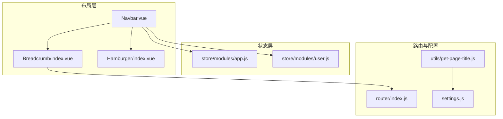
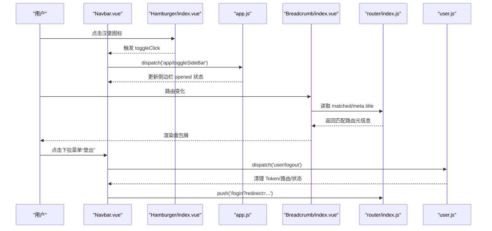
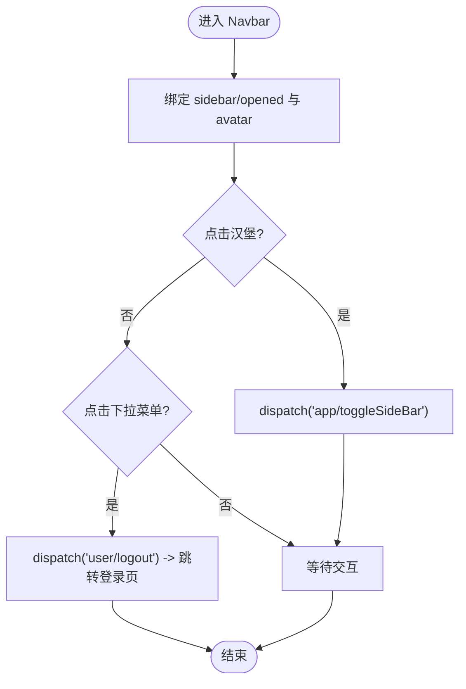
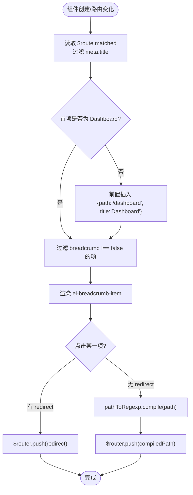
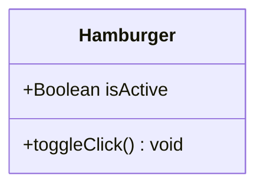
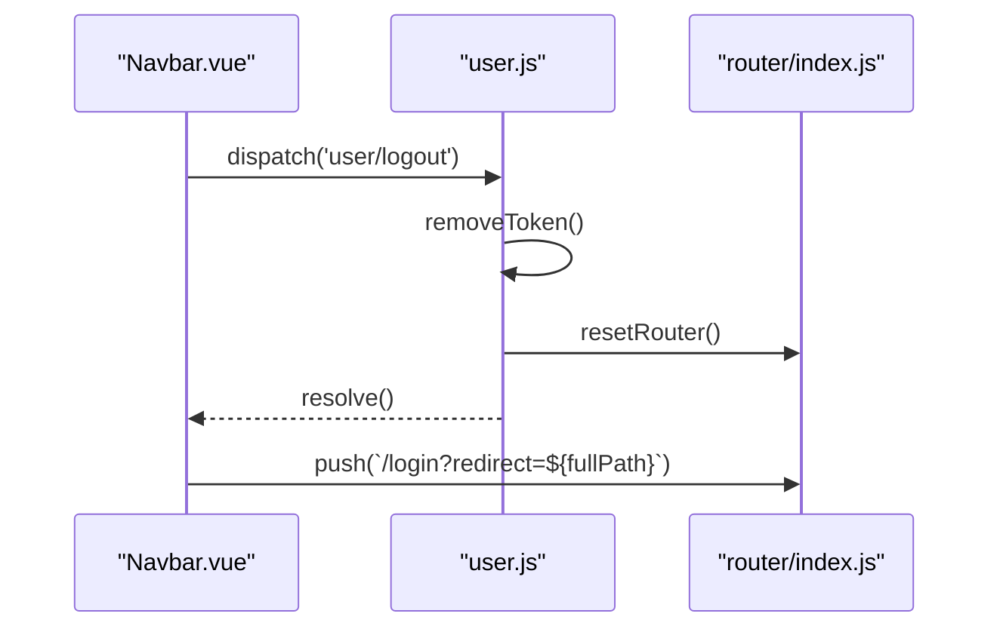
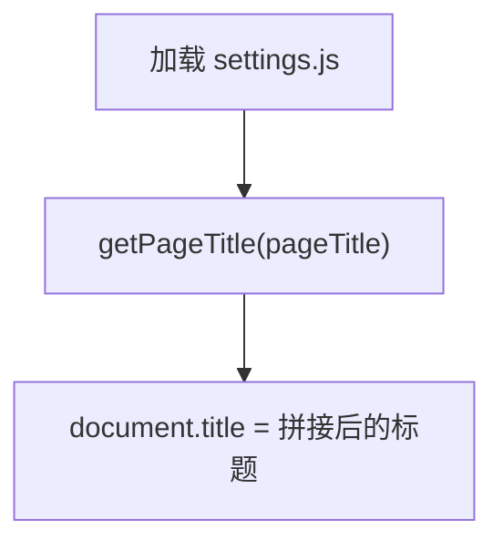
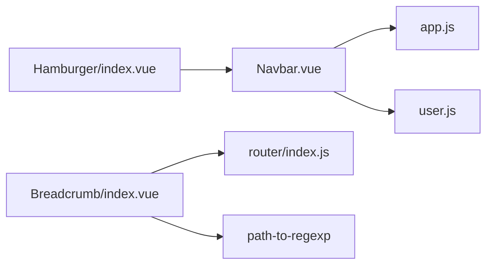

# 顶部导航栏组件

<cite>
**本文引用的文件**   
- [Navbar.vue](file://src/layout/components/Navbar.vue)
- [Breadcrumb/index.vue](file://src/components/Breadcrumb/index.vue)
- [Hamburger/index.vue](file://src/components/Hamburger/index.vue)
- [user.js](file://src/store/modules/user.js)
- [app.js](file://src/store/modules/app.js)
- [get-page-title.js](file://src/utils/get-page-title.js)
- [settings.js](file://src/settings.js)
- [router/index.js](file://src/router/index.js)
</cite>

## 目录
1. [简介](#简介)
2. [项目结构](#项目结构)
3. [核心组件](#核心组件)
4. [架构总览](#架构总览)
5. [详细组件分析](#详细组件分析)
6. [依赖关系分析](#依赖关系分析)
7. [性能与可访问性](#性能与可访问性)
8. [故障排查指南](#故障排查指南)
9. [结论](#结论)
10. [附录：样式定制与头像上传方案](#附录样式定制与头像上传方案)

## 简介
本文件面向“顶部导航栏组件”的实现与使用，围绕 Navbar 组件及其子组件 Breadcrumb（面包屑）与 Hamburger（汉堡菜单按钮），系统说明其功能、交互逻辑、状态管理、路由联动与可扩展点。文档同时覆盖移动端汉堡菜单切换、下拉菜单行为、用户登出流程、页面标题动态更新以及搜索框集成思路，并提供样式定制与用户头像上传的落地方案。

## 项目结构
与顶部导航栏直接相关的代码组织如下：
- layout/components/Navbar.vue：顶部导航容器，聚合汉堡菜单、面包屑与右侧用户菜单
- components/Breadcrumb/index.vue：根据当前路由生成面包屑
- components/Hamburger/index.vue：纯展示型汉堡图标，负责点击事件派发
- store/modules/app.js：侧边栏开关状态与设备类型
- store/modules/user.js：用户信息、Token、登出等
- utils/get-page-title.js：页面标题拼接工具
- settings.js：全局配置（如默认标题）
- router/index.js：路由定义与元信息（title、breadcrumb 等）

图表来源
- [Navbar.vue:1-32](file://src/layout/components/Navbar.vue#L1-L32)
- [Breadcrumb/index.vue:1-10](file://src/components/Breadcrumb/index.vue#L1-L10)
- [Hamburger/index.vue:1-14](file://src/components/Hamburger/index.vue#L1-L14)
- [app.js:1-49](file://src/store/modules/app.js#L1-L49)
- [user.js:1-98](file://src/store/modules/user.js#L1-L98)
- [router/index.js:1-182](file://src/router/index.js#L1-L182)
- [get-page-title.js:1-11](file://src/utils/get-page-title.js#L1-L11)
- [settings.js:1-17](file://src/settings.js#L1-L17)

章节来源
- [Navbar.vue:1-140](file://src/layout/components/Navbar.vue#L1-L140)
- [Breadcrumb/index.vue:1-79](file://src/components/Breadcrumb/index.vue#L1-L79)
- [Hamburger/index.vue:1-45](file://src/components/Hamburger/index.vue#L1-L45)
- [app.js:1-49](file://src/store/modules/app.js#L1-L49)
- [user.js:1-98](file://src/store/modules/user.js#L1-L98)
- [get-page-title.js:1-11](file://src/utils/get-page-title.js#L1-L11)
- [settings.js:1-17](file://src/settings.js#L1-L17)
- [router/index.js:1-182](file://src/router/index.js#L1-L182)

## 核心组件
- Navbar.vue：顶部导航容器，负责组合汉堡菜单、面包屑与用户下拉菜单；处理侧边栏切换与用户登出。
- Breadcrumb/index.vue：基于当前路由 matched 列表渲染面包屑，支持重定向与参数化路径编译。
- Hamburger/index.vue：接收 isActive 控制图标旋转，触发 toggleClick 事件。

章节来源
- [Navbar.vue:1-140](file://src/layout/components/Navbar.vue#L1-L140)
- [Breadcrumb/index.vue:1-79](file://src/components/Breadcrumb/index.vue#L1-L79)
- [Hamburger/index.vue:1-45](file://src/components/Hamburger/index.vue#L1-L45)

## 架构总览
Navbar 通过 Vuex 获取侧边栏状态与用户头像，调用 app 模块切换侧边栏，调用 user 模块执行登出；Breadcrumb 监听路由变化并渲染面包屑；Hamburger 仅负责 UI 交互与事件派发。

图表来源
- [Navbar.vue:51-57](file://src/layout/components/Navbar.vue#L51-L57)
- [Hamburger/index.vue:25-29](file://src/components/Hamburger/index.vue#L25-L29)
- [app.js:31-34](file://src/store/modules/app.js#L31-L34)
- [Breadcrumb/index.vue:21-28](file://src/components/Breadcrumb/index.vue#L21-L28)
- [user.js:67-79](file://src/store/modules/user.js#L67-L79)
- [router/index.js:167-181](file://src/router/index.js#L167-L181)

## 详细组件分析

### Navbar.vue：顶部导航容器
- 功能要点
  - 左侧：汉堡菜单按钮，用于切换侧边栏显示/隐藏
  - 中间：面包屑导航，跟随路由自动更新
  - 右侧：用户头像下拉菜单，包含首页、外部链接与“登出”
- 交互逻辑
  - 点击汉堡图标：调用 app 模块的 toggleSideBar action，切换 sidebar.opened
  - 点击“登出”：调用 user 模块的 logout action，成功后跳转到登录页并携带 redirect 参数
- 数据绑定
  - 通过 mapGetters 获取 sidebar 与 avatar
  - 头像图片地址拼接了缩略图参数以优化加载
- 样式
  - 使用 SCSS 模块化样式，包含汉堡区域、面包屑区域与右侧菜单区

图表来源
- [Navbar.vue:3-30](file://src/layout/components/Navbar.vue#L3-L30)
- [Navbar.vue:44-58](file://src/layout/components/Navbar.vue#L44-L58)
- [app.js:31-34](file://src/store/modules/app.js#L31-L34)
- [user.js:67-79](file://src/store/modules/user.js#L67-L79)

章节来源
- [Navbar.vue:1-140](file://src/layout/components/Navbar.vue#L1-L140)

### Breadcrumb/index.vue：面包屑导航
- 功能要点
  - 根据当前路由 matched 列表过滤出带 meta.title 的路由项
  - 若首项不是 Dashboard，则前置插入一个虚拟 Dashboard 项
  - 支持 redirect 字段进行重定向，或按 path 进行路由跳转
  - 对含参数的 path 使用 path-to-regexp 进行编译
- 交互逻辑
  - 监听 $route 变化，重新计算 levelList
  - 点击非末项面包屑时，根据 redirect 或 path 进行跳转
- 样式
  - 设置字体大小、行高与分隔符，末项为不可点击文本

图表来源
- [Breadcrumb/index.vue:21-61](file://src/components/Breadcrumb/index.vue#L21-L61)

章节来源
- [Breadcrumb/index.vue:1-79](file://src/components/Breadcrumb/index.vue#L1-L79)

### Hamburger/index.vue：汉堡菜单按钮
- 功能要点
  - 接收 isActive 布尔属性，控制 SVG 图标是否旋转
  - 点击后向外派发 toggleClick 事件
- 样式
  - 使用 CSS transform 实现 180° 旋转动画

图表来源
- [Hamburger/index.vue:17-29](file://src/components/Hamburger/index.vue#L17-L29)
- [Hamburger/index.vue:33-44](file://src/components/Hamburger/index.vue#L33-L44)

章节来源
- [Hamburger/index.vue:1-45](file://src/components/Hamburger/index.vue#L1-L45)

### 用户登出流程
- 触发点：Navbar 的用户下拉菜单“登出”
- 状态变更：user 模块 logout action 调用后端接口，移除本地 Token，重置路由与状态
- 路由跳转：登出成功后跳转到 /login，并附带原页面 full 路径作为 redirect 参数

图表来源
- [Navbar.vue:54-57](file://src/layout/components/Navbar.vue#L54-L57)
- [user.js:67-79](file://src/store/modules/user.js#L67-L79)
- [router/index.js:176-179](file://src/router/index.js#L176-L179)

章节来源
- [Navbar.vue:54-57](file://src/layout/components/Navbar.vue#L54-L57)
- [user.js:67-79](file://src/store/modules/user.js#L67-L79)
- [router/index.js:176-179](file://src/router/index.js#L176-L179)

### 页面标题动态更新
- 机制：get-page-title.js 从 settings.js 读取默认标题，将路由 meta.title 与默认标题拼接为 document.title
- 扩展：在路由守卫或应用初始化处调用 getPageTitle(pageTitle) 即可实现标题动态更新

图表来源
- [get-page-title.js:1-11](file://src/utils/get-page-title.js#L1-L11)
- [settings.js:1-17](file://src/settings.js#L1-L17)

章节来源
- [get-page-title.js:1-11](file://src/utils/get-page-title.js#L1-L11)
- [settings.js:1-17](file://src/settings.js#L1-L17)

### 搜索框集成（建议方案）
当前导航栏未内置搜索框。推荐两种集成方式：
- 方案一：在 Navbar 右侧菜单区域新增输入框，结合全局搜索服务或后端 API，使用 ElInput 或自定义输入组件，回车触发搜索并跳转至搜索结果页
- 方案二：通过全局快捷键（如 Ctrl/Cmd + K）打开模态搜索面板，聚焦到搜索输入框，结果列表支持键盘导航与回车选择

注意：该部分为扩展建议，不修改现有源码结构，便于按需接入。

[本节为概念性建议，不涉及具体源码引用]

## 依赖关系分析
- 组件耦合
  - Navbar 依赖 app 与 user 两个 Store 模块
  - Breadcrumb 依赖路由元信息与 path-to-regexp
  - Hamburger 为无状态展示组件，仅通过 props 与事件通信
- 外部依赖
  - Element UI 的下拉菜单与面包屑组件
  - path-to-regexp 用于路径参数编译
  - js-cookie 用于持久化侧边栏状态

图表来源
- [Navbar.vue:35-48](file://src/layout/components/Navbar.vue#L35-L48)
- [Breadcrumb/index.vue:13-13](file://src/components/Breadcrumb/index.vue#L13-L13)
- [app.js:1-49](file://src/store/modules/app.js#L1-L49)
- [user.js:1-98](file://src/store/modules/user.js#L1-L98)
- [router/index.js:1-182](file://src/router/index.js#L1-L182)

章节来源
- [Navbar.vue:35-48](file://src/layout/components/Navbar.vue#L35-L48)
- [Breadcrumb/index.vue:13-13](file://src/components/Breadcrumb/index.vue#L13-L13)
- [app.js:1-49](file://src/store/modules/app.js#L1-L49)
- [user.js:1-98](file://src/store/modules/user.js#L1-L98)
- [router/index.js:1-182](file://src/router/index.js#L1-L182)

## 性能与可访问性
- 性能
  - 头像图片使用缩略图参数减少带宽消耗
  - 面包屑仅在路由变化时重新计算，避免频繁渲染
  - 汉堡图标为轻量 SVG，无额外资源请求
- 可访问性
  - 下拉菜单使用原生元素与语义化标签，利于屏幕阅读器识别
  - 面包屑末项为非交互文本，避免误操作

[本节为通用指导，不涉及具体源码引用]

## 故障排查指南
- 面包屑不显示或顺序异常
  - 检查路由 meta.title 是否正确设置
  - 确认 breadcrumb 未设置为 false
  - 若首项非 Dashboard，组件会前置插入 Dashboard 项，符合预期
- 登出后未跳转登录页
  - 检查 user/logout action 是否成功执行
  - 确认路由守卫与权限逻辑未拦截跳转
- 侧边栏状态不同步
  - 检查 app/toggleSideBar action 是否被调用
  - 确认 Cookie 读写正常（js-cookie）

章节来源
- [Breadcrumb/index.vue:30-40](file://src/components/Breadcrumb/index.vue#L30-L40)
- [user.js:67-79](file://src/store/modules/user.js#L67-L79)
- [app.js:11-25](file://src/store/modules/app.js#L11-L25)

## 结论
Navbar 组件通过组合汉堡菜单、面包屑与用户下拉菜单，提供了完整的顶部导航能力。其交互逻辑清晰、状态管理解耦良好，易于扩展。配合 get-page-title 与 settings，可实现页面标题的动态更新。对于搜索框与头像上传等需求，可在不破坏现有结构的前提下平滑接入。

[本节为总结性内容，不涉及具体源码引用]

## 附录：样式定制与头像上传方案

### 样式定制
- 主题色与尺寸
  - 调整 .navbar 的高度、背景与阴影以适配品牌风格
  - 通过 .avatar-wrapper 与 .user-avatar 控制头像尺寸与圆角
- 响应式布局
  - 在小屏设备上可考虑隐藏面包屑或将其折叠为二级菜单
  - 右侧菜单可改为全屏抽屉或底部弹出面板
- 交互反馈
  - 为汉堡图标与头像添加 hover 态背景色过渡
  - 为下拉菜单项增加焦点态与键盘导航支持

章节来源
- [Navbar.vue:62-138](file://src/layout/components/Navbar.vue#L62-L138)

### 用户头像上传
- 前端实现步骤
  - 在用户下拉菜单中新增“更换头像”入口
  - 使用文件选择器选取图片，限制格式与大小
  - 调用后端上传接口，获得新头像 URL
  - 更新 user 模块中的 avatar 状态，并同步到本地存储（可选）
- 状态与路由
  - 头像变更后无需刷新页面，Vuex 响应式更新即可
  - 若需要服务端校验失败，统一错误提示
- 安全与体验
  - 客户端做基础校验（MIME、大小）
  - 上传过程中提供 loading 状态与失败重试

[本节为扩展建议，不涉及具体源码引用]