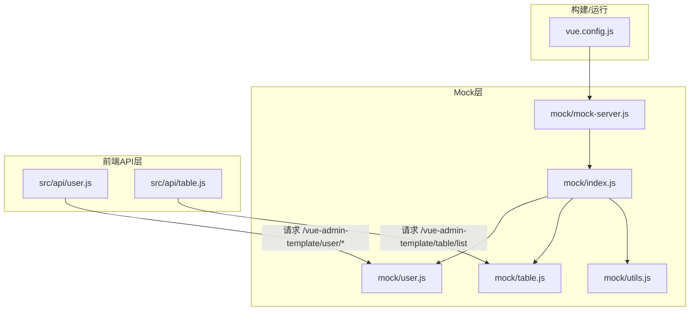
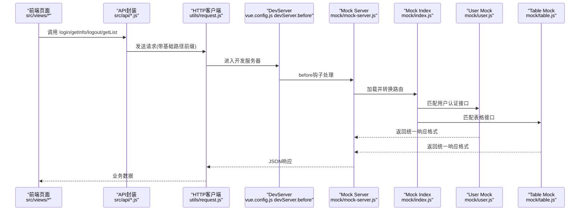
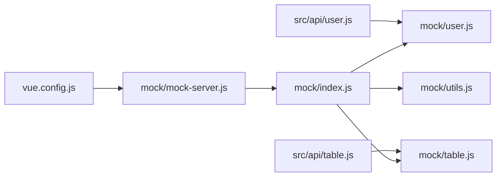

# Mock数据服务

<cite>
**本文引用的文件**   
- [mock/index.js](file://mock/index.js)
- [mock/mock-server.js](file://mock/mock-server.js)
- [mock/user.js](file://mock/user.js)
- [mock/table.js](file://mock/table.js)
- [mock/utils.js](file://mock/utils.js)
- [src/api/user.js](file://src/api/user.js)
- [src/api/table.js](file://src/api/table.js)
- [vue.config.js](file://vue.config.js)
</cite>

## 目录
1. [简介](#简介)
2. [项目结构](#项目结构)
3. [核心组件](#核心组件)
4. [架构总览](#架构总览)
5. [详细组件分析](#详细组件分析)
6. [依赖关系分析](#依赖关系分析)
7. [性能与体积考量](#性能与体积考量)
8. [故障排查指南](#故障排查指南)
9. [结论](#结论)
10. [附录：最佳实践与调试技巧](#附录最佳实践与调试技巧)

## 简介
本文件面向使用 Vue Admin Template 的开发者，系统化说明项目中 Mock 数据服务的配置、启动方式、接口定义与开发集成方法。重点包括：
- 如何使用 MockJS 模拟用户认证与数据表格接口
- mock-server.js 的启动流程与热重载机制
- user.js 与 table.js 中定义的模拟数据结构与方法
- param2Obj 工具函数的作用与使用场景
- 在生产环境禁用 Mock 的配置建议
- 调试技巧与常见问题定位

## 项目结构
Mock 相关代码集中在 mock 目录下，前端 API 调用在 src/api 下，开发服务器在 vue.config.js 中注入 Mock 中间件。

图表来源
- [vue.config.js:32-40](file://vue.config.js#L32-L40)
- [mock/mock-server.js:9-24](file://mock/mock-server.js#L9-L24)
- [mock/index.js:1-10](file://mock/index.js#L1-L10)
- [src/api/user.js:1-25](file://src/api/user.js#L1-L25)
- [src/api/table.js:1-10](file://src/api/table.js#L1-L10)

章节来源
- [vue.config.js:32-40](file://vue.config.js#L32-L40)
- [mock/mock-server.js:1-82](file://mock/mock-server.js#L1-L82)
- [mock/index.js:1-58](file://mock/index.js#L1-L58)

## 核心组件
- mock/index.js：聚合所有 Mock 路由，提供两种接入方式（浏览器端 XHR 拦截与 Express 中间件）
- mock/mock-server.js：Express 中间件，注册路由、解析请求体、支持热重载
- mock/user.js：用户登录、获取用户信息、登出等认证相关接口
- mock/table.js：数据表格列表接口，基于 MockJS 生成随机数据
- mock/utils.js：URL 查询参数解析工具 param2Obj
- src/api/user.js 与 src/api/table.js：前端调用的 API 封装，对应后端路径与请求方法

章节来源
- [mock/index.js:1-58](file://mock/index.js#L1-L58)
- [mock/mock-server.js:1-82](file://mock/mock-server.js#L1-L82)
- [mock/user.js:1-85](file://mock/user.js#L1-L85)
- [mock/table.js:1-30](file://mock/table.js#L1-L30)
- [mock/utils.js:1-26](file://mock/utils.js#L1-L26)
- [src/api/user.js:1-25](file://src/api/user.js#L1-L25)
- [src/api/table.js:1-10](file://src/api/table.js#L1-L10)

## 架构总览
下图展示了从前端发起请求到 Mock 返回数据的完整链路，以及开发服务器的注入点。

图表来源
- [vue.config.js:32-40](file://vue.config.js#L32-L40)
- [mock/mock-server.js:35-44](file://mock/mock-server.js#L35-L44)
- [mock/index.js:48-50](file://mock/index.js#L48-L50)
- [mock/user.js:26-84](file://mock/user.js#L26-L84)
- [mock/table.js:14-29](file://mock/table.js#L14-L29)

## 详细组件分析

### 1) mock/index.js：Mock 路由聚合与XHR拦截
- 功能要点
  - 合并 user.js 与 table.js 的 Mock 路由数组
  - 提供 mockXHR 函数，用于在浏览器端通过重写 XMLHttpRequest.send 的方式拦截请求
  - 将每个 Mock 路由包装为可被 MockJS 处理的规则，并通过正则匹配 URL
  - 将 Express 风格的回调适配为 MockJS 所需的响应格式

- 关键流程
  - 遍历 mocks 数组，对每条路由执行 Mock.mock(url, method, handler)
  - 在 XHR 拦截时，将 withCredentials、responseType 等属性透传给自定义 xhr
  - 将 Express 风格回调的参数转换为 {method, body, query}，其中 query 由 param2Obj 解析

- 复杂度与注意事项
  - 正则匹配 URL，注意避免过于宽泛的正则导致误匹配
  - 浏览器端 XHR 拦截可能影响第三方库（如进度事件），需谨慎启用

章节来源
- [mock/index.js:1-58](file://mock/index.js#L1-L58)

### 2) mock/mock-server.js：Express 中间件与热重载
- 功能要点
  - 使用 body-parser 解析 JSON 与表单请求体
  - registerRoutes 动态加载 mock/index.js 中的路由，并挂载到 Express app
  - responseFake 将每条 Mock 路由包装为 Express 处理器，统一输出 JSON
  - 使用 chokidar 监听 mock 目录变化，实现热重载：移除旧路由栈、清理 require.cache、重新注册路由

- 关键流程
  - 初始化时注册所有 Mock 路由，记录路由索引范围
  - 监听文件变更，自动重建路由并打印热重载日志

- 环境变量
  - 使用 process.env.VUE_APP_BASE_API 作为基础路径前缀，拼接后生成正则表达式匹配 URL

章节来源
- [mock/mock-server.js:1-82](file://mock/mock-server.js#L1-L82)

### 3) mock/user.js：用户认证接口
- 提供的接口
  - POST /vue-admin-template/user/login：根据用户名返回固定 token；未匹配时返回错误码
  - GET /vue-admin-template/user/info.*：根据 token 查询用户信息；token 无效时返回错误码
  - POST /vue-admin-template/user/logout：返回成功响应

- 数据结构
  - tokens：用户名到 token 的映射
  - users：token 到用户信息的映射（包含 roles、avatar、name、introduction 等字段）

- 错误处理
  - 登录失败返回 code=60204
  - 获取用户信息失败返回 code=50008

章节来源
- [mock/user.js:1-85](file://mock/user.js#L1-L85)

### 4) mock/table.js：数据表格接口
- 提供的接口
  - GET /vue-admin-template/table/list：返回分页结构 {total, items}，items 由 MockJS 生成

- 数据生成
  - 使用 Mock.mock 模板生成 30 条记录，包含 id、title、status、author、display_time、pageviews 等字段
  - status 为枚举值之一：published、draft、deleted

章节来源
- [mock/table.js:1-30](file://mock/table.js#L1-L30)

### 5) mock/utils.js：param2Obj 工具函数
- 作用
  - 将 URL 查询字符串解析为对象，例如 ?a=1&b=2 => {a:"1", b:"2"}
  - 处理 + 号转空格、忽略无参情况

- 使用场景
  - 在浏览器端 XHR 拦截时，将 URL 中的查询参数解析为 query 对象，便于 Mock 回调读取

章节来源
- [mock/utils.js:1-26](file://mock/utils.js#L1-L26)

### 6) 前端 API 封装：src/api/user.js 与 src/api/table.js
- 职责
  - 封装统一的请求调用，指定方法与 URL
  - 与 Mock 路由一一对应，确保前后端联调一致性

- 关键点
  - 所有请求均带有基础路径前缀 /vue-admin-template，需与 Mock 路由保持一致
  - getInfo 通过 params 传递 token，logout 无需参数

章节来源
- [src/api/user.js:1-25](file://src/api/user.js#L1-L25)
- [src/api/table.js:1-10](file://src/api/table.js#L1-L10)

## 依赖关系分析
- 模块耦合
  - mock/mock-server.js 依赖 mock/index.js 暴露的 mocks 数组
  - mock/index.js 依赖 mock/user.js、mock/table.js 与 mock/utils.js
  - 前端 API 仅依赖 HTTP 客户端与 Mock 路由路径约定

- 外部依赖
  - MockJS：用于数据模板与响应格式化
  - body-parser：解析请求体
  - chokidar：监听文件变更实现热重载

图表来源
- [vue.config.js:32-40](file://vue.config.js#L32-L40)
- [mock/mock-server.js:9-24](file://mock/mock-server.js#L9-L24)
- [mock/index.js:1-10](file://mock/index.js#L1-L10)
- [src/api/user.js:1-25](file://src/api/user.js#L1-L25)
- [src/api/table.js:1-10](file://src/api/table.js#L1-L10)

章节来源
- [vue.config.js:32-40](file://vue.config.js#L32-L40)
- [mock/mock-server.js:1-82](file://mock/mock-server.js#L1-L82)
- [mock/index.js:1-58](file://mock/index.js#L1-L58)

## 性能与体积考量
- 浏览器端 XHR 拦截（mock/index.js 的 mockXHR）会重写 XMLHttpRequest，可能影响第三方库的事件与行为，建议在开发环境谨慎使用，生产环境务必禁用
- Express 中间件模式（mock/mock-server.js）仅在 devServer.before 中启用，不影响生产构建产物
- MockJS 生成的随机数据会增加初始包体，但通常影响较小；若关注首屏体积，可在生产构建中排除 Mock 相关模块

[本节为通用指导，不直接分析具体文件]

## 故障排查指南
- 问题：登录或获取用户信息返回错误码
  - 检查传入的用户名是否在 tokens 中存在
  - 检查 token 是否有效且存在于 users 映射中
  - 参考错误码：登录失败 60204，获取用户信息失败 50008

- 问题：请求未命中 Mock 路由
  - 确认前端请求 URL 是否以 /vue-admin-template 开头
  - 确认请求方法与路径是否与 Mock 定义一致
  - 检查 devServer.before 是否正确注入 mock/mock-server.js

- 问题：热重载未生效
  - 确认 chokidar 监听的目录为 mock 目录
  - 检查文件修改后控制台是否输出热重载日志
  - 必要时重启开发服务器

章节来源
- [mock/user.js:26-84](file://mock/user.js#L26-L84)
- [mock/mock-server.js:58-80](file://mock/mock-server.js#L58-L80)
- [vue.config.js:32-40](file://vue.config.js#L32-L40)

## 结论
本项目通过 MockJS 与 Express 中间件实现了完整的 Mock 数据服务，覆盖用户认证与数据表格两大常用场景。开发环境下，devServer.before 注入 mock-server.js，配合 chokidar 实现热重载；浏览器端可通过 mockXHR 进行 XHR 拦截。前端 API 与 Mock 路由保持严格一致，便于联调与测试。生产环境建议关闭 Mock，确保真实后端接口的稳定性与安全性。

[本节为总结性内容，不直接分析具体文件]

## 附录：最佳实践与调试技巧
- 接口契约优先
  - 先定义 Mock 路由与响应结构，再实现前端 API 与视图逻辑，保证前后端并行开发
- 统一响应格式
  - 所有 Mock 接口返回统一结构（如 code、data、message），便于前端统一处理
- 命名与路径规范
  - 前端 API 与 Mock 路由保持一致的前缀与路径，避免路径漂移
- 调试技巧
  - 在 mock/mock-server.js 中打印请求路径，快速定位未命中路由
  - 使用浏览器网络面板查看请求与响应，核对参数与状态码
  - 利用 console.log 在 Mock 回调中打印入参与返回值，辅助验证逻辑
- 禁用 Mock 的生产配置
  - 确保生产构建不包含 mock/mock-server.js 与 mock/index.js
  - 在构建配置中排除 Mock 相关模块，避免污染生产包体
  - 校验环境变量与基础路径配置，确保生产环境不会误用 Mock 路径

[本节为通用指导，不直接分析具体文件]