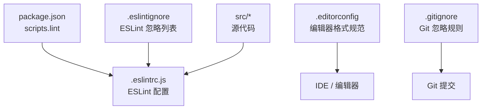
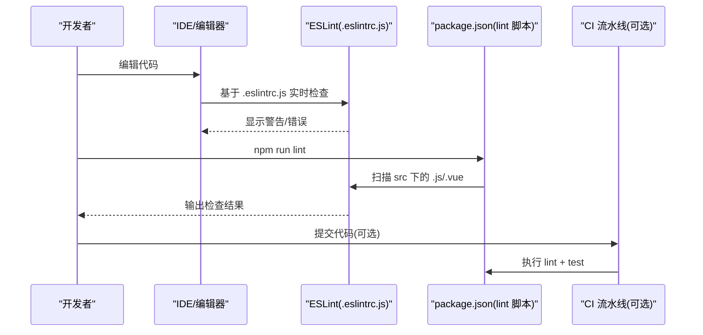
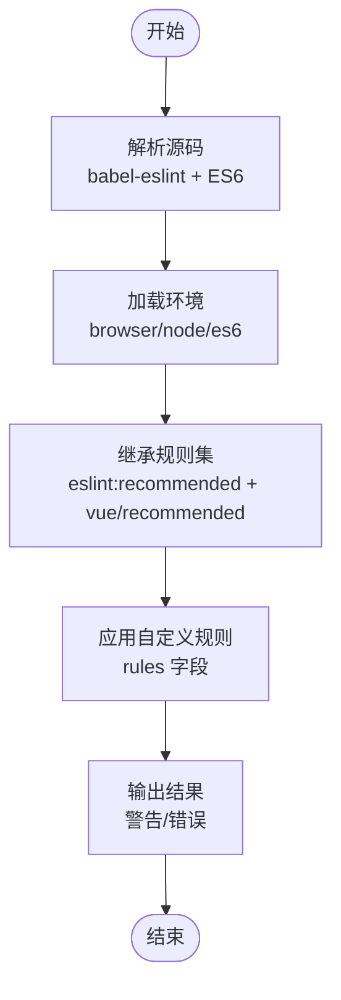
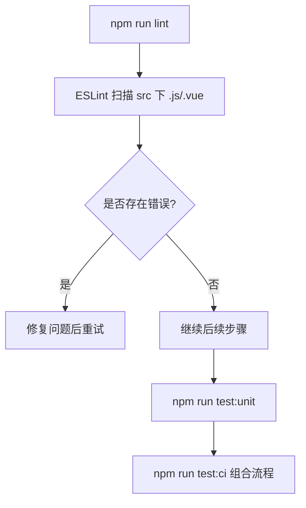
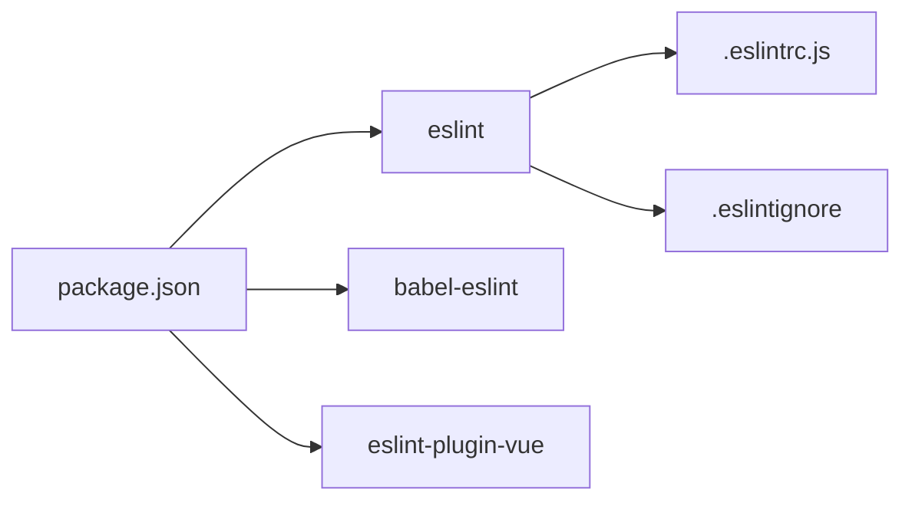

# 代码质量工具

<cite>
**本文引用的文件**   
- [.eslintrc.js](file://.eslintrc.js)
- [.editorconfig](file://.editorconfig)
- [.gitignore](file://.gitignore)
- [package.json](file://package.json)
- [.eslintignore](file://.eslintignore)
</cite>

## 目录
1. [简介](#简介)
2. [项目结构](#项目结构)
3. [核心组件](#核心组件)
4. [架构总览](#架构总览)
5. [详细组件分析](#详细组件分析)
6. [依赖关系分析](#依赖关系分析)
7. [性能与效率](#性能与效率)
8. [故障排查指南](#故障排查指南)
9. [结论](#结论)
10. [附录](#附录)

## 简介
本文件面向团队在 Vue 管理后台模板项目中落地代码质量规范，覆盖以下主题：
- ESLint 规则配置与自定义规则扩展方法
- .editorconfig 代码格式规范（缩进、换行符、编码等）
- .gitignore 忽略规则说明
- 代码检查命令与自动化集成方案
- ESLint 警告/错误的处理流程
- IDE 集成与实时代码检查设置

## 项目结构
本项目将代码质量相关配置集中在根目录的若干配置文件中，便于统一管理与团队协作：
- .eslintrc.js：ESLint 主配置，包含解析器、环境、继承的规则集与自定义规则
- .editorconfig：编辑器统一格式规范
- .eslintignore：ESLint 扫描时忽略的文件/目录
- .gitignore：Git 版本控制忽略规则
- package.json：脚本入口，提供 lint 命令与测试脚本

**图表来源**
- [package.json:6-14](file://package.json#L6-L14)
- [.eslintrc.js:1-199](file://.eslintrc.js#L1-L199)
- [.editorconfig:1-15](file://.editorconfig#L1-L15)
- [.eslintignore:1-5](file://.eslintignore#L1-L5)
- [.gitignore:1-20](file://.gitignore#L1-L20)

**章节来源**
- [package.json:6-14](file://package.json#L6-L14)
- [.eslintrc.js:1-199](file://.eslintrc.js#L1-L199)
- [.editorconfig:1-15](file://.editorconfig#L1-L15)
- [.eslintignore:1-5](file://.eslintignore#L1-L5)
- [.gitignore:1-20](file://.gitignore#L1-L20)

## 核心组件
- ESLint 配置中心：通过 .eslintrc.js 集中定义解析器、运行环境与规则集，并扩展 Vue 推荐规则。
- 编辑器格式规范：通过 .editorconfig 统一缩进、换行、编码等基础格式。
- 忽略策略：通过 .eslintignore 与 .gitignore 分别控制 ESLint 扫描范围与 Git 提交内容。
- 命令与自动化：通过 package.json scripts 暴露 lint 命令，并可组合为 CI 流水线。

**章节来源**
- [.eslintrc.js:1-199](file://.eslintrc.js#L1-L199)
- [.editorconfig:1-15](file://.editorconfig#L1-L15)
- [.eslintignore:1-5](file://.eslintignore#L1-L5)
- [.gitignore:1-20](file://.gitignore#L1-L20)
- [package.json:6-14](file://package.json#L6-L14)

## 架构总览
下图展示从开发者到构建产物的代码质量检查链路：开发者编写代码 → IDE 实时检查 → 本地执行 lint 命令 → 可选地接入 CI 进行强制检查。

**图表来源**
- [package.json:6-14](file://package.json#L6-L14)
- [.eslintrc.js:1-199](file://.eslintrc.js#L1-L199)

## 详细组件分析

### ESLint 规则配置与自定义规则
- 解析与环境
  - 使用 babel-eslint 作为解析器，启用 ES6 语法支持。
  - 同时开启浏览器与 Node 环境，兼容前端与部分脚本逻辑。
- 规则继承
  - 继承 eslint:recommended 与 vue/recommended，获得基础 JS 与 Vue 最佳实践。
- 关键规则要点（示例性说明）
  - 缩进与空格：统一缩进为 2 空格；对象/数组括号内空格控制；逗号风格固定。
  - 语句风格：禁止分号；单引号字符串；大括号风格 1tbs；函数前不留空格。
  - 变量与常量：prefer-const；no-unused-vars 严格限制未使用变量。
  - 比较与类型：eqeqeq 强制全等；use-isnan；valid-typeof。
  - Vue 特定：组件名 PascalCase；属性数量限制；关闭某些换行规则以适配团队风格。
- 自定义规则扩展方式
  - 直接在 rules 字段中添加或覆盖规则项。
  - 如需复用规则集，可拆分为多个配置文件并通过 extends 引用。
  - 针对 Vue SFC 的额外规则可通过 eslint-plugin-vue 提供的命名空间规则进行细化。

**图表来源**
- [.eslintrc.js:1-199](file://.eslintrc.js#L1-L199)

**章节来源**
- [.eslintrc.js:1-199](file://.eslintrc.js#L1-L199)

### .editorconfig 编辑器格式规范
- 全局设置
  - 字符集：UTF-8
  - 缩进：空格，2 个空格
  - 换行符：LF
  - 文件末尾插入新行：开启
  - 去除尾部空白：开启
- Markdown 特例
  - 对 *.md 文件关闭“末尾插入新行”和“去除尾部空白”，避免文档仓库差异。

建议
- 所有成员在 IDE 中启用 EditorConfig 支持，确保本地格式化一致。
- 若存在历史遗留文件，可在提交前用编辑器批量格式化。

**章节来源**
- [.editorconfig:1-15](file://.editorconfig#L1-L15)

### .eslintignore 忽略规则
- 忽略 build/*.js、src/assets、public、dist 等目录/文件，减少无关扫描开销。
- 建议
  - 新增生成文件或第三方资源目录时，及时更新 .eslintignore。
  - 保持最小化忽略范围，避免误跳过业务代码。

**章节来源**
- [.eslintignore:1-5](file://.eslintignore#L1-L5)

### .gitignore 忽略规则
- 忽略 node_modules、dist、.tools、各类日志、package-lock.json、单元测试覆盖率等。
- 忽略常见 IDE 配置目录，避免污染仓库。
- 建议
  - 新增本地运行产物或临时目录时，同步加入 .gitignore。
  - 谨慎对待 package-lock.json 的忽略策略，结合团队发布流程决定。

**章节来源**
- [.gitignore:1-20](file://.gitignore#L1-L20)

### 代码检查命令与自动化集成
- 本地命令
  - npm run lint：对 src 目录下 .js/.vue 执行 ESLint 检查。
- 测试与 CI
  - npm run test:unit：运行 Jest 单元测试。
  - npm run test:ci：先执行 lint，再执行单元测试，适合 CI 环境。
- 自动化建议
  - 在 CI 中执行 npm run test:ci，保证代码质量与测试双保险。
  - 可结合 husky + lint-staged 实现提交前仅检查变更文件，提升体验。

**图表来源**
- [package.json:6-14](file://package.json#L6-L14)

**章节来源**
- [package.json:6-14](file://package.json#L6-L14)

### 如何处理 ESLint 警告与错误
- 快速定位
  - 根据终端输出的文件路径与行号，打开对应文件查看具体规则提示。
- 分类处理
  - 样式类（如缩进、引号、分号）：优先使用编辑器自动格式化或 ESLint --fix。
  - 语义类（如未使用变量、比较方式）：修正代码逻辑或补充必要注释。
  - Vue 特定（如组件命名、属性数量）：按团队约定调整组件结构与模板写法。
- 规则调优
  - 若确需放宽某条规则，可在 .eslintrc.js 的 rules 中调整级别或参数。
  - 对个别文件/行的例外，可使用行内注释指令（例如 eslint-disable-line）。
- 验证修复
  - 修改后再次执行 npm run lint，确保无新增错误。

**章节来源**
- [.eslintrc.js:1-199](file://.eslintrc.js#L1-L199)
- [package.json:6-14](file://package.json#L6-L14)

### IDE 集成与实时代码检查
- VS Code
  - 安装 ESLint 插件，并在设置中启用“保存时自动修复”。
  - 确保已安装项目依赖（node_modules），以便插件正确读取 .eslintrc.js。
- WebStorm / IntelliJ IDEA
  - 在 Settings → Languages & Frameworks → JavaScript → Code Quality Tools → ESLint 中，选择项目根目录的 ESLint 包与配置文件。
- 通用要点
  - 启用 EditorConfig 支持，保证编辑器行为与 .editorconfig 一致。
  - 若出现规则不生效，检查是否使用了正确的 ESLint 版本与配置文件路径。

[本节为通用指导，不涉及具体源码文件]

## 依赖关系分析
- ESLint 生态依赖
  - eslint：核心检查引擎
  - babel-eslint：JS 解析器
  - eslint-plugin-vue：Vue 规则支持
- 脚本依赖
  - scripts.lint 调用 eslint 对 src 目录进行检查
  - scripts.test:* 组合测试与检查流程

**图表来源**
- [package.json:28-51](file://package.json#L28-L51)
- [.eslintrc.js:1-199](file://.eslintrc.js#L1-L199)
- [.eslintignore:1-5](file://.eslintignore#L1-L5)

**章节来源**
- [package.json:28-51](file://package.json#L28-L51)
- [.eslintrc.js:1-199](file://.eslintrc.js#L1-L199)
- [.eslintignore:1-5](file://.eslintignore#L1-L5)

## 性能与效率
- 缩小扫描范围：通过 .eslintignore 排除生成目录与静态资源，减少无效扫描。
- 增量检查：结合 husky + lint-staged，仅对变更文件执行 ESLint，缩短反馈时间。
- 并行与缓存：ESLint 默认具备一定缓存能力；在大型仓库中可考虑升级 ESLint 与插件以获得更好性能。
- 编辑器优化：在 IDE 中按需禁用不必要的规则或延迟非关键检查，提升编辑流畅度。

[本节为通用指导，不涉及具体源码文件]

## 故障排查指南
- 现象：npm run lint 报错找不到模块或规则
  - 排查：确认已执行依赖安装；检查 .eslintrc.js 中 parser 与 plugin 是否正确引用。
- 现象：IDE 中 ESLint 不生效
  - 排查：确认 IDE 已指向项目 ESLint 包与配置文件；重启 IDE 或重载窗口。
- 现象：格式化不一致
  - 排查：确认 EditorConfig 已启用；检查编辑器缩进与换行设置是否与 .editorconfig 一致。
- 现象：CI 失败但本地通过
  - 排查：确认 CI 与本地 ESLint 版本一致；检查环境变量差异导致规则开关不同。

**章节来源**
- [.eslintrc.js:1-199](file://.eslintrc.js#L1-L199)
- [.editorconfig:1-15](file://.editorconfig#L1-L15)
- [package.json:6-14](file://package.json#L6-L14)

## 结论
通过将 ESLint 规则、编辑器格式与忽略策略集中管理，并结合脚本命令与 CI 流程，本项目实现了从开发到提交的端到端代码质量保障。建议在团队内推广以下实践：
- 统一使用 .editorconfig 与 ESLint 规则
- 在 IDE 中启用实时检查与保存修复
- 在 CI 中强制执行 lint 与测试
- 持续优化规则与忽略策略，平衡规范性与开发效率

[本节为总结性内容，不涉及具体源码文件]

## 附录
- 常用命令速查
  - npm run lint：执行 ESLint 检查
  - npm run test:unit：运行单元测试
  - npm run test:ci：执行 lint + 单元测试（适合 CI）

**章节来源**
- [package.json:6-14](file://package.json#L6-L14)