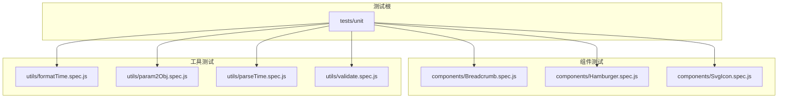
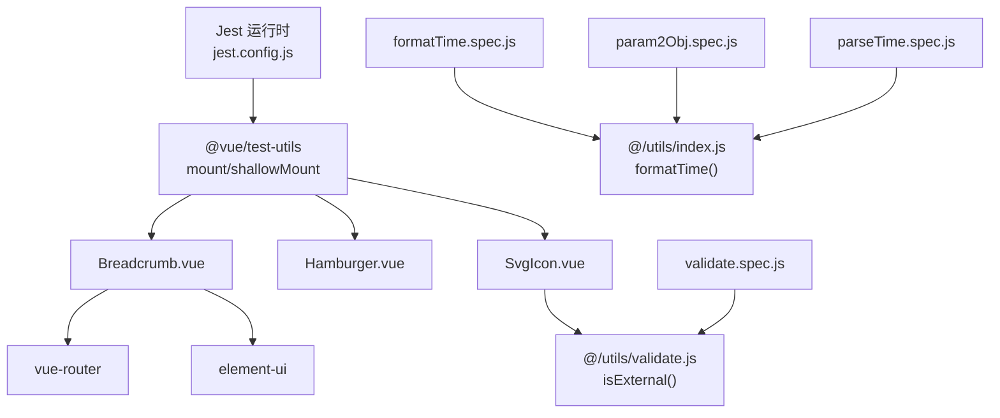
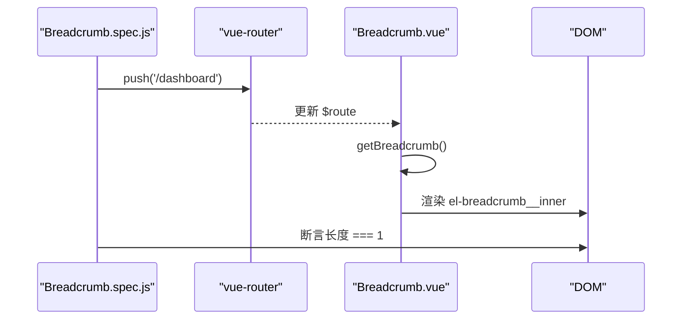
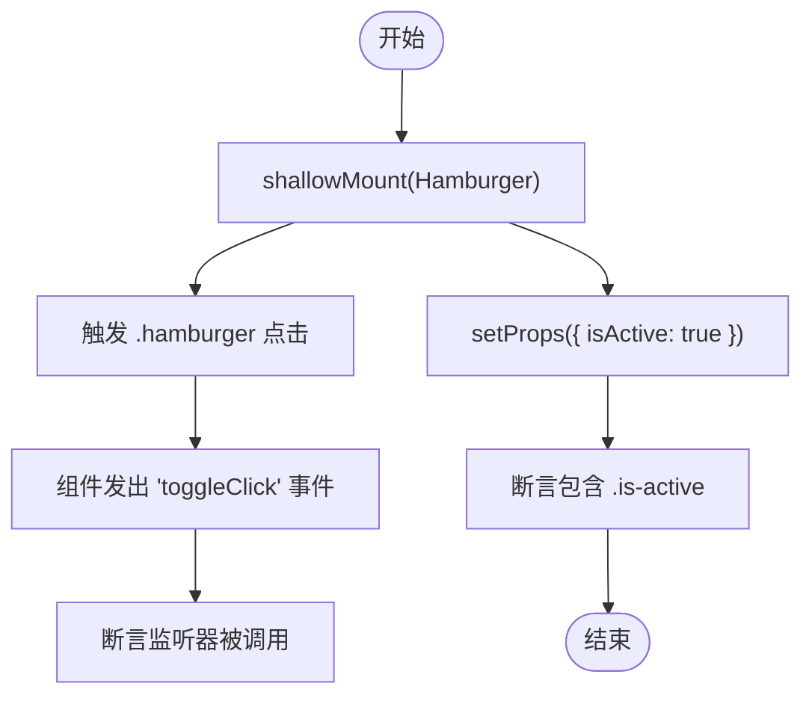
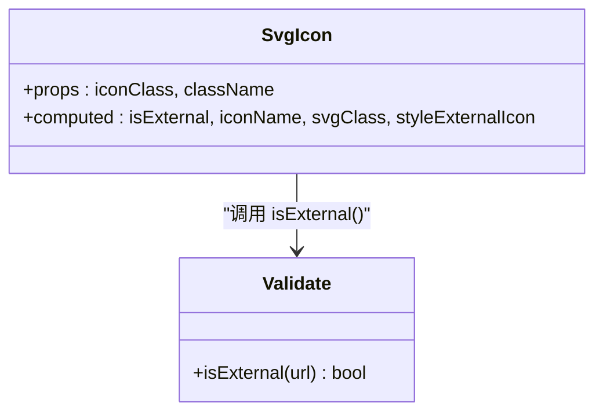
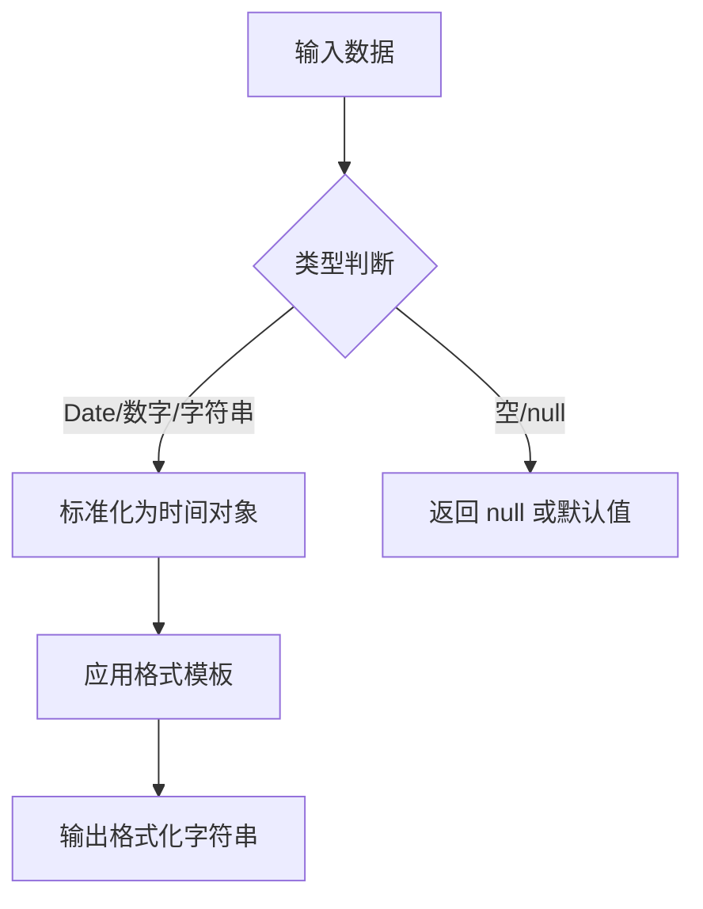
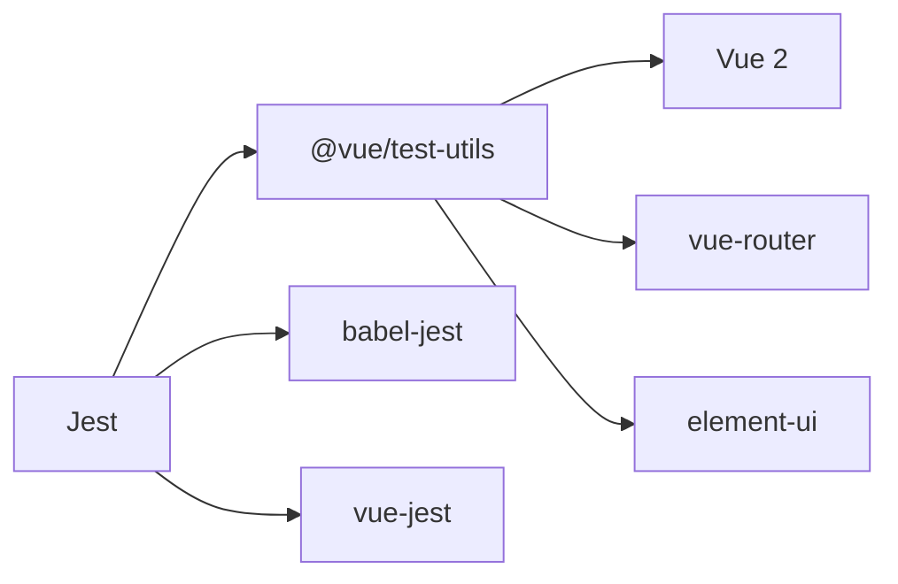

# 单元测试

<cite>
**本文引用的文件**   
- [jest.config.js](file://jest.config.js)
- [package.json](file://package.json)
- [.eslintrc.js（测试目录）](file://tests/unit/.eslintrc.js)
- [Breadcrumb/index.vue](file://src/components/Breadcrumb/index.vue)
- [Hamburger/index.vue](file://src/components/Hamburger/index.vue)
- [SvgIcon/index.vue](file://src/components/SvgIcon/index.vue)
- [Breadcrumb.spec.js](file://tests/unit/components/Breadcrumb.spec.js)
- [Hamburger.spec.js](file://tests/unit/components/Hamburger.spec.js)
- [SvgIcon.spec.js](file://tests/unit/components/SvgIcon.spec.js)
- [formatTime.spec.js](file://tests/unit/utils/formatTime.spec.js)
- [param2Obj.spec.js](file://tests/unit/utils/param2Obj.spec.js)
- [parseTime.spec.js](file://tests/unit/utils/parseTime.spec.js)
- [validate.spec.js](file://tests/unit/utils/validate.spec.js)
</cite>

## 目录
1. [简介](#简介)
2. [项目结构](#项目结构)
3. [核心组件与测试入口](#核心组件与测试入口)
4. [架构总览](#架构总览)
5. [详细组件分析](#详细组件分析)
6. [依赖关系分析](#依赖关系分析)
7. [性能与可维护性建议](#性能与可维护性建议)
8. [故障排查指南](#故障排查指南)
9. [结论](#结论)
10. [附录：运行与覆盖率](#附录运行与覆盖率)

## 简介
本文件面向使用 Jest + @vue/test-utils 的 Vue 2 项目的单元测试实践，围绕以下目标展开：
- 解释 Jest 配置选项与测试环境设置
- 详解组件测试编写方法（Breadcrumb、Hamburger、SvgIcon）
- 说明工具函数测试最佳实践（formatTime、param2Obj、parseTime、validate）
- 提供测试覆盖率配置与报告生成方式
- 覆盖异步测试、事件模拟、DOM 操作等高级技巧
- 指导如何运行测试并查看结果

## 项目结构
本项目将测试代码集中在 tests/unit 目录下，按功能域组织为 components 与 utils 两个子目录。Jest 通过 jest.config.js 统一配置模块解析、转换器、匹配规则与覆盖率收集范围。

图表来源
- [jest.config.js:13-17](file://jest.config.js#L13-L17)

章节来源
- [jest.config.js:1-24](file://jest.config.js#L1-L24)
- [package.json:6-14](file://package.json#L6-L14)

## 核心组件与测试入口
- Breadcrumb 组件：根据路由元信息渲染面包屑导航，支持 Dashboard 前缀、重定向与路径编译。
- Hamburger 组件：汉堡菜单图标，点击触发 toggleClick 事件，支持 isActive 控制样式。
- SvgIcon 组件：统一 SVG 图标渲染，区分外部链接与内部 symbol 引用，透传 listeners。

对应测试用例：
- Breadcrumb.spec.js：基于真实路由表断言不同层级下的面包屑数量与最后一个项是否可点击。
- Hamburger.spec.js：监听自定义事件与 props 驱动的类名变化。
- SvgIcon.spec.js：校验 iconClass 到 #icon-xxx 的映射以及 className 合并逻辑。

章节来源
- [Breadcrumb/index.vue:1-63](file://src/components/Breadcrumb/index.vue#L1-L63)
- [Hamburger/index.vue:1-30](file://src/components/Hamburger/index.vue#L1-L30)
- [SvgIcon/index.vue:1-45](file://src/components/SvgIcon/index.vue#L1-L45)
- [Breadcrumb.spec.js:1-99](file://tests/unit/components/Breadcrumb.spec.js#L1-L99)
- [Hamburger.spec.js:1-19](file://tests/unit/components/Hamburger.spec.js#L1-L19)
- [SvgIcon.spec.js:1-23](file://tests/unit/components/SvgIcon.spec.js#L1-L23)

## 架构总览
下图展示测试框架、Vue 组件与工具函数之间的交互关系，以及测试执行时的关键依赖。

图表来源
- [jest.config.js:1-11](file://jest.config.js#L1-L11)
- [Breadcrumb/index.vue:12-14](file://src/components/Breadcrumb/index.vue#L12-L14)
- [SvgIcon/index.vue:8-10](file://src/components/SvgIcon/index.vue#L8-L10)
- [package.json:31-33](file://package.json#L31-L33)

## 详细组件分析

### Breadcrumb 组件测试
- 测试要点
  - 在 dashboard 路由下仅显示一个面包屑项
  - 普通路由与嵌套路由下面包屑项数量正确
  - 缺少 meta.title 的路由被过滤
  - 最后一个面包屑项不可点击（无 a 标签）
- 实现思路
  - 使用 createLocalVue 挂载 vue-router 与 element-ui
  - 构造 routes 树，通过 router.push 切换路由后断言 DOM 节点数量
  - 对最后一个项进行 contains('a') 判断，确保其不可跳转
- 注意事项
  - 路由变更后需等待 Vue 更新完成后再断言（当前用例中直接断言，通常足够）
  - 如需断言点击行为，可 mock $router.push 并验证调用参数

图表来源
- [Breadcrumb.spec.js:53-62](file://tests/unit/components/Breadcrumb.spec.js#L53-L62)
- [Breadcrumb/index.vue:21-40](file://src/components/Breadcrumb/index.vue#L21-L40)

章节来源
- [Breadcrumb.spec.js:1-99](file://tests/unit/components/Breadcrumb.spec.js#L1-L99)
- [Breadcrumb/index.vue:1-63](file://src/components/Breadcrumb/index.vue#L1-L63)

### Hamburger 组件测试
- 测试要点
  - 点击汉堡图标触发 toggleClick 事件
  - isActive prop 控制 .is-active 类名的存在与否
- 实现思路
  - 使用 shallowMount 隔离子组件
  - 通过 wrapper.vm.$on 监听事件并断言被调用
  - setProps 切换 isActive 后断言类名

图表来源
- [Hamburger.spec.js:4-17](file://tests/unit/components/Hamburger.spec.js#L4-L17)
- [Hamburger/index.vue:17-30](file://src/components/Hamburger/index.vue#L17-L30)

章节来源
- [Hamburger.spec.js:1-19](file://tests/unit/components/Hamburger.spec.js#L1-L19)
- [Hamburger/index.vue:1-45](file://src/components/Hamburger/index.vue#L1-L45)

### SvgIcon 组件测试
- 测试要点
  - iconClass 正确映射为 use 的 href="#icon-xxx"
  - className 属性会追加到 svg 的 class 列表中
- 实现思路
  - shallowMount 传入 propsData
  - 断言 use 元素的 attributes().href
  - 断言 classes() 是否包含传入的 className

图表来源
- [SvgIcon/index.vue:8-45](file://src/components/SvgIcon/index.vue#L8-L45)
- [SvgIcon.spec.js:4-21](file://tests/unit/components/SvgIcon.spec.js#L4-L21)

章节来源
- [SvgIcon.spec.js:1-23](file://tests/unit/components/SvgIcon.spec.js#L1-L23)
- [SvgIcon/index.vue:1-63](file://src/components/SvgIcon/index.vue#L1-L63)

### 工具函数测试最佳实践
- formatTime
  - 覆盖十位时间戳、相对时间（刚刚/分钟前/小时前/天前）、固定日期格式化
  - 注意时区与毫秒精度，必要时注入时间偏移以稳定断言
- param2Obj
  - 校验 URL 查询参数解析，包括 base64 字段与中文解码
- parseTime
  - 覆盖 Date、字符串、十位时间戳、自定义格式、星期几、空值与 null
- validate
  - validUsername 白名单校验
  - isExternal 外链判定（http/https 开头）

图表来源
- [formatTime.spec.js:3-30](file://tests/unit/utils/formatTime.spec.js#L3-L30)
- [parseTime.spec.js:3-35](file://tests/unit/utils/parseTime.spec.js#L3-L35)

章节来源
- [formatTime.spec.js:1-31](file://tests/unit/utils/formatTime.spec.js#L1-L31)
- [param2Obj.spec.js:1-15](file://tests/unit/utils/param2Obj.spec.js#L1-L15)
- [parseTime.spec.js:1-36](file://tests/unit/utils/parseTime.spec.js#L1-L36)
- [validate.spec.js:1-18](file://tests/unit/utils/validate.spec.js#L1-L18)

## 依赖关系分析
- 测试框架与插件
  - Jest 作为测试运行器
  - @vue/test-utils 提供 mount/shallowMount
  - babel-jest 处理 JS/JSX
  - vue-jest 处理 .vue 单文件组件
  - jest-transform-stub 忽略样式与静态资源
- 第三方库
  - vue-router 用于路由驱动的面包屑测试
  - element-ui 用于面包屑 UI 组件
  - path-to-regexp 用于路径编译（组件内部依赖）

图表来源
- [package.json:28-33](file://package.json#L28-L33)
- [jest.config.js:3-8](file://jest.config.js#L3-L8)

章节来源
- [package.json:28-51](file://package.json#L28-L51)
- [jest.config.js:1-11](file://jest.config.js#L1-L11)

## 性能与可维护性建议
- 使用 shallowMount 替代 mount 以提升速度，仅在需要完整 DOM 或子组件交互时使用 mount
- 避免在测试中发起真实网络请求，使用 mock 或拦截
- 将公共路由与常量抽取到测试夹具，减少重复
- 对时间相关断言尽量使用固定时间源或可控偏移，提升稳定性
- 保持测试粒度单一：每个 it 只断言一个行为

[本节为通用建议，不直接分析具体文件]

## 故障排查指南
- ESLint 报错 jest 未定义
  - 确认 tests/unit/.eslintrc.js 已启用 env.jest
- 无法解析 @ 别名
  - 检查 moduleNameMapper 是否指向 src 目录
- 样式/静态资源导致构建失败
  - 确认 jest-transform-stub 已配置以忽略 css/scss/svg 等
- 组件渲染为空或断言失败
  - 确认已安装并注册 element-ui 与 vue-router
  - 检查是否需要 await nextTick 或 flushPromises 处理异步更新

章节来源
- [tests/unit/.eslintrc.js:1-6](file://tests/unit/.eslintrc.js#L1-L6)
- [jest.config.js:9-11](file://jest.config.js#L9-L11)
- [jest.config.js:5-8](file://jest.config.js#L5-L8)
- [Breadcrumb.spec.js:6-8](file://tests/unit/components/Breadcrumb.spec.js#L6-L8)

## 结论
本项目采用 Jest + @vue/test-utils 构建了清晰的组件与工具函数测试体系。通过合理的 Jest 配置与分层测试策略，既保证了面包屑、汉堡菜单、SVG 图标等组件的行为正确性，也覆盖了常用工具函数的边界情况。建议在后续迭代中持续完善异步场景与错误分支的覆盖，并逐步引入快照测试与覆盖率门禁。

[本节为总结性内容，不直接分析具体文件]

## 附录：运行与覆盖率

### 运行测试
- 清理缓存并运行单元测试
  - npm run test:unit
- CI 流程（可选）
  - npm run test:ci（先 lint，再运行测试）

章节来源
- [package.json:6-14](file://package.json#L6-L14)

### Jest 配置要点
- 模块扩展与转换器
  - moduleFileExtensions 支持 js/jsx/json/vue
  - transform 分别用 vue-jest、jest-transform-stub、babel-jest
- 别名映射
  - moduleNameMapper 将 @/ 映射到 <rootDir>/src/
- 测试匹配
  - testMatch 匹配 tests/unit/**/*.spec.* 与 __tests__/*
- 覆盖率
  - collectCoverageFrom 指定 src/utils/** 与 src/components/**（排除 auth.js/request.js）
  - coverageDirectory 输出到 tests/unit/coverage
  - coverageReporters 生成 lcov 与 text-summary
- 测试环境
  - testURL 设置为 http://localhost/

章节来源
- [jest.config.js:1-24](file://jest.config.js#L1-L24)

### 覆盖率报告
- 运行命令
  - npm run test:unit -- --coverage
- 查看报告
  - 打开 tests/unit/coverage/lcov-report/index.html
- 常见指标
  - Statements、Branches、Functions、Lines 的覆盖率阈值可在 CI 中配置

章节来源
- [jest.config.js:16-22](file://jest.config.js#L16-L22)