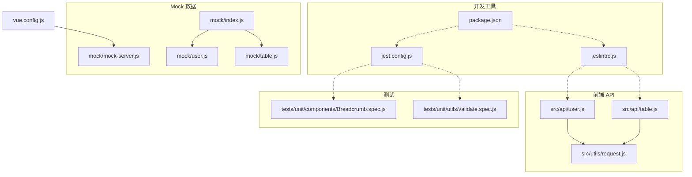
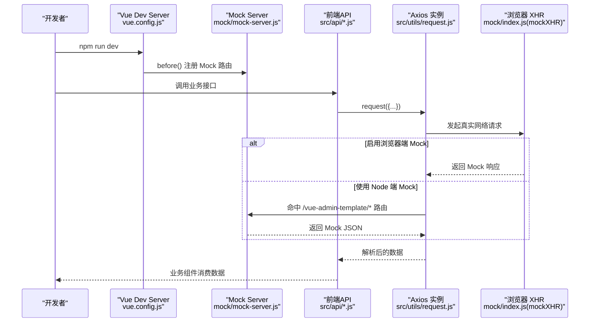
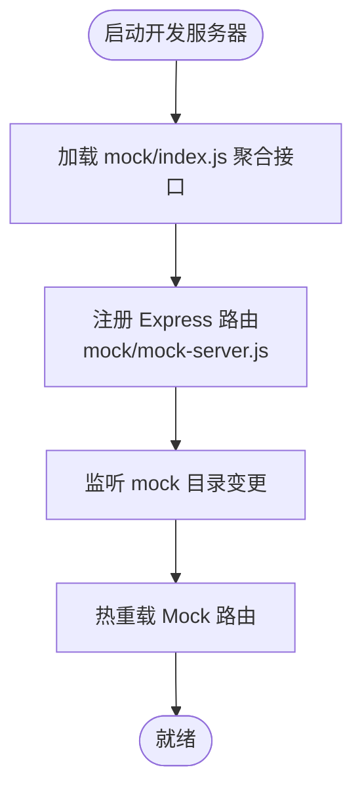
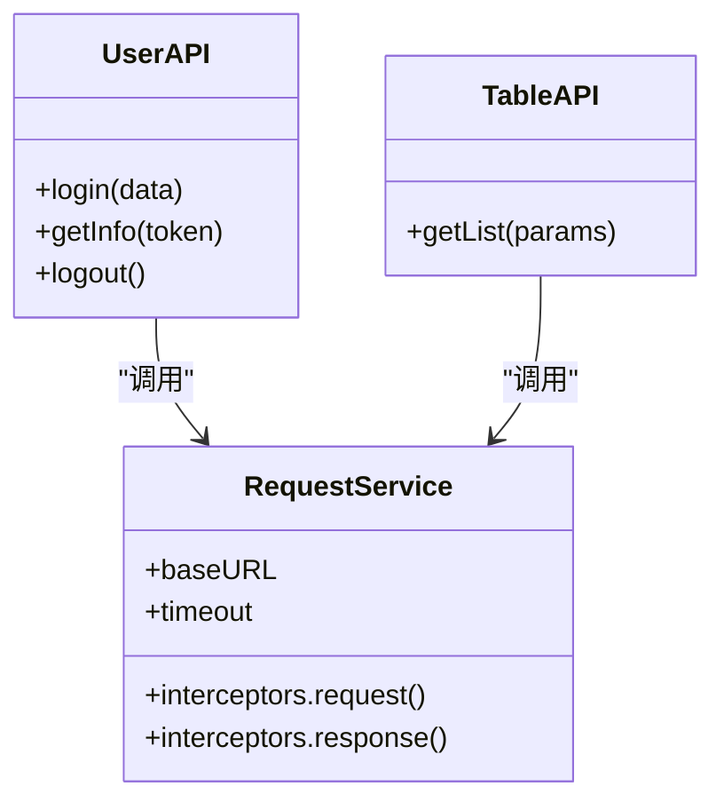
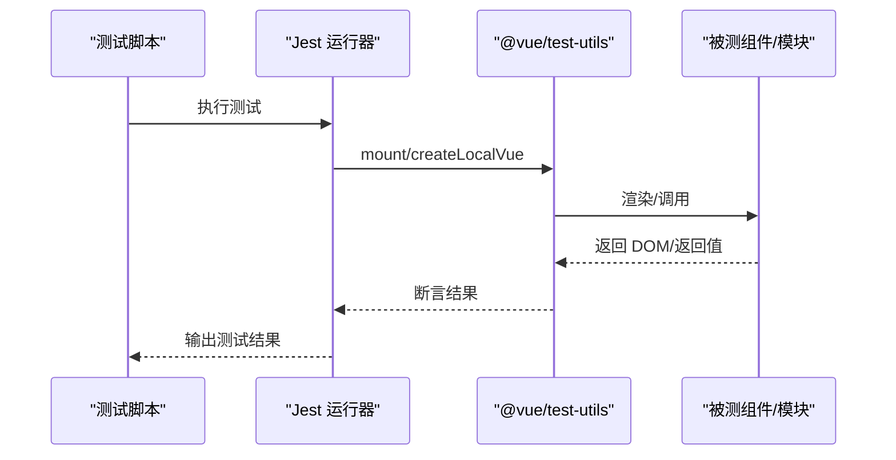
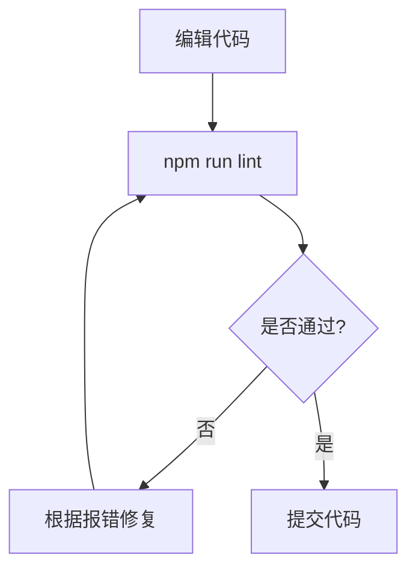
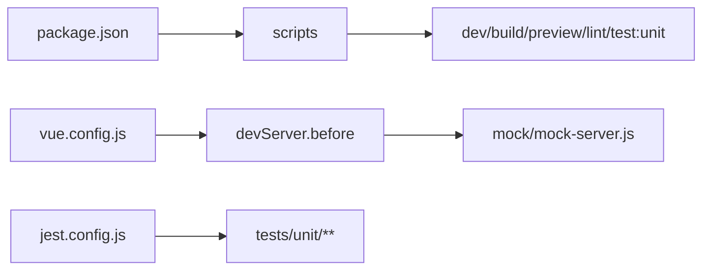

# 开发工具

<cite>
**本文引用的文件**   
- [package.json](file://package.json)
- [jest.config.js](file://jest.config.js)
- [.eslintrc.js](file://.eslintrc.js)
- [mock/index.js](file://mock/index.js)
- [mock/mock-server.js](file://mock/mock-server.js)
- [mock/user.js](file://mock/user.js)
- [mock/table.js](file://mock/table.js)
- [src/api/user.js](file://src/api/user.js)
- [src/api/table.js](file://src/api/table.js)
- [src/utils/request.js](file://src/utils/request.js)
- [vue.config.js](file://vue.config.js)
- [tests/unit/components/Breadcrumb.spec.js](file://tests/unit/components/Breadcrumb.spec.js)
- [tests/unit/utils/validate.spec.js](file://tests/unit/utils/validate.spec.js)
</cite>

## 目录
1. [简介](#简介)
2. [项目结构](#项目结构)
3. [核心组件](#核心组件)
4. [架构总览](#架构总览)
5. [详细组件分析](#详细组件分析)
6. [依赖关系分析](#依赖关系分析)
7. [性能与调试](#性能与调试)
8. [故障排查](#故障排查)
9. [结论](#结论)

## 简介
本仓库是一个基于 Vue 2 + Element UI 的后台管理模板，内置了 Mock 数据服务、Jest 单元测试、ESLint 代码检查等开发辅助工具。本文面向开发者，系统讲解：
- Mock 数据的配置与模拟 API 的实现方式
- Jest 测试框架的配置与测试用例编写指南
- ESLint 规则配置与代码规范检查
- 开发环境调试技巧与性能分析建议

## 项目结构
本项目采用“功能模块 + 工具层”的组织方式：
- mock：Mock 数据定义与服务启动逻辑
- src/api：前端 API 调用封装
- src/utils：通用工具（如请求封装）
- tests/unit：Jest 单元测试
- 根级配置文件：jest.config.js、.eslintrc.js、vue.config.js、package.json

图表来源
- [vue.config.js:32-40](file://vue.config.js#L32-L40)
- [mock/index.js:1-56](file://mock/index.js#L1-L56)
- [mock/mock-server.js:1-81](file://mock/mock-server.js#L1-L81)
- [mock/user.js:1-84](file://mock/user.js#L1-L84)
- [mock/table.js:1-30](file://mock/table.js#L1-L30)
- [src/api/user.js:1-25](file://src/api/user.js#L1-L25)
- [src/api/table.js:1-10](file://src/api/table.js#L1-L10)
- [src/utils/request.js:1-86](file://src/utils/request.js#L1-L86)
- [jest.config.js:1-25](file://jest.config.js#L1-L25)
- [.eslintrc.js:1-199](file://.eslintrc.js#L1-L199)
- [package.json:6-15](file://package.json#L6-L15)

章节来源
- [package.json:6-15](file://package.json#L6-L15)
- [vue.config.js:32-40](file://vue.config.js#L32-L40)

## 核心组件
- Mock 数据服务
  - 通过 mock/index.js 聚合所有接口定义，并暴露 mockXHR 用于浏览器端拦截 XMLHttpRequest
  - 通过 mock/mock-server.js 在 devServer.before 中注册 Express 路由，实现 Node 端 Mock
- 前端 API 封装
  - src/api/* 统一导出业务接口方法，内部使用 src/utils/request.js 的 axios 实例
- 单元测试
  - 基于 Jest + @vue/test-utils，测试用例位于 tests/unit/**
- 代码检查
  - ESLint 规则集中配置于 .eslintrc.js，并通过 package.json scripts 提供 lint 命令

章节来源
- [mock/index.js:1-56](file://mock/index.js#L1-L56)
- [mock/mock-server.js:1-81](file://mock/mock-server.js#L1-L81)
- [src/api/user.js:1-25](file://src/api/user.js#L1-L25)
- [src/api/table.js:1-10](file://src/api/table.js#L1-L10)
- [src/utils/request.js:1-86](file://src/utils/request.js#L1-L86)
- [jest.config.js:1-25](file://jest.config.js#L1-L25)
- [.eslintrc.js:1-199](file://.eslintrc.js#L1-L199)
- [package.json:6-15](file://package.json#L6-L15)

## 架构总览
下图展示了开发时 Mock 数据如何接入前端请求链路，以及测试与代码检查如何参与开发流程。

图表来源
- [vue.config.js:32-40](file://vue.config.js#L32-L40)
- [mock/mock-server.js:1-81](file://mock/mock-server.js#L1-L81)
- [mock/index.js:12-51](file://mock/index.js#L12-L51)
- [src/utils/request.js:1-86](file://src/utils/request.js#L1-L86)
- [src/api/user.js:1-25](file://src/api/user.js#L1-L25)
- [src/api/table.js:1-10](file://src/api/table.js#L1-L10)

## 详细组件分析

### Mock 数据服务
- 接口定义
  - user.js：登录、获取用户信息、登出等接口，包含成功与失败分支
  - table.js：表格列表接口，使用 Mock.mock 生成随机数据
- 聚合与浏览器端拦截
  - index.js 聚合 user.js 与 table.js 的接口数组，并提供 mockXHR 函数，重写 XMLHttpRequest.send 以拦截请求并返回 Mock 数据
- Node 端 Mock 服务
  - mock-server.js 在 devServer.before 中注入 Express 中间件，解析 body，动态注册路由，支持热更新监听 mock 目录变更

图表来源
- [mock/index.js:1-56](file://mock/index.js#L1-L56)
- [mock/mock-server.js:1-81](file://mock/mock-server.js#L1-L81)

章节来源
- [mock/user.js:1-84](file://mock/user.js#L1-L84)
- [mock/table.js:1-30](file://mock/table.js#L1-L30)
- [mock/index.js:1-56](file://mock/index.js#L1-L56)
- [mock/mock-server.js:1-81](file://mock/mock-server.js#L1-L81)
- [vue.config.js:32-40](file://vue.config.js#L32-L40)

### 前端 API 与请求封装
- 业务 API
  - src/api/user.js：导出 login、getInfo、logout
  - src/api/table.js：导出 getList
- 请求封装
  - src/utils/request.js：创建 axios 实例，设置 baseURL、超时；添加请求/响应拦截器，统一处理鉴权头、错误提示、Token 过期重登等

图表来源
- [src/utils/request.js:1-86](file://src/utils/request.js#L1-L86)
- [src/api/user.js:1-25](file://src/api/user.js#L1-L25)
- [src/api/table.js:1-10](file://src/api/table.js#L1-L10)

章节来源
- [src/api/user.js:1-25](file://src/api/user.js#L1-L25)
- [src/api/table.js:1-10](file://src/api/table.js#L1-L10)
- [src/utils/request.js:1-86](file://src/utils/request.js#L1-L86)

### Jest 单元测试
- 配置要点
  - jest.config.js 定义了 Vue 单文件组件转换、静态资源 stub、别名映射、测试匹配模式、覆盖率收集范围与报告格式
- 测试示例
  - tests/unit/components/Breadcrumb.spec.js：挂载组件、注入 Router/ElementUI，断言不同路由下的面包屑数量
  - tests/unit/utils/validate.spec.js：校验工具函数的输入输出

图表来源
- [jest.config.js:1-25](file://jest.config.js#L1-L25)
- [tests/unit/components/Breadcrumb.spec.js:1-99](file://tests/unit/components/Breadcrumb.spec.js#L1-L99)
- [tests/unit/utils/validate.spec.js:1-18](file://tests/unit/utils/validate.spec.js#L1-L18)

章节来源
- [jest.config.js:1-25](file://jest.config.js#L1-L25)
- [tests/unit/components/Breadcrumb.spec.js:1-99](file://tests/unit/components/Breadcrumb.spec.js#L1-L99)
- [tests/unit/utils/validate.spec.js:1-18](file://tests/unit/utils/validate.spec.js#L1-L18)

### ESLint 代码检查
- 规则来源
  - .eslintrc.js 继承 eslint:recommended 与 plugin:vue/recommended，并自定义大量规则（缩进、分号、引号、命名、no-console 等）
- 使用方式
  - package.json scripts 提供 lint 与自动修复命令

图表来源
- [.eslintrc.js:1-199](file://.eslintrc.js#L1-L199)
- [package.json:6-15](file://package.json#L6-L15)

章节来源
- [.eslintrc.js:1-199](file://.eslintrc.js#L1-L199)
- [package.json:6-15](file://package.json#L6-L15)

## 依赖关系分析
- 构建与脚本
  - package.json 中的 scripts 串联了 dev、build、preview、lint、test:unit 等常用命令
- 开发服务器集成
  - vue.config.js 的 devServer.before 引入 mock/mock-server.js，使开发时自动挂载 Mock 路由
- 测试与覆盖率
  - jest.config.js 指定测试路径、转换器、别名、覆盖率目录与报告格式

图表来源
- [package.json:6-15](file://package.json#L6-L15)
- [vue.config.js:32-40](file://vue.config.js#L32-L40)
- [jest.config.js:1-25](file://jest.config.js#L1-L25)

章节来源
- [package.json:6-15](file://package.json#L6-L15)
- [vue.config.js:32-40](file://vue.config.js#L32-L40)
- [jest.config.js:1-25](file://jest.config.js#L1-L25)

## 性能与调试
- 开发调试
  - 使用浏览器开发者工具 Network 面板观察请求与 Mock 响应
  - 在 src/utils/request.js 的请求/响应拦截器中添加日志或断点，便于定位鉴权与错误处理逻辑
- 性能分析
  - 使用 npm run preview -- --report 进行打包预览与静态资源分析
  - 结合浏览器 Performance 面板分析页面交互与渲染瓶颈
- 覆盖率统计
  - 运行测试后查看 tests/unit/coverage 目录下的 lcov 报告，评估 utils 与 components 的覆盖情况

[本节为通用指导，不直接分析具体文件]

## 故障排查
- Mock 未生效
  - 确认是否在开发环境且已启用 devServer.before
  - 检查接口 URL 是否与 mock 定义一致，注意前缀 /vue-admin-template
  - 若使用浏览器端 Mock，确保已调用 mock/index.js 提供的 mockXHR
- 请求鉴权失败
  - 检查 src/utils/request.js 的响应拦截器对 code 的判断逻辑与 Token 过期处理
  - 确认 Mock 返回的 token 与前端存储是否匹配
- 测试无法解析 Vue 文件或样式
  - 检查 jest.config.js 的 transform 与 moduleNameMapper 配置是否正确
- ESLint 报错
  - 根据 .eslintrc.js 的规则逐项修复，必要时使用 npm run lint -- --fix 自动修复

章节来源
- [vue.config.js:32-40](file://vue.config.js#L32-L40)
- [mock/index.js:12-51](file://mock/index.js#L12-L51)
- [src/utils/request.js:33-83](file://src/utils/request.js#L33-L83)
- [jest.config.js:1-25](file://jest.config.js#L1-L25)
- [.eslintrc.js:1-199](file://.eslintrc.js#L1-L199)

## 结论
本项目将 Mock 数据、单元测试与代码检查深度融入开发工作流：
- Mock 数据既支持浏览器端拦截，也支持 Node 端 Express 路由，灵活适配不同场景
- Jest 测试配合 @vue/test-utils 可快速验证组件与工具函数行为
- ESLint 规则保障代码风格与质量，配合脚本一键检查与修复
- 借助 devServer 集成与预览分析脚本，提升开发与交付效率

[本节为总结性内容，不直接分析具体文件]