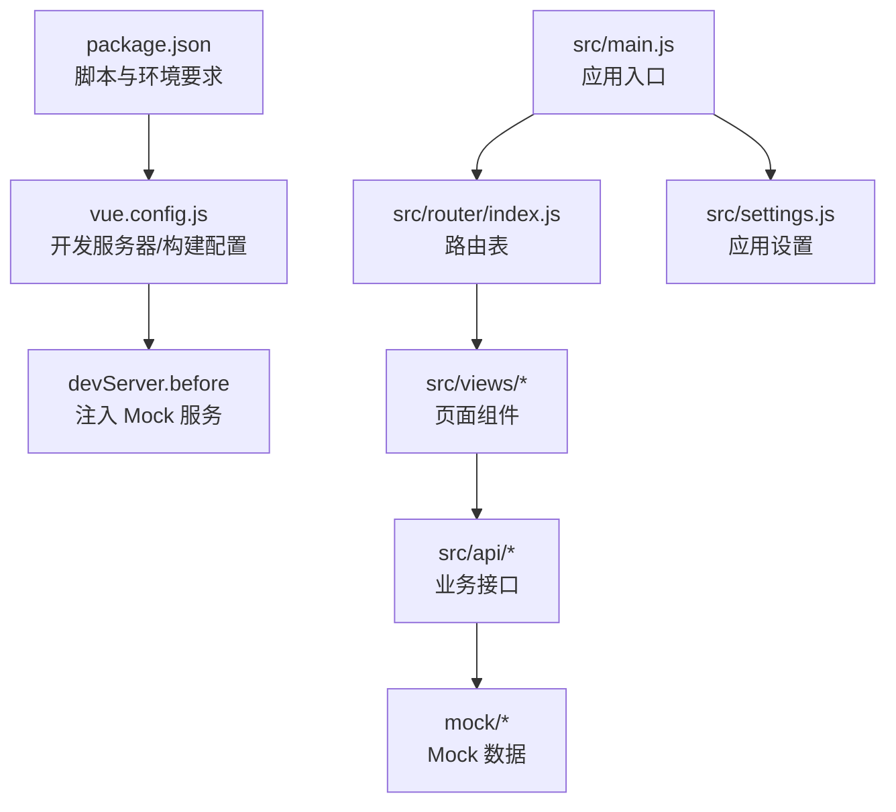
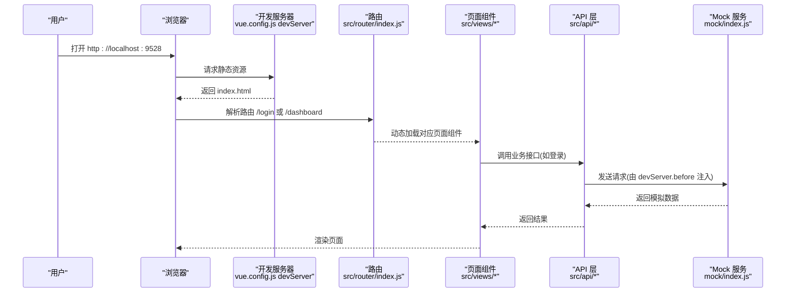
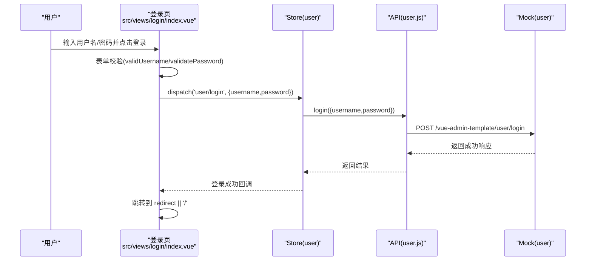
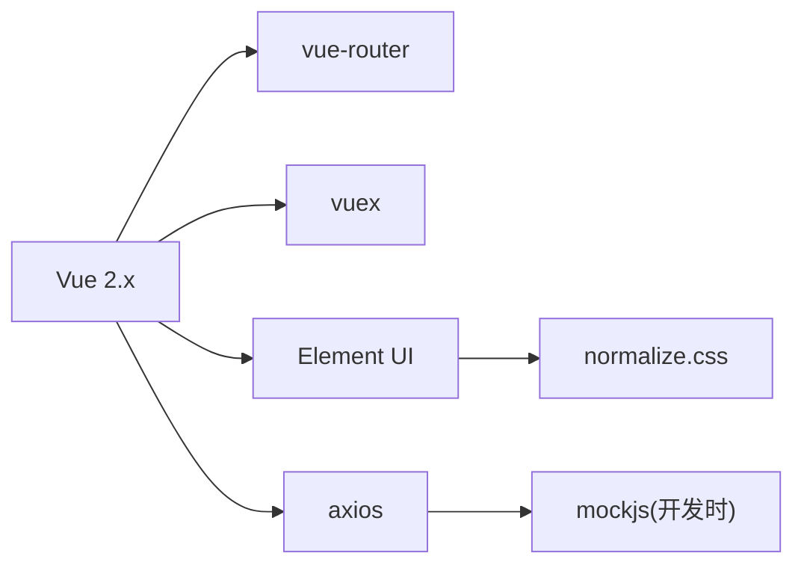

# 快速开始

<cite>
**本文引用的文件**   
- [package.json](file://package.json)
- [README.md](file://README.md)
- [vue.config.js](file://vue.config.js)
- [src/main.js](file://src/main.js)
- [src/settings.js](file://src/settings.js)
- [src/router/index.js](file://src/router/index.js)
- [src/views/login/index.vue](file://src/views/login/index.vue)
- [src/api/user.js](file://src/api/user.js)
- [mock/index.js](file://mock/index.js)
</cite>

## 目录
1. [简介](#简介)
2. [项目结构](#项目结构)
3. [核心组件](#核心组件)
4. [架构总览](#架构总览)
5. [详细组件分析](#详细组件分析)
6. [依赖分析](#依赖分析)
7. [性能考虑](#性能考虑)
8. [故障排查指南](#故障排查指南)
9. [结论](#结论)
10. [附录：常用命令与配置速查](#附录常用命令与配置速查)

## 简介
本指南面向首次接触该项目的开发者，帮助你快速完成环境准备、依赖安装、启动开发服务器，并了解基本的项目配置（环境变量、API 接口）、路由与页面添加、组件集成等常见操作。同时提供常见问题与解决方案，确保你能顺利运行项目并进行二次开发。

## 项目结构
该项目基于 Vue CLI 构建，采用模块化组织方式：
- 入口与初始化：src/main.js
- 应用设置与标题：src/settings.js
- 路由定义：src/router/index.js
- 视图页面：src/views/*
- API 请求封装与调用：src/utils/request.js、src/api/*
- Mock 服务：mock/*
- 构建与开发服务器配置：vue.config.js
- 脚本与环境要求：package.json

图表来源
- [package.json:6-14](file://package.json#L6-L14)
- [vue.config.js:32-40](file://vue.config.js#L32-L40)
- [src/main.js:1-16](file://src/main.js#L1-L16)
- [src/router/index.js:33-56](file://src/router/index.js#L33-L56)
- [mock/index.js:1-10](file://mock/index.js#L1-L10)

章节来源
- [package.json:1-63](file://package.json#L1-L63)
- [README.md:21-47](file://README.md#L21-L47)
- [vue.config.js:1-40](file://vue.config.js#L1-L40)
- [src/main.js:1-44](file://src/main.js#L1-L44)

## 核心组件
- 应用入口与插件注册：在 src/main.js 中引入 Element UI、全局样式、图标、权限控制，并在生产环境启用 Mock；创建 Vue 实例挂载 router 与 store。
- 应用设置：src/settings.js 导出 title、fixedHeader、sidebarLogo 等基础设置，被 vue.config.js 读取以生成页面标题等。
- 路由系统：src/router/index.js 定义常量路由表，包含登录页、仪表盘、示例页、表单、嵌套菜单等，支持懒加载与元信息 meta。
- API 层：src/api/user.js 封装用户相关接口（登录、获取信息、登出），统一通过 request 工具发起请求。
- Mock 服务：mock/index.js 聚合 user/table 等 mock 模块，并提供 mockXHR 方法用于拦截 XHR 请求。

章节来源
- [src/main.js:1-44](file://src/main.js#L1-L44)
- [src/settings.js:1-17](file://src/settings.js#L1-L17)
- [src/router/index.js:1-182](file://src/router/index.js#L1-L182)
- [src/api/user.js:1-25](file://src/api/user.js#L1-L25)
- [mock/index.js:1-58](file://mock/index.js#L1-L58)

## 架构总览
下图展示了从浏览器访问到页面渲染的关键流程，包括开发服务器、路由、页面组件、API 与 Mock 的交互关系。

图表来源
- [vue.config.js:32-40](file://vue.config.js#L32-L40)
- [src/router/index.js:33-56](file://src/router/index.js#L33-L56)
- [src/views/login/index.vue:108-123](file://src/views/login/index.vue#L108-L123)
- [src/api/user.js:3-9](file://src/api/user.js#L3-L9)
- [mock/index.js:15-50](file://mock/index.js#L15-L50)

## 详细组件分析

### Node.js 环境与依赖安装
- Node.js 版本要求：>= 8.9（见 engines.node）
- npm 版本要求：>= 3.0.0（见 engines.npm）
- 安装依赖：npm install
- 启动开发服务器：npm run dev（默认端口 9528，自动打开浏览器）
- 构建命令：npm run build:prod（生产）、npm run build:stage（测试）
- 预览构建产物：npm run preview

章节来源
- [package.json:57-60](file://package.json#L57-L60)
- [package.json:6-14](file://package.json#L6-L14)
- [README.md:21-47](file://README.md#L21-L47)

### 环境变量与开发服务器配置
- 端口优先级：process.env.port > process.env.npm_config_port > 9528
- 自动打开浏览器：devServer.open = true
- 错误覆盖层：overlay.errors = true, overlay.warnings = false
- Mock 注入：devServer.before 注入 mock/mock-server.js
- 公共路径与输出目录：publicPath='/', outputDir='dist', assetsDir='static'
- Lint 行为：lintOnSave 仅在 development 开启
- 生产 SourceMap：productionSourceMap=false

章节来源
- [vue.config.js:11-16](file://vue.config.js#L11-L16)
- [vue.config.js:32-40](file://vue.config.js#L32-L40)
- [vue.config.js:27-31](file://vue.config.js#L27-L31)

### 基本项目配置说明
- 应用标题与侧边栏设置：src/settings.js 导出 title、fixedHeader、sidebarLogo
- 标题注入：vue.config.js 读取 settings.title 作为 webpack name，用于 HTML 注入
- Element UI 语言包：src/main.js 中引入英文 locale，如需中文可切换为中文语言包

章节来源
- [src/settings.js:1-17](file://src/settings.js#L1-L17)
- [vue.config.js:3-9](file://vue.config.js#L3-L9)
- [src/main.js:5-8](file://src/main.js#L5-L8)

### API 接口配置与 Mock
- 接口封装：src/api/user.js 定义了 login/getInfo/logout 三个接口，统一使用 request 工具
- Mock 数据：mock/index.js 聚合 user/table 模块，并通过 mockXHR 拦截 XHR 请求
- 生产环境开关：src/main.js 在生产环境下启用 mockXHR，便于联调与演示

章节来源
- [src/api/user.js:1-25](file://src/api/user.js#L1-L25)
- [mock/index.js:1-58](file://mock/index.js#L1-L58)
- [src/main.js:18-29](file://src/main.js#L18-L29)

### 添加第一个页面
步骤概览：
1. 在 src/views 下新建页面组件（例如 src/views/my-page/index.vue）
2. 在 src/router/index.js 中添加路由项，指向新页面组件
3. 若需要侧边栏显示，为路由设置 meta.title 与 meta.icon
4. 刷新浏览器即可访问新页面

提示：
- 路由支持懒加载（component: () => import(...)），有助于首屏性能
- 隐藏路由可通过 hidden: true 配置

章节来源
- [src/router/index.js:33-56](file://src/router/index.js#L33-L56)
- [src/router/index.js:167-171](file://src/router/index.js#L167-L171)

### 配置路由
- 常量路由表：constantRoutes 集中管理所有基础路由
- 根路由重定向：/ 重定向到 /dashboard
- 子路由与嵌套：children 数组定义多级菜单
- 元信息 meta：title、icon、activeMenu、breadcrumb 等控制侧边栏与面包屑展示

章节来源
- [src/router/index.js:33-165](file://src/router/index.js#L33-L165)

### 集成组件
- 全局样式与主题：src/main.js 引入 normalize.css、Element UI 样式与全局 SCSS
- 图标系统：src/main.js 引入 '@/icons'，配合 svg-sprite-loader 处理 SVG 图标
- 权限控制：src/main.js 引入 '@/permission'，用于路由守卫与权限控制

章节来源
- [src/main.js:3-16](file://src/main.js#L3-L16)
- [vue.config.js:66-81](file://vue.config.js#L66-L81)

### 登录流程时序图
以下序列图展示了登录页面的关键交互：表单校验 -> 调用 store -> 触发 API -> Mock 返回 -> 跳转首页。

图表来源
- [src/views/login/index.vue:108-123](file://src/views/login/index.vue#L108-L123)
- [src/api/user.js:3-9](file://src/api/user.js#L3-L9)
- [mock/index.js:15-50](file://mock/index.js#L15-L50)

## 依赖分析
- 运行时依赖：vue、vue-router、vuex、axios、element-ui、nprogress、js-cookie、normalize.css、path-to-regexp、core-js
- 开发依赖：@vue/cli-service、babel、eslint、jest、sass、svg-sprite-loader、svgo、mockjs 等
- 浏览器支持：现代浏览器与 IE10+

图表来源
- [package.json:16-27](file://package.json#L16-L27)
- [package.json:28-51](file://package.json#L28-L51)
- [README.md:87-93](file://README.md#L87-L93)

章节来源
- [package.json:16-51](file://package.json#L16-L51)
- [README.md:87-93](file://README.md#L87-L93)

## 性能考虑
- 预加载优化：vue.config.js 中启用 preload 并排除 runtime 等文件，减少首屏时间
- 预取禁用：删除 prefetch 插件，避免过多无意义请求
- 代码分割：对 elementUI、libs、components 进行 chunk 拆分，提升缓存命中率
- 运行时 Chunk：runtimeChunk('single') 将运行时逻辑抽离为独立文件
- 生产 SourceMap 关闭：productionSourceMap=false，减小产物体积

章节来源
- [vue.config.js:51-64](file://vue.config.js#L51-L64)
- [vue.config.js:94-120](file://vue.config.js#L94-L120)
- [vue.config.js:31](file://vue.config.js#L31)

## 故障排查指南
- 端口占用或权限问题
  - 现象：无法启动或提示端口占用
  - 解决：修改端口环境变量 port 或 npm_config_port；Windows 管理员权限运行；macOS/Linux 使用 sudo
  - 参考：[vue.config.js:11-16](file://vue.config.js#L11-L16)
- 开发服务器未自动打开浏览器
  - 检查 devServer.open 是否为 true
  - 参考：[vue.config.js:32-34](file://vue.config.js#L32-L34)
- Mock 不生效
  - 确认 devServer.before 已注入 mock-server
  - 生产环境会启用 mockXHR，开发环境需确保接口路径匹配
  - 参考：[vue.config.js:39](file://vue.config.js#L39)、[src/main.js:26-29](file://src/main.js#L26-L29)、[mock/index.js:15-50](file://mock/index.js#L15-L50)
- 路由跳转异常或空白页
  - 检查路由 path/name/meta 是否正确
  - 确认组件路径与懒加载语法无误
  - 参考：[src/router/index.js:33-165](file://src/router/index.js#L33-L165)
- Element UI 语言包显示英文
  - 如需中文，请替换 main.js 中的 locale 导入为中文语言包
  - 参考：[src/main.js:5-8](file://src/main.js#L5-L8)
- 构建产物路径不正确
  - 根据部署路径调整 publicPath
  - 参考：[vue.config.js:21-27](file://vue.config.js#L21-L27)

章节来源
- [vue.config.js:11-16](file://vue.config.js#L11-L16)
- [vue.config.js:32-40](file://vue.config.js#L32-L40)
- [src/main.js:26-29](file://src/main.js#L26-L29)
- [src/router/index.js:33-165](file://src/router/index.js#L33-L165)
- [src/main.js:5-8](file://src/main.js#L5-L8)
- [vue.config.js:21-27](file://vue.config.js#L21-L27)

## 结论
通过本指南，你可以快速搭建并运行项目，理解其核心结构与关键配置，掌握添加页面、配置路由、集成组件的基本流程，并能高效排查常见问题。建议在熟悉基础用法后，进一步阅读路由与权限控制、API 封装与 Mock 机制，以便更好地扩展与定制项目。

## 附录：常用命令与配置速查
- 安装依赖：npm install
- 启动开发服务器：npm run dev
- 构建生产环境：npm run build:prod
- 构建测试环境：npm run build:stage
- 预览构建产物：npm run preview
- 代码检查与修复：npm run lint / npm run lint -- --fix
- 单元测试：npm run test:unit
- CI 任务：npm run test:ci

章节来源
- [package.json:6-14](file://package.json#L6-L14)
- [README.md:49-63](file://README.md#L49-L63)