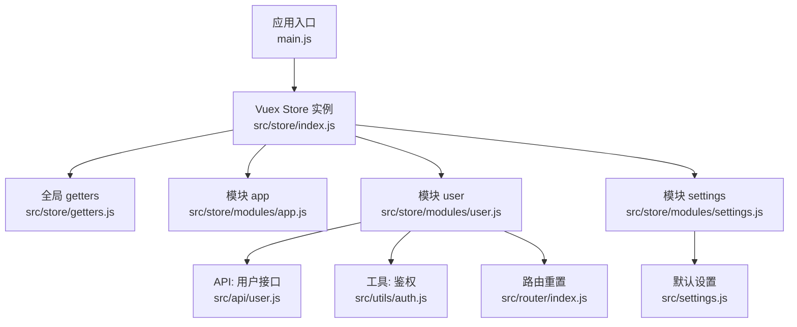
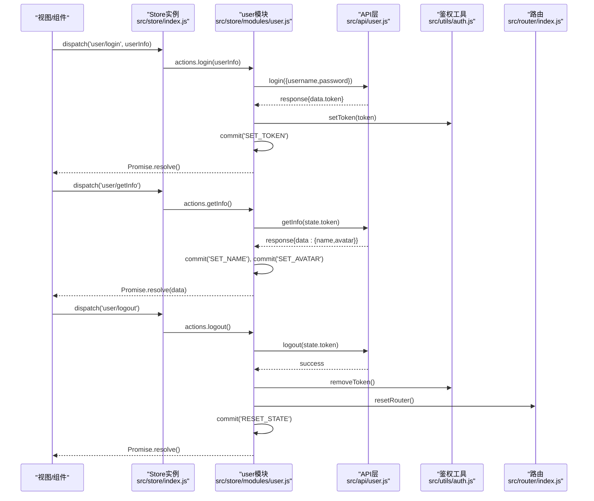
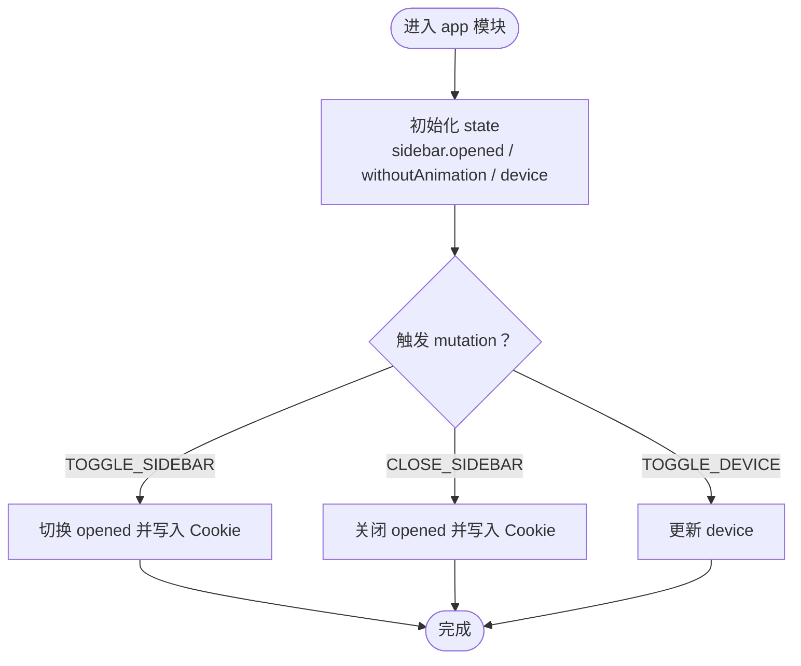
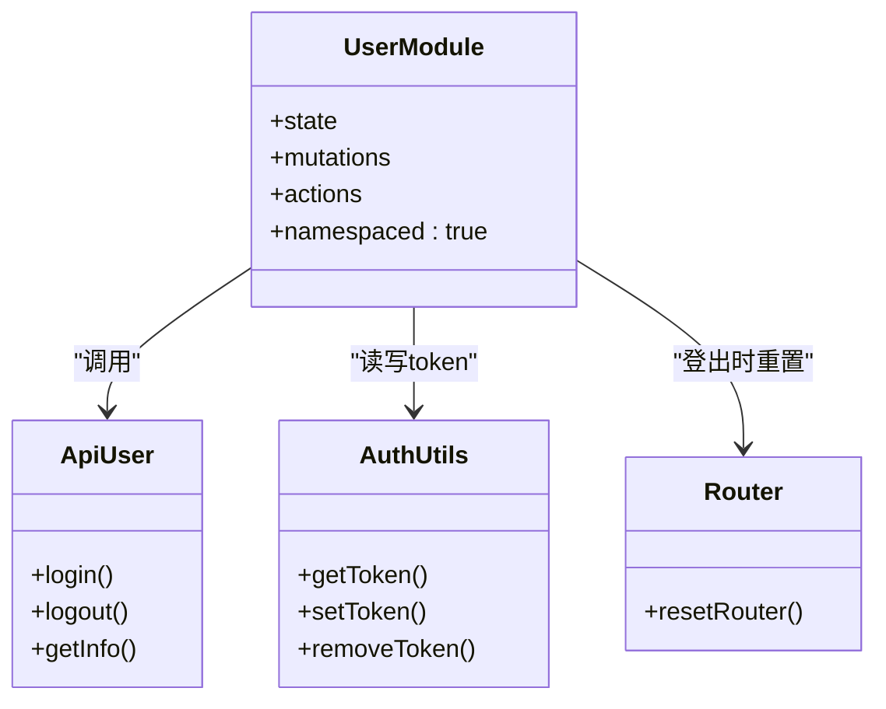
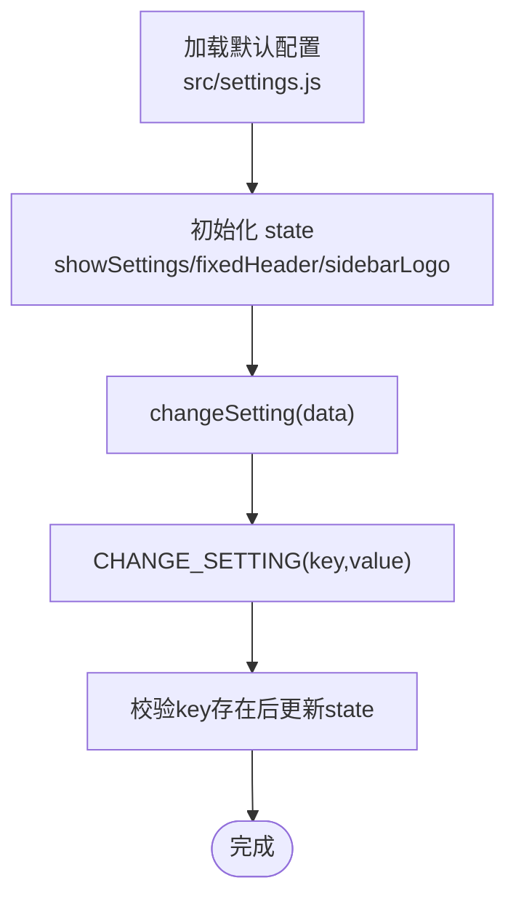
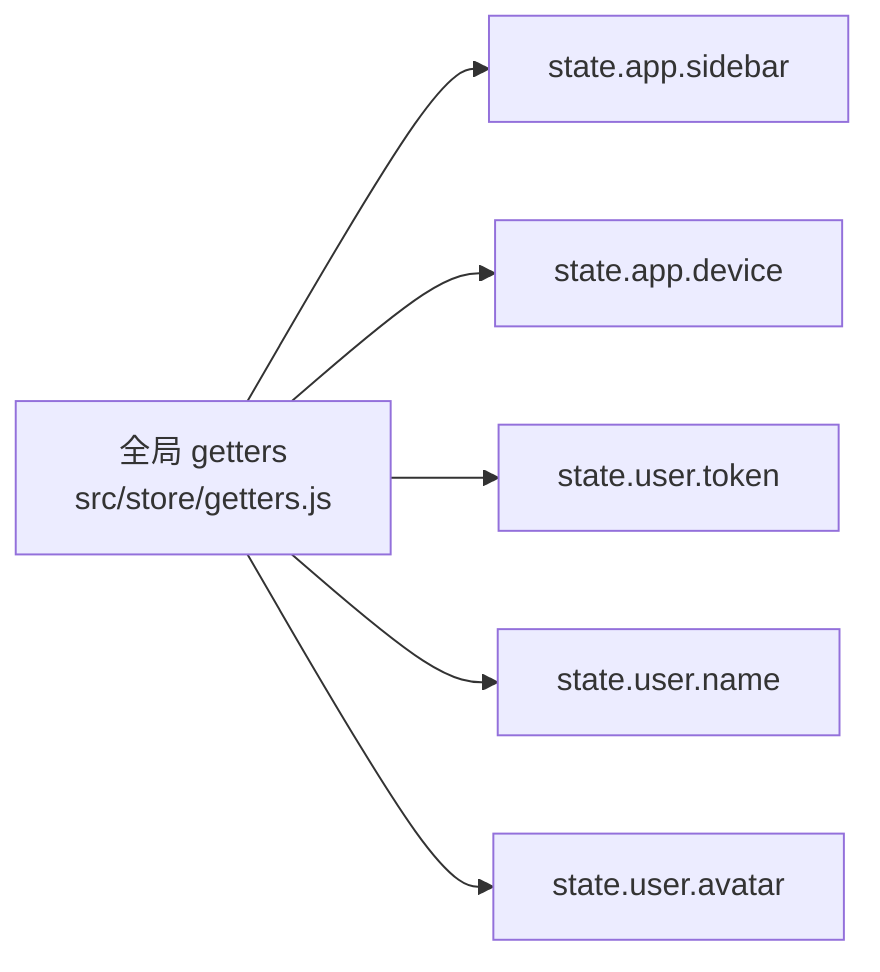
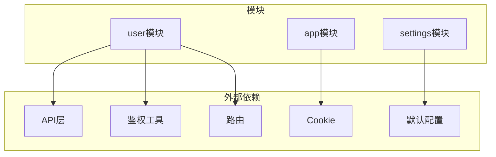

# Store模块扩展

<cite>
**本文引用的文件**   
- [src/store/index.js](file://src/store/index.js)
- [src/store/getters.js](file://src/store/getters.js)
- [src/store/modules/app.js](file://src/store/modules/app.js)
- [src/store/modules/user.js](file://src/store/modules/user.js)
- [src/store/modules/settings.js](file://src/store/modules/settings.js)
- [src/api/user.js](file://src/api/user.js)
- [src/utils/auth.js](file://src/utils/auth.js)
- [src/router/index.js](file://src/router/index.js)
- [src/settings.js](file://src/settings.js)
</cite>

## 目录
1. [简介](#简介)
2. [项目结构](#项目结构)
3. [核心组件](#核心组件)
4. [架构总览](#架构总览)
5. [详细组件分析](#详细组件分析)
6. [依赖关系分析](#依赖关系分析)
7. [性能与可维护性](#性能与可维护性)
8. [测试与调试指南](#测试与调试指南)
9. [结论](#结论)
10. [附录：Store模块开发规范清单](#附录store模块开发规范清单)

## 简介
本指南面向基于Vuex的Vue项目，系统化讲解如何扩展Store模块。以项目中已有的user、app、settings三个模块为例，说明module结构设计、state定义、mutations与actions编写规范，以及模块间依赖和数据流向。同时涵盖getter的使用场景、模块热重载机制、单元测试与调试方法，帮助你在保持代码一致性的前提下高效扩展新的状态管理模块。

## 项目结构
Store相关代码集中在src/store目录下，采用“按功能域拆分模块”的组织方式：
- store/index.js：创建Vuex实例，注册全局getters与子模块
- store/getters.js：集中式计算属性（跨模块读取）
- store/modules/*：各业务域的模块（app、user、settings等）

图表来源
- [src/store/index.js:1-20](file://src/store/index.js#L1-L20)
- [src/store/getters.js:1-9](file://src/store/getters.js#L1-L9)
- [src/store/modules/app.js:1-49](file://src/store/modules/app.js#L1-L49)
- [src/store/modules/user.js:1-98](file://src/store/modules/user.js#L1-L98)
- [src/store/modules/settings.js:1-33](file://src/store/modules/settings.js#L1-L33)
- [src/api/user.js](file://src/api/user.js)
- [src/utils/auth.js](file://src/utils/auth.js)
- [src/router/index.js](file://src/router/index.js)
- [src/settings.js](file://src/settings.js)

章节来源
- [src/store/index.js:1-20](file://src/store/index.js#L1-L20)

## 核心组件
- Vuex Store 实例：在index.js中通过new Vuex.Store创建，并挂载modules与getters
- 模块命名空间：所有模块均开启namespaced，避免命名冲突，便于模块化调用
- Getter集中化：在getters.js中提供跨模块的派生数据访问点
- 模块职责划分：
  - app：UI布局相关状态（侧边栏开关、设备类型）
  - user：认证与用户信息（token、name、avatar），以及与后端交互
  - settings：应用级配置项（如是否显示设置、固定头部、侧边栏Logo）

章节来源
- [src/store/index.js:10-17](file://src/store/index.js#L10-L17)
- [src/store/getters.js:1-9](file://src/store/getters.js#L1-L9)
- [src/store/modules/app.js:43-48](file://src/store/modules/app.js#L43-L48)
- [src/store/modules/user.js:91-96](file://src/store/modules/user.js#L91-L96)
- [src/store/modules/settings.js:26-31](file://src/store/modules/settings.js#L26-L31)

## 架构总览
下图展示了Store模块的整体交互关系与数据流向：视图通过dispatch触发action，action调用mutation更新state；getter提供派生数据；模块之间通过各自独立的state隔离，必要时通过getter或action间接协作。

图表来源
- [src/store/modules/user.js:30-89](file://src/store/modules/user.js#L30-L89)
- [src/api/user.js](file://src/api/user.js)
- [src/utils/auth.js](file://src/utils/auth.js)
- [src/router/index.js](file://src/router/index.js)

## 详细组件分析

### app模块：UI布局状态
- state设计
  - sidebar.opened：控制侧边栏展开/收起
  - sidebar.withoutAnimation：控制切换动画
  - device：设备类型（如desktop/mobile）
- mutations
  - TOGGLE_SIDEBAR/CLOSE_SIDEBAR：切换/关闭侧边栏，同步持久化到Cookie
  - TOGGLE_DEVICE：切换设备类型
- actions
  - toggleSideBar/closeSideBar/toggleDevice：封装对mutations的调用
- 特点
  - 使用js-cookie进行状态持久化
  - namespaced为true，避免与其他模块冲突

图表来源
- [src/store/modules/app.js:3-29](file://src/store/modules/app.js#L3-L29)

章节来源
- [src/store/modules/app.js:1-49](file://src/store/modules/app.js#L1-L49)

### user模块：认证与用户信息
- state设计
  - token：从本地存储获取初始值
  - name/avatar：用户基本信息
- mutations
  - RESET_STATE：重置state到默认值
  - SET_TOKEN/SET_NAME/SET_AVATAR：单项赋值
- actions
  - login：调用登录API，成功后保存token到本地存储并commit
  - getInfo：根据token拉取用户信息，commit name/avatar
  - logout：调用登出API，清除本地token、重置路由、清空state
  - resetToken：仅清理本地token并重置state
- 外部依赖
  - API：src/api/user.js
  - 鉴权工具：src/utils/auth.js
  - 路由：src/router/index.js（登出时重置路由）

图表来源
- [src/store/modules/user.js:1-98](file://src/store/modules/user.js#L1-L98)
- [src/api/user.js](file://src/api/user.js)
- [src/utils/auth.js](file://src/utils/auth.js)
- [src/router/index.js](file://src/router/index.js)

章节来源
- [src/store/modules/user.js:1-98](file://src/store/modules/user.js#L1-L98)

### settings模块：应用配置
- state设计
  - showSettings/fixedHeader/sidebarLogo：来自默认配置src/settings.js
- mutations
  - CHANGE_SETTING：安全地更新已存在的配置键
- actions
  - changeSetting：封装mutation调用
- 特点
  - 通过默认配置初始化，便于运行时动态调整

图表来源
- [src/store/modules/settings.js:1-33](file://src/store/modules/settings.js#L1-L33)
- [src/settings.js](file://src/settings.js)

章节来源
- [src/store/modules/settings.js:1-33](file://src/store/modules/settings.js#L1-L33)

### 全局Getter
- 作用
  - 提供跨模块的派生数据访问点，简化组件中的读取逻辑
- 示例
  - sidebar：读取app.sidebar
  - device：读取app.device
  - token/name/avatar：读取user模块的用户信息

图表来源
- [src/store/getters.js:1-9](file://src/store/getters.js#L1-L9)

章节来源
- [src/store/getters.js:1-9](file://src/store/getters.js#L1-L9)

## 依赖关系分析
- 模块内依赖
  - user模块依赖API层、鉴权工具与路由，用于实现完整的认证流程
  - app模块依赖Cookie库进行状态持久化
  - settings模块依赖默认配置文件
- 模块间依赖
  - 模块之间通过各自的state隔离，无直接相互引用
  - 跨模块数据访问统一通过全局getter或组件computed组合
- 数据流向
  - 组件 -> dispatch(action) -> action(异步/同步) -> commit(mutation) -> state变更 -> getter派生 -> 视图响应式更新

图表来源
- [src/store/modules/user.js:1-98](file://src/store/modules/user.js#L1-L98)
- [src/store/modules/app.js:1-49](file://src/store/modules/app.js#L1-L49)
- [src/store/modules/settings.js:1-33](file://src/store/modules/settings.js#L1-L33)

章节来源
- [src/store/modules/user.js:1-98](file://src/store/modules/user.js#L1-L98)
- [src/store/modules/app.js:1-49](file://src/store/modules/app.js#L1-L49)
- [src/store/modules/settings.js:1-33](file://src/store/modules/settings.js#L1-L33)

## 性能与可维护性
- 命名空间
  - 所有模块启用namespaced，避免命名冲突，提升可维护性
- 状态最小化
  - state仅保留必要字段，复杂派生数据通过getter计算
- 副作用隔离
  - 将网络请求、本地存储、路由操作放在actions中，mutations只做纯同步状态更新
- 配置外置
  - settings模块将默认配置抽离至独立文件，便于管理与覆盖
- 可测试性
  - mutations为纯函数，易于单测；actions可通过mock API与工具函数进行测试

[本节为通用指导，不直接分析具体文件]

## 测试与调试指南

### 单元测试要点
- 测试目标
  - mutations：验证输入payload与state变更是否符合预期
  - actions：验证对外部依赖（API、auth、router）的调用顺序与参数
- 推荐策略
  - 使用Jest对mutations进行纯函数断言
  - 对actions使用mock对象模拟API与工具函数，断言commit调用与返回值
  - 针对user模块，重点覆盖login/getInfo/logout/resetToken分支路径
- 参考位置
  - 现有单元测试位于tests/unit目录，可作为结构与风格参考

章节来源
- [tests/unit/components/Breadcrumb.spec.js](file://tests/unit/components/Breadcrumb.spec.js)
- [tests/unit/components/Hamburger.spec.js](file://tests/unit/components/Hamburger.spec.js)
- [tests/unit/components/SvgIcon.spec.js](file://tests/unit/components/SvgIcon.spec.js)
- [tests/unit/utils/formatTime.spec.js](file://tests/unit/utils/formatTime.spec.js)
- [tests/unit/utils/param2Obj.spec.js](file://tests/unit/utils/param2Obj.spec.js)
- [tests/unit/utils/parseTime.spec.js](file://tests/unit/utils/parseTime.spec.js)
- [tests/unit/utils/validate.spec.js](file://tests/unit/utils/validate.spec.js)

### 调试技巧
- 浏览器插件
  - 使用Vuex DevTools观察state变化、mutation历史与action执行
- 日志输出
  - 在关键action中打印入参与返回结果，辅助定位问题
- 断点调试
  - 在mutations处打断点，确认state变更时机与参数正确性

[本节为通用指导，不直接分析具体文件]

## 结论
通过遵循上述模块设计规范与最佳实践，你可以稳定地扩展新的Store模块。保持state精简、mutations纯同步、actions处理副作用、getter集中派生，配合命名空间与模块化组织，能够显著提升项目的可维护性与可测试性。

[本节为总结性内容，不直接分析具体文件]

## 附录：Store模块开发规范清单
- 模块结构
  - 每个模块包含state、mutations、actions，并启用namespaced
- state定义
  - 仅包含必要字段；复杂派生数据放入getter
- mutations
  - 纯同步函数；命名使用大写常量；参数语义清晰
- actions
  - 封装异步逻辑；调用API与外部系统；通过commit更新state
- getter
  - 集中暴露跨模块派生数据；避免在组件中重复计算
- 依赖管理
  - 模块间不直接互相引用；通过getter或组件组合数据
- 热重载
  - 使用Webpack/Vue CLI提供的HMR能力，无需手动刷新页面即可更新模块
- 测试与调试
  - 对mutations进行单测；对actions进行mock测试；结合DevTools与断点调试

[本节为通用指导，不直接分析具体文件]