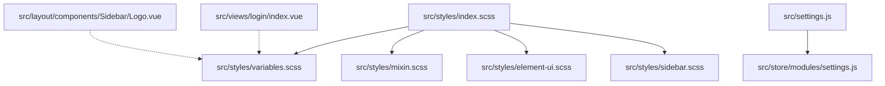
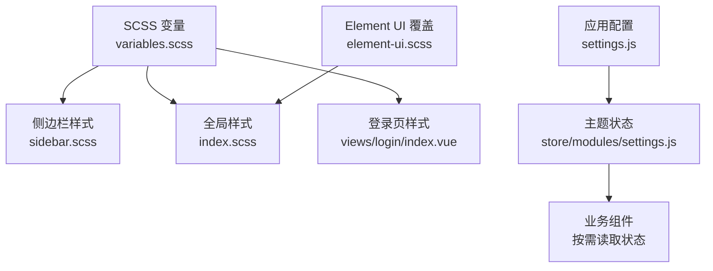
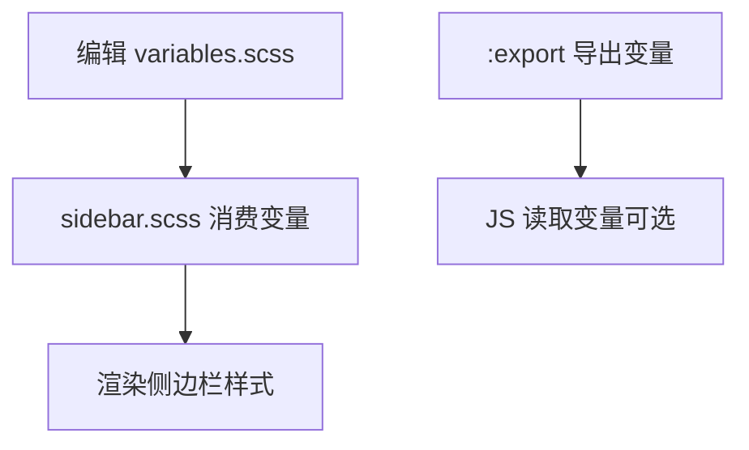
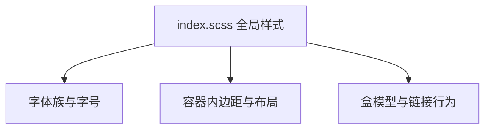
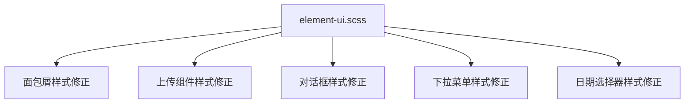
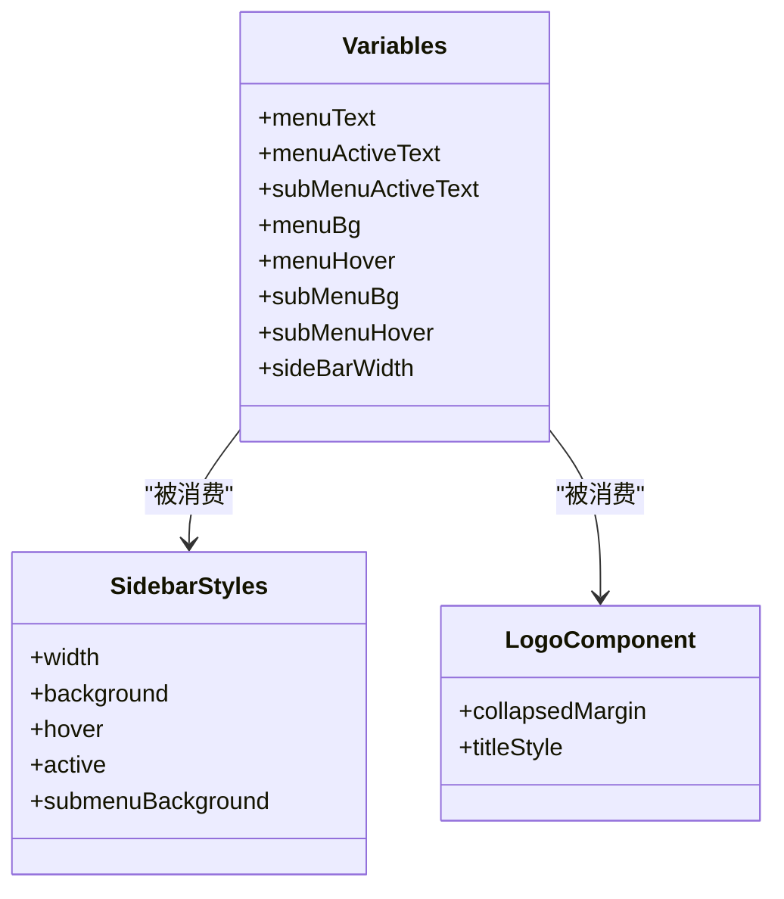
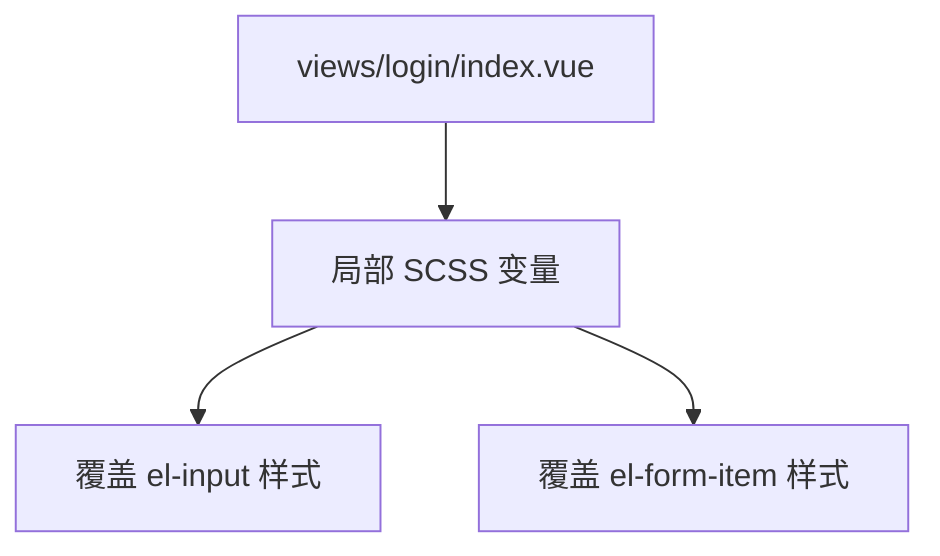
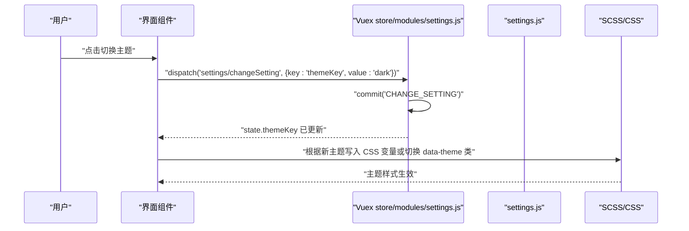
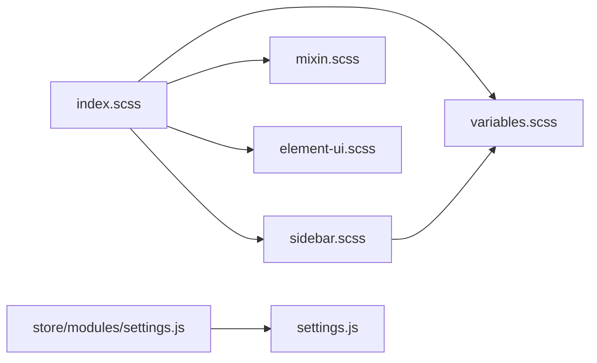

# 主题定制指南

<cite>
**本文引用的文件**   
- [src/settings.js](file://src/settings.js)
- [src/store/modules/settings.js](file://src/store/modules/settings.js)
- [src/styles/index.scss](file://src/styles/index.scss)
- [src/styles/variables.scss](file://src/styles/variables.scss)
- [src/styles/sidebar.scss](file://src/styles/sidebar.scss)
- [src/styles/element-ui.scss](file://src/styles/element-ui.scss)
- [src/styles/mixin.scss](file://src/styles/mixin.scss)
- [src/layout/components/Sidebar/Logo.vue](file://src/layout/components/Sidebar/Logo.vue)
- [src/views/login/index.vue](file://src/views/login/index.vue)
</cite>

## 目录
1. [简介](#简介)
2. [项目结构](#项目结构)
3. [核心组件](#核心组件)
4. [架构总览](#架构总览)
5. [详细组件分析](#详细组件分析)
6. [依赖关系分析](#依赖关系分析)
7. [性能与可维护性](#性能与可维护性)
8. [故障排查](#故障排查)
9. [结论](#结论)
10. [附录：常见主题场景实现方案](#附录常见主题场景实现方案)

## 简介
本指南面向希望基于 SCSS 变量体系进行主题定制的开发者，覆盖颜色、字体、间距等变量的定义与使用；说明如何在 settings.js 中配置应用主题相关选项，并给出在 Vuex store 中动态切换主题的可行路径；同时提供 Element UI 组件的主题覆盖方法、自定义样式组织与命名规范建议，以及深色模式、品牌色定制等常见主题场景的实现思路。

## 项目结构
本项目采用“全局样式入口 + 模块化 SCSS”的组织方式：
- 全局入口 index.scss 统一引入 variables、mixin、transition、element-ui、sidebar 等样式模块
- variables.scss 集中管理侧边栏等主题相关的 SCSS 变量，并通过 :export 暴露给 JS 使用
- sidebar.scss 使用 variables.scss 中的变量控制侧边栏布局与交互态
- element-ui.scss 用于覆盖 Element UI 默认样式
- mixin.scss 提供通用混入（如滚动条样式）
- settings.js 提供应用级配置项，store/modules/settings.js 将其映射为状态并提供变更能力

图表来源
- [src/styles/index.scss:1-5](file://src/styles/index.scss#L1-L5)
- [src/styles/variables.scss:1-25](file://src/styles/variables.scss#L1-L25)
- [src/styles/sidebar.scss:1-20](file://src/styles/sidebar.scss#L1-L20)
- [src/styles/element-ui.scss:1-10](file://src/styles/element-ui.scss#L1-L10)
- [src/styles/mixin.scss:1-10](file://src/styles/mixin.scss#L1-L10)
- [src/settings.js:1-16](file://src/settings.js#L1-L16)
- [src/store/modules/settings.js:1-10](file://src/store/modules/settings.js#L1-L10)

章节来源
- [src/styles/index.scss:1-66](file://src/styles/index.scss#L1-L66)
- [src/styles/variables.scss:1-25](file://src/styles/variables.scss#L1-L25)
- [src/styles/sidebar.scss:1-227](file://src/styles/sidebar.scss#L1-L227)
- [src/styles/element-ui.scss:1-50](file://src/styles/element-ui.scss#L1-L50)
- [src/styles/mixin.scss:1-28](file://src/styles/mixin.scss#L1-L28)
- [src/settings.js:1-16](file://src/settings.js#L1-L16)
- [src/store/modules/settings.js:1-33](file://src/store/modules/settings.js#L1-L33)

## 核心组件
- SCSS 变量中心：variables.scss 定义了菜单文本、激活态文本、背景、悬停色、子菜单背景与悬停色、侧边栏宽度等变量，并通过 :export 导出供 JS 读取
- 全局样式入口：index.scss 引入所有样式模块，并设置全局字体族、基础盒模型、链接行为、容器 padding 等
- 侧边栏样式：sidebar.scss 大量使用 variables.scss 的变量来控制侧边栏宽度、背景、悬停与激活态颜色
- Element UI 覆盖：element-ui.scss 对面包屑、上传、对话框、下拉菜单、日期选择器等组件样式进行微调
- 通用混入：mixin.scss 提供 clearfix、scrollBar、relative 等常用混入
- 应用配置：settings.js 提供 title、fixedHeader、sidebarLogo 等配置项
- 主题状态：store/modules/settings.js 将 settings.js 的配置映射到 Vuex state，并提供 CHANGE_SETTING mutation 和 changeSetting action 以支持运行时修改

章节来源
- [src/styles/variables.scss:1-25](file://src/styles/variables.scss#L1-L25)
- [src/styles/index.scss:1-66](file://src/styles/index.scss#L1-L66)
- [src/styles/sidebar.scss:1-227](file://src/styles/sidebar.scss#L1-L227)
- [src/styles/element-ui.scss:1-50](file://src/styles/element-ui.scss#L1-L50)
- [src/styles/mixin.scss:1-28](file://src/styles/mixin.scss#L1-L28)
- [src/settings.js:1-16](file://src/settings.js#L1-L16)
- [src/store/modules/settings.js:1-33](file://src/store/modules/settings.js#L1-L33)

## 架构总览
下图展示了主题定制的关键数据流与样式依赖关系：SCSS 变量作为单一事实源，被多个样式模块消费；JS 侧通过 settings.js 提供配置，Vuex 提供运行时修改能力；组件通过 class 或 CSS 变量间接消费主题值。

图表来源
- [src/styles/variables.scss:1-25](file://src/styles/variables.scss#L1-L25)
- [src/styles/sidebar.scss:1-20](file://src/styles/sidebar.scss#L1-L20)
- [src/styles/index.scss:1-13](file://src/styles/index.scss#L1-L13)
- [src/views/login/index.vue:128-173](file://src/views/login/index.vue#L128-L173)
- [src/settings.js:1-16](file://src/settings.js#L1-L16)
- [src/store/modules/settings.js:1-33](file://src/store/modules/settings.js#L1-L33)
- [src/styles/element-ui.scss:1-10](file://src/styles/element-ui.scss#L1-L10)

## 详细组件分析

### SCSS 变量系统与主题定制
- 变量范围与用途
  - 菜单文本与激活态文本：$menuText、$menuActiveText、$subMenuActiveText
  - 背景与悬停：$menuBg、$menuHover、$subMenuBg、$subMenuHover
  - 侧边栏宽度：$sideBarWidth
- 变量导出机制
  - 通过 :export 将 SCSS 变量导出为 JS 对象，便于在 JS 中读取（例如动态注入 CSS 变量或构建主题包）
- 使用位置
  - sidebar.scss 直接引用这些变量控制侧边栏外观与交互
  - 其他模块如需一致的主题色，应优先从 variables.scss 引入，避免硬编码

图表来源
- [src/styles/variables.scss:1-25](file://src/styles/variables.scss#L1-L25)
- [src/styles/sidebar.scss:1-20](file://src/styles/sidebar.scss#L1-L20)

章节来源
- [src/styles/variables.scss:1-25](file://src/styles/variables.scss#L1-L25)
- [src/styles/sidebar.scss:1-227](file://src/styles/sidebar.scss#L1-L227)

### 字体与全局排版
- 全局字体族在 index.scss 中定义，确保全站字体一致性
- label 加粗、链接行为、box-sizing 重置等基础排版规则集中在 index.scss
- 建议在 variables.scss 中新增 $fontFamily、$fontSizeBase 等变量，并在 index.scss 中使用，以便统一管理

图表来源
- [src/styles/index.scss:7-17](file://src/styles/index.scss#L7-L17)
- [src/styles/index.scss:19-32](file://src/styles/index.scss#L19-L32)
- [src/styles/index.scss:62-66](file://src/styles/index.scss#L62-L66)

章节来源
- [src/styles/index.scss:1-66](file://src/styles/index.scss#L1-L66)

### Element UI 组件主题覆盖
- element-ui.scss 对以下组件进行了样式修正：
  - 面包屑：调整字体权重
  - 上传：隐藏原生 input、调整拖拽区域尺寸
  - 对话框：修复定位与居中问题
  - 下拉菜单：菜单项显示为块级元素
  - 日期选择器：分隔符盒模型修正
- 若需进一步覆盖 Element UI 主题色，可在 element-ui.scss 中通过 CSS 变量或类名覆盖其默认样式（例如 .el-button--primary 的颜色）

图表来源
- [src/styles/element-ui.scss:1-50](file://src/styles/element-ui.scss#L1-L50)

章节来源
- [src/styles/element-ui.scss:1-50](file://src/styles/element-ui.scss#L1-L50)

### 侧边栏主题与布局
- 侧边栏宽度由 $sideBarWidth 控制，折叠态与移动端响应式逻辑在 sidebar.scss 中处理
- 菜单项 hover、active、子菜单背景与悬停均使用 variables.scss 的变量，保证主题一致性
- Logo 组件在 collapsed 状态下调整 logo 外边距与标题样式

图表来源
- [src/styles/variables.scss:1-25](file://src/styles/variables.scss#L1-L25)
- [src/styles/sidebar.scss:1-20](file://src/styles/sidebar.scss#L1-L20)
- [src/layout/components/Sidebar/Logo.vue:57-82](file://src/layout/components/Sidebar/Logo.vue#L57-L82)

章节来源
- [src/styles/sidebar.scss:1-227](file://src/styles/sidebar.scss#L1-L227)
- [src/layout/components/Sidebar/Logo.vue:57-82](file://src/layout/components/Sidebar/Logo.vue#L57-L82)

### 登录页局部主题
- 登录页在 views/login/index.vue 中定义了局部 SCSS 变量（背景、光标色、深浅灰），并通过 scoped 样式覆盖 Element UI 输入框与表单项
- 该页面展示了如何在组件内部使用 SCSS 变量进行局部主题定制

图表来源
- [src/views/login/index.vue:128-173](file://src/views/login/index.vue#L128-L173)

章节来源
- [src/views/login/index.vue:128-205](file://src/views/login/index.vue#L128-L205)

### 应用配置与动态主题切换
- settings.js 提供应用级配置项（如 fixedHeader、sidebarLogo）
- store/modules/settings.js 将这些配置映射为 Vuex state，并提供 CHANGE_SETTING mutation 与 changeSetting action
- 动态主题切换的实现思路：
  - 在 settings.js 中新增 themeKey 或 brandColor 等字段
  - 在 store/modules/settings.js 中同步新增对应 state 与 mutation/action
  - 在运行时调用 dispatch('settings/changeSetting', { key, value }) 更新主题
  - 在 SCSS 中可通过 CSS 变量或根据 body 上的 data-theme 属性切换主题类名，从而改变变量生效值

图表来源
- [src/settings.js:1-16](file://src/settings.js#L1-L16)
- [src/store/modules/settings.js:1-33](file://src/store/modules/settings.js#L1-L33)

章节来源
- [src/settings.js:1-16](file://src/settings.js#L1-L16)
- [src/store/modules/settings.js:1-33](file://src/store/modules/settings.js#L1-L33)

## 依赖关系分析
- 样式依赖
  - index.scss 作为入口，顺序引入 variables、mixin、transition、element-ui、sidebar
  - sidebar.scss 强依赖 variables.scss 的变量
  - element-ui.scss 独立于 variables.scss，但可与 variables.scss 配合使用
- JS 依赖
  - store/modules/settings.js 依赖 settings.js 提供的默认配置
  - 组件通过 Vuex 访问 settings 状态，进而驱动主题切换

图表来源
- [src/styles/index.scss:1-5](file://src/styles/index.scss#L1-L5)
- [src/styles/sidebar.scss:1-20](file://src/styles/sidebar.scss#L1-L20)
- [src/store/modules/settings.js:1-10](file://src/store/modules/settings.js#L1-L10)
- [src/settings.js:1-16](file://src/settings.js#L1-L16)

章节来源
- [src/styles/index.scss:1-66](file://src/styles/index.scss#L1-L66)
- [src/styles/sidebar.scss:1-227](file://src/styles/sidebar.scss#L1-L227)
- [src/store/modules/settings.js:1-33](file://src/store/modules/settings.js#L1-L33)
- [src/settings.js:1-16](file://src/settings.js#L1-L16)

## 性能与可维护性
- 变量集中化：将颜色、字体、间距等统一放入 variables.scss，减少重复与不一致
- 作用域隔离：组件内局部样式使用 scoped，避免污染全局
- 渐进增强：优先使用 CSS 变量或 data-theme 类切换主题，避免频繁重建样式表
- 命名规范：
  - SCSS 变量使用 $kebab-case 或 $camelCase，语义清晰（如 $color-primary、$spacing-md）
  - 类名遵循 BEM 或业务前缀，避免冲突
- 可测试性：主题切换逻辑尽量放在 store 层，便于单元测试与集成测试

[本节为通用指导，不直接分析具体文件]

## 故障排查
- 侧边栏宽度异常
  - 检查 variables.scss 中 $sideBarWidth 是否被正确导入并在 sidebar.scss 中使用
  - 确认未在其他样式文件中覆盖该变量
- Element UI 样式未生效
  - 确认 element-ui.scss 已被 index.scss 引入
  - 检查组件类名是否正确，必要时提高选择器优先级或使用 !important（谨慎）
- 动态主题无效
  - 检查 store/modules/settings.js 是否包含对应的 key/value
  - 确认组件在状态变更后触发了样式更新（CSS 变量赋值或 data-theme 切换）
- 登录页样式错乱
  - 检查 views/login/index.vue 的局部变量与作用域样式是否覆盖了预期元素

章节来源
- [src/styles/variables.scss:1-25](file://src/styles/variables.scss#L1-L25)
- [src/styles/sidebar.scss:1-20](file://src/styles/sidebar.scss#L1-L20)
- [src/styles/element-ui.scss:1-50](file://src/styles/element-ui.scss#L1-L50)
- [src/store/modules/settings.js:1-33](file://src/store/modules/settings.js#L1-L33)
- [src/views/login/index.vue:128-173](file://src/views/login/index.vue#L128-L173)

## 结论
通过统一的 SCSS 变量体系与清晰的样式分层，本项目实现了良好的主题可定制性与可维护性。结合 settings.js 与 Vuex store，可以在运行时安全地切换主题。Element UI 的样式覆盖点明确，便于按需扩展。按照本指南实践，可快速完成品牌色定制、深色模式等常见主题需求。

[本节为总结性内容，不直接分析具体文件]

## 附录：常见主题场景实现方案

### 深色模式
- 步骤
  - 在 variables.scss 中新增深色主题变量（如 $bg-dark、$text-dark、$menu-bg-dark 等）
  - 在 index.scss 中根据 body[data-theme="dark"] 或根节点类名切换变量值
  - 在 store/modules/settings.js 中新增 themeMode 状态与变更 action
  - 在组件中根据 themeMode 切换 data-theme 或类名
- 关键点
  - 保持浅色与深色变量成对出现，便于维护
  - 使用 CSS 变量或类名切换，避免重建样式表

章节来源
- [src/styles/variables.scss:1-25](file://src/styles/variables.scss#L1-L25)
- [src/styles/index.scss:1-13](file://src/styles/index.scss#L1-L13)
- [src/store/modules/settings.js:1-33](file://src/store/modules/settings.js#L1-L33)

### 品牌色定制
- 步骤
  - 在 variables.scss 中新增 $brand-color 及其明暗变体（如 $brand-light、$brand-dark）
  - 在 sidebar.scss、element-ui.scss 中替换硬编码颜色为变量
  - 在 settings.js 中新增 brandColor 配置项，并在 store 中暴露
  - 运行时通过 dispatch 更新 brandColor，并应用到 CSS 变量或主题类
- 关键点
  - 品牌色应贯穿按钮、链接、激活态等高可见度元素
  - 注意对比度与无障碍要求

章节来源
- [src/styles/variables.scss:1-25](file://src/styles/variables.scss#L1-L25)
- [src/styles/sidebar.scss:1-20](file://src/styles/sidebar.scss#L1-L20)
- [src/styles/element-ui.scss:1-10](file://src/styles/element-ui.scss#L1-L10)
- [src/settings.js:1-16](file://src/settings.js#L1-L16)
- [src/store/modules/settings.js:1-33](file://src/store/modules/settings.js#L1-L33)

### 字体与间距规范
- 步骤
  - 在 variables.scss 中新增 $font-family-base、$font-size-base、$line-height-base、$spacing-* 系列变量
  - 在 index.scss 中应用这些变量到 body、容器、组件
  - 在 mixin.scss 中提供 spacing 混入，统一间距使用
- 关键点
  - 字体族应考虑多语言与系统兼容性
  - 间距遵循 4px/8px 网格体系，提升视觉一致性

章节来源
- [src/styles/index.scss:7-17](file://src/styles/index.scss#L7-L17)
- [src/styles/mixin.scss:1-28](file://src/styles/mixin.scss#L1-L28)