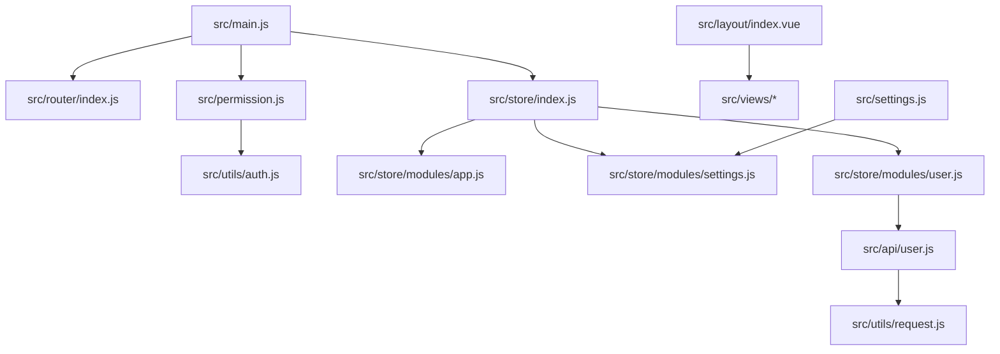
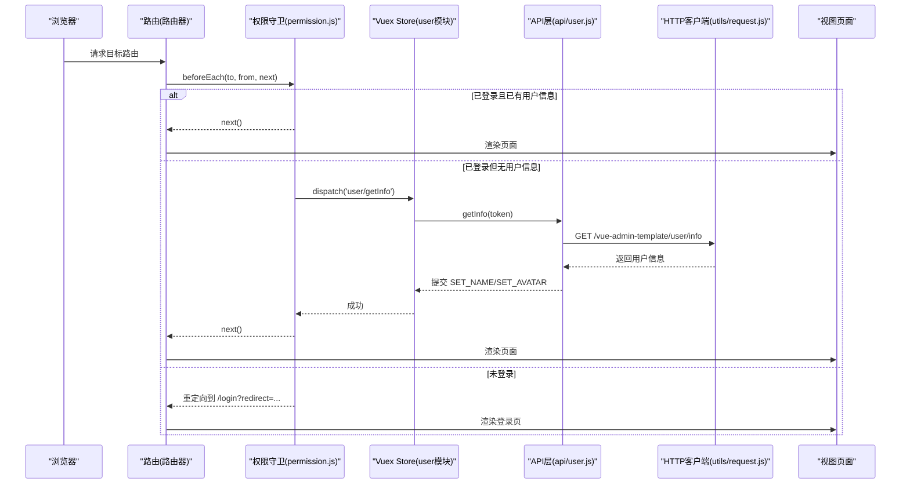
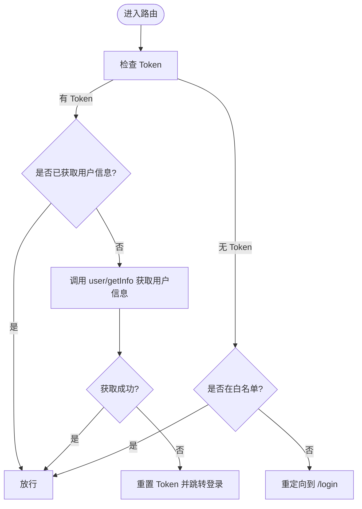
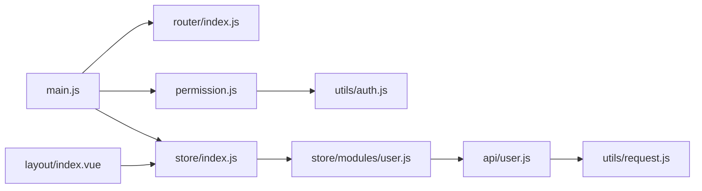

# 扩展开发指南

<cite>
**本文引用的文件**   
- [main.js](file://src/main.js)
- [router/index.js](file://src/router/index.js)
- [permission.js](file://src/permission.js)
- [store/index.js](file://src/store/index.js)
- [store/modules/app.js](file://src/store/modules/app.js)
- [store/modules/settings.js](file://src/store/modules/settings.js)
- [store/modules/user.js](file://src/store/modules/user.js)
- [utils/auth.js](file://src/utils/auth.js)
- [utils/request.js](file://src/utils/request.js)
- [api/user.js](file://src/api/user.js)
- [layout/index.vue](file://src/layout/index.vue)
- [views/login/index.vue](file://src/views/login/index.vue)
- [views/dashboard/index.vue](file://src/views/dashboard/index.vue)
- [settings.js](file://src/settings.js)
</cite>

## 目录
1. [简介](#简介)
2. [项目结构](#项目结构)
3. [核心组件](#核心组件)
4. [架构总览](#架构总览)
5. [详细组件分析](#详细组件分析)
6. [依赖关系分析](#依赖关系分析)
7. [性能与重构建议](#性能与重构建议)
8. [常见问题排查](#常见问题排查)
9. [结论](#结论)
10. [附录：扩展清单与最佳实践](#附录扩展清单与最佳实践)

## 简介
本指南面向需要在现有 Vue 管理后台模板上进行功能扩展与二次开发的工程师。文档围绕“新增页面、组件、路由、Store 模块”的标准流程，结合权限控制、主题定制、国际化支持等常见扩展场景，给出可操作的步骤、代码级流程图与最佳实践。同时提供插件开发与第三方库集成方法、性能优化技巧与重构建议，帮助你在不破坏既有架构的前提下高效扩展。

## 项目结构
该仓库采用典型的前端工程化结构：
- src/main.js：应用入口，统一注册 UI 框架、全局样式、图标、权限守卫与 Mock（生产环境）
- src/router/index.js：集中式路由定义，包含常量路由与懒加载
- src/permission.js：路由守卫，负责鉴权、进度条、标题设置
- src/store/*：Vuex 状态管理，按模块拆分 app、settings、user
- src/utils/*：工具函数，如 auth、request、validate
- src/api/*：业务接口封装
- src/layout/*：布局容器与侧边栏、导航等
- src/views/*：页面视图
- src/settings.js：应用配置项（标题、固定头部、侧边栏 Logo 等）

**图示来源**
- [main.js:1-44](file://src/main.js#L1-L44)
- [router/index.js:1-182](file://src/router/index.js#L1-L182)
- [permission.js:1-65](file://src/permission.js#L1-L65)
- [store/index.js:1-20](file://src/store/index.js#L1-L20)
- [store/modules/app.js:1-49](file://src/store/modules/app.js#L1-L49)
- [store/modules/settings.js:1-33](file://src/store/modules/settings.js#L1-L33)
- [store/modules/user.js:1-98](file://src/store/modules/user.js#L1-L98)
- [api/user.js:1-25](file://src/api/user.js#L1-L25)
- [utils/request.js:1-86](file://src/utils/request.js#L1-L86)
- [layout/index.vue:1-94](file://src/layout/index.vue#L1-L94)
- [settings.js:1-17](file://src/settings.js#L1-L17)

**章节来源**
- [main.js:1-44](file://src/main.js#L1-L44)
- [router/index.js:1-182](file://src/router/index.js#L1-L182)
- [permission.js:1-65](file://src/permission.js#L1-L65)
- [store/index.js:1-20](file://src/store/index.js#L1-L20)
- [layout/index.vue:1-94](file://src/layout/index.vue#L1-L94)
- [settings.js:1-17](file://src/settings.js#L1-L17)

## 核心组件
- 应用入口 main.js：统一引入 ElementUI、全局样式、图标、权限控制；在生产环境启用 Mock；创建 Vue 实例并挂载 router、store。
- 路由 router/index.js：定义 constantRoutes，使用懒加载组件；提供 resetRouter 用于动态重置路由。
- 权限 permission.js：beforeEach 中处理登录态、白名单、用户信息获取；afterEach 关闭进度条。
- Store store/index.js：聚合 app、settings、user 三个模块，并提供 getters。
- 工具 utils/request.js：基于 axios 的 HTTP 客户端，统一拦截器、错误处理、Token 注入。
- 布局 layout/index.vue：组合 Sidebar、Navbar、AppMain，响应式适配移动端。

**章节来源**
- [main.js:1-44](file://src/main.js#L1-L44)
- [router/index.js:1-182](file://src/router/index.js#L1-L182)
- [permission.js:1-65](file://src/permission.js#L1-L65)
- [store/index.js:1-20](file://src/store/index.js#L1-L20)
- [utils/request.js:1-86](file://src/utils/request.js#L1-L86)
- [layout/index.vue:1-94](file://src/layout/index.vue#L1-L94)

## 架构总览
下图展示从浏览器访问到页面渲染的关键路径：路由守卫 -> 用户信息获取 -> 视图渲染 -> 调用 API -> 返回数据。

**图示来源**
- [permission.js:13-59](file://src/permission.js#L13-L59)
- [store/modules/user.js:46-65](file://src/store/modules/user.js#L46-L65)
- [api/user.js:11-17](file://src/api/user.js#L11-L17)
- [utils/request.js:14-31](file://src/utils/request.js#L14-L31)

## 详细组件分析

### 新增页面与路由
标准流程：
1. 在 views 下新建页面组件（例如 views/new-page/index.vue）。
2. 在 router/index.js 的 constantRoutes 中添加路由条目，使用懒加载 component: () => import('@/views/new-page/index')。
3. 如需菜单显示，为路由 meta 设置 title、icon 等属性。
4. 若需权限控制，可在 meta.roles 中指定角色，并在权限守卫中扩展校验逻辑。

注意事项：
- 所有子路由必须设置 name，以便 keep-alive 缓存。
- 404 路由必须放在最后。
- 外部链接可使用 path 直接写 URL。

**章节来源**
- [router/index.js:33-165](file://src/router/index.js#L33-L165)

### 新增组件
推荐做法：
- 将通用 UI 组件放入 components 目录，遵循单一职责原则。
- 通过相对路径或别名 @ 引入，避免深层路径引用。
- 对复杂组件进行 props 校验与事件命名规范（kebab-case）。

示例参考：
- 项目中已有 Breadcrumb、Hamburger、SvgIcon 等组件，可作为复用参考。

**章节来源**
- [components/Breadcrumb/index.vue](file://src/components/Breadcrumb/index.vue)
- [components/Hamburger/index.vue](file://src/components/Hamburger/index.vue)
- [components/SvgIcon/index.vue](file://src/components/SvgIcon/index.vue)

### 新增 Store 模块
标准流程：
1. 在 store/modules 下新建模块文件（例如 modules/newModule.js），包含 state、mutations、actions，并导出 namespaced: true。
2. 在 store/index.js 中引入并注册新模块。
3. 在组件中使用 mapState/mapActions 或直接 this.$store.dispatch('newModule/actionName') 调用。

最佳实践：
- mutations 仅做同步状态变更，actions 处理异步逻辑。
- 将跨模块共享的状态抽取到 getters，减少重复计算。
- 对敏感状态（如 token）使用持久化工具（当前使用 js-cookie）。

**章节来源**
- [store/modules/app.js:1-49](file://src/store/modules/app.js#L1-L49)
- [store/modules/settings.js:1-33](file://src/store/modules/settings.js#L1-L33)
- [store/modules/user.js:1-98](file://src/store/modules/user.js#L1-L98)
- [store/index.js:1-20](file://src/store/index.js#L1-L20)

### 权限扩展
现有机制：
- permission.js 根据 getToken() 判断登录态，白名单放行，否则跳转登录。
- user 模块提供 getInfo、resetToken、logout 等方法，配合路由守卫完成鉴权。

扩展建议：
- 在 router.meta.roles 中声明角色，并在 beforeEach 中根据用户角色决定是否放行。
- 可将角色判定逻辑抽离为独立函数，便于测试与维护。
- 对于需要动态生成菜单的场景，可在登录后拉取菜单数据，并通过 router.addRoute 动态添加路由。

**图示来源**
- [permission.js:13-59](file://src/permission.js#L13-L59)
- [store/modules/user.js:46-88](file://src/store/modules/user.js#L46-L88)
- [utils/auth.js:1-16](file://src/utils/auth.js#L1-L16)

**章节来源**
- [permission.js:1-65](file://src/permission.js#L1-L65)
- [store/modules/user.js:1-98](file://src/store/modules/user.js#L1-L98)
- [utils/auth.js:1-16](file://src/utils/auth.js#L1-L16)

### 主题定制
可通过 settings.js 与 store/modules/settings.js 控制外观行为：
- fixedHeader：是否固定头部
- sidebarLogo：是否在侧边栏显示 Logo
- showSettings：是否显示设置面板（由默认设置导入）

扩展建议：
- 在 settings.js 中新增主题相关字段（如 primaryColor、darkMode），并在 store/modules/settings.js 中同步 state。
- 在 layout 组件中根据 settings 动态切换 class 或 CSS 变量，实现主题切换。

**章节来源**
- [settings.js:1-17](file://src/settings.js#L1-L17)
- [store/modules/settings.js:1-33](file://src/store/modules/settings.js#L1-L33)
- [layout/index.vue:26-43](file://src/layout/index.vue#L26-L43)

### 国际化支持
现有基础：
- main.js 中引入 ElementUI 的英文语言包 locale，并可切换为中文。
- 页面标题通过 getPageTitle 工具函数设置。

扩展建议：
- 引入 vue-i18n，统一管理多语言文案。
- 将 ElementUI 的语言包与业务文案统一纳入 i18n 管理。
- 在 settings.js 中增加 language 字段，并在 store/modules/settings.js 中维护，切换时更新 document.title 与 ElementUI locale。

**章节来源**
- [main.js:5-8](file://src/main.js#L5-L8)
- [permission.js:17-18](file://src/permission.js#L17-L18)

### 插件开发与第三方库集成
- UI 框架：ElementUI 已在 main.js 中全局注册，可按需引入组件与样式。
- 图标：通过 '@/icons' 引入 svg 图标资源，可在组件中以 <svg-icon> 方式使用。
- 进度条：NProgress 已在 permission.js 中初始化与使用。
- HTTP 客户端：axios 通过 utils/request.js 封装，统一拦截器与错误处理。

集成步骤：
1. 安装依赖（npm/yarn）。
2. 在 main.js 中按需引入并全局注册。
3. 在需要的地方使用插件提供的 API。
4. 对可能影响性能的插件进行按需加载或延迟初始化。

**章节来源**
- [main.js:5-16](file://src/main.js#L5-L16)
- [permission.js:4-9](file://src/permission.js#L4-L9)
- [utils/request.js:1-11](file://src/utils/request.js#L1-L11)

## 依赖关系分析
- main.js 依赖 router、store、permission、icons、styles。
- permission.js 依赖 router、store、auth、getPageTitle。
- store/modules/user.js 依赖 api/user.js、utils/auth.js、router.resetRouter。
- api/user.js 依赖 utils/request.js。
- layout/index.vue 依赖 store.state.app 与 store.state.settings。

**图示来源**
- [main.js:1-44](file://src/main.js#L1-L44)
- [permission.js:1-65](file://src/permission.js#L1-L65)
- [store/modules/user.js:1-98](file://src/store/modules/user.js#L1-L98)
- [api/user.js:1-25](file://src/api/user.js#L1-L25)
- [utils/request.js:1-86](file://src/utils/request.js#L1-L86)
- [layout/index.vue:1-94](file://src/layout/index.vue#L1-L94)

**章节来源**
- [main.js:1-44](file://src/main.js#L1-L44)
- [permission.js:1-65](file://src/permission.js#L1-L65)
- [store/modules/user.js:1-98](file://src/store/modules/user.js#L1-L98)
- [api/user.js:1-25](file://src/api/user.js#L1-L25)
- [utils/request.js:1-86](file://src/utils/request.js#L1-L86)
- [layout/index.vue:1-94](file://src/layout/index.vue#L1-L94)

## 性能与重构建议
- 路由懒加载：所有页面组件使用 () => import(...) 懒加载，减少首屏体积。
- 组件拆分：将大组件拆分为多个小组件，提升可维护性与复用性。
- 状态管理：避免在组件内维护过多本地状态，优先使用 Vuex 管理跨组件共享状态。
- 网络请求：统一使用 utils/request.js，避免重复封装；合理使用缓存策略（如后端 ETag/Cache-Control）。
- 构建优化：开启 gzip、按需打包 ElementUI、移除无用代码（Tree Shaking）、图片压缩。
- 内存泄漏：在组件销毁时取消未完成的请求（axios cancel token）与监听器。
- 可观测性：在 request 拦截器中记录关键日志，便于定位问题。

[本节为通用指导，不直接分析具体文件]

## 常见问题排查
- 登录后仍跳转到登录页：检查 getToken() 是否正确读取 Cookie；确认 user/getInfo 是否成功；查看 permission.js 中的白名单与跳转逻辑。
- 页面标题不生效：确认 getPageTitle 是否被调用；检查 meta.title 是否设置。
- 请求未携带 Token：检查 utils/request.js 的请求拦截器是否正确注入 X-Token；确认 store.getters.token 是否存在。
- 退出后路由未重置：确保 logout action 中调用了 resetRouter()。
- 移动端侧边栏异常：检查 layout/index.vue 的 classObj 与设备检测逻辑。

**章节来源**
- [permission.js:13-59](file://src/permission.js#L13-L59)
- [utils/request.js:14-31](file://src/utils/request.js#L14-L31)
- [store/modules/user.js:67-88](file://src/store/modules/user.js#L67-L88)
- [layout/index.vue:26-43](file://src/layout/index.vue#L26-L43)

## 结论
通过遵循本文档的流程与最佳实践，你可以在保持现有架构稳定的前提下，快速扩展页面、组件、路由与 Store 模块，并安全地集成第三方库与插件。建议在扩展过程中持续进行代码审查与性能评估，逐步完善权限、主题与国际化能力，以提升项目的可维护性与用户体验。

[本节为总结性内容，不直接分析具体文件]

## 附录：扩展清单与最佳实践
- 新增页面
  - 在 views 下创建页面组件
  - 在 router/index.js 添加路由条目，使用懒加载
  - 设置 meta.title、meta.icon 以显示菜单
- 新增组件
  - 放入 components 目录，遵循单一职责
  - 合理命名 props 与 events
- 新增 Store 模块
  - 在 store/modules 下创建模块，导出 namespaced: true
  - 在 store/index.js 中注册模块
- 权限扩展
  - 在 meta.roles 中声明角色
  - 在 beforeEach 中扩展角色校验逻辑
- 主题定制
  - 在 settings.js 新增主题字段
  - 在 store/modules/settings.js 同步 state
  - 在 layout 中根据 settings 切换主题
- 国际化支持
  - 引入 vue-i18n，统一管理文案
  - 切换 ElementUI 语言包与业务文案
- 插件与第三方库集成
  - 在 main.js 中按需引入并全局注册
  - 对性能敏感的插件进行延迟加载

[本节为通用指导，不直接分析具体文件]