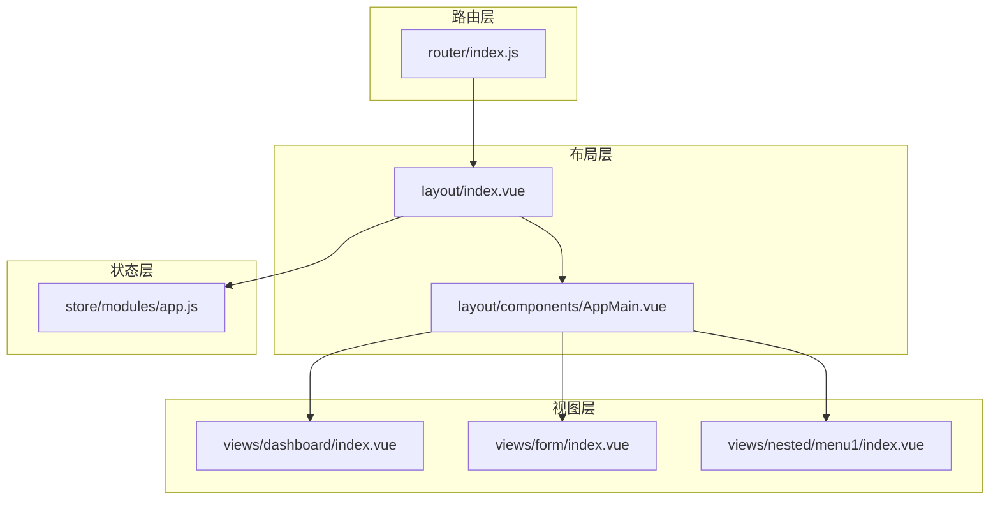
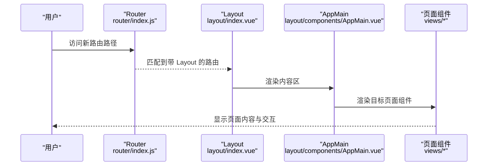
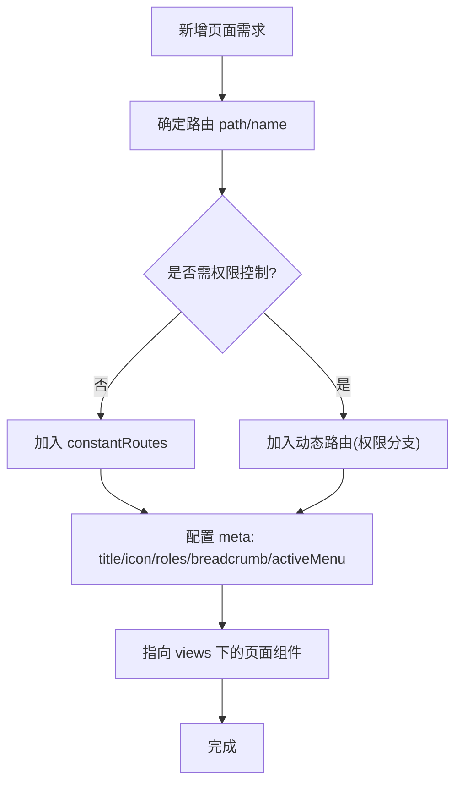
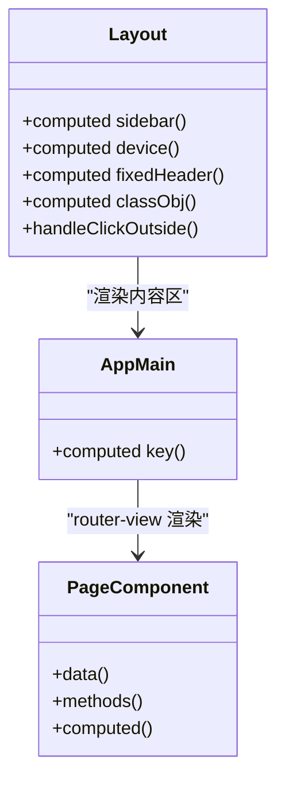
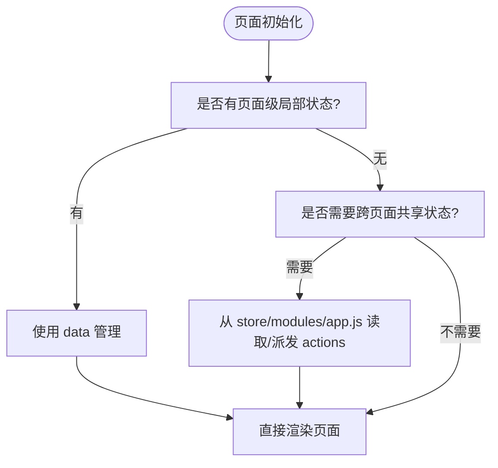
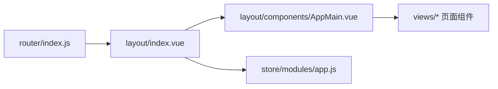

# 新增页面开发

<cite>
**本文引用的文件**   
- [src/router/index.js](file://src/router/index.js)
- [src/layout/index.vue](file://src/layout/index.vue)
- [src/layout/components/AppMain.vue](file://src/layout/components/AppMain.vue)
- [src/views/dashboard/index.vue](file://src/views/dashboard/index.vue)
- [src/views/form/index.vue](file://src/views/form/index.vue)
- [src/views/nested/menu1/index.vue](file://src/views/nested/menu1/index.vue)
- [src/store/modules/app.js](file://src/store/modules/app.js)
- [src/settings.js](file://src/settings.js)
</cite>

## 目录
1. [简介](#简介)
2. [项目结构](#项目结构)
3. [核心组件](#核心组件)
4. [架构总览](#架构总览)
5. [详细组件分析](#详细组件分析)
6. [依赖关系分析](#依赖关系分析)
7. [性能与可维护性](#性能与可维护性)
8. [故障排查指南](#故障排查指南)
9. [结论](#结论)
10. [附录：完整新增页面流程清单](#附录完整新增页面流程清单)

## 简介
本指南面向在现有 Vue 管理后台模板中新增页面的开发者，提供从创建页面文件、编写组件规范、配置路由到与布局集成、处理页面级状态管理的完整步骤。文档基于仓库实际代码进行说明，确保每一步都可落地执行。

## 项目结构
本项目采用“功能视图 + 布局容器 + 路由集中管理”的结构：
- views：业务页面组件目录
- layout：全局布局容器（侧边栏、导航、内容区）
- router：路由定义与权限控制入口
- store：全局状态（如侧边栏开关、设备类型等）
- settings：应用基础设置（标题、固定头部、侧边栏 Logo 等）

图表来源
- [src/router/index.js:33-164](file://src/router/index.js#L33-L164)
- [src/layout/index.vue:1-50](file://src/layout/index.vue#L1-L50)
- [src/layout/components/AppMain.vue:1-17](file://src/layout/components/AppMain.vue#L1-L17)
- [src/views/dashboard/index.vue:1-17](file://src/views/dashboard/index.vue#L1-L17)
- [src/views/form/index.vue:1-77](file://src/views/form/index.vue#L1-L77)
- [src/views/nested/menu1/index.vue:1-8](file://src/views/nested/menu1/index.vue#L1-L8)
- [src/store/modules/app.js:1-49](file://src/store/modules/app.js#L1-L49)

章节来源
- [src/router/index.js:1-182](file://src/router/index.js#L1-L182)
- [src/layout/index.vue:1-94](file://src/layout/index.vue#L1-L94)
- [src/layout/components/AppMain.vue:1-41](file://src/layout/components/AppMain.vue#L1-L41)
- [src/views/dashboard/index.vue:1-31](file://src/views/dashboard/index.vue#L1-L31)
- [src/views/form/index.vue:1-86](file://src/views/form/index.vue#L1-L86)
- [src/views/nested/menu1/index.vue:1-8](file://src/views/nested/menu1/index.vue#L1-L8)
- [src/store/modules/app.js:1-49](file://src/store/modules/app.js#L1-L49)

## 核心组件
- Layout 布局容器：负责侧边栏、顶部导航、主内容区的装配与响应式行为，并通过 AppMain 渲染当前路由对应的页面。
- AppMain：统一的内容渲染区域，使用 router-view 展示具体页面，并添加过渡动画。
- 页面组件：位于 views 下，按模块划分目录，每个模块一个 index.vue 作为入口。
- 路由：集中定义在 router/index.js，支持嵌套路由、隐藏路由、重定向与 meta 元信息。
- 状态：store/modules/app.js 管理侧边栏展开/收起、设备类型等全局 UI 状态。

章节来源
- [src/layout/index.vue:14-50](file://src/layout/index.vue#L14-L50)
- [src/layout/components/AppMain.vue:9-17](file://src/layout/components/AppMain.vue#L9-L17)
- [src/router/index.js:6-26](file://src/router/index.js#L6-L26)
- [src/store/modules/app.js:3-29](file://src/store/modules/app.js#L3-L29)

## 架构总览
新增页面时，数据与控制流如下：
- 用户在浏览器访问 URL，由 Router 匹配路由
- 若路由对应 Layout，则进入布局容器
- Layout 通过 AppMain 渲染目标页面组件
- 页面组件可通过 Vuex 获取或更新全局状态

图表来源
- [src/router/index.js:33-164](file://src/router/index.js#L33-L164)
- [src/layout/index.vue:1-50](file://src/layout/index.vue#L1-L50)
- [src/layout/components/AppMain.vue:1-17](file://src/layout/components/AppMain.vue#L1-L17)

## 详细组件分析

### 路由与 Meta 配置
- 路由定义位置：src/router/index.js
- 常量路由 constantRoutes：无需权限即可访问的基础路由集合
- 路由对象关键字段：
  - path：URL 路径
  - component：懒加载的页面组件
  - children：子路由（用于菜单分组与嵌套）
  - redirect：默认重定向
  - name：用于 keep-alive 缓存（必须唯一）
  - hidden：是否在侧边栏隐藏
  - meta：包含 title、icon、roles、breadcrumb、activeMenu 等元信息

图表来源
- [src/router/index.js:9-26](file://src/router/index.js#L9-L26)
- [src/router/index.js:33-164](file://src/router/index.js#L33-L164)

章节来源
- [src/router/index.js:9-26](file://src/router/index.js#L9-L26)
- [src/router/index.js:33-164](file://src/router/index.js#L33-L164)

### 页面组件编写规范
- 文件命名：建议以 index.vue 作为模块入口，便于路由懒加载 import('@/views/moduleName')
- 组件名：name 字段应与路由 name 保持一致，以便 keep-alive 正确缓存
- 样式作用域：建议使用 scoped 避免样式污染
- 状态管理：页面级局部状态放在 data；跨页面共享状态放入 store
- 示例参考：
  - 简单展示型页面：[src/views/dashboard/index.vue:1-31](file://src/views/dashboard/index.vue#L1-L31)
  - 表单型页面：[src/views/form/index.vue:1-86](file://src/views/form/index.vue#L1-L86)
  - 嵌套路由容器：[src/views/nested/menu1/index.vue:1-8](file://src/views/nested/menu1/index.vue#L1-L8)

章节来源
- [src/views/dashboard/index.vue:1-31](file://src/views/dashboard/index.vue#L1-L31)
- [src/views/form/index.vue:1-86](file://src/views/form/index.vue#L1-L86)
- [src/views/nested/menu1/index.vue:1-8](file://src/views/nested/menu1/index.vue#L1-L8)

### 与布局组件的集成
- Layout 负责装配 Sidebar、Navbar、AppMain
- AppMain 内部使用 router-view 渲染当前路由页面，并提供过渡动画
- 页面组件只需关注自身业务逻辑，无需关心布局细节

图表来源
- [src/layout/index.vue:14-50](file://src/layout/index.vue#L14-L50)
- [src/layout/components/AppMain.vue:9-17](file://src/layout/components/AppMain.vue#L9-L17)

章节来源
- [src/layout/index.vue:1-94](file://src/layout/index.vue#L1-L94)
- [src/layout/components/AppMain.vue:1-41](file://src/layout/components/AppMain.vue#L1-L41)

### 页面级状态管理
- 页面内局部状态：使用 data 管理
- 跨页面共享状态：使用 Vuex store，例如 app 模块中的侧边栏开关与设备类型
- 在页面组件中通过 mapGetters/mapActions 或直接 this.$store 访问/修改

图表来源
- [src/store/modules/app.js:3-49](file://src/store/modules/app.js#L3-L49)
- [src/views/dashboard/index.vue:7-17](file://src/views/dashboard/index.vue#L7-L17)

章节来源
- [src/store/modules/app.js:1-49](file://src/store/modules/app.js#L1-L49)
- [src/views/dashboard/index.vue:7-17](file://src/views/dashboard/index.vue#L7-L17)

## 依赖关系分析
- router/index.js 引入 Layout 作为容器组件，并将各页面组件以懒加载方式挂载
- Layout 依赖 store/modules/app.js 的状态来控制侧边栏与设备类型
- AppMain 依赖 Vue Router 的 <router-view> 渲染页面
- 页面组件可能依赖 store 的 getters/actions 来读写全局状态

图表来源
- [src/router/index.js:6-8](file://src/router/index.js#L6-L8)
- [src/layout/index.vue:14-50](file://src/layout/index.vue#L14-L50)
- [src/layout/components/AppMain.vue:9-17](file://src/layout/components/AppMain.vue#L9-L17)
- [src/store/modules/app.js:1-49](file://src/store/modules/app.js#L1-L49)

章节来源
- [src/router/index.js:1-182](file://src/router/index.js#L1-L182)
- [src/layout/index.vue:1-94](file://src/layout/index.vue#L1-L94)
- [src/layout/components/AppMain.vue:1-41](file://src/layout/components/AppMain.vue#L1-L41)
- [src/store/modules/app.js:1-49](file://src/store/modules/app.js#L1-L49)

## 性能与可维护性
- 路由懒加载：所有页面组件均使用动态 import，减少首屏体积
- 组件命名与路由 name 一致：利于 keep-alive 缓存，提升二次打开速度
- 样式隔离：使用 scoped 避免全局样式污染
- 状态分层：页面级状态放 data，全局状态放 store，保持职责清晰
- 路由 meta 规范化：title/icon/roles 等元信息集中描述，便于菜单生成与权限控制

章节来源
- [src/router/index.js:33-164](file://src/router/index.js#L33-L164)
- [src/views/dashboard/index.vue:1-31](file://src/views/dashboard/index.vue#L1-L31)
- [src/views/form/index.vue:1-86](file://src/views/form/index.vue#L1-L86)

## 故障排查指南
- 页面不显示
  - 检查路由是否正确注册且 path/name 与组件 name 一致
  - 确认组件路径引用无误（注意 @ 别名）
- 侧边栏未高亮或菜单不显示
  - 检查 meta.title/meta.icon 是否配置
  - 若为隐藏路由，确认 hidden 属性是否符合预期
- 页面刷新后状态丢失
  - 页面级状态应持久化或使用 store 管理
  - 全局 UI 状态（如侧边栏开关）已在 app.js 中使用 Cookies 持久化
- 样式冲突
  - 确保组件样式使用 scoped
  - 避免在全局样式中覆盖组件类名

章节来源
- [src/router/index.js:9-26](file://src/router/index.js#L9-L26)
- [src/store/modules/app.js:3-29](file://src/store/modules/app.js#L3-L29)

## 结论
按照本指南，你可以在 src/views 下新建页面组件，并在 src/router/index.js 中注册路由与 meta 元信息，页面将自动被 Layout 与 AppMain 渲染。对于跨页面状态，优先使用 store 管理；对于页面级状态，使用 data 管理。遵循懒加载、命名一致、样式隔离等最佳实践，可获得更好的性能与维护性。

## 附录：完整新增页面流程清单
- 在 src/views 下新建模块目录与 index.vue 页面组件
- 在 src/router/index.js 中添加路由：
  - 填写 path、name、component（懒加载）、meta（title/icon/roles/breadcrumb/activeMenu）
  - 如需分组，使用 children 嵌套
  - 如需隐藏，设置 hidden: true
- 如需与布局集成：
  - 确保路由指向 Layout 容器（大多数业务路由都如此）
  - 页面组件无需额外处理布局
- 如需页面级状态管理：
  - 局部状态使用 data
  - 全局状态通过 store/modules/app.js 或其他模块管理
- 验证：
  - 启动项目，访问新路由路径，确认页面正常渲染
  - 检查侧边栏菜单是否按 meta.title 显示与高亮
  - 检查浏览器控制台是否有路由或组件加载错误

章节来源
- [src/router/index.js:33-164](file://src/router/index.js#L33-L164)
- [src/layout/index.vue:1-50](file://src/layout/index.vue#L1-L50)
- [src/layout/components/AppMain.vue:1-17](file://src/layout/components/AppMain.vue#L1-L17)
- [src/store/modules/app.js:1-49](file://src/store/modules/app.js#L1-L49)
- [src/settings.js:1-17](file://src/settings.js#L1-L17)