# 权限系统扩展

<cite>
**本文引用的文件**   
- [src/permission.js](file://src/permission.js)
- [src/router/index.js](file://src/router/index.js)
- [src/store/modules/user.js](file://src/store/modules/user.js)
- [src/api/user.js](file://src/api/user.js)
- [src/utils/auth.js](file://src/utils/auth.js)
- [src/main.js](file://src/main.js)
</cite>

## 目录
1. [简介](#简介)
2. [项目结构](#项目结构)
3. [核心组件](#核心组件)
4. [架构总览](#架构总览)
5. [详细组件分析](#详细组件分析)
6. [依赖关系分析](#依赖关系分析)
7. [性能与缓存策略](#性能与缓存策略)
8. [常见问题排查](#常见问题排查)
9. [结论](#结论)
10. [附录：常见权限场景实现方案](#附录常见权限场景实现方案)

## 简介
本文件面向需要在现有最小化后台模板基础上扩展 RBAC（基于角色的访问控制）权限体系的开发者。当前仓库已具备基础的路由守卫、用户信息获取与 Token 管理，但尚未实现“按角色动态生成路由”和“按钮级权限控制”。本文将说明如何：
- 扩展现有 RBAC 机制：角色定义、权限验证逻辑、动态路由生成
- 在 permission.js 中接入自定义路由守卫逻辑
- 实现按钮级别的权限控制
- 设计权限数据的获取与缓存策略，以及权限变更时的刷新机制
- 提供菜单权限、操作权限、数据权限等常见场景的实现方案

## 项目结构
本项目采用 Vue + Element UI 的前端工程结构，权限相关代码主要分布在以下位置：
- 路由守卫与进度条：src/permission.js
- 路由表与常量路由：src/router/index.js
- 用户状态与接口调用：src/store/modules/user.js、src/api/user.js
- Token 存取工具：src/utils/auth.js
- 应用入口与权限模块引入：src/main.js

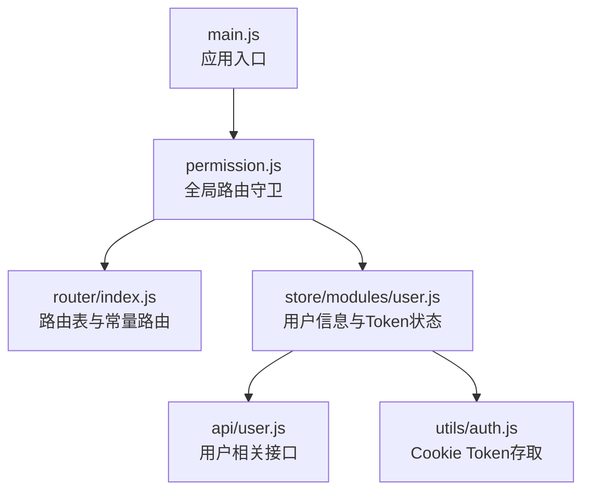

**图表来源**
- [src/main.js:15-16](file://src/main.js#L15-L16)
- [src/permission.js:1-7](file://src/permission.js#L1-L7)
- [src/router/index.js:1-10](file://src/router/index.js#L1-L10)
- [src/store/modules/user.js:1-3](file://src/store/modules/user.js#L1-L3)
- [src/api/user.js:1-2](file://src/api/user.js#L1-L2)
- [src/utils/auth.js:1-2](file://src/utils/auth.js#L1-L2)

**章节来源**
- [src/main.js:15-16](file://src/main.js#L15-L16)
- [src/permission.js:1-7](file://src/permission.js#L1-L7)
- [src/router/index.js:1-10](file://src/router/index.js#L1-L10)
- [src/store/modules/user.js:1-3](file://src/store/modules/user.js#L1-L3)
- [src/api/user.js:1-2](file://src/api/user.js#L1-L2)
- [src/utils/auth.js:1-2](file://src/utils/auth.js#L1-L2)

## 核心组件
- 路由守卫（permission.js）
  - 负责登录态校验、白名单放行、用户信息获取、错误处理与进度条控制
  - 是扩展权限控制的核心切入点
- 路由表（router/index.js）
  - 提供常量路由（无需权限即可访问的基础页面）
  - 支持 meta.roles 字段用于后续按角色过滤
- 用户模块（store/modules/user.js）
  - 维护 token、name、avatar 等用户状态
  - 提供 getInfo、logout、resetToken 等动作
- 用户接口（api/user.js）
  - 封装 login、getInfo、logout 三个 API
- Token 工具（utils/auth.js）
  - 基于 Cookie 的 getToken/setToken/removeToken

**章节来源**
- [src/permission.js:13-58](file://src/permission.js#L13-L58)
- [src/router/index.js:28-33](file://src/router/index.js#L28-L33)
- [src/store/modules/user.js:5-28](file://src/store/modules/user.js#L5-L28)
- [src/store/modules/user.js:30-88](file://src/store/modules/user.js#L30-L88)
- [src/api/user.js:1-24](file://src/api/user.js#L1-L24)
- [src/utils/auth.js:5-14](file://src/utils/auth.js#L5-L14)

## 架构总览
下图展示了从应用启动到路由守卫拦截、再到用户信息获取与 Token 管理的整体流程。

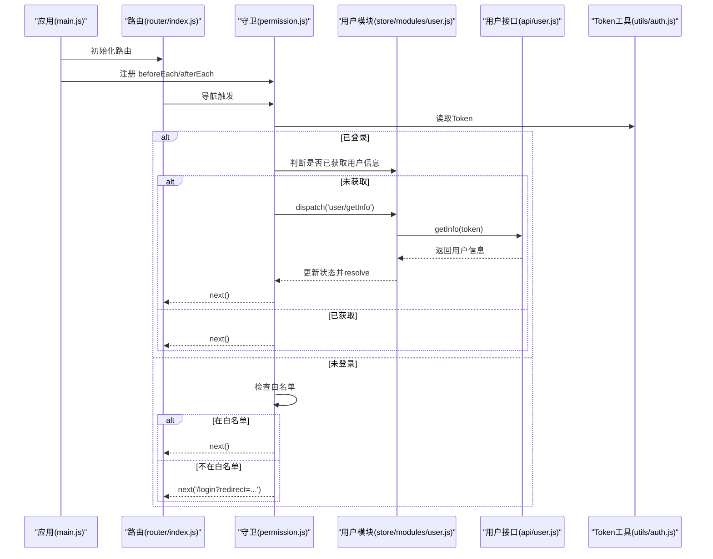

**图表来源**
- [src/main.js:15-16](file://src/main.js#L15-L16)
- [src/permission.js:13-58](file://src/permission.js#L13-L58)
- [src/store/modules/user.js:46-65](file://src/store/modules/user.js#L46-L65)
- [src/api/user.js:11-16](file://src/api/user.js#L11-L16)
- [src/utils/auth.js:5-6](file://src/utils/auth.js#L5-L6)

## 详细组件分析

### 路由守卫（permission.js）
- 功能要点
  - 使用 NProgress 显示进度条
  - 设置页面标题
  - 根据 Token 存在与否分流：已登录则尝试获取用户信息；未登录则走白名单或跳转登录
  - 捕获异常后重置 Token 并引导重新登录
- 扩展点
  - 可在“已登录且已获取用户信息”分支之后，加入“权限校验与动态路由生成”逻辑
  - 可在此处统一拦截无权限访问，进行提示或重定向

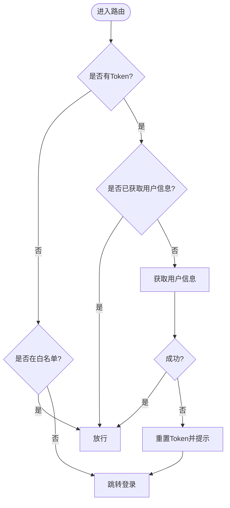

**图表来源**
- [src/permission.js:13-58](file://src/permission.js#L13-L58)

**章节来源**
- [src/permission.js:13-58](file://src/permission.js#L13-L58)

### 路由表（router/index.js）
- 常量路由
  - 提供无需权限即可访问的基础页面（如登录、404、首页、示例页等）
- 角色控制标记
  - 路由 meta.roles 可用于后续按角色过滤生成侧边栏与动态路由
- 动态路由能力
  - 提供 resetRouter 方法以清空并重建路由匹配器，便于权限变更后重建路由

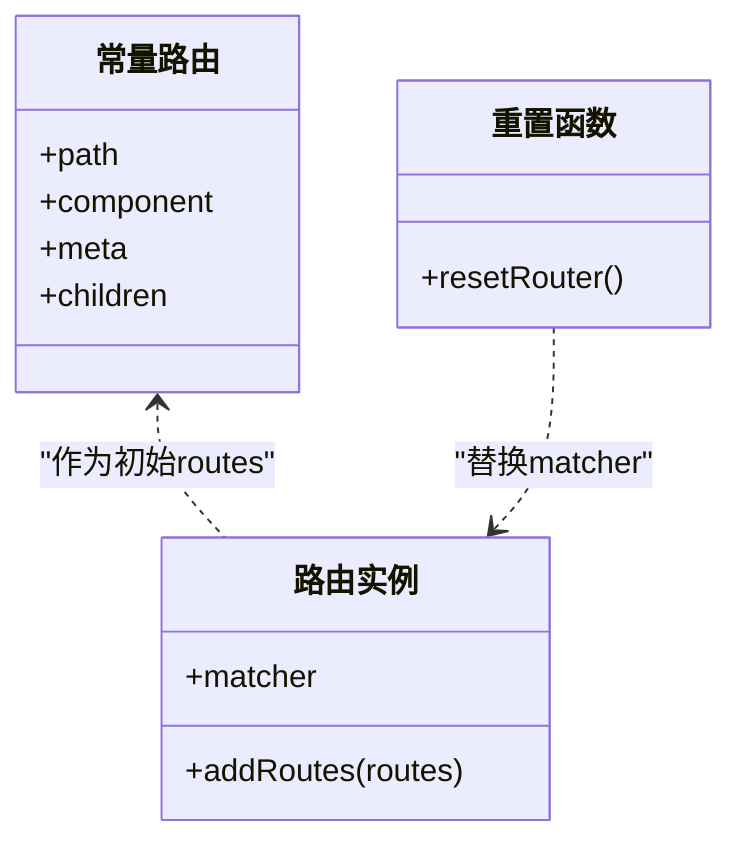

**图表来源**
- [src/router/index.js:28-33](file://src/router/index.js#L28-L33)
- [src/router/index.js:167-179](file://src/router/index.js#L167-L179)

**章节来源**
- [src/router/index.js:28-33](file://src/router/index.js#L28-L33)
- [src/router/index.js:167-179](file://src/router/index.js#L167-L179)

### 用户模块（store/modules/user.js）
- 状态
  - token、name、avatar
- 动作
  - login：提交用户名密码，成功后写入 Token
  - getInfo：根据 Token 拉取用户信息，更新 name/avatar
  - logout：调用后端登出，清除 Token、重置路由、重置状态
  - resetToken：仅清理本地 Token 与状态
- 与权限的关系
  - 在权限扩展时，建议将 roles/permissions 一并放入该模块，供守卫与组件使用

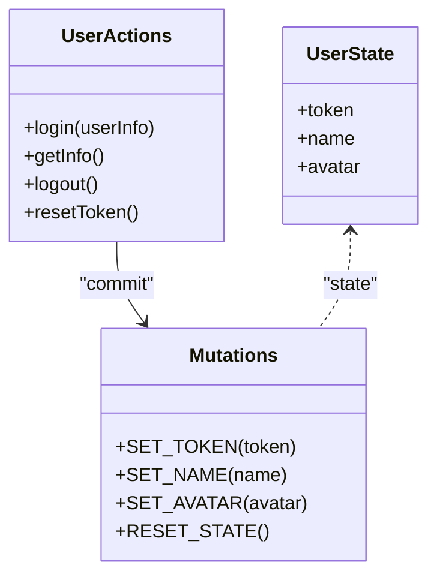

**图表来源**
- [src/store/modules/user.js:5-28](file://src/store/modules/user.js#L5-L28)
- [src/store/modules/user.js:30-88](file://src/store/modules/user.js#L30-L88)

**章节来源**
- [src/store/modules/user.js:5-28](file://src/store/modules/user.js#L5-L28)
- [src/store/modules/user.js:30-88](file://src/store/modules/user.js#L30-L88)

### 用户接口（api/user.js）
- 封装了登录、获取用户信息、登出三个接口
- 权限扩展时可新增“获取权限列表”的接口，例如 getPermissions

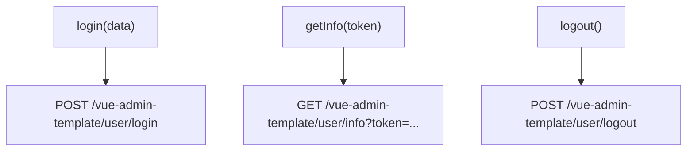

**图表来源**
- [src/api/user.js:3-8](file://src/api/user.js#L3-L8)
- [src/api/user.js:11-16](file://src/api/user.js#L11-L16)
- [src/api/user.js:19-23](file://src/api/user.js#L19-L23)

**章节来源**
- [src/api/user.js:1-24](file://src/api/user.js#L1-L24)

### Token 工具（utils/auth.js）
- 基于 js-cookie 的 Token 存取
- 权限扩展中常用于：
  - 守卫中读取 Token 判断登录态
  - 登出或权限失效时移除 Token

**章节来源**
- [src/utils/auth.js:1-14](file://src/utils/auth.js#L1-L14)

## 依赖关系分析
- main.js 引入 permission.js，确保全局路由守卫生效
- permission.js 依赖 router、store、auth、element-ui Message、nprogress
- store/modules/user.js 依赖 api/user.js 与 utils/auth.js
- router/index.js 暴露常量路由与 resetRouter，供权限扩展时动态添加路由

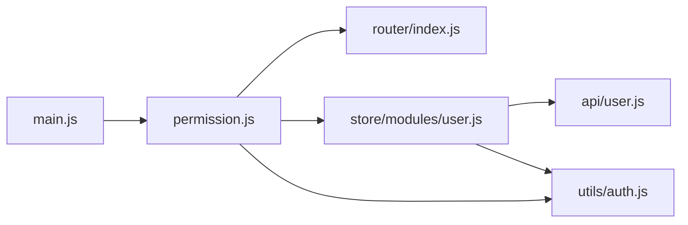

**图表来源**
- [src/main.js:15-16](file://src/main.js#L15-L16)
- [src/permission.js:1-7](file://src/permission.js#L1-L7)
- [src/store/modules/user.js:1-3](file://src/store/modules/user.js#L1-L3)
- [src/router/index.js:1-10](file://src/router/index.js#L1-L10)
- [src/utils/auth.js:1-2](file://src/utils/auth.js#L1-L2)
- [src/api/user.js:1-2](file://src/api/user.js#L1-L2)

**章节来源**
- [src/main.js:15-16](file://src/main.js#L15-L16)
- [src/permission.js:1-7](file://src/permission.js#L1-L7)
- [src/store/modules/user.js:1-3](file://src/store/modules/user.js#L1-L3)
- [src/router/index.js:1-10](file://src/router/index.js#L1-L10)
- [src/utils/auth.js:1-2](file://src/utils/auth.js#L1-L2)
- [src/api/user.js:1-2](file://src/api/user.js#L1-L2)

## 性能与缓存策略
- 权限数据缓存
  - 建议在 store 中增加 permissions 字段，首次登录后拉取并缓存
  - 结合 localStorage 做持久化缓存，避免每次刷新都请求后端
- 路由懒加载
  - 路由组件使用动态 import，减少首屏体积
- 防抖与重试
  - 对频繁触发的权限校验（如按钮级）可做轻量缓存或去抖
- 权限变更刷新
  - 当后端权限变更时，通过“刷新权限”动作重新拉取并重建路由

[本节为通用指导，不直接分析具体文件]

## 常见问题排查
- 登录后仍被跳转到登录页
  - 检查 Token 是否正确写入 Cookie
  - 检查 getInfo 是否成功返回用户信息
- 动态路由未生效
  - 确认是否在获取用户信息后调用了 addRoutes 并 await 完成
  - 确认是否使用了 router.replace 或再次进入目标路由以触发渲染
- 按钮权限无效
  - 检查指令是否正确注册并在模板中使用
  - 检查权限标识是否与后端返回一致

**章节来源**
- [src/permission.js:33-44](file://src/permission.js#L33-L44)
- [src/store/modules/user.js:46-65](file://src/store/modules/user.js#L46-L65)

## 结论
当前仓库提供了完善的基础设施：路由守卫、用户信息获取、Token 管理与常量路由。在此基础上，只需在 permission.js 中接入“权限获取与校验”、“动态路由生成”，并在 store 中维护权限数据，即可实现完整的 RBAC 体系。同时，可通过自定义指令实现按钮级权限控制，配合缓存与刷新机制，满足复杂业务场景下的权限需求。

[本节为总结性内容，不直接分析具体文件]

## 附录：常见权限场景实现方案

### 角色定义与权限模型
- 角色（roles）：如 admin、editor 等
- 权限（permissions）：如 menu:view、menu:add、btn:export 等
- 建议在后端返回用户信息时附带 roles 与 permissions，前端存入 store

[本节为概念性说明，不直接分析具体文件]

### 菜单权限（路由级）
- 步骤
  - 在获取用户信息后，调用后端接口获取权限列表
  - 遍历后端返回的菜单树，过滤出当前用户有权访问的路由
  - 使用 router.addRoutes 动态挂载路由
  - 使用 router.replace(to.fullPath) 确保当前路由正确渲染
- 关键点
  - 仅在首次登录或权限变更时执行一次
  - 注意异步时序，确保 addRoutes 完成后才放行

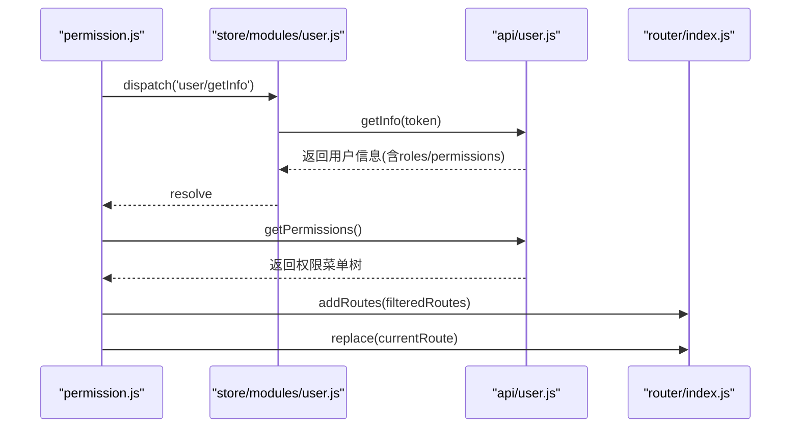

**图表来源**
- [src/permission.js:33-44](file://src/permission.js#L33-L44)
- [src/store/modules/user.js:46-65](file://src/store/modules/user.js#L46-L65)
- [src/router/index.js:167-179](file://src/router/index.js#L167-L179)

**章节来源**
- [src/permission.js:33-44](file://src/permission.js#L33-L44)
- [src/store/modules/user.js:46-65](file://src/store/modules/user.js#L46-L65)
- [src/router/index.js:167-179](file://src/router/index.js#L167-L179)

### 操作权限（按钮级）
- 思路
  - 自定义 v-permission 指令，接收权限标识（如 btn:export）
  - 在指令中比对当前用户权限集合，决定是否渲染元素
- 实现要点
  - 在 main.js 中注册指令
  - 在组件模板中使用 v-permission="xxx"
  - 权限变更时，需触发组件重新渲染（如 key 变化或 forceUpdate）

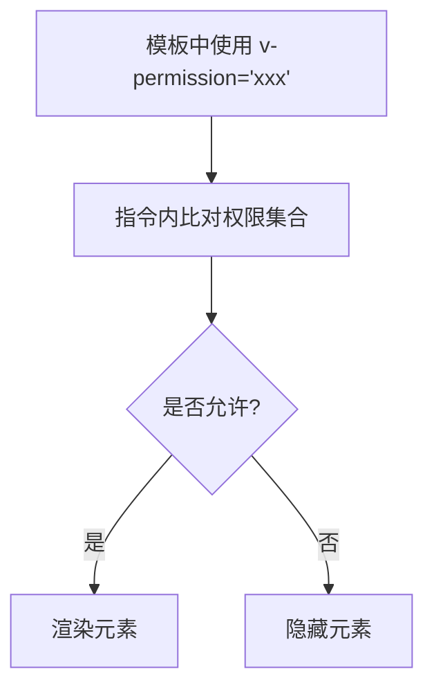

[本节为概念性说明，不直接分析具体文件]

### 数据权限（行级/列级）
- 思路
  - 在表格渲染前，根据权限过滤数据（如仅展示本人数据）
  - 在列级别，根据权限控制敏感字段显示
- 实现要点
  - 在 store 中维护 dataScope 或 fieldPermissions
  - 在组件计算属性中根据权限过滤数据或字段

[本节为概念性说明，不直接分析具体文件]

### 权限数据的获取与缓存策略
- 获取时机
  - 首次登录成功后拉取权限
  - 权限变更时主动刷新
- 缓存策略
  - 内存缓存：store.permissions
  - 持久化缓存：localStorage 存储权限快照
- 失效与刷新
  - 提供 refreshPermissions 动作，拉取最新权限并重建路由
  - 登出时清除缓存

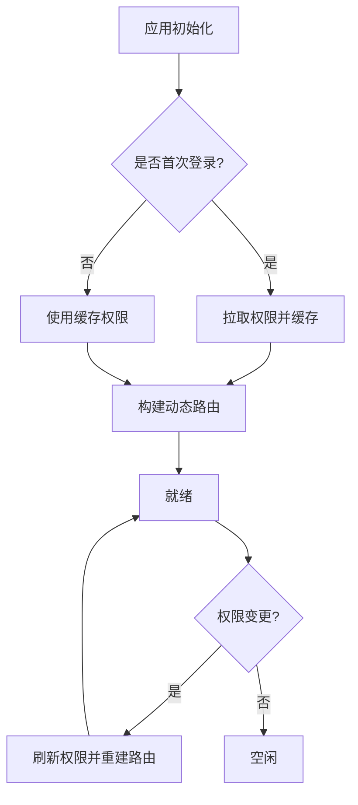

[本节为概念性说明，不直接分析具体文件]

### 权限变更时的刷新机制
- 触发条件
  - 用户切换角色
  - 管理员修改用户权限
- 刷新流程
  - 调用 refreshPermissions 拉取最新权限
  - 清空旧路由 matcher，重建新路由
  - 重定向到当前路径，确保视图正确渲染

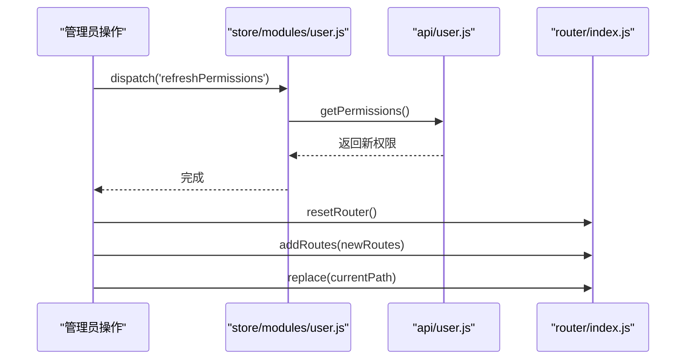

**图表来源**
- [src/router/index.js:167-179](file://src/router/index.js#L167-L179)

[本节为概念性说明，不直接分析具体文件]