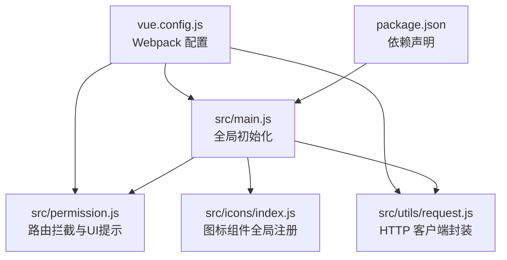
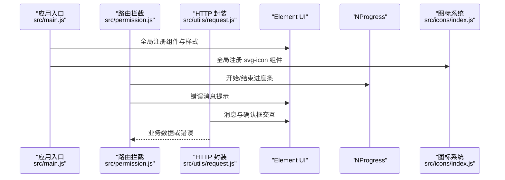
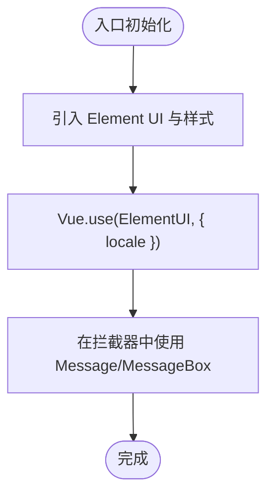
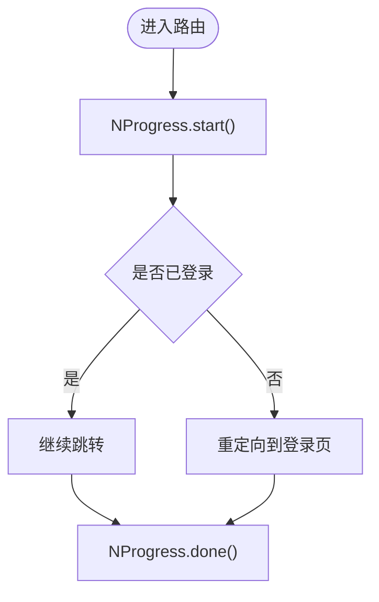
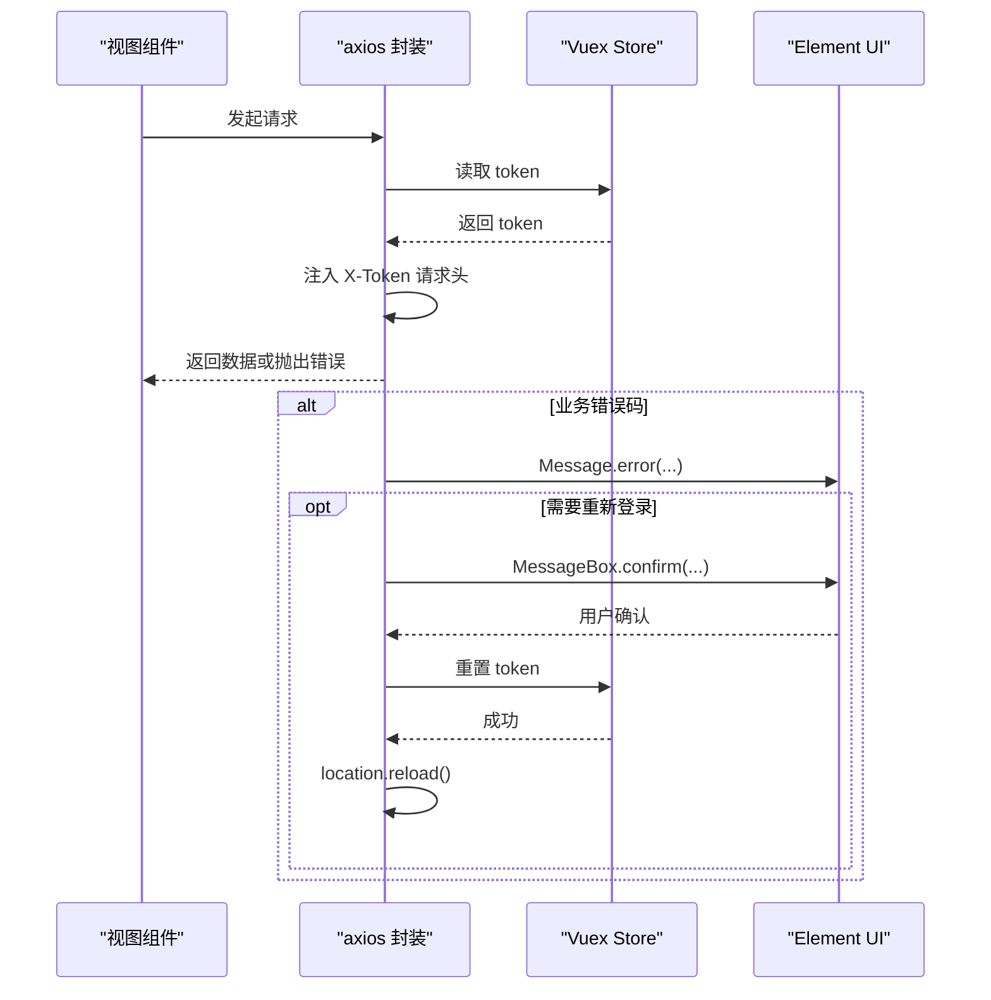
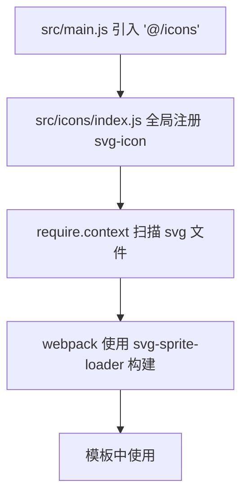
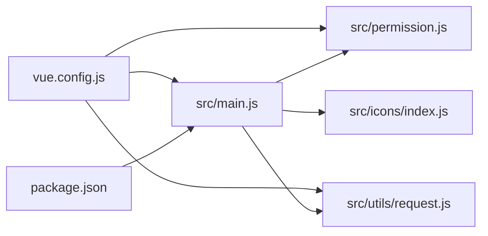
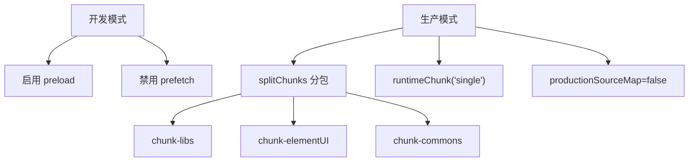

# 第三方库集成

<cite>
**本文引用的文件**   
- [package.json](file://package.json)
- [src/main.js](file://src/main.js)
- [vue.config.js](file://vue.config.js)
- [src/permission.js](file://src/permission.js)
- [src/utils/request.js](file://src/utils/request.js)
- [src/icons/index.js](file://src/icons/index.js)
</cite>

## 目录
1. [简介](#简介)
2. [项目结构](#项目结构)
3. [核心组件](#核心组件)
4. [架构总览](#架构总览)
5. [详细组件分析](#详细组件分析)
6. [依赖关系分析](#依赖关系分析)
7. [性能与打包优化](#性能与打包优化)
8. [样式冲突与版本兼容](#样式冲突与版本兼容)
9. [常见问题排查](#常见问题排查)
10. [结论](#结论)

## 简介
本指南面向在 Vue 2 + Element UI 管理后台项目中引入和使用第三方库的实践，覆盖以下主题：
- npm 包安装与依赖声明
- 在入口文件中全局注册与按需加载
- 样式引入与冲突处理
- 打包体积优化与分包策略
- 常见第三方库（图标、进度条、HTTP 客户端）的集成示例
- 将第三方库封装为内部组件与插件扩展思路

## 项目结构
本项目采用 Vue CLI 脚手架，主要与第三方库集成相关的目录与文件如下：
- 依赖清单：package.json
- 应用入口：src/main.js
- 构建配置：vue.config.js
- 权限与路由拦截：src/permission.js
- HTTP 请求封装：src/utils/request.js
- 图标系统：src/icons/index.js

图表来源
- [package.json:16-26](file://package.json#L16-L26)
- [src/main.js:1-43](file://src/main.js#L1-L43)
- [src/permission.js:1-65](file://src/permission.js#L1-L65)
- [src/utils/request.js:1-86](file://src/utils/request.js#L1-L86)
- [src/icons/index.js:1-10](file://src/icons/index.js#L1-L10)
- [vue.config.js:1-124](file://vue.config.js#L1-L124)

章节来源
- [package.json:16-26](file://package.json#L16-L26)
- [src/main.js:1-43](file://src/main.js#L1-L43)
- [vue.config.js:1-124](file://vue.config.js#L1-L124)

## 核心组件
- Element UI：通过入口文件全局注册，并引入主题样式与国际化语言包。
- NProgress：用于页面切换时的顶部进度条，包含样式引入与基础配置。
- Axios：作为 HTTP 客户端，封装请求/响应拦截器，结合 Element UI 的消息与确认框进行交互。
- 图标系统：基于 SVG Sprite 的图标组件，在入口中全局注册并自动扫描 svg 资源。

章节来源
- [src/main.js:5-7,31-34:5-7](file://src/main.js#L5-L7)
- [src/permission.js:4-9](file://src/permission.js#L4-L9)
- [src/utils/request.js:1-2](file://src/utils/request.js#L1-L2)
- [src/icons/index.js:1-5](file://src/icons/index.js#L1-L5)

## 架构总览
下图展示了第三方库在项目中的集成位置与调用关系：

图表来源
- [src/main.js:5-7,31-34:5-7](file://src/main.js#L5-L7)
- [src/permission.js:4-9,38-44:4-9](file://src/permission.js#L4-L9)
- [src/utils/request.js:45-82](file://src/utils/request.js#L45-L82)
- [src/icons/index.js:1-5](file://src/icons/index.js#L1-L5)

## 详细组件分析

### Element UI 集成
- 全局注册：在入口文件中引入 Element UI 及其样式，并通过 Vue.use 完成全局注册，同时传入国际化语言包。
- 按需使用：在权限拦截与 HTTP 封装中直接引用 Message、MessageBox 等组件 API。
- 样式引入：引入 theme-chalk 主题样式，确保组件视觉一致。

图表来源
- [src/main.js:5-7,31-34:5-7](file://src/main.js#L5-L7)
- [src/permission.js:3,38-44](file://src/permission.js#L3)
- [src/utils/request.js:2,45-82](file://src/utils/request.js#L2)

章节来源
- [src/main.js:5-7,31-34:5-7](file://src/main.js#L5-L7)
- [src/permission.js:3,38-44](file://src/permission.js#L3)
- [src/utils/request.js:2,45-82](file://src/utils/request.js#L2)

### NProgress 集成
- 样式引入：在权限拦截文件中引入 nprogress 样式。
- 基础配置：关闭 spinner，提升体验。
- 生命周期：在路由 beforeEach 中 start，afterEach 中 done，保证进度条与导航同步。

图表来源
- [src/permission.js:4-9,13-15,61-64:4-9](file://src/permission.js#L4-L9)

章节来源
- [src/permission.js:4-9,13-15,61-64:4-9](file://src/permission.js#L4-L9)

### Axios 封装与 Element UI 交互
- 实例创建：设置 baseURL、超时时间等。
- 请求拦截：从 store 获取 token 并注入请求头。
- 响应拦截：根据后端返回码统一处理错误，使用 Element UI 的 Message 与 MessageBox 进行用户反馈；对特定错误码触发重新登录流程。

图表来源
- [src/utils/request.js:6-11,13-31,45-82:6-11](file://src/utils/request.js#L6-L11)

章节来源
- [src/utils/request.js:6-11,13-31,45-82:6-11](file://src/utils/request.js#L6-L11)

### 图标系统集成
- 全局注册：在 icons/index.js 中将 SvgIcon 组件以 svg-icon 名称全局注册。
- 资源扫描：使用 require.context 自动导入 src/icons/svg 下的所有 svg 文件，配合 webpack 的 svg-sprite-loader 生成 sprite。
- 样式与构建：在 vue.config.js 中为 svg 单独配置 loader，排除 src/icons 目录并使用 svg-sprite-loader。

图表来源
- [src/main.js:15](file://src/main.js#L15)
- [src/icons/index.js:1-10](file://src/icons/index.js#L1-L10)
- [vue.config.js:66-81](file://vue.config.js#L66-L81)

章节来源
- [src/main.js:15](file://src/main.js#L15)
- [src/icons/index.js:1-10](file://src/icons/index.js#L1-L10)
- [vue.config.js:66-81](file://vue.config.js#L66-L81)

## 依赖关系分析
- 运行时依赖：vue、element-ui、axios、nprogress、normalize.css 等。
- 开发依赖：@vue/cli-service、babel、eslint、mockjs、svg-sprite-loader、svgo 等。
- 关键耦合点：
  - main.js 负责全局初始化与第三方库注册。
  - permission.js 依赖 Element UI 与 NProgress。
  - utils/request.js 依赖 axios 与 Element UI。
  - vue.config.js 控制第三方库的分包与优化。

图表来源
- [package.json:16-26](file://package.json#L16-L26)
- [src/main.js:1-43](file://src/main.js#L1-L43)
- [src/permission.js:1-65](file://src/permission.js#L1-L65)
- [src/utils/request.js:1-86](file://src/utils/request.js#L1-L86)
- [src/icons/index.js:1-10](file://src/icons/index.js#L1-L10)
- [vue.config.js:1-124](file://vue.config.js#L1-L124)

章节来源
- [package.json:16-26](file://package.json#L16-L26)
- [vue.config.js:95-119](file://vue.config.js#L95-L119)

## 性能与打包优化
- 预加载与预取：开启 preload，删除 prefetch 以减少无关请求。
- 代码分割：
  - 将 node_modules 中的第三方库抽离为 chunk-libs。
  - 针对 element-ui 单独拆分 chunk-elementUI，避免与应用代码混包。
  - 抽取公共模块 commons，减少重复打包。
- Runtime Chunk：启用 single runtimeChunk，提升缓存命中。
- 生产环境 SourceMap：关闭 productionSourceMap，减小产物体积。

图表来源
- [vue.config.js:51-64,95-119,31:51-64](file://vue.config.js#L51-L64)

章节来源
- [vue.config.js:51-64,95-119,31:51-64](file://vue.config.js#L51-L64)

## 样式冲突与版本兼容
- 样式引入顺序：先引入 normalize.css，再引入 Element UI 主题样式，最后引入项目全局样式，以降低冲突概率。
- 主题定制：如需自定义主题，可在 Element UI 基础上替换主题变量或引入自定义样式文件。
- 版本兼容性：
  - 锁定依赖版本（见 package.json），避免升级带来不兼容。
  - 若需升级，建议逐个升级并回归测试，重点关注 UI 组件行为变化与 CSS 选择器变更。
- 命名空间隔离：对于可能产生全局样式的第三方库，建议在容器内使用更具体的类名或 CSS Modules 进行隔离（视具体库支持情况而定）。

章节来源
- [src/main.js:3-9](file://src/main.js#L3-L9)
- [package.json:16-26](file://package.json#L16-L26)

## 常见问题排查
- 进度条未显示或卡住：
  - 检查是否在路由 beforeEach 中调用 NProgress.start()，并在 afterEach 中调用 NProgress.done()。
  - 确认是否正确引入 nprogress 样式。
- 消息提示不出现：
  - 确认已在入口全局注册 Element UI。
  - 检查是否在拦截器中正确调用 Message/MessageBox。
- Token 失效后未跳转：
  - 检查响应拦截器中对特定错误码的处理逻辑，以及 MessageBox 确认后是否执行了重置 token 与刷新页面。
- 图标不显示：
  - 确认已在入口引入 '@/icons'。
  - 检查 svg 文件路径与 require.context 是否正确。
  - 确认 webpack 配置中 svg-sprite-loader 规则生效。

章节来源
- [src/permission.js:4-9,13-15,61-64:4-9](file://src/permission.js#L4-L9)
- [src/utils/request.js:45-82](file://src/utils/request.js#L45-L82)
- [src/main.js:15](file://src/main.js#L15)
- [src/icons/index.js:1-10](file://src/icons/index.js#L1-L10)
- [vue.config.js:66-81](file://vue.config.js#L66-L81)

## 结论
本项目已对常用第三方库进行了标准化集成：Element UI 全局注册与按需使用、NProgress 与路由生命周期绑定、Axios 封装与 UI 交互、SVG 图标系统自动化构建。通过 vue.config.js 的分包与优化策略，有效控制了打包体积并提升了运行性能。后续新增第三方库时，建议遵循“入口集中注册、样式有序引入、按需加载、分包优化”的原则，以保证项目的可维护性与性能表现。