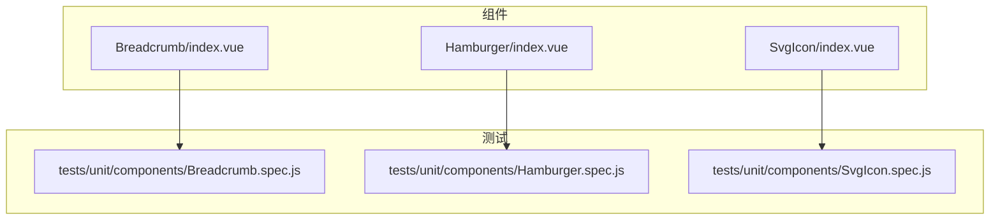
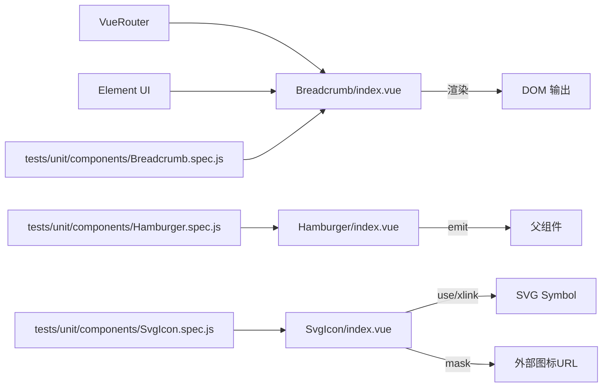
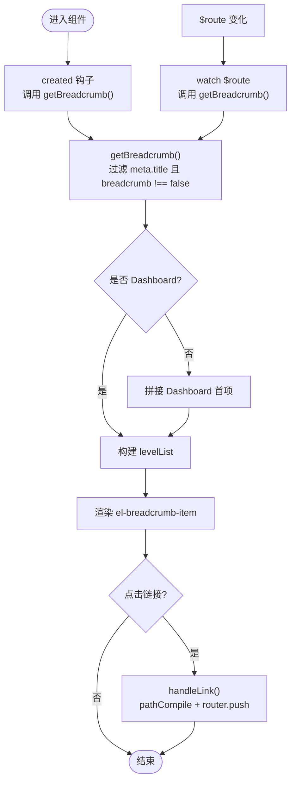
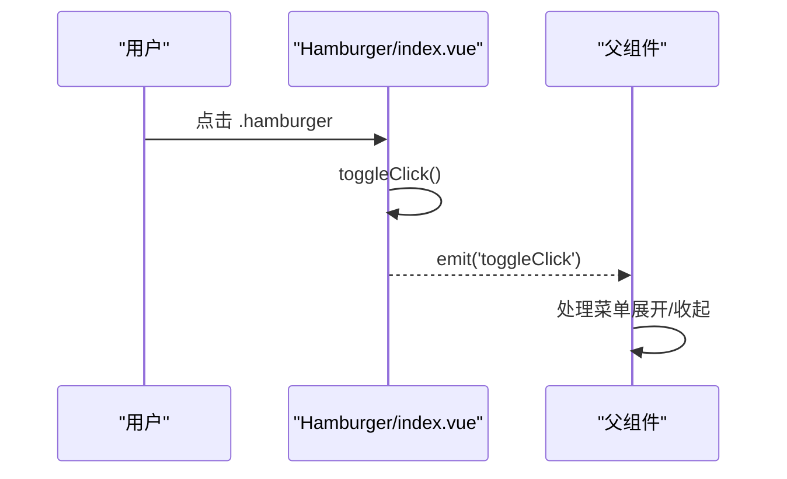
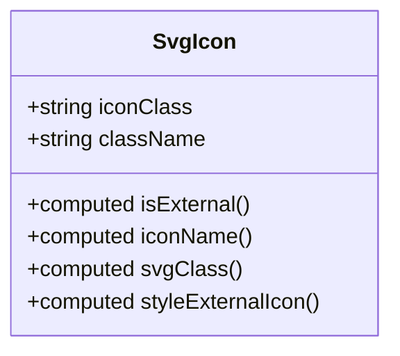
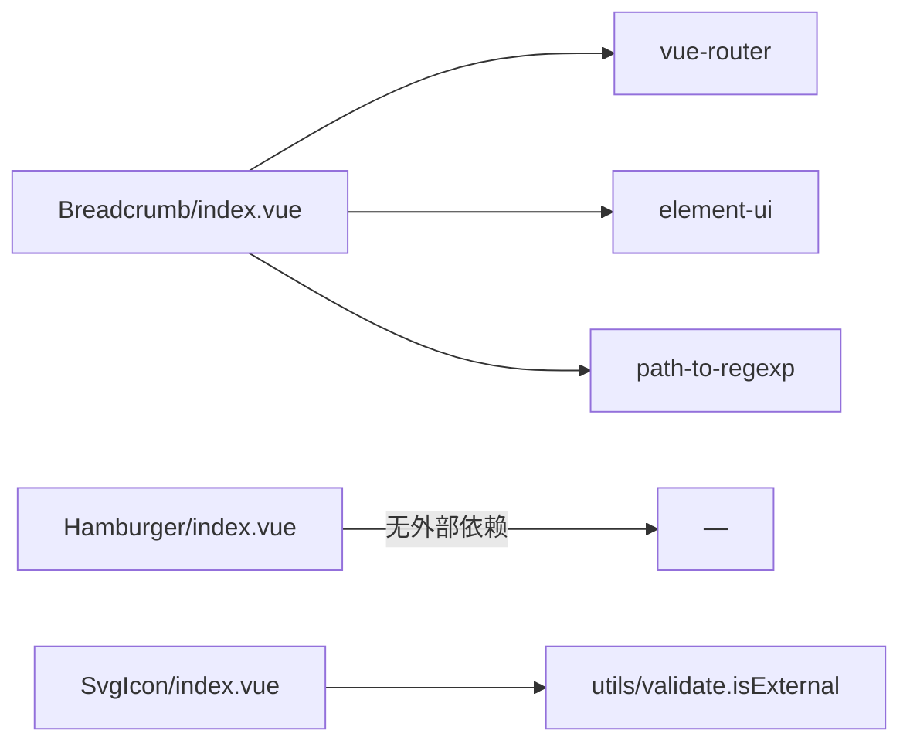
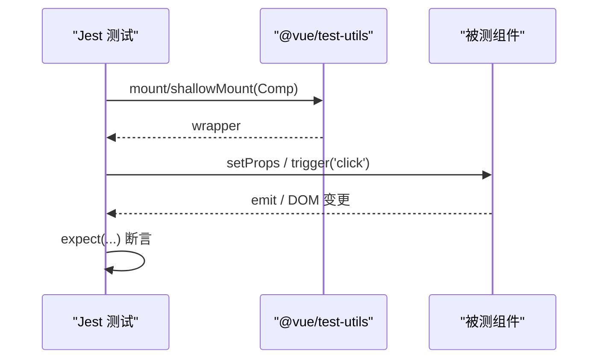

# 组件开发规范

<cite>
**本文引用的文件**   
- [src/components/Breadcrumb/index.vue](file://src/components/Breadcrumb/index.vue)
- [src/components/Hamburger/index.vue](file://src/components/Hamburger/index.vue)
- [src/components/SvgIcon/index.vue](file://src/components/SvgIcon/index.vue)
- [tests/unit/components/Breadcrumb.spec.js](file://tests/unit/components/Breadcrumb.spec.js)
- [tests/unit/components/Hamburger.spec.js](file://tests/unit/components/Hamburger.spec.js)
- [tests/unit/components/SvgIcon.spec.js](file://tests/unit/components/SvgIcon.spec.js)
</cite>

## 目录
1. [引言](#引言)
2. [项目结构](#项目结构)
3. [核心组件](#核心组件)
4. [架构总览](#架构总览)
5. [详细组件分析](#详细组件分析)
6. [依赖关系分析](#依赖关系分析)
7. [性能与优化](#性能与优化)
8. [测试指南](#测试指南)
9. [样式隔离与主题定制](#样式隔离与主题定制)
10. [调试技巧](#调试技巧)
11. [结论](#结论)

## 引言
本规范面向可复用的 Vue 组件开发，结合仓库中 Breadcrumb、Hamburger、SvgIcon 三个现有组件，总结命名约定、文件组织、props 设计、生命周期管理、事件处理、插槽使用、测试方法、性能优化、样式隔离与主题定制等最佳实践。目标是让团队成员在统一标准下高效产出高质量、可维护的组件。

## 项目结构
- 组件位于 src/components 目录下，每个组件以文件夹形式组织，入口文件统一命名为 index.vue。
- 单元测试位于 tests/unit/components 下，按组件名一一对应。
- 该结构有利于组件解耦、独立演进和自动化测试覆盖。

图表来源
- [src/components/Breadcrumb/index.vue:1-79](file://src/components/Breadcrumb/index.vue#L1-L79)
- [src/components/Hamburger/index.vue:1-45](file://src/components/Hamburger/index.vue#L1-L45)
- [src/components/SvgIcon/index.vue:1-63](file://src/components/SvgIcon/index.vue#L1-L63)
- [tests/unit/components/Breadcrumb.spec.js:1-99](file://tests/unit/components/Breadcrumb.spec.js#L1-L99)
- [tests/unit/components/Hamburger.spec.js:1-19](file://tests/unit/components/Hamburger.spec.js#L1-L19)
- [tests/unit/components/SvgIcon.spec.js:1-23](file://tests/unit/components/SvgIcon.spec.js#L1-L23)

章节来源
- [src/components/Breadcrumb/index.vue:1-79](file://src/components/Breadcrumb/index.vue#L1-L79)
- [src/components/Hamburger/index.vue:1-45](file://src/components/Hamburger/index.vue#L1-L45)
- [src/components/SvgIcon/index.vue:1-63](file://src/components/SvgIcon/index.vue#L1-L63)
- [tests/unit/components/Breadcrumb.spec.js:1-99](file://tests/unit/components/Breadcrumb.spec.js#L1-L99)
- [tests/unit/components/Hamburger.spec.js:1-19](file://tests/unit/components/Hamburger.spec.js#L1-L19)
- [tests/unit/components/SvgIcon.spec.js:1-23](file://tests/unit/components/SvgIcon.spec.js#L1-L23)

## 核心组件
- Breadcrumb：基于路由元信息动态渲染面包屑，支持 Dashboard 前缀、重定向与参数路径编译。
- Hamburger：纯展示型按钮组件，通过 props 控制激活态，点击触发事件交由父组件处理。
- SvgIcon：统一的图标渲染组件，支持本地 SVG symbol 与外部 URL 两种模式，透传监听器。

章节来源
- [src/components/Breadcrumb/index.vue:1-79](file://src/components/Breadcrumb/index.vue#L1-L79)
- [src/components/Hamburger/index.vue:1-45](file://src/components/Hamburger/index.vue#L1-L45)
- [src/components/SvgIcon/index.vue:1-63](file://src/components/SvgIcon/index.vue#L1-L63)

## 架构总览
下图展示了三个组件与其测试之间的对应关系，以及 Breadcrumb 对路由与 Element UI 的依赖。

图表来源
- [src/components/Breadcrumb/index.vue:1-79](file://src/components/Breadcrumb/index.vue#L1-L79)
- [src/components/Hamburger/index.vue:1-45](file://src/components/Hamburger/index.vue#L1-L45)
- [src/components/SvgIcon/index.vue:1-63](file://src/components/SvgIcon/index.vue#L1-L63)
- [tests/unit/components/Breadcrumb.spec.js:1-99](file://tests/unit/components/Breadcrumb.spec.js#L1-L99)
- [tests/unit/components/Hamburger.spec.js:1-19](file://tests/unit/components/Hamburger.spec.js#L1-L19)
- [tests/unit/components/SvgIcon.spec.js:1-23](file://tests/unit/components/SvgIcon.spec.js#L1-L23)

## 详细组件分析

### Breadcrumb 组件
- 职责：根据当前路由 matched 生成面包屑导航，自动注入 Dashboard 首页项，过滤无标题或显式隐藏的面由项，支持带参路由跳转。
- 命名约定：组件名为 Breadcrumb，文件为 index.vue。
- Props：未暴露 props，内部状态 levelList 由路由驱动。
- 生命周期与数据流：
  - created 初始化一次面包屑列表。
  - watch $route 响应路由变化重新计算。
  - methods 提供 getBreadcrumb、isDashboard、pathCompile、handleLink。
- 事件处理：不向外抛事件；通过 this.$router.push 进行导航。
- 插槽：未使用插槽。
- 样式：使用 scoped SCSS，类名 app-breadcrumb 包裹，避免污染全局。

图表来源
- [src/components/Breadcrumb/index.vue:15-62](file://src/components/Breadcrumb/index.vue#L15-L62)

章节来源
- [src/components/Breadcrumb/index.vue:1-79](file://src/components/Breadcrumb/index.vue#L1-L79)

### Hamburger 组件
- 职责：提供汉堡菜单按钮，根据 isActive 切换激活态样式，点击时向外抛出 toggleClick 事件。
- 命名约定：组件名为 Hamburger，文件为 index.vue。
- Props：isActive（Boolean，默认 false）。
- 生命周期：无特殊生命周期逻辑。
- 事件处理：toggleClick 事件由父组件监听并处理。
- 插槽：未使用插槽。
- 样式：scoped CSS，.hamburger 基础样式，.is-active 旋转动画。

图表来源
- [src/components/Hamburger/index.vue:16-30](file://src/components/Hamburger/index.vue#L16-L30)

章节来源
- [src/components/Hamburger/index.vue:1-45](file://src/components/Hamburger/index.vue#L1-L45)

### SvgIcon 组件
- 职责：统一渲染图标，支持本地 SVG symbol 与外部 URL 两种模式，透传监听器给根节点。
- 命名约定：组件名为 SvgIcon，文件为 index.vue。
- Props：iconClass（String，必填）、className（String，可选）。
- 计算属性：
  - isExternal：判断是否为外部 URL。
  - iconName：拼接 #icon-{iconClass}。
  - svgClass：合并基础类与自定义类。
  - styleExternalIcon：为外部图标设置 mask 样式。
- 生命周期：无特殊生命周期逻辑。
- 事件处理：通过 v-on="$listeners" 将父级监听器透传到根元素。
- 插槽：未使用插槽。
- 样式：scoped CSS，.svg-icon 与 .svg-external-icon 两类样式。

图表来源
- [src/components/SvgIcon/index.vue:12-44](file://src/components/SvgIcon/index.vue#L12-L44)

章节来源
- [src/components/SvgIcon/index.vue:1-63](file://src/components/SvgIcon/index.vue#L1-L63)

## 依赖关系分析
- Breadcrumb 依赖：
  - vue-router：用于读取 $route.matched 与 this.$router.push。
  - element-ui：使用 el-breadcrumb 与 el-breadcrumb-item。
  - path-to-regexp：用于路径参数编译。
- Hamburger 依赖：无外部依赖。
- SvgIcon 依赖：
  - utils/validate.isExternal：判断是否为外部 URL。

图表来源
- [src/components/Breadcrumb/index.vue:12-14](file://src/components/Breadcrumb/index.vue#L12-L14)
- [src/components/SvgIcon/index.vue:9-10](file://src/components/SvgIcon/index.vue#L9-L10)

章节来源
- [src/components/Breadcrumb/index.vue:1-79](file://src/components/Breadcrumb/index.vue#L1-L79)
- [src/components/Hamburger/index.vue:1-45](file://src/components/Hamburger/index.vue#L1-L45)
- [src/components/SvgIcon/index.vue:1-63](file://src/components/SvgIcon/index.vue#L1-L63)

## 性能与优化
- 路由监听优化：Breadcrumb 使用 watch $route 触发 getBreadcrumb，建议在复杂场景中对匹配结果做缓存，避免频繁计算。
- 渲染优化：Breadcrumb 使用 transition-group 包裹列表项，注意过渡动画的性能开销，必要时减少层级或使用 will-change。
- 图标渲染：SvgIcon 对外部 URL 使用 mask 背景图，建议预加载常用图标以减少闪烁。
- 事件冒泡：Hamburger 仅触发单一事件，避免在父层重复绑定大量监听器。
- 样式体积：所有组件均使用 scoped 样式，避免全局污染，利于按需打包。

[本节为通用指导，不直接分析具体文件]

## 测试指南
- 工具链：@vue/test-utils + Jest。
- Breadcrumb 测试要点：
  - 挂载时注入 VueRouter 与 ElementUI。
  - 断言不同路由下的面包屑数量与结构。
  - 验证最后一级面包屑不可点击。
- Hamburger 测试要点：
  - 模拟点击触发 toggleClick 事件。
  - 断言 isActive prop 影响 .is-active 类存在性。
- SvgIcon 测试要点：
  - 断言 iconClass 正确映射到 use 的 href。
  - 断言 className 能追加到根节点类名集合。

图表来源
- [tests/unit/components/Breadcrumb.spec.js:1-99](file://tests/unit/components/Breadcrumb.spec.js#L1-L99)
- [tests/unit/components/Hamburger.spec.js:1-19](file://tests/unit/components/Hamburger.spec.js#L1-L19)
- [tests/unit/components/SvgIcon.spec.js:1-23](file://tests/unit/components/SvgIcon.spec.js#L1-L23)

章节来源
- [tests/unit/components/Breadcrumb.spec.js:1-99](file://tests/unit/components/Breadcrumb.spec.js#L1-L99)
- [tests/unit/components/Hamburger.spec.js:1-19](file://tests/unit/components/Hamburger.spec.js#L1-L19)
- [tests/unit/components/SvgIcon.spec.js:1-23](file://tests/unit/components/SvgIcon.spec.js#L1-L23)

## 样式隔离与主题定制
- 样式隔离：
  - 所有组件样式均使用 scoped，避免全局污染。
  - 组件内使用语义化类名（如 .app-breadcrumb、.hamburger、.svg-icon），便于定位与维护。
- 主题定制：
  - Breadcrumb：可通过外层容器类 .app-breadcrumb 扩展样式，或覆盖 Element UI 的 el-breadcrumb 相关样式。
  - Hamburger：通过 .hamburger 与 .is-active 控制外观与动画。
  - SvgIcon：通过 .svg-icon 与 .svg-external-icon 控制尺寸、颜色与遮罩效果；外部图标通过 mask 实现着色。
- 变量与混入：
  - 建议将颜色、字号等提取至 styles/variables.scss 与 styles/mixin.scss，供组件复用。

章节来源
- [src/components/Breadcrumb/index.vue:66-79](file://src/components/Breadcrumb/index.vue#L66-L79)
- [src/components/Hamburger/index.vue:33-44](file://src/components/Hamburger/index.vue#L33-L44)
- [src/components/SvgIcon/index.vue:48-62](file://src/components/SvgIcon/index.vue#L48-L62)

## 调试技巧
- 路由相关：
  - 在 Breadcrumb 的 getBreadcrumb 中打印 $route.matched，确认元信息与层级是否正确。
  - 使用浏览器开发者工具的“网络”面板检查 path-to-regexp 编译后的路径是否符合预期。
- 事件相关：
  - 在 Hamburger 的 toggleClick 中打点日志，确认父组件是否正确监听。
- 图标相关：
  - 在 SvgIcon 中检查 iconName 与 isExternal 的计算结果，确认 use 标签与 mask 样式是否正确应用。
- 测试辅助：
  - 使用 wrapper.debug() 输出组件树结构，快速定位渲染问题。
  - 在 Breadcrumb 测试中临时打开被注释的交互用例，逐步验证点击行为。

[本节为通用指导，不直接分析具体文件]

## 结论
通过统一命名与文件组织、清晰的 props 设计、明确的生命周期与事件机制、完善的测试覆盖与样式隔离策略，团队可以稳定地产出高质量的可复用 Vue 组件。在实际项目中，建议持续沉淀组件库文档与示例，配合自动化测试与代码审查，确保组件的一致性与可维护性。