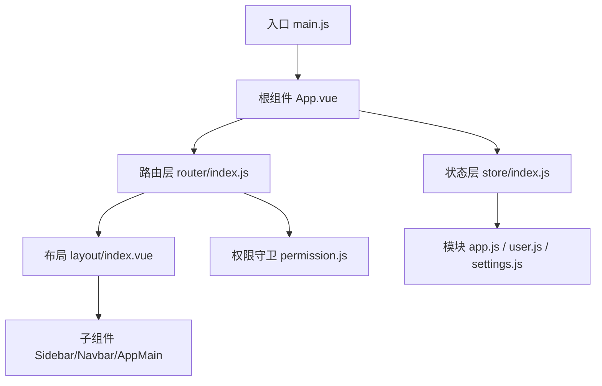
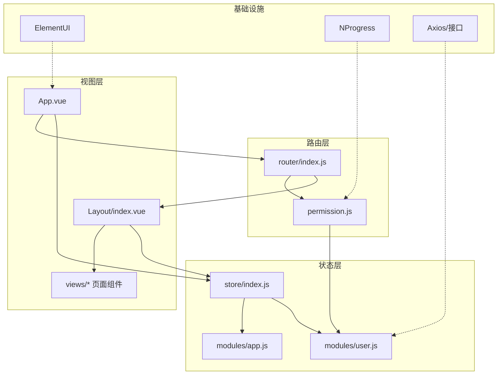
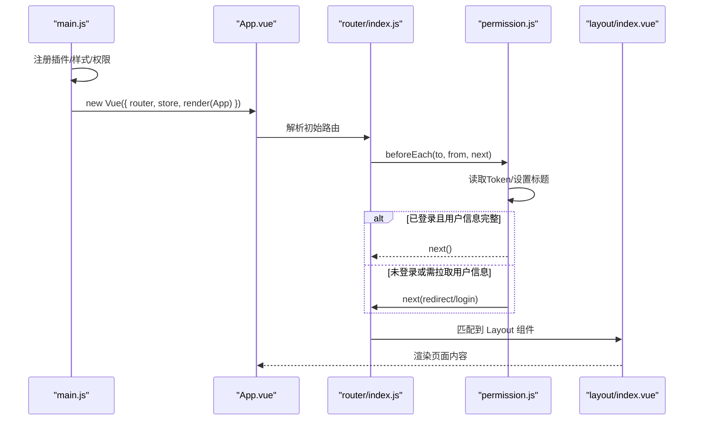
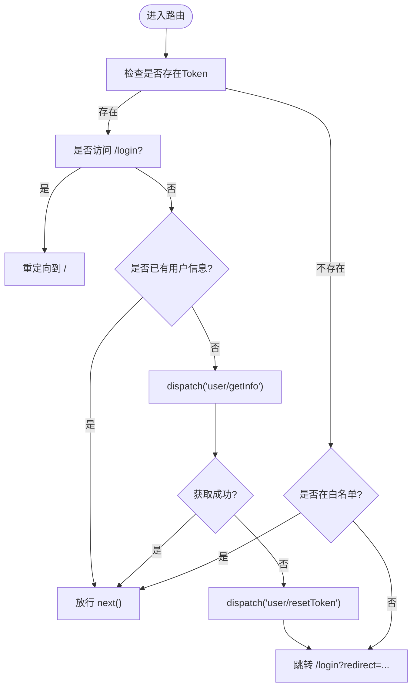
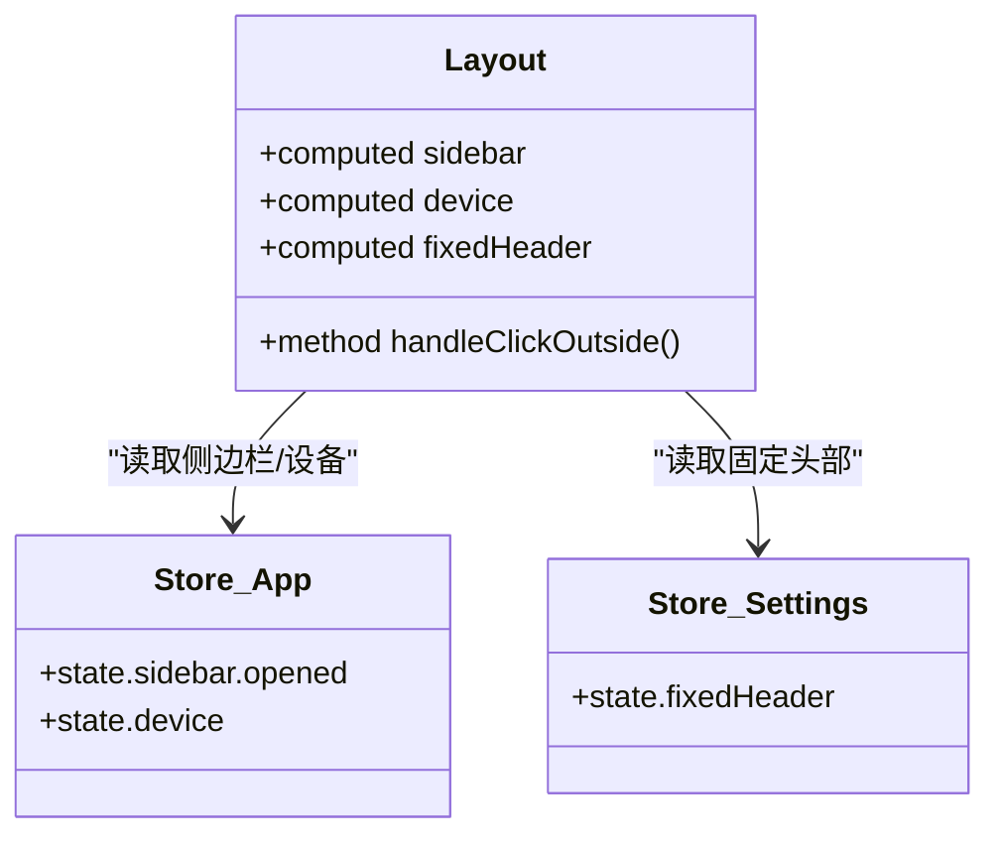
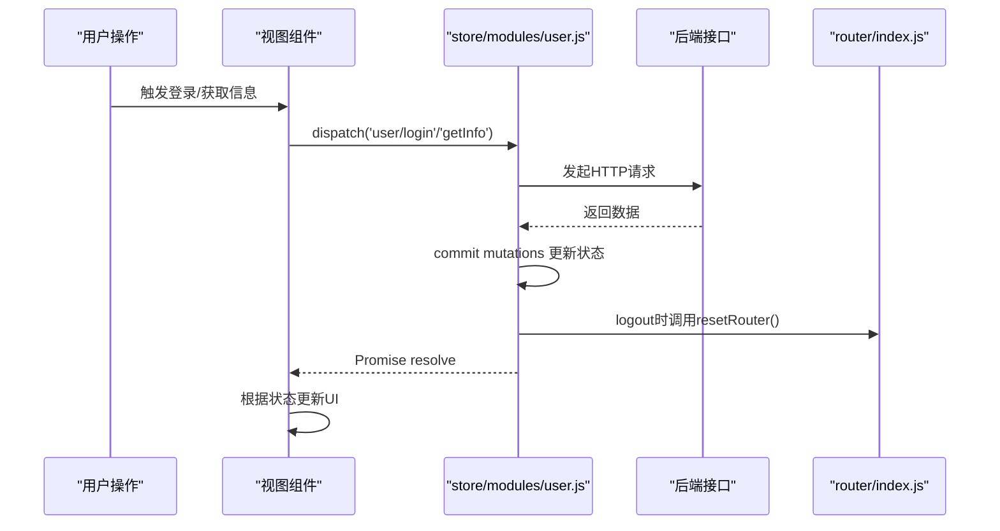
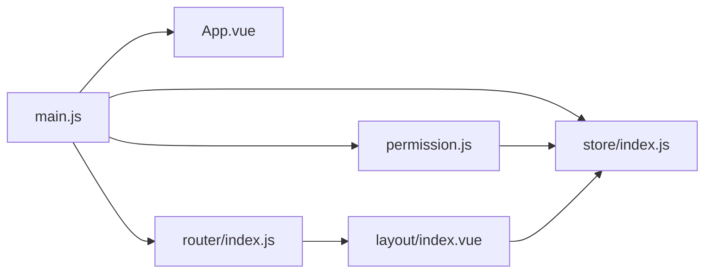

# 整体架构

<cite>
**本文引用的文件**   
- [main.js](file://src/main.js)
- [App.vue](file://src/App.vue)
- [router/index.js](file://src/router/index.js)
- [store/index.js](file://src/store/index.js)
- [permission.js](file://src/permission.js)
- [layout/index.vue](file://src/layout/index.vue)
- [store/modules/app.js](file://src/store/modules/app.js)
- [store/modules/user.js](file://src/store/modules/user.js)
- [package.json](file://package.json)
</cite>

## 目录
1. [简介](#简介)
2. [项目结构](#项目结构)
3. [核心组件](#核心组件)
4. [架构总览](#架构总览)
5. [详细组件分析](#详细组件分析)
6. [依赖关系分析](#依赖关系分析)
7. [性能与可维护性](#性能与可维护性)
8. [故障排查指南](#故障排查指南)
9. [结论](#结论)

## 简介
本仓库是一个基于 Vue 2 的管理后台模板，采用 MVVM 架构模式：Vue.js 负责视图层渲染与组件化，Vuex 作为集中式状态管理，Vue Router 提供单页应用路由与导航。项目通过权限守卫、动态路由与布局组件，实现登录鉴权、页面切换与多端适配的后台体验。

## 项目结构
项目遵循“功能域 + 分层”的组织方式：
- src/api：接口封装
- src/components：通用业务组件
- src/layout：后台布局（侧边栏、顶栏、主内容区）
- src/router：路由定义与全局前置守卫
- src/store：Vuex 模块（app/settings/user）
- src/utils：工具函数（请求封装、鉴权、校验等）
- src/views：页面级组件
- src/styles：全局样式与主题变量

图表来源
- [main.js:11-43](file://src/main.js#L11-L43)
- [App.vue:1-12](file://src/App.vue#L1-L12)
- [router/index.js:1-182](file://src/router/index.js#L1-L182)
- [store/index.js:1-20](file://src/store/index.js#L1-L20)
- [layout/index.vue:1-94](file://src/layout/index.vue#L1-L94)
- [permission.js:1-65](file://src/permission.js#L1-L65)

章节来源
- [main.js:1-44](file://src/main.js#L1-L44)
- [package.json:16-27](file://package.json#L16-L27)

## 核心组件
- 视图层（View）
  - App.vue：根容器，挂载 <router-view/> 作为页面出口
  - layout/index.vue：后台布局壳，组合 Navbar、Sidebar、AppMain，并响应设备尺寸变化
- 路由层（Router）
  - router/index.js：常量路由表、懒加载、滚动行为、重置路由能力
  - permission.js：全局前置守卫，处理登录态、用户信息获取与重定向
- 状态层（Store）
  - store/index.js：聚合 Vuex 模块与 getters
  - modules/app.js：侧边栏开关、设备类型等 UI 状态
  - modules/user.js：登录、获取用户信息、登出、Token 管理等业务状态
- 基础设施
  - ElementUI 组件库与国际化
  - NProgress 进度条
  - Axios 请求封装（在 utils/request.js 中，供 api 调用）

章节来源
- [App.vue:1-12](file://src/App.vue#L1-L12)
- [layout/index.vue:1-94](file://src/layout/index.vue#L1-L94)
- [router/index.js:1-182](file://src/router/index.js#L1-L182)
- [permission.js:1-65](file://src/permission.js#L1-L65)
- [store/index.js:1-20](file://src/store/index.js#L1-L20)
- [store/modules/app.js:1-49](file://src/store/modules/app.js#L1-L49)
- [store/modules/user.js:1-98](file://src/store/modules/user.js#L1-L98)

## 架构总览
本项目采用 MVVM 架构：
- Model：后端数据与持久化 Token（Cookie/LocalStorage）
- View：Vue 组件树（App.vue、Layout、各 views）
- ViewModel：Vue 实例、Vuex Store、路由状态

图表来源
- [main.js:11-43](file://src/main.js#L11-L43)
- [App.vue:1-12](file://src/App.vue#L1-L12)
- [router/index.js:1-182](file://src/router/index.js#L1-L182)
- [permission.js:1-65](file://src/permission.js#L1-L65)
- [store/index.js:1-20](file://src/store/index.js#L1-L20)
- [layout/index.vue:1-94](file://src/layout/index.vue#L1-L94)

## 详细组件分析

### 应用启动流程（main.js → App.vue）
- 初始化阶段
  - 引入并注册 ElementUI、全局样式、图标、权限守卫
  - 生产环境启用 Mock 拦截
  - 创建 Vue 实例，注入 router、store，渲染 App.vue
- 根组件阶段
  - App.vue 仅包含 <router-view/>，作为所有页面的挂载点
- 路由阶段
  - router/index.js 定义常量路由与懒加载策略
  - permission.js 在路由切换前进行鉴权与标题设置

图表来源
- [main.js:11-43](file://src/main.js#L11-L43)
- [App.vue:1-12](file://src/App.vue#L1-L12)
- [router/index.js:167-181](file://src/router/index.js#L167-L181)
- [permission.js:13-59](file://src/permission.js#L13-L59)
- [layout/index.vue:1-50](file://src/layout/index.vue#L1-L50)

章节来源
- [main.js:1-44](file://src/main.js#L1-L44)
- [App.vue:1-12](file://src/App.vue#L1-L12)
- [router/index.js:1-182](file://src/router/index.js#L1-L182)
- [permission.js:1-65](file://src/permission.js#L1-L65)

### 路由与权限控制
- 路由设计
  - 使用懒加载按需引入页面组件，减少首屏体积
  - 统一 Layout 包裹业务页面，便于侧边栏与顶栏复用
  - 提供 resetRouter 以支持动态路由重建
- 权限控制
  - 白名单放行（如 /login）
  - 有 Token 时若访问 /login 则重定向至首页
  - 无用户信息时触发获取用户信息；失败则清理 Token 并跳转登录
  - 无 Token 时非白名单路由一律重定向登录

图表来源
- [permission.js:11-59](file://src/permission.js#L11-L59)
- [store/modules/user.js:30-88](file://src/store/modules/user.js#L30-L88)
- [router/index.js:167-181](file://src/router/index.js#L167-L181)

章节来源
- [permission.js:1-65](file://src/permission.js#L1-L65)
- [router/index.js:1-182](file://src/router/index.js#L1-L182)
- [store/modules/user.js:1-98](file://src/store/modules/user.js#L1-L98)

### 布局与响应式
- Layout 组件组合了侧边栏、顶栏与主内容区
- 通过计算属性映射 Vuex 中的 sidebar/device/fixedHeader 状态
- 移动端点击遮罩关闭侧边栏，保持交互一致性

图表来源
- [layout/index.vue:16-49](file://src/layout/index.vue#L16-L49)
- [store/modules/app.js:3-28](file://src/store/modules/app.js#L3-L28)

章节来源
- [layout/index.vue:1-94](file://src/layout/index.vue#L1-L94)
- [store/modules/app.js:1-49](file://src/store/modules/app.js#L1-L49)

### 状态管理与数据流
- store/index.js 聚合 app、settings、user 三个模块
- user 模块负责登录、获取用户信息、登出、重置 Token，并与路由重置联动
- app 模块管理侧边栏展开状态与设备类型，持久化到 Cookie

图表来源
- [store/index.js:10-17](file://src/store/index.js#L10-L17)
- [store/modules/user.js:30-88](file://src/store/modules/user.js#L30-L88)
- [router/index.js:175-179](file://src/router/index.js#L175-L179)

章节来源
- [store/index.js:1-20](file://src/store/index.js#L1-L20)
- [store/modules/user.js:1-98](file://src/store/modules/user.js#L1-L98)
- [store/modules/app.js:1-49](file://src/store/modules/app.js#L1-L49)

### 技术栈选择与架构决策
- Vue 2 + Vue Router + Vuex：成熟稳定，生态完善，适合中后台快速迭代
- ElementUI：提供丰富的企业级组件，降低 UI 开发成本
- NProgress：轻量级顶部进度条，提升用户体验
- 懒加载路由：按页面拆分代码，减小首屏包体
- 权限与布局解耦：通过全局守卫与 Layout 组件，保证安全与可维护性

章节来源
- [package.json:16-27](file://package.json#L16-L27)
- [main.js:1-17](file://src/main.js#L1-L17)
- [router/index.js:167-171](file://src/router/index.js#L167-L171)

## 依赖关系分析
- 入口依赖
  - main.js 依赖 ElementUI、全局样式、App.vue、store、router、icons、permission
- 路由依赖
  - router/index.js 依赖 Layout 与各页面组件，导出 createRouter 与 resetRouter
- 权限依赖
  - permission.js 依赖 router、store、utils/auth、nprogress
- 布局依赖
  - layout/index.vue 依赖 store.app 与 store.settings

图表来源
- [main.js:11-17](file://src/main.js#L11-L17)
- [router/index.js:1-8](file://src/router/index.js#L1-L8)
- [permission.js:1-7](file://src/permission.js#L1-L7)
- [layout/index.vue:15-16](file://src/layout/index.vue#L15-L16)

章节来源
- [main.js:1-44](file://src/main.js#L1-L44)
- [router/index.js:1-182](file://src/router/index.js#L1-L182)
- [permission.js:1-65](file://src/permission.js#L1-L65)
- [layout/index.vue:1-94](file://src/layout/index.vue#L1-L94)

## 性能与可维护性
- 首屏优化
  - 路由懒加载减少初始包体
  - 按需引入 ElementUI 组件与样式
- 运行时优化
  - 使用 keep-alive 缓存常用页面（可在路由 meta 中配置）
  - 合理拆分模块，避免大文件耦合
- 可维护性
  - 路由与权限分离，职责清晰
  - Vuex 模块化，命名空间隔离状态
  - 统一的布局与组件复用，降低重复代码

[本节为通用建议，不直接分析具体文件]

## 故障排查指南
- 登录后仍被重定向到登录页
  - 检查 Token 是否正确写入与读取
  - 确认 user/getInfo 是否成功，失败会触发 resetToken 并跳转
- 页面空白或路由不生效
  - 检查路由表是否正确注册，是否有拼写错误
  - 确认 Layout 组件是否正确包裹业务页面
- 侧边栏状态异常
  - 检查 app.js 中 TOGGLE_SIDEBAR/CLOSE_SIDEBAR 与 Cookie 同步逻辑
- 进度条不消失
  - 检查 permission.js 的 afterEach 钩子是否执行

章节来源
- [permission.js:13-64](file://src/permission.js#L13-L64)
- [store/modules/user.js:30-88](file://src/store/modules/user.js#L30-L88)
- [store/modules/app.js:11-28](file://src/store/modules/app.js#L11-L28)

## 结论
该项目以 Vue 2 为核心，结合 Vue Router 与 Vuex 构建清晰的 MVVM 架构。通过 Layout 统一布局、权限守卫保障安全、懒加载优化性能，形成一套易于扩展与维护的中后台解决方案。建议在后续迭代中继续强化模块边界、完善错误边界与埋点监控，进一步提升稳定性与可观测性。