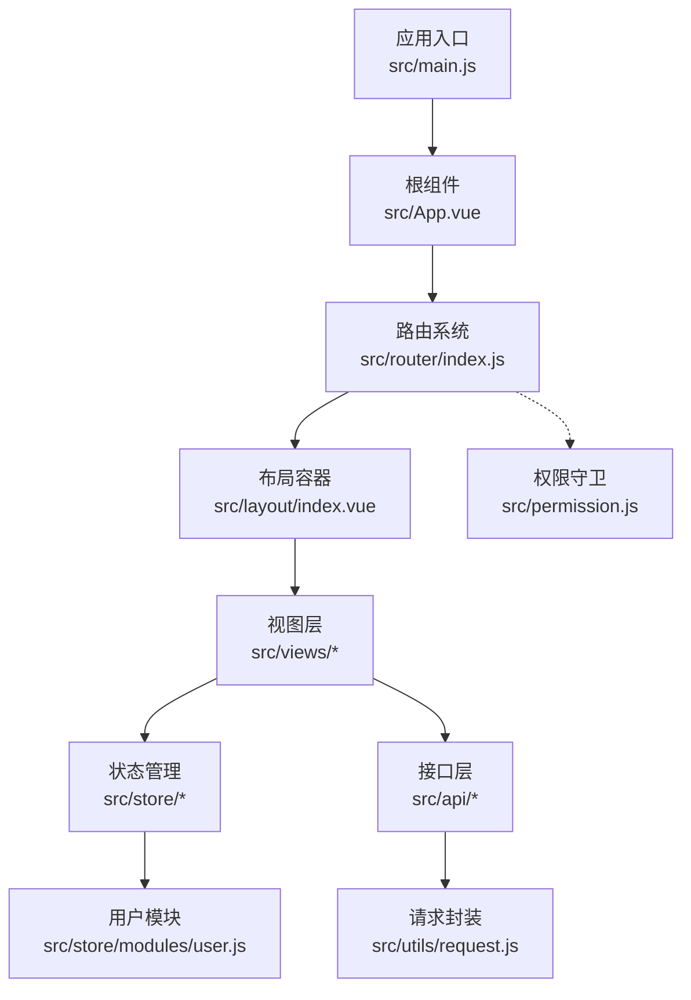
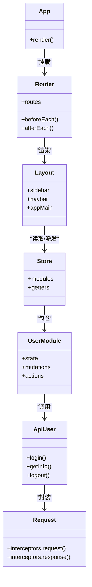
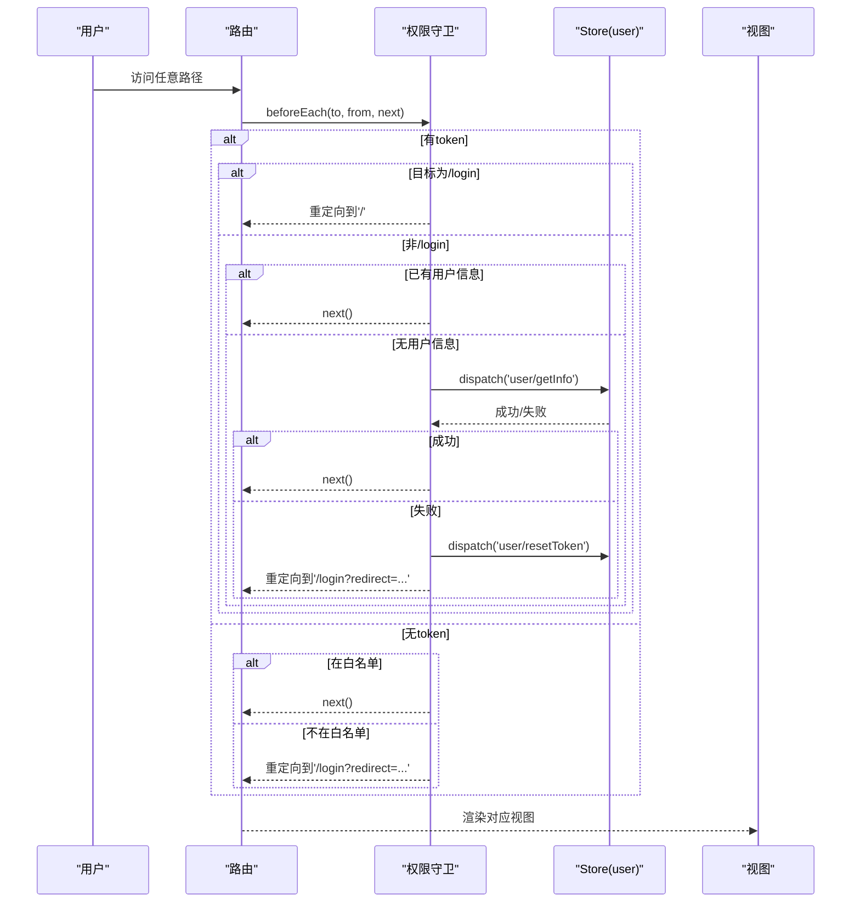
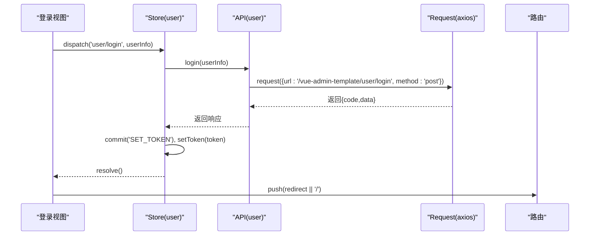
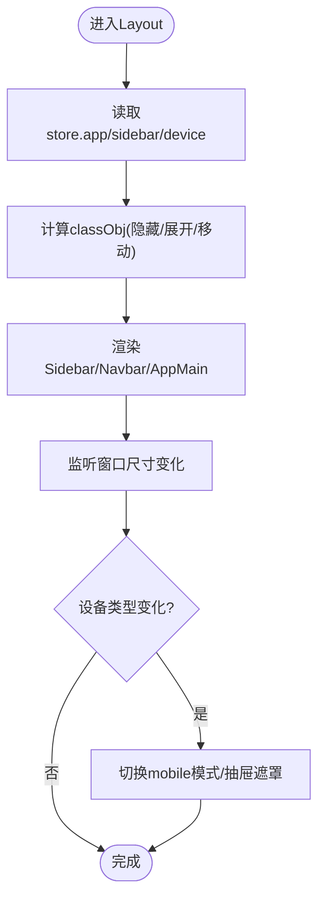
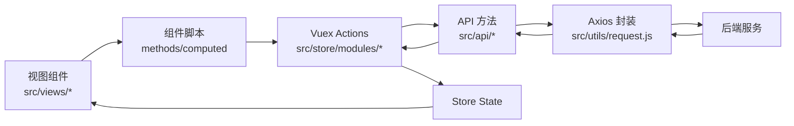
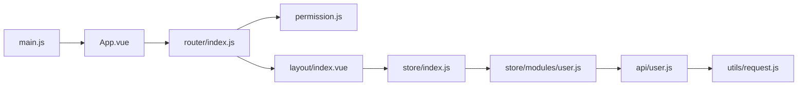

# 架构设计

<cite>
**本文引用的文件**   
- [README.md](file://README.md)
- [main.js](file://src/main.js)
- [App.vue](file://src/App.vue)
- [index.js（路由）](file://src/router/index.js)
- [permission.js](file://src/permission.js)
- [index.js（状态管理入口）](file://src/store/index.js)
- [user.js（用户模块）](file://src/store/modules/user.js)
- [user.js（API层）](file://src/api/user.js)
- [request.js（请求封装）](file://src/utils/request.js)
- [index.vue（布局容器）](file://src/layout/index.vue)
- [index.vue（登录页）](file://src/views/login/index.vue)
</cite>

## 目录
1. [引言](#引言)
2. [项目结构](#项目结构)
3. [核心组件与职责边界](#核心组件与职责边界)
4. [架构总览](#架构总览)
5. [详细组件分析](#详细组件分析)
6. [依赖关系分析](#依赖关系分析)
7. [性能与可维护性建议](#性能与可维护性建议)
8. [故障排查指南](#故障排查指南)
9. [结论](#结论)

## 引言
本项目是一个基于 Vue 的管理后台模板，采用 MVVM 模式与组件化架构，结合 Element UI、Vue Router、Vuex 和 Axios，提供权限控制、动态路由、响应式布局等能力。整体遵循“视图层-路由层-状态管理层-接口层”的分层组织方式，强调低耦合、高内聚与可测试性。

## 项目结构
项目采用按功能域划分的目录结构：
- src/api：业务接口定义，统一通过 axios 封装发起请求
- src/components：通用业务无关的原子组件
- src/layout：页面级布局容器及其子组件（侧边栏、导航栏、主内容区）
- src/router：路由配置与守卫逻辑
- src/store：全局状态（Vuex），按模块拆分
- src/utils：工具函数与通用逻辑（如请求封装、鉴权、校验）
- src/views：页面级视图组件
- src/styles：全局样式与主题变量

图表来源
- [main.js:1-44](file://src/main.js#L1-L44)
- [App.vue:1-12](file://src/App.vue#L1-L12)
- [index.js（路由）:1-182](file://src/router/index.js#L1-L182)
- [index.vue（布局容器）:1-94](file://src/layout/index.vue#L1-L94)
- [index.js（状态管理入口）:1-20](file://src/store/index.js#L1-L20)
- [user.js（用户模块）:1-98](file://src/store/modules/user.js#L1-L98)
- [user.js（API层）:1-25](file://src/api/user.js#L1-L25)
- [request.js（请求封装）:1-86](file://src/utils/request.js#L1-L86)
- [permission.js:1-65](file://src/permission.js#L1-L65)

章节来源
- [README.md:21-63](file://README.md#L21-L63)

## 核心组件与职责边界
- 视图层（Views/Layouts）
  - 负责页面结构与交互展示，不直接操作网络请求，通过 Vuex actions 触发数据变更
  - 典型：登录页、仪表盘、表格、表单、嵌套菜单等
- 路由层（Router）
  - 负责页面跳转、懒加载、元信息（标题、图标、面包屑）与重定向
  - 与权限守卫配合实现白名单与角色控制
- 状态管理层（Store/Vuex）
  - 集中管理跨组件共享状态（用户信息、设备类型、设置项等）
  - 通过 mutations 同步更新 state，actions 处理异步流程
- 接口层（API）
  - 对后端 API 进行方法化封装，保持调用方无感知
- 基础设施（Utils/Request）
  - 统一拦截器、错误提示、Token 注入、超时与 baseURL 配置

职责边界原则
- 视图层只关注 UI 与用户交互
- 路由层只关注导航与元信息
- Store 只关注状态与副作用编排
- API 层只关注接口契约
- Utils 提供横切能力（鉴权、校验、格式化）

章节来源
- [index.js（路由）:1-182](file://src/router/index.js#L1-L182)
- [index.js（状态管理入口）:1-20](file://src/store/index.js#L1-L20)
- [user.js（API层）:1-25](file://src/api/user.js#L1-L25)
- [request.js（请求封装）:1-86](file://src/utils/request.js#L1-L86)

## 架构总览
本项目的架构模式为 MVVM + 组件化：
- Model：由 Vuex store 中的 modules 承载（如 user、app、settings）
- View：由 Vue 单文件组件构成（views、components、layout）
- ViewModel：组件脚本中通过 computed/watch/methods 驱动视图更新，并通过 dispatch/commit 与 Store 通信

图表来源
- [App.vue:1-12](file://src/App.vue#L1-L12)
- [index.js（路由）:1-182](file://src/router/index.js#L1-L182)
- [index.vue（布局容器）:1-94](file://src/layout/index.vue#L1-L94)
- [index.js（状态管理入口）:1-20](file://src/store/index.js#L1-L20)
- [user.js（用户模块）:1-98](file://src/store/modules/user.js#L1-L98)
- [user.js（API层）:1-25](file://src/api/user.js#L1-L25)
- [request.js（请求封装）:1-86](file://src/utils/request.js#L1-L86)

## 详细组件分析

### 路由与权限守卫
- 路由配置
  - 使用常量路由表，支持 children 嵌套、重定向、meta 元信息（标题、图标、面包屑、activeMenu）
  - 提供 resetRouter 以在登出后重置路由匹配器
- 权限守卫
  - beforeEach 中根据 token 与白名单决定是否放行
  - 未登录时跳转到 /login，携带 redirect 参数以便登录后回跳
  - 已登录但未获取用户信息时，先拉取用户信息再放行
  - afterEach 关闭进度条

图表来源
- [index.js（路由）:1-182](file://src/router/index.js#L1-L182)
- [permission.js:1-65](file://src/permission.js#L1-L65)
- [user.js（用户模块）:1-98](file://src/store/modules/user.js#L1-L98)

章节来源
- [index.js（路由）:1-182](file://src/router/index.js#L1-L182)
- [permission.js:1-65](file://src/permission.js#L1-L65)

### 登录流程
- 视图层（登录页）
  - 表单校验通过后，调用 store.dispatch('user/login', userInfo)
  - 成功后根据 redirect 参数或默认路径跳转
- 状态层（user 模块）
  - login action 调用 API.login，成功后 commit SET_TOKEN 并持久化 token
- 接口层（api/user）
  - 将登录请求映射到后端接口
- 请求层（utils/request）
  - 自动注入 X-Token 头，统一错误提示与异常处理

图表来源
- [index.vue（登录页）:55-125](file://src/views/login/index.vue#L55-L125)
- [user.js（用户模块）:30-44](file://src/store/modules/user.js#L30-L44)
- [user.js（API层）:3-9](file://src/api/user.js#L3-L9)
- [request.js（请求封装）:13-31](file://src/utils/request.js#L13-L31)

章节来源
- [index.vue（登录页）:55-125](file://src/views/login/index.vue#L55-L125)
- [user.js（用户模块）:30-44](file://src/store/modules/user.js#L30-L44)
- [user.js（API层）:3-9](file://src/api/user.js#L3-L9)
- [request.js（请求封装）:13-31](file://src/utils/request.js#L13-L31)

### 布局与响应式
- 布局容器
  - 组合 Sidebar、Navbar、AppMain 三大区域
  - 通过 store.state.app 控制侧边栏展开/收起与设备类型（mobile/desktop）
  - 监听窗口尺寸变化，切换设备模式与抽屉遮罩行为
- 样式与适配
  - 固定头部宽度随侧边栏状态变化
  - 移动端打开侧边栏时显示遮罩层

图表来源
- [index.vue（布局容器）:1-94](file://src/layout/index.vue#L1-L94)

章节来源
- [index.vue（布局容器）:1-94](file://src/layout/index.vue#L1-L94)

### 数据流向图（从视图到后端）

图表来源
- [index.vue（登录页）:55-125](file://src/views/login/index.vue#L55-L125)
- [user.js（用户模块）:1-98](file://src/store/modules/user.js#L1-L98)
- [user.js（API层）:1-25](file://src/api/user.js#L1-L25)
- [request.js（请求封装）:1-86](file://src/utils/request.js#L1-L86)

## 依赖关系分析
- 松耦合分层
  - 视图仅依赖 Store 与 Router，不直接依赖 HTTP 库
  - Store 仅依赖 API 层与工具函数
  - API 层仅依赖请求封装
- 关键依赖链
  - main.js 初始化 Vue、ElementUI、全局样式、图标、权限守卫
  - App.vue 作为根容器挂载 router-view
  - 路由守卫在每次导航前执行鉴权逻辑
  - 布局容器依赖 store.app 与 store.settings 控制 UI 行为

图表来源
- [main.js:1-44](file://src/main.js#L1-L44)
- [App.vue:1-12](file://src/App.vue#L1-L12)
- [index.js（路由）:1-182](file://src/router/index.js#L1-L182)
- [permission.js:1-65](file://src/permission.js#L1-L65)
- [index.vue（布局容器）:1-94](file://src/layout/index.vue#L1-L94)
- [index.js（状态管理入口）:1-20](file://src/store/index.js#L1-L20)
- [user.js（用户模块）:1-98](file://src/store/modules/user.js#L1-L98)
- [user.js（API层）:1-25](file://src/api/user.js#L1-L25)
- [request.js（请求封装）:1-86](file://src/utils/request.js#L1-L86)

章节来源
- [main.js:1-44](file://src/main.js#L1-L44)
- [index.js（路由）:1-182](file://src/router/index.js#L1-L182)
- [permission.js:1-65](file://src/permission.js#L1-L65)

## 性能与可维护性建议
- 路由懒加载
  - 所有页面组件均使用动态 import，减少首屏体积
- 状态最小化
  - 仅在 store 中保存必要的跨组件状态，避免过度共享
- 接口层抽象
  - 新增接口统一在 api 目录下声明，便于管理与 mock 替换
- 错误处理集中化
  - 通过 request 拦截器统一处理业务码与网络异常，降低重复代码
- 样式模块化
  - 使用 SCSS 变量与 mixin，保证主题一致性与可维护性

[本节为通用建议，不直接分析具体文件]

## 故障排查指南
- 无法进入受保护页面
  - 检查是否已正确设置 token 且白名单配置无误
  - 确认 permission.js 中白名单与重定向逻辑
- 登录后仍被踢出
  - 检查后端返回的业务码，若命中“非法token/其他客户端登录/token过期”，会触发重新登录流程
  - 查看 request 拦截器的错误分支与 MessageBox 提示
- 侧边栏在移动端异常
  - 检查 store.app.device 与 sidebar.opened 的状态流转
  - 确认布局容器的点击遮罩事件是否正确派发 closeSideBar

章节来源
- [permission.js:1-65](file://src/permission.js#L1-L65)
- [request.js（请求封装）:33-83](file://src/utils/request.js#L33-L83)
- [index.vue（布局容器）:1-94](file://src/layout/index.vue#L1-L94)

## 结论
该项目以清晰的 MVVM 与组件化架构为基础，通过路由守卫实现权限控制，借助 Vuex 管理全局状态，并以统一的请求封装提升可维护性与健壮性。目录组织遵循“视图-路由-状态-接口-工具”的分层原则，具备良好的扩展性与团队协作友好度。建议在后续迭代中继续坚持单一职责、最小状态与集中错误处理的实践，以保证长期可维护性。