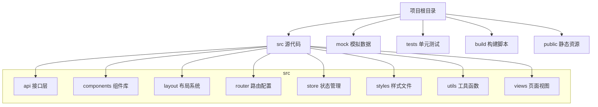
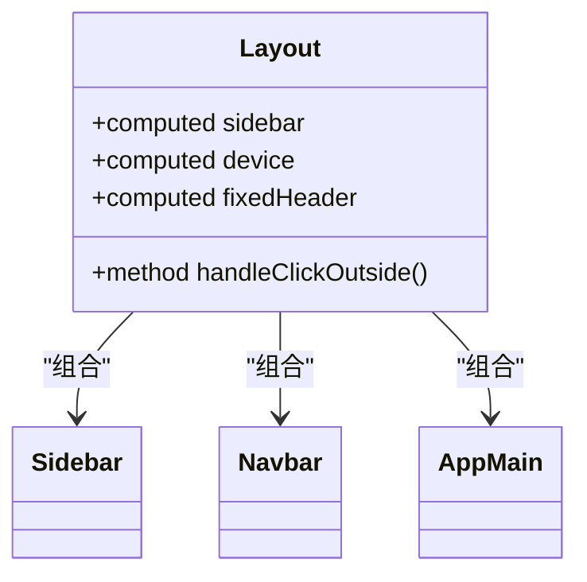
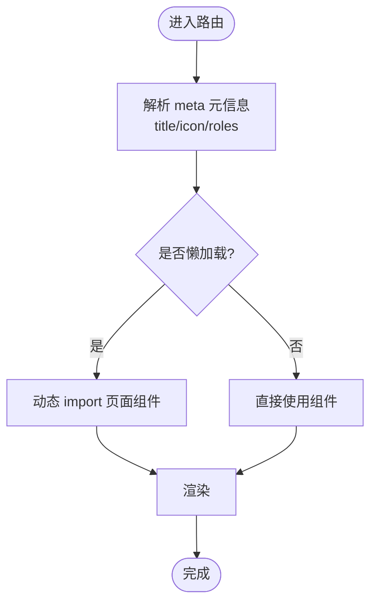
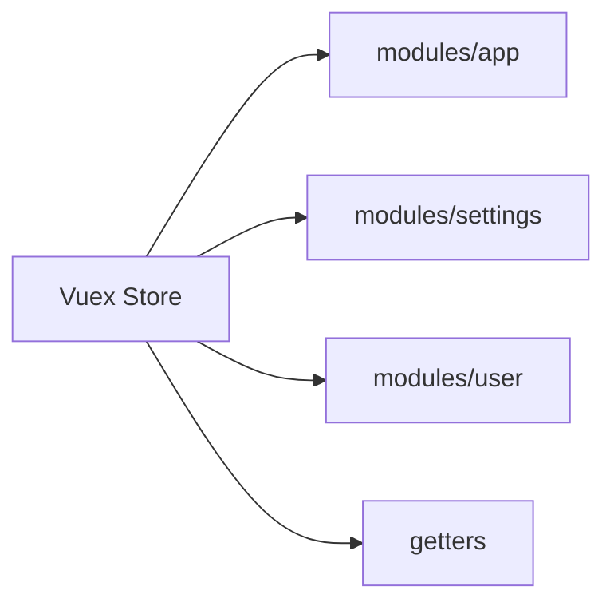
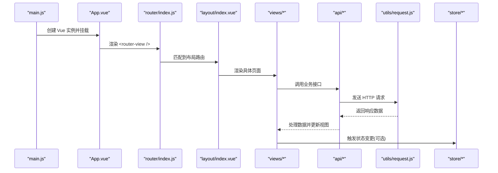
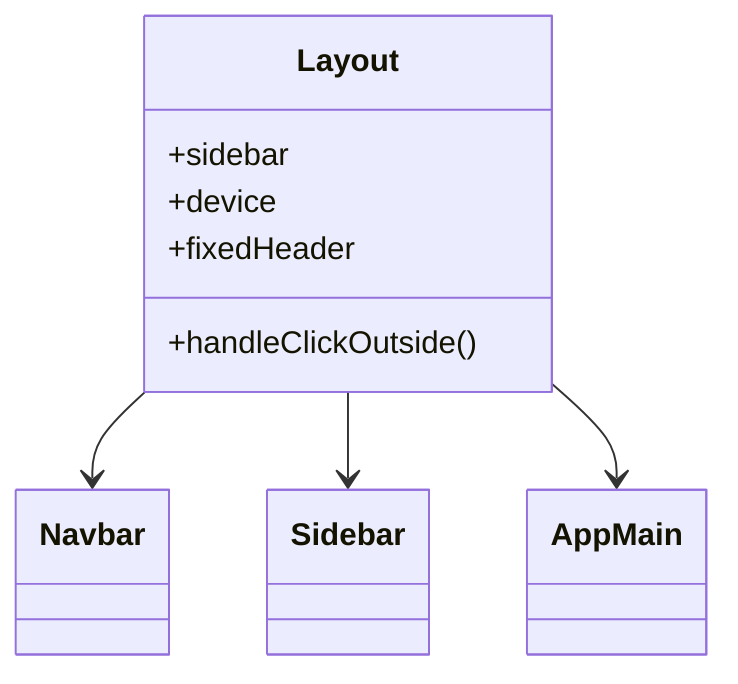
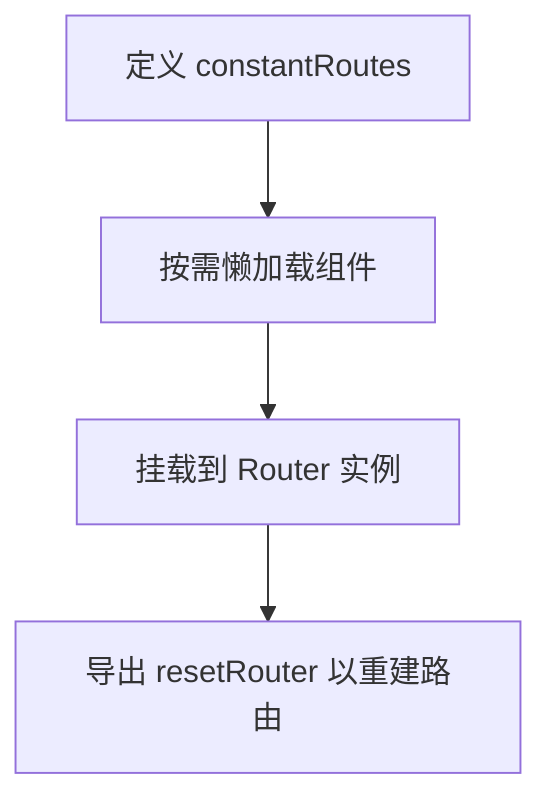
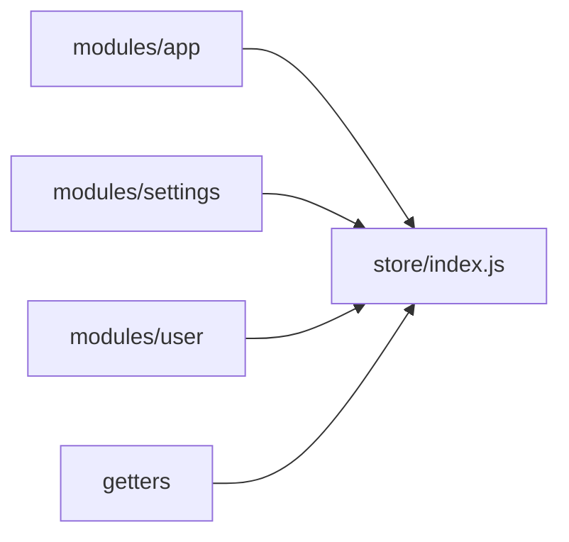
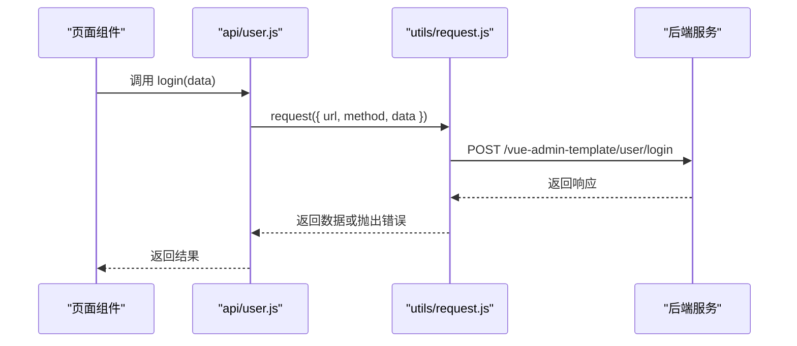
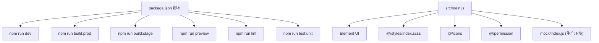

# 目录结构

<cite>
**本文引用的文件**   
- [README.md](file://README.md)
- [package.json](file://package.json)
- [src/main.js](file://src/main.js)
- [src/App.vue](file://src/App.vue)
- [src/router/index.js](file://src/router/index.js)
- [src/store/index.js](file://src/store/index.js)
- [src/layout/index.vue](file://src/layout/index.vue)
- [src/api/user.js](file://src/api/user.js)
- [src/utils/request.js](file://src/utils/request.js)
- [mock/index.js](file://mock/index.js)
- [tests/unit/components/Breadcrumb.spec.js](file://tests/unit/components/Breadcrumb.spec.js)
</cite>

## 目录总览
本仓库采用 Vue 2 + Element UI 的后台管理模板，遵循“按职责分层、按功能分域”的组织方式。核心代码位于 src 目录，围绕 API 接口层、组件库、布局系统、路由配置、状态管理、样式文件与工具函数进行清晰划分；mock 目录提供本地模拟数据；tests 目录组织单元测试；build 目录用于构建脚本（当前为空，实际构建由 vue-cli-service 驱动）。



**图表来源**
- [package.json:6-14](file://package.json#L6-L14)
- [src/main.js:1-44](file://src/main.js#L1-L44)

**章节来源**
- [README.md:21-63](file://README.md#L21-L63)
- [package.json:1-63](file://package.json#L1-L63)

## 设计原则与组织方式
- 分层清晰：API 层、UI 层、布局层、路由层、状态层、工具层、样式层各司其职，降低耦合。
- 功能聚合：同一业务域（如用户、表格）在 api 与 views 中就近组织，便于维护。
- 可测试性：组件与工具函数具备独立单元测试，便于回归与重构。
- 可扩展性：通过路由 meta 与 store modules 扩展权限、菜单与全局设置。
- 可构建性：统一使用 vue-cli-service 命令，支持开发、预览、生产构建与产物分析。

**章节来源**
- [src/router/index.js:9-26](file://src/router/index.js#L9-L26)
- [src/store/index.js:10-17](file://src/store/index.js#L10-L17)
- [package.json:6-14](file://package.json#L6-L14)

## 核心目录说明

### src/api 接口层
- 职责：封装所有后端接口调用，统一请求参数与返回结构，屏蔽网络细节。
- 组织方式：按业务模块拆分文件（如 user.js、table.js），对外暴露函数供组件或 store 调用。
- 最佳实践：
  - 仅暴露函数，不直接处理业务逻辑。
  - 结合 utils/request 统一拦截器处理鉴权、错误提示与异常分支。
  - 对敏感字段与 token 传递进行集中管理。

**章节来源**
- [src/api/user.js:1-25](file://src/api/user.js#L1-L25)
- [src/utils/request.js:1-86](file://src/utils/request.js#L1-L86)

### src/components 组件库
- 职责：提供可复用的通用 UI 组件（如面包屑、汉堡按钮、SVG 图标等）。
- 组织方式：每个组件一个文件夹，包含 index.vue 作为入口，必要时附带样式与脚本。
- 最佳实践：
  - 组件保持单一职责，props/emit 明确。
  - 避免在组件内直接访问复杂业务状态，优先通过 props 与事件解耦。
  - 为关键组件编写单元测试，覆盖交互与边界条件。

**章节来源**
- [tests/unit/components/Breadcrumb.spec.js:1-99](file://tests/unit/components/Breadcrumb.spec.js#L1-L99)

### src/layout 布局系统
- 职责：提供应用级布局外壳，包括侧边栏、顶部导航、主内容区与响应式适配。
- 组织方式：
  - layout/index.vue 作为布局容器，组合 Navbar、Sidebar、AppMain 等子组件。
  - components 下细分布局相关组件；mixin 提供尺寸变化等公共逻辑。
- 最佳实践：
  - 布局组件尽量无业务依赖，专注结构与样式。
  - 通过 store 控制侧边栏开关、设备类型等全局布局状态。



**图表来源**
- [src/layout/index.vue:1-94](file://src/layout/index.vue#L1-L94)

**章节来源**
- [src/layout/index.vue:1-94](file://src/layout/index.vue#L1-L94)

### src/router 路由配置
- 职责：定义应用路由表、嵌套路由、重定向与元信息（标题、图标、权限等）。
- 组织方式：集中管理 constantRoutes，按需懒加载页面组件，提供 resetRouter 以动态重置路由。
- 最佳实践：
  - 将无需权限的常量路由与需要权限的动态路由分离。
  - 使用 meta 描述菜单展示与权限控制所需信息。
  - 对 404 路由置于末尾，确保兜底匹配。



**图表来源**
- [src/router/index.js:33-165](file://src/router/index.js#L33-L165)
- [src/App.vue:1-12](file://src/App.vue#L1-L12)

**章节来源**
- [src/router/index.js:1-182](file://src/router/index.js#L1-L182)
- [src/App.vue:1-12](file://src/App.vue#L1-L12)

### src/store 状态管理
- 职责：集中管理应用全局状态，包括应用设置、用户信息与界面状态。
- 组织方式：
  - store/index.js 聚合各模块（app、settings、user）与 getters。
  - modules 下按领域拆分 state/mutations/actions。
- 最佳实践：
  - 严格区分同步 mutations 与异步 actions。
  - 将跨组件共享的状态（如侧边栏开关、设备类型、用户 token）放在对应模块。
  - 通过 getters 派生计算属性，避免重复逻辑。



**图表来源**
- [src/store/index.js:1-20](file://src/store/index.js#L1-L20)

**章节来源**
- [src/store/index.js:1-20](file://src/store/index.js#L1-L20)

### src/styles 样式文件
- 职责：统一管理全局样式、主题变量、混入与过渡动画。
- 组织方式：
  - variables.scss 定义颜色、字号、间距等设计令牌。
  - mixin.scss 提供常用 SCSS 混入。
  - element-ui.scss 覆盖 Element UI 默认样式。
  - sidebar.scss、transition.scss 分别负责侧边栏与动效。
- 最佳实践：
  - 使用 SCSS 变量与混入提升一致性。
  - 避免在组件内写大量样式，优先复用全局样式。

**章节来源**
- [src/layout/index.vue:53-93](file://src/layout/index.vue#L53-L93)

### src/utils 工具函数
- 职责：封装通用工具方法，如 HTTP 请求封装、鉴权、表单校验、页面标题生成等。
- 组织方式：
  - request.js 基于 axios 封装请求拦截与响应处理。
  - auth.js 管理 token 存取。
  - validate.js 提供常用校验规则。
  - get-page-title.js 根据路由 meta 生成页面标题。
- 最佳实践：
  - 工具函数保持纯函数特性，便于测试与复用。
  - 将网络层与业务层解耦，便于替换底层实现。

**章节来源**
- [src/utils/request.js:1-86](file://src/utils/request.js#L1-L86)

### src/views 页面视图
- 职责：承载具体业务页面，按功能模块组织目录（如 dashboard、form、login、table、tree、nested 等）。
- 组织方式：
  - 每个页面一个文件夹，index.vue 作为入口。
  - 复杂页面可按需拆分子组件，但保持页面级聚合。
- 最佳实践：
  - 页面组件尽量薄，业务逻辑下沉到 store 与 api。
  - 使用路由懒加载减少首屏体积。

**章节来源**
- [src/router/index.js:33-165](file://src/router/index.js#L33-L165)

## 架构概览
应用启动流程：main.js 初始化 Vue 实例，挂载 router、store，引入全局样式与权限控制；App.vue 通过 router-view 渲染页面；layout 作为主要布局容器；api 层通过 utils/request 发起请求；store 管理全局状态；router 控制页面跳转与菜单展示。



**图表来源**
- [src/main.js:1-44](file://src/main.js#L1-L44)
- [src/App.vue:1-12](file://src/App.vue#L1-L12)
- [src/router/index.js:167-181](file://src/router/index.js#L167-L181)
- [src/layout/index.vue:1-50](file://src/layout/index.vue#L1-L50)
- [src/api/user.js:1-25](file://src/api/user.js#L1-L25)
- [src/utils/request.js:1-86](file://src/utils/request.js#L1-L86)
- [src/store/index.js:1-20](file://src/store/index.js#L1-L20)

## 详细组件分析

### 布局系统（layout）
- 组成：Layout 容器组合 Navbar、Sidebar、AppMain，并通过 mixin 处理窗口尺寸变化。
- 行为：根据 store.app.sidebar 与 store.settings.fixedHeader 控制布局样式与固定头部。
- 扩展点：新增布局区域时，可在 components 下添加新组件并在 Layout 中组合。



**图表来源**
- [src/layout/index.vue:1-50](file://src/layout/index.vue#L1-L50)

**章节来源**
- [src/layout/index.vue:1-94](file://src/layout/index.vue#L1-L94)

### 路由系统（router）
- 特点：集中式路由表，支持嵌套路由与懒加载；提供 resetRouter 用于权限变更后重建路由。
- 关键点：meta 字段用于菜单展示与权限控制；404 路由置于末尾兜底。



**图表来源**
- [src/router/index.js:33-181](file://src/router/index.js#L33-L181)

**章节来源**
- [src/router/index.js:1-182](file://src/router/index.js#L1-L182)

### 状态管理（store）
- 模块：app（侧边栏与设备）、settings（全局设置）、user（用户信息与 token）。
- 模式：state/mutations/actions 分离，actions 处理异步逻辑，mutations 仅做状态变更。



**图表来源**
- [src/store/index.js:1-20](file://src/store/index.js#L1-L20)

**章节来源**
- [src/store/index.js:1-20](file://src/store/index.js#L1-L20)

### 接口层（api）
- 封装：user.js 暴露 login/getInfo/logout 等方法，统一通过 utils/request 发起请求。
- 鉴权：request.js 在请求头注入 X-Token，并在响应拦截器中处理错误码与登出流程。



**图表来源**
- [src/api/user.js:1-25](file://src/api/user.js#L1-L25)
- [src/utils/request.js:1-86](file://src/utils/request.js#L1-L86)

**章节来源**
- [src/api/user.js:1-25](file://src/api/user.js#L1-L25)
- [src/utils/request.js:1-86](file://src/utils/request.js#L1-L86)

## 依赖关系分析
- main.js 作为入口，引入 Element UI、全局样式、icons、permission 控制，并在生产环境启用 mockXHR。
- package.json 定义了开发、构建、预览、测试与代码检查脚本，以及运行时与开发依赖。



**图表来源**
- [package.json:6-14](file://package.json#L6-L14)
- [src/main.js:1-44](file://src/main.js#L1-L44)

**章节来源**
- [package.json:1-63](file://package.json#L1-L63)
- [src/main.js:1-44](file://src/main.js#L1-L44)

## 性能考虑
- 路由懒加载：通过动态 import 减少首屏体积，提升加载速度。
- 组件拆分：将大组件拆分为小组件，提高复用性与可测试性。
- 样式优化：使用 SCSS 变量与混入，避免重复样式；按需引入 Element UI 样式。
- 构建优化：使用 vue-cli-service 提供的构建能力，配合 preview --report 分析包体积。

[本节为通用指导，不涉及具体文件]

## 故障排查指南
- 网络请求失败：检查 utils/request.js 的拦截器逻辑与后端返回码，确认 X-Token 是否正确注入。
- 权限与路由问题：确认 router/index.js 的 meta.roles 与权限守卫逻辑；必要时调用 resetRouter 重建路由。
- 布局异常：检查 layout/index.vue 的 computed 与 store.app/sidebar 状态是否一致。
- 构建与预览：使用 npm run preview 与 npm run preview -- --report 定位资源体积与路径问题。

**章节来源**
- [src/utils/request.js:14-83](file://src/utils/request.js#L14-L83)
- [src/router/index.js:175-181](file://src/router/index.js#L175-L181)
- [src/layout/index.vue:26-49](file://src/layout/index.vue#L26-L49)

## 结论
该项目的目录结构清晰、职责分明，遵循了前端工程化的最佳实践。通过 api、components、layout、router、store、styles、utils、views 的分层组织，配合 mock 与 tests，形成了可维护、可扩展且易于测试的后台管理模板。建议在后续迭代中继续坚持这些原则，逐步完善权限模型与组件文档。

[本节为总结性内容，不涉及具体文件]

## 附录

### 目录树图
```text
.
├── build/
├── mock/
│   ├── index.js
│   ├── mock-server.js
│   ├── table.js
│   ├── user.js
│   └── utils.js
├── public/
│   └── index.html
├── src/
│   ├── api/
│   │   ├── table.js
│   │   └── user.js
│   ├── assets/404_images/
│   ├── components/
│   │   ├── Breadcrumb/
│   │   │   └── index.vue
│   │   ├── Hamburger/
│   │   │   └── index.vue
│   │   └── SvgIcon/
│   │       └── index.vue
│   ├── icons/
│   │   ├── svg/
│   │   ├── index.js
│   │   └── svgo.yml
│   ├── layout/
│   │   ├── components/
│   │   │   ├── Sidebar/
│   │   │   │   ├── FixiOSBug.js
│   │   │   │   ├── Item.vue
│   │   │   │   ├── Link.vue
│   │   │   │   ├── Logo.vue
│   │   │   │   ├── SidebarItem.vue
│   │   │   │   └── index.vue
│   │   │   ├── AppMain.vue
│   │   │   ├── Navbar.vue
│   │   │   └── index.js
│   │   ├── mixin/
│   │   │   └── ResizeHandler.js
│   │   └── index.vue
│   ├── router/
│   │   └── index.js
│   ├── store/
│   │   ├── modules/
│   │   │   ├── app.js
│   │   │   ├── settings.js
│   │   │   └── user.js
│   │   ├── getters.js
│   │   └── index.js
│   ├── styles/
│   │   ├── element-ui.scss
│   │   ├── index.scss
│   │   ├── mixin.scss
│   │   ├── sidebar.scss
│   │   ├── transition.scss
│   │   └── variables.scss
│   ├── utils/
│   │   ├── auth.js
│   │   ├── get-page-title.js
│   │   ├── index.js
│   │   ├── request.js
│   │   └── validate.js
│   ├── views/
│   │   ├── dashboard/
│   │   │   └── index.vue
│   │   ├── form/
│   │   │   └── index.vue
│   │   ├── login/
│   │   │   └── index.vue
│   │   ├── nested/
│   │   │   ├── menu1/
│   │   │   │   ├── menu1-1/
│   │   │   │   │   └── index.vue
│   │   │   │   ├── menu1-2/
│   │   │   │   │   ├── menu1-2-1/
│   │   │   │   │   │   └── index.vue
│   │   │   │   │   ├── menu1-2-2/
│   │   │   │   │   │   └── index.vue
│   │   │   │   │   └── index.vue
│   │   │   │   ├── menu1-3/
│   │   │   │   │   └── index.vue
│   │   │   │   └── index.vue
│   │   │   └── menu2/
│   │   │       └── index.vue
│   │   ├── table/
│   │   │   └── index.vue
│   │   ├── tree/
│   │   │   └── index.vue
│   │   └── 404.vue
│   ├── App.vue
│   ├── main.js
│   ├── permission.js
│   └── settings.js
├── tests/unit/
│   ├── components/
│   │   ├── Breadcrumb.spec.js
│   │   ├── Hamburger.spec.js
│   │   └── SvgIcon.spec.js
│   ├── utils/
│   │   ├── formatTime.spec.js
│   │   ├── param2Obj.spec.js
│   │   ├── parseTime.spec.js
│   │   └── validate.spec.js
│   └── .eslintrc.js
├── .editorconfig
├── .eslintignore
├── .eslintrc.js
├── .gitignore
├── .travis.yml
├── README-zh.md
├── README.md
├── babel.config.js
├── dev.cmd
├── jest.config.js
├── jsconfig.json
├── package.json
├── postcss.config.js
└── vue.config.js
```

[本节为目录展示，不涉及具体文件]