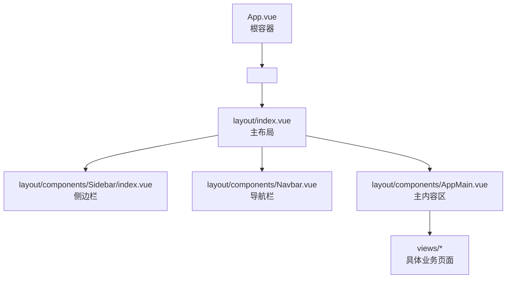
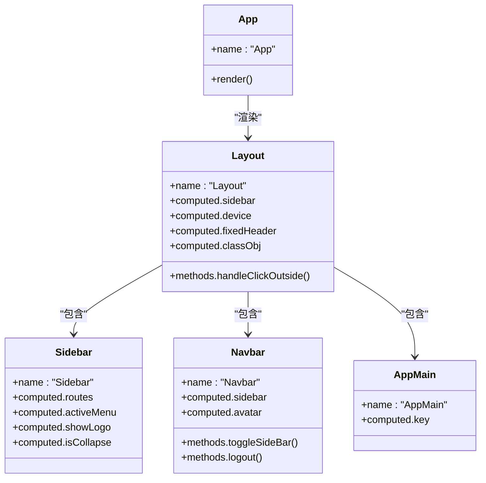
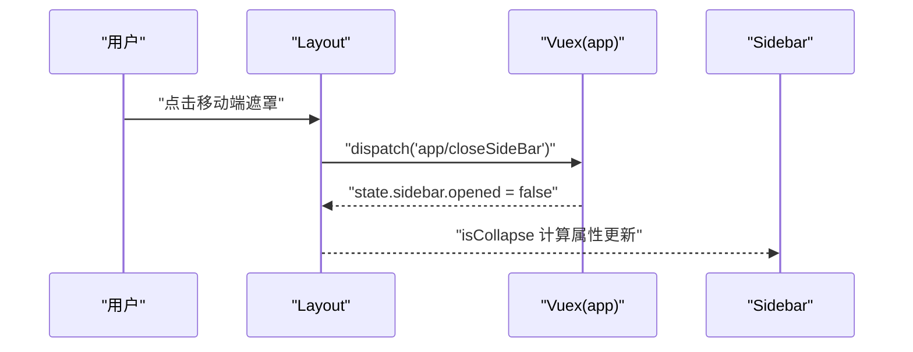
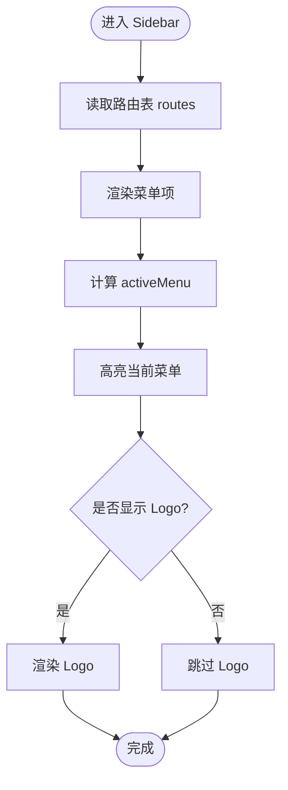
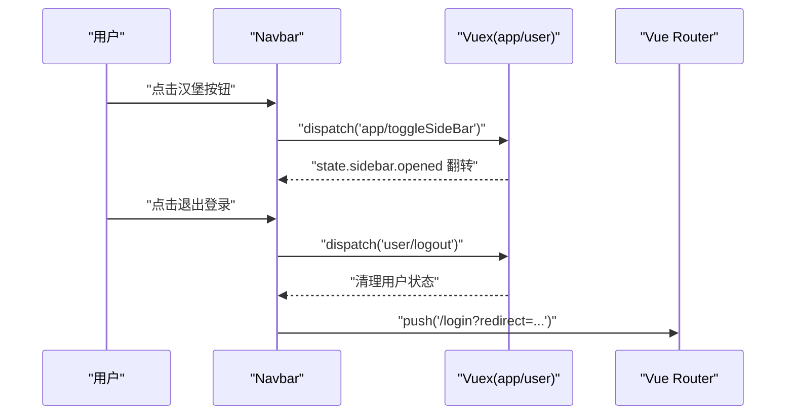
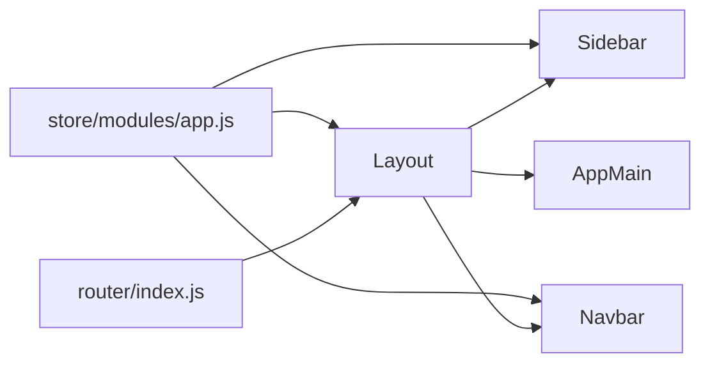

# 组件层次

<cite>
**本文引用的文件**   
- [App.vue](file://src/App.vue)
- [Layout/index.vue](file://src/layout/index.vue)
- [Sidebar/index.vue](file://src/layout/components/Sidebar/index.vue)
- [Navbar.vue](file://src/layout/components/Navbar.vue)
- [AppMain.vue](file://src/layout/components/AppMain.vue)
- [store/modules/app.js](file://src/store/modules/app.js)
- [router/index.js](file://src/router/index.js)
</cite>

## 目录
1. [简介](#简介)
2. [项目结构](#项目结构)
3. [核心组件](#核心组件)
4. [架构总览](#架构总览)
5. [详细组件分析](#详细组件分析)
6. [依赖关系分析](#依赖关系分析)
7. [性能与可维护性](#性能与可维护性)
8. [故障排查指南](#故障排查指南)
9. [结论](#结论)

## 简介
本文聚焦于应用的组件层次结构，从根组件 App.vue 到主布局 Layout，再到侧边栏 Sidebar、导航栏 Navbar、主内容区 AppMain 的父子关系、兄弟组件通信方式与数据传递机制进行系统性说明。同时给出组件生命周期管理策略与状态共享方案，并辅以组件关系图和数据流向图，帮助读者快速理解整体架构与关键交互路径。

## 项目结构
本项目的视图层采用“布局 + 子模块”的组织方式：
- 根容器 App.vue 仅负责挂载路由出口。
- 业务页面统一通过 Layout 主布局包裹，内部包含 Sidebar、Navbar、AppMain 三个并列子区域。
- 路由配置将 Layout 作为大多数页面的父组件，从而保证一致的布局体验。

图表来源
- [App.vue:1-12](file://src/App.vue#L1-L12)
- [Layout/index.vue:1-12](file://src/layout/index.vue#L1-L12)
- [Sidebar/index.vue:1-19](file://src/layout/components/Sidebar/index.vue#L1-L19)
- [Navbar.vue:1-32](file://src/layout/components/Navbar.vue#L1-L32)
- [AppMain.vue:1-7](file://src/layout/components/AppMain.vue#L1-L7)
- [router/index.js:33-165](file://src/router/index.js#L33-L165)

章节来源
- [App.vue:1-12](file://src/App.vue#L1-L12)
- [Layout/index.vue:1-12](file://src/layout/index.vue#L1-L12)
- [router/index.js:33-165](file://src/router/index.js#L33-L165)

## 核心组件
- App.vue：应用根容器，渲染 <router-view />，承载全局路由切换。
- Layout（主布局）：组合 Sidebar、Navbar、AppMain；根据设备与侧边栏状态动态调整样式与行为；通过 Vuex 读取/更新全局状态。
- Sidebar（侧边栏）：基于路由表渲染菜单项，响应折叠/展开状态，高亮当前激活菜单。
- Navbar（导航栏）：提供汉堡按钮控制侧边栏、面包屑展示、用户头像下拉菜单与退出登录逻辑。
- AppMain（主内容区）：使用 transition 包裹 <router-view />，实现页面切换动画，并通过 key 强制刷新路由视图。

章节来源
- [App.vue:1-12](file://src/App.vue#L1-L12)
- [Layout/index.vue:15-50](file://src/layout/index.vue#L15-L50)
- [Sidebar/index.vue:21-55](file://src/layout/components/Sidebar/index.vue#L21-L55)
- [Navbar.vue:34-59](file://src/layout/components/Navbar.vue#L34-L59)
- [AppMain.vue:9-17](file://src/layout/components/AppMain.vue#L9-L17)

## 架构总览
下图展示了从 App.vue 到 Layout 及其子组件的层级关系，以及它们与路由和状态管理的交互。

图表来源
- [App.vue:1-12](file://src/App.vue#L1-L12)
- [Layout/index.vue:15-50](file://src/layout/index.vue#L15-L50)
- [Sidebar/index.vue:21-55](file://src/layout/components/Sidebar/index.vue#L21-L55)
- [Navbar.vue:34-59](file://src/layout/components/Navbar.vue#L34-L59)
- [AppMain.vue:9-17](file://src/layout/components/AppMain.vue#L9-L17)

## 详细组件分析

### App.vue（根容器）
- 职责：挂载应用根节点，渲染 <router-view />，由 Vue Router 决定加载哪个页面组件。
- 生命周期：无自定义逻辑，依赖 Vue 默认生命周期。
- 数据流：不持有业务状态，仅作为路由出口容器。

章节来源
- [App.vue:1-12](file://src/App.vue#L1-L12)

### Layout（主布局）
- 职责：
  - 组合 Sidebar、Navbar、AppMain 三大区域。
  - 根据设备类型（mobile/desktop）与侧边栏打开状态，动态添加类名以控制布局样式。
  - 在移动端点击遮罩关闭侧边栏。
- 状态来源：
  - 通过 Vuex getters 读取 app.sidebar、app.device 与 settings.fixedHeader。
- 交互流程：
  - 点击遮罩触发 handleClickOutside，调用 store.dispatch('app/closeSideBar') 关闭侧边栏。
- 生命周期：
  - 混入 ResizeMixin（用于监听窗口尺寸变化），结合 state.device 切换布局模式。

图表来源
- [Layout/index.vue:45-49](file://src/layout/index.vue#L45-L49)
- [store/modules/app.js:21-25](file://src/store/modules/app.js#L21-L25)
- [Sidebar/index.vue:51-53](file://src/layout/components/Sidebar/index.vue#L51-L53)

章节来源
- [Layout/index.vue:1-50](file://src/layout/index.vue#L1-L50)
- [store/modules/app.js:1-49](file://src/store/modules/app.js#L1-L49)

### Sidebar（侧边栏）
- 职责：
  - 基于路由表 routes 渲染菜单项，支持多级嵌套。
  - 根据当前路由高亮 activeMenu。
  - 根据设置显示/隐藏 Logo。
  - 根据 sidebar.opened 控制折叠状态 isCollapse。
- 数据来源：
  - routes 来自 this.$router.options.routes。
  - activeMenu 优先使用 meta.activeMenu，否则使用当前 path。
  - showLogo 来自 $store.state.settings.sidebarLogo。
  - isCollapse 由 computed.sidebar.opened 取反得到。

图表来源
- [Sidebar/index.vue:21-55](file://src/layout/components/Sidebar/index.vue#L21-L55)
- [router/index.js:33-165](file://src/router/index.js#L33-L165)

章节来源
- [Sidebar/index.vue:1-57](file://src/layout/components/Sidebar/index.vue#L1-L57)
- [router/index.js:33-165](file://src/router/index.js#L33-L165)

### Navbar（导航栏）
- 职责：
  - 提供汉堡按钮，触发侧边栏开关。
  - 集成 Breadcrumb 面包屑组件。
  - 用户头像下拉菜单，包含首页、外部链接与退出登录。
- 交互流程：
  - toggleSideBar 调用 store.dispatch('app/toggleSideBar') 切换侧边栏状态。
  - logout 调用 user/logout action，随后跳转到登录页并携带 redirect 参数。

图表来源
- [Navbar.vue:50-58](file://src/layout/components/Navbar.vue#L50-L58)
- [store/modules/app.js:31-40](file://src/store/modules/app.js#L31-L40)

章节来源
- [Navbar.vue:1-140](file://src/layout/components/Navbar.vue#L1-L140)

### AppMain（主内容区）
- 职责：
  - 使用 transition 包裹 <router-view />，实现页面切换动画。
  - 通过 computed.key 绑定 $route.path，确保路由切换时强制重建视图，避免缓存导致的状态不一致。
- 生命周期：
  - 无自定义逻辑，依赖 Vue 默认生命周期与路由守卫。

章节来源
- [AppMain.vue:1-41](file://src/layout/components/AppMain.vue#L1-L41)

## 依赖关系分析
- 组件耦合：
  - Layout 强依赖 Sidebar、Navbar、AppMain 三个子组件。
  - Sidebar 依赖路由表与 Vuex app 模块。
  - Navbar 依赖 Vuex app 与 user 模块。
  - AppMain 依赖 Vue Router。
- 状态共享：
  - 侧边栏开关、设备类型等全局状态集中在 store/modules/app.js，通过 mapGetters 在各组件中读取。
  - 设置项（如 fixedHeader、sidebarLogo）位于 settings 模块，供 Layout 与 Sidebar 读取。
- 路由驱动：
  - router/index.js 将 Layout 作为多数页面的父组件，从而形成统一的布局树。

图表来源
- [router/index.js:33-165](file://src/router/index.js#L33-L165)
- [Layout/index.vue:15-50](file://src/layout/index.vue#L15-L50)
- [store/modules/app.js:1-49](file://src/store/modules/app.js#L1-L49)

章节来源
- [router/index.js:33-165](file://src/router/index.js#L33-L165)
- [Layout/index.vue:15-50](file://src/layout/index.vue#L15-L50)
- [store/modules/app.js:1-49](file://src/store/modules/app.js#L1-L49)

## 性能与可维护性
- 路由级懒加载：所有页面组件均使用动态 import，减少首屏体积。
- 视图切换优化：AppMain 使用 transition 与 key 强制重建，避免不必要的缓存问题。
- 状态集中管理：全局 UI 状态集中于 Vuex，便于追踪与维护。
- 样式模块化：变量与 mixin 分离，便于主题扩展与复用。

[本节为通用建议，不涉及具体文件分析]

## 故障排查指南
- 侧边栏无法收起：
  - 检查 Layout 的 handleClickOutside 是否正确派发 closeSideBar action。
  - 确认 store/modules/app.js 中的 CLOSE_SIDEBAR mutation 是否被正确执行。
- 菜单高亮异常：
  - 检查 Sidebar 的 activeMenu 计算逻辑，确认 meta.activeMenu 或 path 是否符合预期。
- 页面切换无动画或状态错乱：
  - 检查 AppMain 的 key 是否绑定 $route.path，确保每次路由切换都重建视图。
- 移动端布局异常：
  - 检查 store/modules/app.js 的 device 状态与 Layout 的 classObj 计算属性是否同步。

章节来源
- [Layout/index.vue:45-49](file://src/layout/index.vue#L45-L49)
- [store/modules/app.js:21-25](file://src/store/modules/app.js#L21-L25)
- [Sidebar/index.vue:36-44](file://src/layout/components/Sidebar/index.vue#L36-L44)
- [AppMain.vue:12-16](file://src/layout/components/AppMain.vue#L12-L16)

## 结论
该应用采用清晰的组件层次结构：App.vue 作为根容器，Layout 作为主布局，Sidebar、Navbar、AppMain 作为并列子组件。全局状态通过 Vuex 统一管理，路由驱动页面渲染与菜单高亮。组件间通信以“父传子 props + Vuex 共享状态”为主，事件通过 dispatch 与 mutations 进行单向数据流更新。该架构具备良好的可扩展性与可维护性，适合中后台系统的持续迭代。