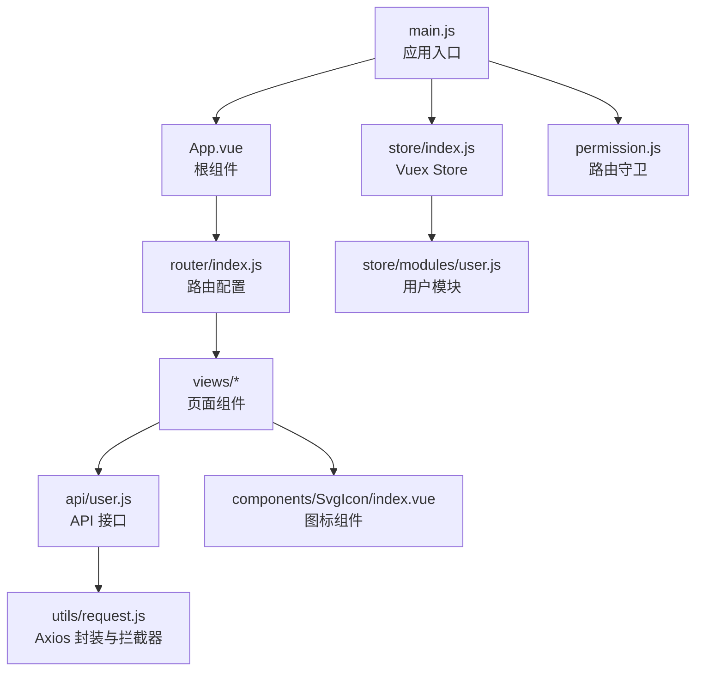
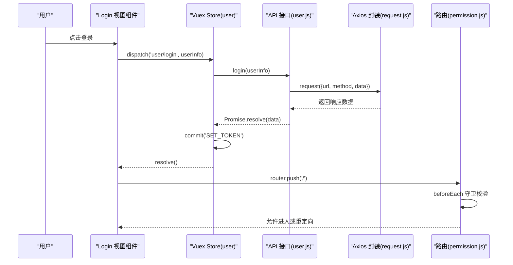
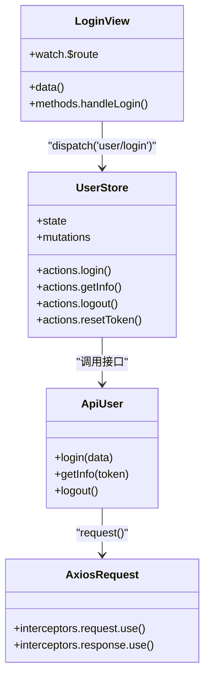
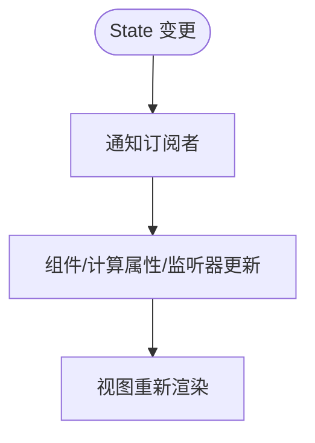
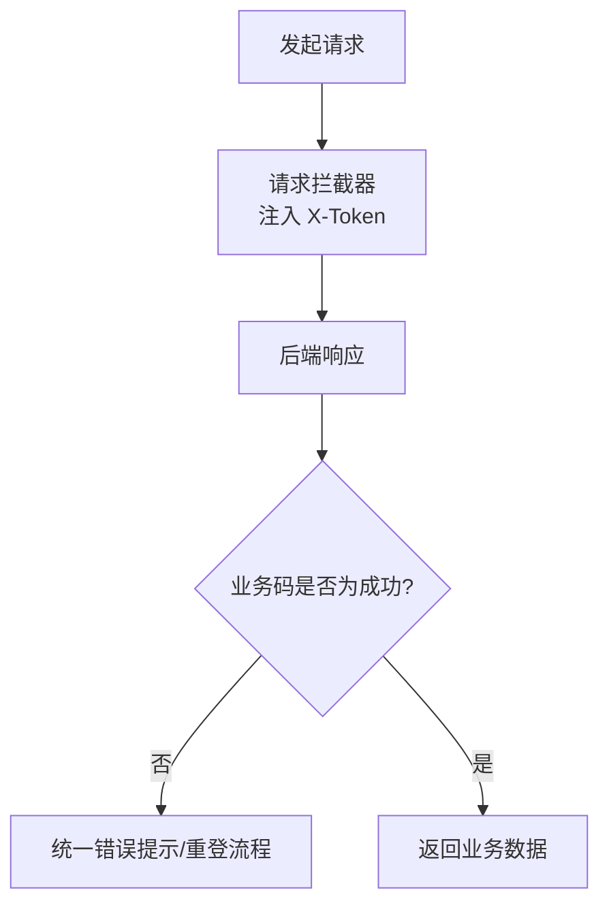
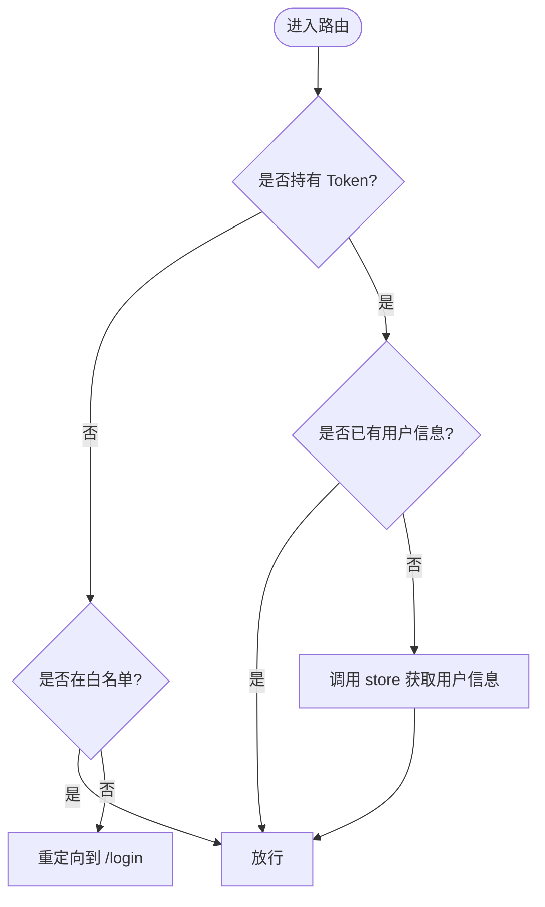
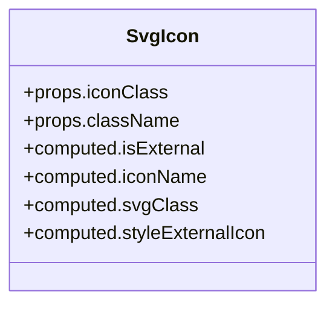
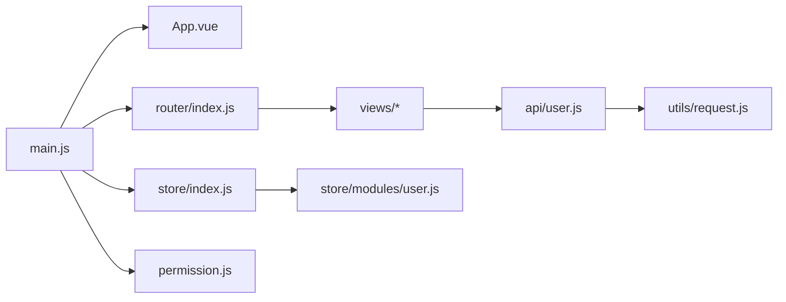

# 设计模式

<cite>
**本文引用的文件**   
- [main.js](file://src/main.js)
- [App.vue](file://src/App.vue)
- [store/index.js](file://src/store/index.js)
- [store/modules/user.js](file://src/store/modules/user.js)
- [router/index.js](file://src/router/index.js)
- [permission.js](file://src/permission.js)
- [utils/request.js](file://src/utils/request.js)
- [api/user.js](file://src/api/user.js)
- [views/login/index.vue](file://src/views/login/index.vue)
- [components/SvgIcon/index.vue](file://src/components/SvgIcon/index.vue)
</cite>

## 目录
1. [简介](#简介)
2. [项目结构](#项目结构)
3. [核心组件](#核心组件)
4. [架构总览](#架构总览)
5. [详细组件分析](#详细组件分析)
6. [依赖关系分析](#依赖关系分析)
7. [性能与可维护性](#性能与可维护性)
8. [故障排查指南](#故障排查指南)
9. [结论](#结论)

## 简介
本文面向在 Vue 项目中实践设计模式的开发者，围绕以下主题展开：
- MVVM 模式在 Vue + Vuex + Vue Router 中的落地（Model/Store、View/Views、ViewModel/Component）
- 观察者模式在 Vue 响应式系统中的体现
- 拦截器模式在 Axios 请求封装中的应用
- 路由守卫模式在权限控制中的实现
- 组件化设计与复用策略
- 结合仓库代码给出具体模式的应用场景与调用链说明

## 项目结构
本项目采用典型的前端工程分层：
- 视图层：views 下的业务页面组件
- 组件层：components 下的通用 UI 组件
- 状态层：store 使用 Vuex 管理全局状态
- 网络层：utils/request.js 基于 Axios 封装请求与拦截器
- 路由层：router/index.js 定义路由表，permission.js 实现路由守卫
- 入口与根组件：main.js 初始化应用，App.vue 作为根容器

图表来源
- [main.js:1-44](file://src/main.js#L1-L44)
- [App.vue:1-12](file://src/App.vue#L1-L12)
- [router/index.js:1-182](file://src/router/index.js#L1-L182)
- [store/index.js:1-20](file://src/store/index.js#L1-L20)
- [store/modules/user.js:1-98](file://src/store/modules/user.js#L1-L98)
- [permission.js:1-65](file://src/permission.js#L1-L65)
- [api/user.js:1-25](file://src/api/user.js#L1-L25)
- [utils/request.js:1-86](file://src/utils/request.js#L1-L86)
- [components/SvgIcon/index.vue:1-63](file://src/components/SvgIcon/index.vue#L1-L63)

章节来源
- [main.js:1-44](file://src/main.js#L1-L44)
- [App.vue:1-12](file://src/App.vue#L1-L12)
- [router/index.js:1-182](file://src/router/index.js#L1-L182)
- [store/index.js:1-20](file://src/store/index.js#L1-L20)
- [permission.js:1-65](file://src/permission.js#L1-L65)

## 核心组件
- Model(Store)：Vuex 集中式状态管理，包含 app、settings、user 等模块。用户登录、获取信息、登出等逻辑集中在 user 模块。
- View(Views)：以 views 为边界的页面级组件，负责展示与用户交互，如登录页、仪表盘、表格等。
- ViewModel(Component)：Vue 单文件组件，通过 data/computed/methods/watch 驱动视图更新，并通过 $store/$router 与状态和路由通信。

职责分离要点
- Store 仅关注状态变更与副作用处理（mutations/actions），不直接操作 DOM。
- Views 仅关注 UI 呈现与用户事件，通过 dispatch 触发 actions，避免直接修改 state。
- Component 作为 ViewModel，桥接 View 与 Store/Router，保持“展示+轻量交互”的职责边界。

章节来源
- [store/index.js:1-20](file://src/store/index.js#L1-L20)
- [store/modules/user.js:1-98](file://src/store/modules/user.js#L1-L98)
- [views/login/index.vue:1-238](file://src/views/login/index.vue#L1-L238)

## 架构总览
下图展示了从用户操作到数据更新的完整链路，体现了 MVVM 与多种设计模式的协作。

图表来源
- [views/login/index.vue:108-123](file://src/views/login/index.vue#L108-L123)
- [store/modules/user.js:31-43](file://src/store/modules/user.js#L31-L43)
- [api/user.js:3-9](file://src/api/user.js#L3-L9)
- [utils/request.js:14-31](file://src/utils/request.js#L14-L31)
- [permission.js:13-59](file://src/permission.js#L13-L59)

## 详细组件分析

### MVVM 模式在 Vue 中的实现
- Model(Store)
  - 使用 Vuex 组织状态与副作用，user 模块提供 token/name/avatar 等状态，以及 login/getInfo/logout/resetToken 等 action。
  - mutations 统一变更 state，actions 协调异步流程并调用 API。
- View(Views)
  - 登录页负责表单渲染、校验与交互；成功后通过 $router 跳转。
- ViewModel(Component)
  - 组件通过 $store.dispatch 触发 store 行为，通过 $route/$router 进行导航，保持视图与状态解耦。

图表来源
- [views/login/index.vue:58-125](file://src/views/login/index.vue#L58-L125)
- [store/modules/user.js:5-96](file://src/store/modules/user.js#L5-L96)
- [api/user.js:1-25](file://src/api/user.js#L1-L25)
- [utils/request.js:1-86](file://src/utils/request.js#L1-L86)

章节来源
- [store/modules/user.js:1-98](file://src/store/modules/user.js#L1-L98)
- [views/login/index.vue:1-238](file://src/views/login/index.vue#L1-L238)

### 观察者模式在 Vue 响应式系统中的应用
- Vue 的响应式系统基于观察者模式：当 state 变化时，订阅者（computed/watchers/组件）自动收到通知并重新渲染。
- Vuex 同样遵循该模式：mutation/action 改变 state 后，所有依赖该 state 的组件或 getter 都会得到更新。
- 在登录流程中，store 提交 mutation 设置 token 后，相关组件（如侧边栏、头部）会因响应式而刷新显示。

[本图为概念示意，不对应具体源码文件]

### 拦截器模式在 Axios 请求封装中的使用
- 请求拦截器：在发送请求前注入认证头（X-Token），保证每个请求携带令牌。
- 响应拦截器：统一处理业务码判断、错误提示、非法/过期令牌的重登流程。
- 将通用逻辑下沉至 request.js，业务 API 仅声明 URL/方法/参数，提升可维护性与一致性。

图表来源
- [utils/request.js:14-31](file://src/utils/request.js#L14-L31)
- [utils/request.js:34-83](file://src/utils/request.js#L34-L83)

章节来源
- [utils/request.js:1-86](file://src/utils/request.js#L1-L86)

### 路由守卫模式在权限控制中的实现
- permission.js 注册 beforeEach 全局前置守卫：
  - 未登录且非白名单路径则重定向到 /login
  - 已登录但未拉取用户信息时，先调用 store 获取用户信息
  - 登录后访问 /login 则重定向到首页
- 配合 NProgress 提供进度条体验，并在 afterEach 结束进度条。

图表来源
- [permission.js:13-59](file://src/permission.js#L13-L59)

章节来源
- [permission.js:1-65](file://src/permission.js#L1-L65)
- [router/index.js:167-181](file://src/router/index.js#L167-L181)

### 组件化设计模式与复用策略
- 通用组件抽取：如 SvgIcon 组件，根据 props 动态决定渲染 SVG 或外部图标，支持 className 扩展，具备良好复用性。
- 布局与子组件拆分：layout 下拆分为 Sidebar、Navbar、AppMain 等，便于组合与复用。
- 页面级组件按功能域划分（dashboard、table、form 等），保持单一职责。

图表来源
- [components/SvgIcon/index.vue:12-45](file://src/components/SvgIcon/index.vue#L12-L45)

章节来源
- [components/SvgIcon/index.vue:1-63](file://src/components/SvgIcon/index.vue#L1-L63)

## 依赖关系分析
- main.js 引入 App、router、store、permission，完成应用初始化与全局能力挂载。
- App.vue 作为根容器，承载 <router-view />。
- router/index.js 定义常量路由表并提供 resetRouter 用于登出后重置路由匹配器。
- store/index.js 聚合 modules 与 getters，对外暴露 store 实例。
- api/user.js 依赖 utils/request.js 提供的 axios 实例。
- permission.js 依赖 router、store、auth 工具函数与页面标题工具。

图表来源
- [main.js:1-44](file://src/main.js#L1-L44)
- [App.vue:1-12](file://src/App.vue#L1-L12)
- [router/index.js:1-182](file://src/router/index.js#L1-L182)
- [store/index.js:1-20](file://src/store/index.js#L1-L20)
- [store/modules/user.js:1-98](file://src/store/modules/user.js#L1-L98)
- [api/user.js:1-25](file://src/api/user.js#L1-L25)
- [utils/request.js:1-86](file://src/utils/request.js#L1-L86)
- [permission.js:1-65](file://src/permission.js#L1-L65)

章节来源
- [main.js:1-44](file://src/main.js#L1-L44)
- [router/index.js:1-182](file://src/router/index.js#L1-L182)
- [store/index.js:1-20](file://src/store/index.js#L1-L20)
- [api/user.js:1-25](file://src/api/user.js#L1-L25)
- [utils/request.js:1-86](file://src/utils/request.js#L1-L86)
- [permission.js:1-65](file://src/permission.js#L1-L65)

## 性能与可维护性
- 路由懒加载：路由表中使用动态 import 按需加载页面组件，减少首屏体积。
- 状态最小化：仅在 store 中保存必要的全局状态，避免过度共享。
- 拦截器集中化：将鉴权、错误处理等横切逻辑收敛至 request.js，降低重复代码。
- 组件粒度合理：通用 UI 与页面组件分离，利于测试与维护。

[本节为通用建议，不直接分析具体文件]

## 故障排查指南
- 登录失败或无权限
  - 检查 permission.js 的路由守卫逻辑是否正确放行白名单与已登录用户。
  - 确认 store/user.js 的 getInfo 是否能正确拉取用户信息。
- 请求异常或重复登录弹窗
  - 查看 utils/request.js 的响应拦截器对业务码的判断与重登流程。
  - 确认后端返回的业务码是否符合预期。
- 路由无法跳转或死循环
  - 检查路由表 meta 与 redirect 配置，确保不存在冲突。
  - 使用 resetRouter 在登出后清理动态路由。

章节来源
- [permission.js:13-59](file://src/permission.js#L13-L59)
- [store/modules/user.js:46-65](file://src/store/modules/user.js#L46-L65)
- [utils/request.js:45-83](file://src/utils/request.js#L45-L83)
- [router/index.js:175-181](file://src/router/index.js#L175-L181)

## 结论
本项目在 Vue 生态中清晰实践了多种设计模式：
- MVVM：通过 Vuex 与 Vue 组件明确分工，实现状态与视图的解耦。
- 观察者模式：依托 Vue/Vuex 的响应式机制，实现数据驱动的视图更新。
- 拦截器模式：在 Axios 层面统一处理鉴权与错误，提高一致性与可维护性。
- 路由守卫模式：在权限控制上提供集中化的访问策略。
- 组件化：通过通用组件与布局拆分，提升复用性与可测试性。

这些模式共同构成了项目的稳定骨架，有助于在复杂业务场景中保持清晰的职责边界与良好的扩展性。