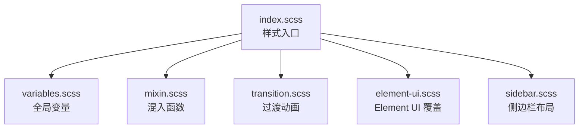
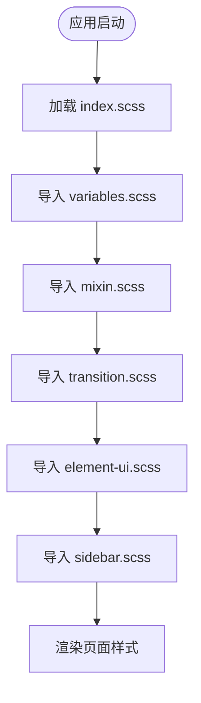
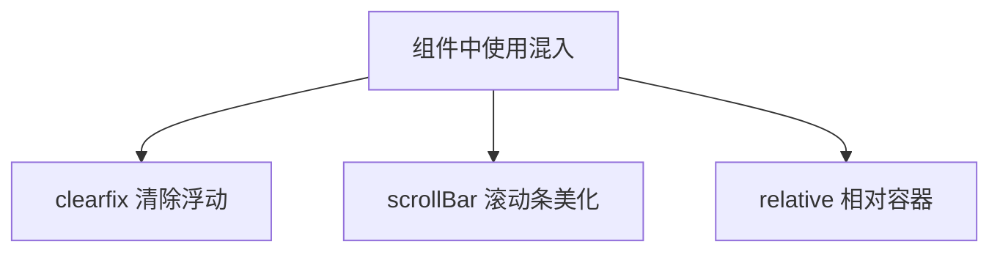
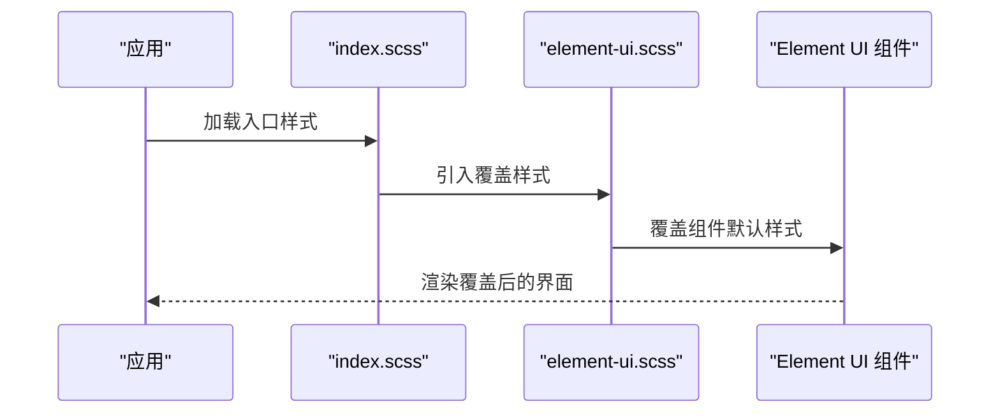
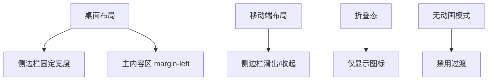
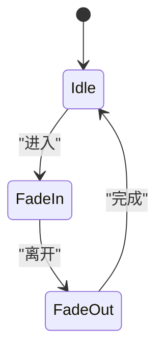
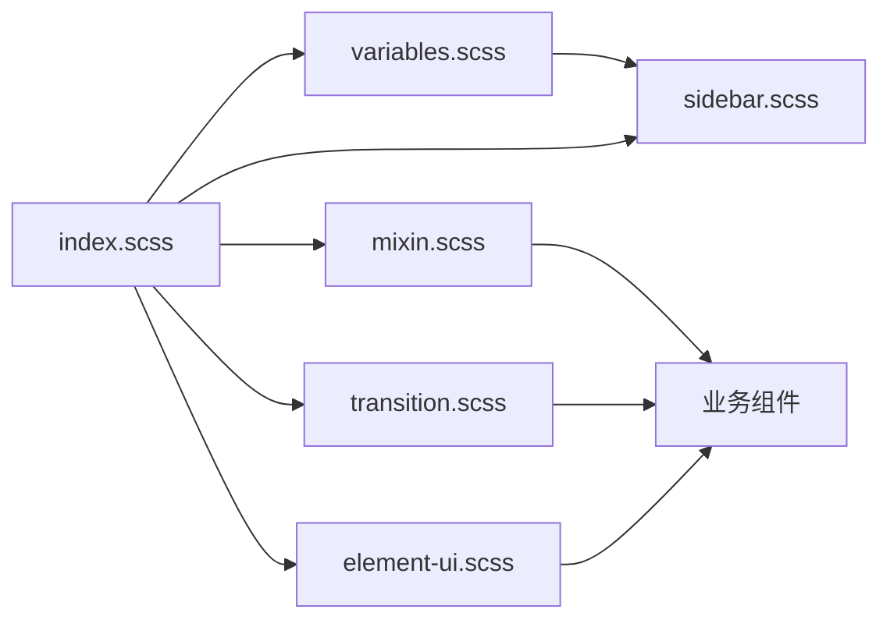

# 样式系统

<cite>
**本文引用的文件**   
- [src/styles/index.scss](file://src/styles/index.scss)
- [src/styles/variables.scss](file://src/styles/variables.scss)
- [src/styles/mixin.scss](file://src/styles/mixin.scss)
- [src/styles/element-ui.scss](file://src/styles/element-ui.scss)
- [src/styles/sidebar.scss](file://src/styles/sidebar.scss)
- [src/styles/transition.scss](file://src/styles/transition.scss)
</cite>

## 目录
1. [简介](#简介)
2. [项目结构](#项目结构)
3. [核心组件](#核心组件)
4. [架构总览](#架构总览)
5. [详细组件分析](#详细组件分析)
6. [依赖关系分析](#依赖关系分析)
7. [性能与优化](#性能与优化)
8. [故障排查指南](#故障排查指南)
9. [结论](#结论)

## 简介
本样式系统基于 SCSS，采用“全局变量 + 混入函数 + 主题覆盖 + 组件样式”的分层组织方式。通过集中管理颜色、尺寸等设计令牌，配合 Element UI 的主题覆盖与通用过渡动画，实现可维护、可扩展且易于定制的前端样式体系。

## 项目结构
样式目录位于 src/styles，入口文件统一引入各模块，保证样式加载顺序与依赖清晰：
- index.scss：样式入口，按依赖顺序引入变量、混入、过渡、Element UI 覆盖、侧边栏等
- variables.scss：全局设计令牌（颜色、宽度等），并通过 :export 暴露给 JS
- mixin.scss：通用混入（清除浮动、滚动条、相对布局）
- element-ui.scss：Element UI 组件样式覆盖与修复
- sidebar.scss：侧边栏与主内容区布局及响应式行为
- transition.scss：全局过渡动画类名



**图表来源**
- [src/styles/index.scss:1-5](file://src/styles/index.scss#L1-L5)

**章节来源**
- [src/styles/index.scss:1-66](file://src/styles/index.scss#L1-L66)

## 核心组件
- 全局变量与导出
  - 定义菜单文本色、激活态文本色、子菜单背景与悬停色、侧边栏宽度等
  - 使用 :export 将 SCSS 变量导出为 JS 可读取对象，便于运行时动态切换主题或配置
- 混入函数
  - clearfix：清除浮动
  - scrollBar：统一滚动条外观
  - relative：快速设置相对定位容器
- Element UI 覆盖
  - 面包屑字体权重、上传组件隐藏原生 input、对话框定位修复、下拉菜单链接块级化、日期选择器分隔符盒模型修正
- 侧边栏与布局
  - 固定侧边栏、主内容区留白、折叠态、移动端滑出/收起、无动画模式
- 过渡动画
  - fade、fade-transform、breadcrumb 过渡类名，用于页面与导航切换

**章节来源**
- [src/styles/variables.scss:1-26](file://src/styles/variables.scss#L1-L26)
- [src/styles/mixin.scss:1-29](file://src/styles/mixin.scss#L1-L29)
- [src/styles/element-ui.scss:1-50](file://src/styles/element-ui.scss#L1-L50)
- [src/styles/sidebar.scss:1-227](file://src/styles/sidebar.scss#L1-L227)
- [src/styles/transition.scss:1-49](file://src/styles/transition.scss#L1-L49)

## 架构总览
样式系统以 index.scss 为入口，遵循“先变量、再混入、后业务样式”的加载顺序，确保后续样式能消费设计令牌与通用能力。Element UI 覆盖在变量之后引入，避免被第三方样式覆盖；侧边栏样式最后引入，以便对框架默认样式进行最终调整。



**图表来源**
- [src/styles/index.scss:1-5](file://src/styles/index.scss#L1-L5)

**章节来源**
- [src/styles/index.scss:1-66](file://src/styles/index.scss#L1-L66)

## 详细组件分析

### 全局变量与主题定制
- 设计令牌
  - 菜单文本色、激活态文本色、子菜单激活文本色
  - 菜单背景色、悬停色
  - 子菜单背景色、悬停色
  - 侧边栏宽度
- 主题定制方案
  - 修改 variables.scss 中的变量即可全局生效
  - 通过 :export 暴露变量，可在 JS 中读取并动态注入到 CSS 变量或内联样式，实现运行时换肤
  - 建议将品牌主色、字号、间距等纳入变量体系，保持视觉一致性

```mermaid
classDiagram
class Variables {
+menuText
+menuActiveText
+subMenuActiveText
+menuBg
+menuHover
+subMenuBg
+subMenuHover
+sideBarWidth
}
class ExportedJS {
+读取变量
+动态注入主题
}
Variables --> ExportedJS : " : export"
```

**图表来源**
- [src/styles/variables.scss:1-26](file://src/styles/variables.scss#L1-L26)

**章节来源**
- [src/styles/variables.scss:1-26](file://src/styles/variables.scss#L1-L26)

### 混入函数与通用样式
- 混入
  - clearfix：解决父容器高度塌陷
  - scrollBar：统一 WebKit 滚动条样式
  - relative：快速构建相对定位容器
- 通用样式
  - body/html 基础排版与 box-sizing
  - a 标签交互态
  - .app-container 页面容器内边距
  - .clearfix 工具类



**图表来源**
- [src/styles/mixin.scss:1-29](file://src/styles/mixin.scss#L1-L29)
- [src/styles/index.scss:51-65](file://src/styles/index.scss#L51-L65)

**章节来源**
- [src/styles/mixin.scss:1-29](file://src/styles/mixin.scss#L1-L29)
- [src/styles/index.scss:7-65](file://src/styles/index.scss#L7-L65)

### Element UI 主题覆盖与自定义
- 覆盖范围
  - 面包屑链接字体权重
  - 上传组件隐藏原生 input
  - 对话框定位与居中
  - 下拉菜单链接块级化
  - 日期选择器分隔符盒模型
- 自定义方法
  - 在 element-ui.scss 中追加覆盖规则，优先于 Element 默认样式
  - 结合 variables.scss 的颜色变量，统一品牌色
  - 针对特定业务封装 .upload-container 等容器类，复用样式



**图表来源**
- [src/styles/index.scss:4-4](file://src/styles/index.scss#L4-L4)
- [src/styles/element-ui.scss:1-50](file://src/styles/element-ui.scss#L1-L50)

**章节来源**
- [src/styles/element-ui.scss:1-50](file://src/styles/element-ui.scss#L1-L50)

### 侧边栏与布局（含响应式）
- 桌面端
  - 侧边栏固定定位，宽度由变量控制
  - 主内容区左侧 margin 与侧边栏宽度一致
  - 支持折叠态（窄图标+提示）、子菜单展开/悬停高亮
- 移动端
  - 通过 .mobile 修饰符切换为滑出式侧边栏
  - 支持 .hideSidebar 收起时从左侧滑出
- 无动画模式
  - .withoutAnimation 禁用过渡，提升性能或调试体验



**图表来源**
- [src/styles/sidebar.scss:1-227](file://src/styles/sidebar.scss#L1-L227)

**章节来源**
- [src/styles/sidebar.scss:1-227](file://src/styles/sidebar.scss#L1-L227)

### 过渡动画
- 提供 fade、fade-transform、breadcrumb 三类过渡类名
- 适用于路由切换、导航项进出场等场景
- 可通过 .withoutAnimation 关闭过渡以提升性能



**图表来源**
- [src/styles/transition.scss:1-49](file://src/styles/transition.scss#L1-L49)

**章节来源**
- [src/styles/transition.scss:1-49](file://src/styles/transition.scss#L1-L49)

## 依赖关系分析
- 入口依赖链
  - index.scss 依次引入 variables、mixin、transition、element-ui、sidebar
- 变量消费方
  - sidebar.scss 消费 $sideBarWidth、$menuBg、$menuHover、$subMenuBg、$subMenuHover 等
- 混入消费方
  - 业务组件可使用 clearfix、scrollBar、relative 等混入
- Element UI 覆盖时机
  - 在变量与混入之后引入，确保覆盖优先级正确



**图表来源**
- [src/styles/index.scss:1-5](file://src/styles/index.scss#L1-L5)
- [src/styles/sidebar.scss:1-227](file://src/styles/sidebar.scss#L1-L227)

**章节来源**
- [src/styles/index.scss:1-66](file://src/styles/index.scss#L1-L66)
- [src/styles/sidebar.scss:1-227](file://src/styles/sidebar.scss#L1-L227)

## 性能与优化
- 样式加载顺序
  - 将变量与混入放在前面，减少重复计算与覆盖冲突
- 避免过度使用 !important
  - 仅在必要时覆盖第三方样式，尽量通过更具体的选择器降低优先级
- 合理使用过渡
  - 在不需要动效的场景使用 .withoutAnimation 禁用过渡，减少重排重绘
- 滚动条样式
  - 使用统一的 scrollBar 混入，避免多处重复定义
- 变量驱动主题
  - 通过 :export 暴露变量，在 JS 中按需注入，减少多套样式文件的体积

[本节为通用指导，不直接分析具体文件]

## 故障排查指南
- 侧边栏宽度异常
  - 检查 variables.scss 中 $sideBarWidth 是否被意外覆盖
  - 确认 sidebar.scss 中相关选择器的优先级未被更高优先级规则覆盖
- 移动端侧边栏无法收起
  - 检查 .mobile.hideSidebar 组合类是否正确挂载
  - 确认 transform 与 translate3d 参数是否与 $sideBarWidth 一致
- Element UI 样式未生效
  - 确认 element-ui.scss 在 index.scss 中被引入
  - 检查覆盖的选择器是否匹配当前版本 Element UI 的类名
- 过渡动画卡顿
  - 尝试添加 .withoutAnimation 禁用过渡
  - 避免同时启用过多复杂动画

**章节来源**
- [src/styles/sidebar.scss:94-185](file://src/styles/sidebar.scss#L94-L185)
- [src/styles/element-ui.scss:1-50](file://src/styles/element-ui.scss#L1-L50)

## 结论
该样式系统通过集中化的变量管理、可复用的混入、清晰的入口依赖与针对性的 Element UI 覆盖，构建了稳定且易扩展的样式架构。借助 :export 机制，可实现运行时主题切换；通过合理的过渡与响应式策略，兼顾了用户体验与性能。建议在后续迭代中继续完善设计令牌体系，并将更多通用样式抽象为混入或原子类，进一步提升可维护性与一致性。