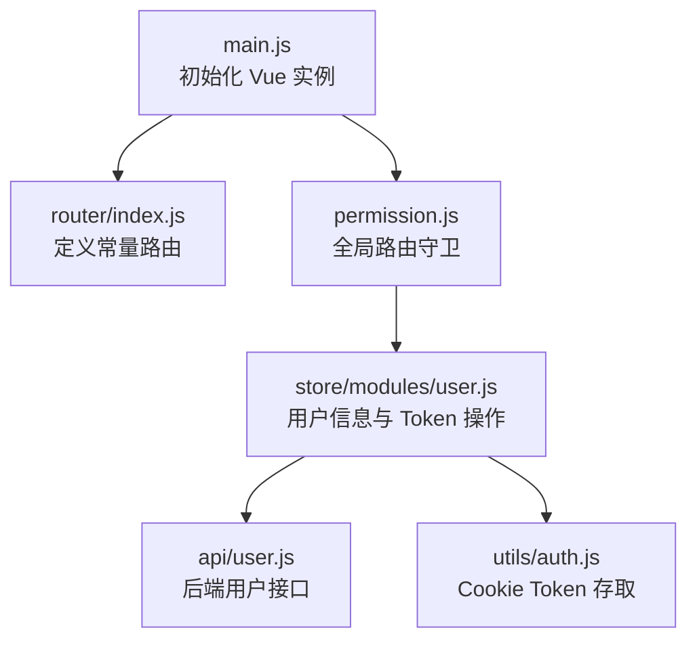
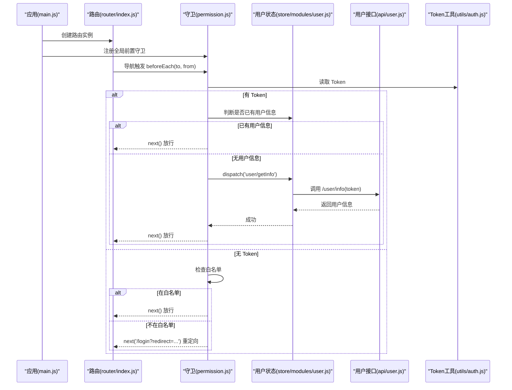
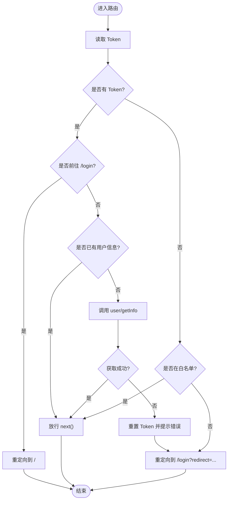
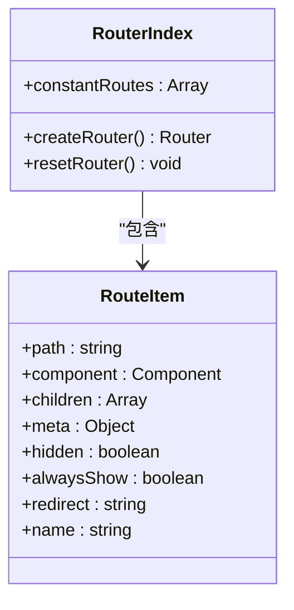
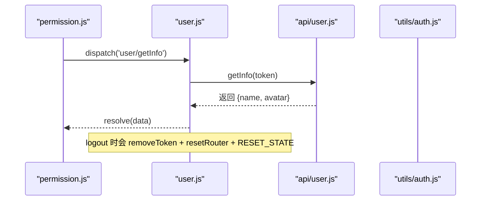
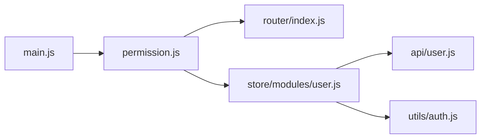

# 权限控制系统

<cite>
**本文引用的文件**   
- [src/permission.js](file://src/permission.js)
- [src/router/index.js](file://src/router/index.js)
- [src/store/modules/user.js](file://src/store/modules/user.js)
- [src/utils/auth.js](file://src/utils/auth.js)
- [src/api/user.js](file://src/api/user.js)
- [src/main.js](file://src/main.js)
</cite>

## 目录
1. [简介](#简介)
2. [项目结构](#项目结构)
3. [核心组件](#核心组件)
4. [架构总览](#架构总览)
5. [详细组件分析](#详细组件分析)
6. [依赖关系分析](#依赖关系分析)
7. [性能与优化](#性能与优化)
8. [故障排查指南](#故障排查指南)
9. [结论](#结论)
10. [附录：扩展实践](#附录扩展实践)

## 简介
本文件面向权限控制系统的实现与扩展，聚焦以下目标：
- 基于路由的权限控制机制：路由守卫、白名单、登录态校验、用户信息获取。
- 动态路由生成与角色权限验证：如何在现有基础上扩展为“按角色动态生成菜单与路由”。
- 细粒度权限控制：菜单权限、按钮权限、数据权限的实现思路与落地方案。
- 与认证系统集成：Token 管理、用户信息缓存、刷新与登出流程。
- 性能优化策略与常见问题解决方案。

## 项目结构
本项目采用最小化后台模板结构，权限相关代码集中在以下位置：
- 路由定义：src/router/index.js
- 路由拦截器（全局前置守卫）：src/permission.js
- 用户状态与认证动作：src/store/modules/user.js
- Token 存取工具：src/utils/auth.js
- 用户接口封装：src/api/user.js
- 应用入口并引入权限模块：src/main.js

图表来源
- [src/main.js:11-16](file://src/main.js#L11-L16)
- [src/router/index.js:167-181](file://src/router/index.js#L167-L181)
- [src/permission.js:1-8](file://src/permission.js#L1-L8)
- [src/store/modules/user.js:1-3](file://src/store/modules/user.js#L1-L3)
- [src/utils/auth.js:1-16](file://src/utils/auth.js#L1-L16)
- [src/api/user.js:1-25](file://src/api/user.js#L1-L25)

章节来源
- [src/main.js:11-16](file://src/main.js#L11-L16)
- [src/router/index.js:1-181](file://src/router/index.js#L1-L181)
- [src/permission.js:1-65](file://src/permission.js#L1-L65)
- [src/store/modules/user.js:1-98](file://src/store/modules/user.js#L1-L98)
- [src/utils/auth.js:1-16](file://src/utils/auth.js#L1-L16)
- [src/api/user.js:1-25](file://src/api/user.js#L1-L25)

## 核心组件
- 路由层（router/index.js）
  - 提供 constantRoutes 常量路由表，包含登录、404、首页与示例页面等基础路由。
  - 暴露 resetRouter 用于重置路由匹配器，配合登出或权限变更场景使用。
- 路由守卫（permission.js）
  - 全局 beforeEach 守卫负责：进度条、标题设置、白名单放行、未登录重定向到登录页、已登录但无用户信息时拉取用户信息。
  - afterEach 结束进度条。
- 用户状态（store/modules/user.js）
  - 维护 token、name、avatar 等状态；提供 login/getInfo/logout/resetToken 等 action。
  - getInfo 调用后端接口获取用户信息，成功后写入 name/avatar。
  - logout 会清除 Token、重置路由、重置状态。
- Token 工具（utils/auth.js）
  - 基于 Cookie 的 getToken/setToken/removeToken。
- 用户接口（api/user.js）
  - 封装 /user/login、/user/info、/user/logout 三个接口。

章节来源
- [src/router/index.js:28-181](file://src/router/index.js#L28-L181)
- [src/permission.js:11-64](file://src/permission.js#L11-L64)
- [src/store/modules/user.js:5-98](file://src/store/modules/user.js#L5-L98)
- [src/utils/auth.js:1-16](file://src/utils/auth.js#L1-L16)
- [src/api/user.js:1-25](file://src/api/user.js#L1-L25)

## 架构总览
下图展示从应用启动到路由导航的完整权限链路：

图表来源
- [src/main.js:11-16](file://src/main.js#L11-L16)
- [src/permission.js:13-58](file://src/permission.js#L13-L58)
- [src/store/modules/user.js:46-65](file://src/store/modules/user.js#L46-L65)
- [src/api/user.js:11-17](file://src/api/user.js#L11-L17)
- [src/utils/auth.js:5-7](file://src/utils/auth.js#L5-L7)

## 详细组件分析

### 路由守卫（permission.js）
- 功能要点
  - 白名单：仅允许 /login 直接访问。
  - 已登录且进入 /login：重定向到首页。
  - 已登录但未拉取用户信息：调用 store.dispatch('user/getInfo') 后放行。
  - 未登录且非白名单：重定向到 /login，携带 redirect 参数以便登录后回跳。
  - 进度条：beforeEach 开始，afterEach 结束。
- 关键路径
  - 白名单判断与重定向逻辑。
  - 用户信息获取失败时的错误处理与清理 Token。

图表来源
- [src/permission.js:11-58](file://src/permission.js#L11-L58)
- [src/store/modules/user.js:81-88](file://src/store/modules/user.js#L81-L88)

章节来源
- [src/permission.js:11-64](file://src/permission.js#L11-L64)

### 路由配置（router/index.js）
- 常量路由 constantRoutes
  - 包含登录、404、首页、示例、表单、嵌套菜单、外链等基础路由。
  - meta 字段预留 roles 能力（注释中说明），当前未启用基于角色的过滤。
- 路由工厂与重置
  - createRouter 创建路由实例，初始 routes 为 constantRoutes。
  - resetRouter 通过替换 matcher 实现“软重置”，配合登出或权限变更。

图表来源
- [src/router/index.js:28-181](file://src/router/index.js#L28-L181)

章节来源
- [src/router/index.js:28-181](file://src/router/index.js#L28-L181)

### 用户状态与认证（store/modules/user.js）
- 状态
  - token、name、avatar。
- Actions
  - login：提交用户名密码，成功后写入 Token。
  - getInfo：根据 Token 拉取用户信息，成功后写入 name/avatar。
  - logout：调用后端登出，清除 Token、重置路由、重置状态。
  - resetToken：仅清除本地 Token 与状态。
- 与路由集成
  - permission.js 在需要用户信息时调用 getInfo。
  - logout 中调用 resetRouter，确保权限变更后路由匹配器被清空。

图表来源
- [src/store/modules/user.js:46-65](file://src/store/modules/user.js#L46-L65)
- [src/store/modules/user.js:67-88](file://src/store/modules/user.js#L67-L88)
- [src/api/user.js:11-17](file://src/api/user.js#L11-L17)
- [src/utils/auth.js:13-15](file://src/utils/auth.js#L13-L15)

章节来源
- [src/store/modules/user.js:5-98](file://src/store/modules/user.js#L5-L98)
- [src/api/user.js:1-25](file://src/api/user.js#L1-L25)
- [src/utils/auth.js:1-16](file://src/utils/auth.js#L1-L16)

### 与认证系统集成
- Token 生命周期
  - 登录成功后由 user.js 写入 Cookie（utils/auth.js）。
  - 路由守卫每次导航前读取 Token 进行鉴权。
  - 登出或 Token 失效时清除 Cookie 并跳转登录页。
- 用户信息缓存
  - 首次进入受保护页面时拉取用户信息并缓存于 store。
  - 后续导航无需重复请求，除非主动刷新或登出。

章节来源
- [src/utils/auth.js:5-15](file://src/utils/auth.js#L5-L15)
- [src/store/modules/user.js:30-44](file://src/store/modules/user.js#L30-L44)
- [src/permission.js:20-45](file://src/permission.js#L20-L45)

## 依赖关系分析
- 模块耦合
  - permission.js 依赖 router、store、auth、UI 组件与进度条库。
  - user.js 依赖 api/user.js、utils/auth.js、router（resetRouter）。
  - main.js 引入 permission.js 以注册全局守卫。
- 外部依赖
  - Element UI（Message）、NProgress（进度条）、js-cookie（Token 存储）。

图表来源
- [src/main.js:11-16](file://src/main.js#L11-L16)
- [src/permission.js:1-8](file://src/permission.js#L1-L8)
- [src/store/modules/user.js:1-3](file://src/store/modules/user.js#L1-L3)

章节来源
- [src/main.js:11-16](file://src/main.js#L11-L16)
- [src/permission.js:1-8](file://src/permission.js#L1-L8)
- [src/store/modules/user.js:1-3](file://src/store/modules/user.js#L1-L3)

## 性能与优化
- 路由懒加载
  - 所有视图组件均采用动态 import，减少首屏体积。
- 用户信息缓存
  - 仅在首次需要时拉取用户信息，避免重复网络请求。
- 路由重置
  - 登出时使用 resetRouter 替换 matcher，避免残留动态路由导致内存泄漏。
- 建议优化
  - 将用户信息缓存至持久化存储（如 localStorage）并在应用启动时恢复，减少重复请求。
  - 对频繁访问的静态资源与图标进行预加载。
  - 将权限判定逻辑下沉到服务端，前端仅做最小化校验，降低前端计算开销。

[本节为通用指导，不直接分析具体文件]

## 故障排查指南
- 无法进入受保护页面
  - 检查 Token 是否存在（utils/auth.js）。
  - 确认白名单是否正确配置（permission.js）。
  - 查看 getInfo 是否抛出异常，必要时清理 Token 并重试登录。
- 登录后仍被重定向到登录页
  - 检查 getInfo 返回值是否为空或接口报错。
  - 确认 store 中 name/avatar 是否成功写入。
- 登出后仍可访问动态路由
  - 确认 logout 中是否调用了 resetRouter 与 removeToken。
- 进度条卡住
  - 检查 beforeEach/afterEach 是否成对执行，确保 NProgress.done() 被调用。

章节来源
- [src/permission.js:13-64](file://src/permission.js#L13-L64)
- [src/store/modules/user.js:67-88](file://src/store/modules/user.js#L67-L88)
- [src/utils/auth.js:5-15](file://src/utils/auth.js#L5-L15)

## 结论
当前仓库提供了基础的基于路由的权限控制：通过全局守卫校验 Token 与用户信息，结合白名单机制完成基本鉴权。若需更完善的权限体系（按角色动态生成菜单与路由、按钮级与数据级权限），可在现有基础上扩展：
- 在路由 meta.roles 上标注角色，并在守卫中根据用户角色过滤可访问路由。
- 在服务端返回用户角色与权限列表，前端据此生成动态路由与菜单。
- 在组件层实现按钮级权限指令与数据级权限过滤。

[本节为总结性内容，不直接分析具体文件]

## 附录：扩展实践

### 添加新的权限规则（基于角色）
- 步骤
  - 在路由 meta.roles 中标注允许的角色数组。
  - 在路由守卫中，根据用户角色集合判断是否放行。
  - 若无权限，统一跳转到 403 或提示无权限。
- 参考位置
  - 路由元信息约定：[src/router/index.js:19-25](file://src/router/index.js#L19-L25)
  - 守卫逻辑扩展点：[src/permission.js:28-45](file://src/permission.js#L28-L45)

章节来源
- [src/router/index.js:19-25](file://src/router/index.js#L19-L25)
- [src/permission.js:28-45](file://src/permission.js#L28-L45)

### 实现动态菜单生成
- 思路
  - 从后端获取用户角色与权限列表。
  - 根据权限列表过滤 constantRoutes 或合并动态路由，生成侧边栏菜单。
  - 使用 keep-alive 与路由 name 保持组件状态。
- 参考位置
  - 常量路由结构：[src/router/index.js:33-165](file://src/router/index.js#L33-L165)
  - 用户信息获取：[src/store/modules/user.js:46-65](file://src/store/modules/user.js#L46-L65)

章节来源
- [src/router/index.js:33-165](file://src/router/index.js#L33-L165)
- [src/store/modules/user.js:46-65](file://src/store/modules/user.js#L46-L65)

### 处理无权限访问
- 前端
  - 在路由守卫中增加角色校验，不满足则跳转 403。
  - 在组件中使用自定义指令控制按钮显示/隐藏。
- 后端
  - 接口层校验权限，返回 403 时前端统一提示。
- 参考位置
  - 404 路由占位：[src/router/index.js:40-44](file://src/router/index.js#L40-L44)
  - 错误提示组件：[src/permission.js:38-44](file://src/permission.js#L38-L44)

章节来源
- [src/router/index.js:40-44](file://src/router/index.js#L40-L44)
- [src/permission.js:38-44](file://src/permission.js#L38-L44)

### 权限系统与用户认证集成
- 登录流程
  - 用户提交凭证 -> 后端返回 Token -> 写入 Cookie -> 拉取用户信息 -> 放行。
- 刷新与过期
  - Token 过期时 getInfo 失败 -> 清理 Token -> 跳转登录。
- 参考位置
  - 登录与 Token 写入：[src/store/modules/user.js:30-44](file://src/store/modules/user.js#L30-L44)
  - 用户信息拉取与错误处理：[src/store/modules/user.js:46-65](file://src/store/modules/user.js#L46-L65)
  - 路由守卫中的错误分支：[src/permission.js:38-44](file://src/permission.js#L38-L44)

章节来源
- [src/store/modules/user.js:30-65](file://src/store/modules/user.js#L30-L65)
- [src/permission.js:38-44](file://src/permission.js#L38-L44)

### 权限缓存与刷新机制
- 现状
  - 用户信息缓存在 store，Token 存储在 Cookie。
- 建议
  - 将用户信息同步到持久化存储，应用启动时恢复，减少重复请求。
  - 在 Token 刷新场景中，先刷新 Token 再重试原请求，保证用户体验。
- 参考位置
  - Token 存取：[src/utils/auth.js:5-15](file://src/utils/auth.js#L5-L15)
  - 用户信息缓存：[src/store/modules/user.js:5-11](file://src/store/modules/user.js#L5-L11)

章节来源
- [src/utils/auth.js:5-15](file://src/utils/auth.js#L5-L15)
- [src/store/modules/user.js:5-11](file://src/store/modules/user.js#L5-L11)