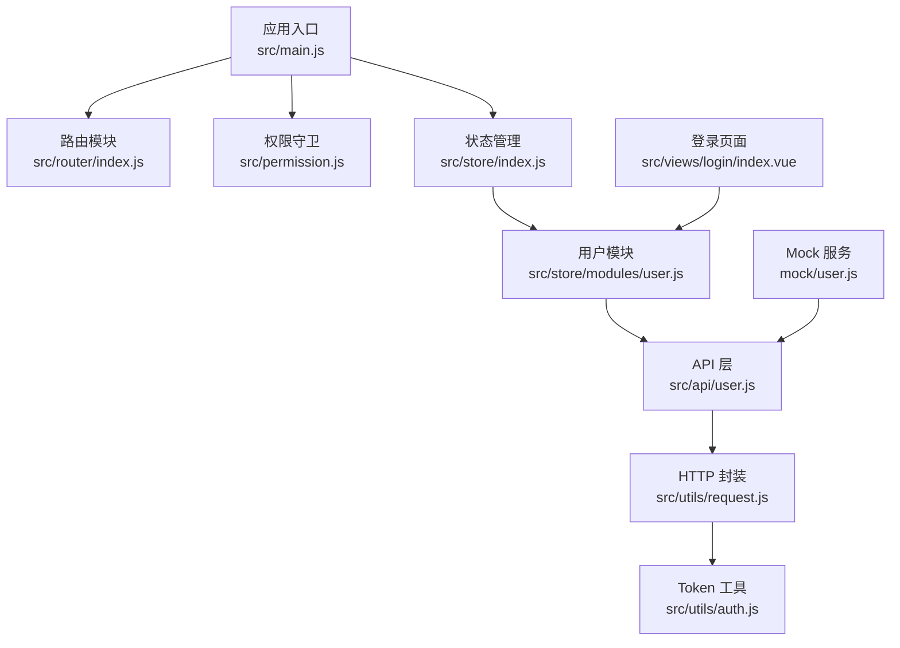
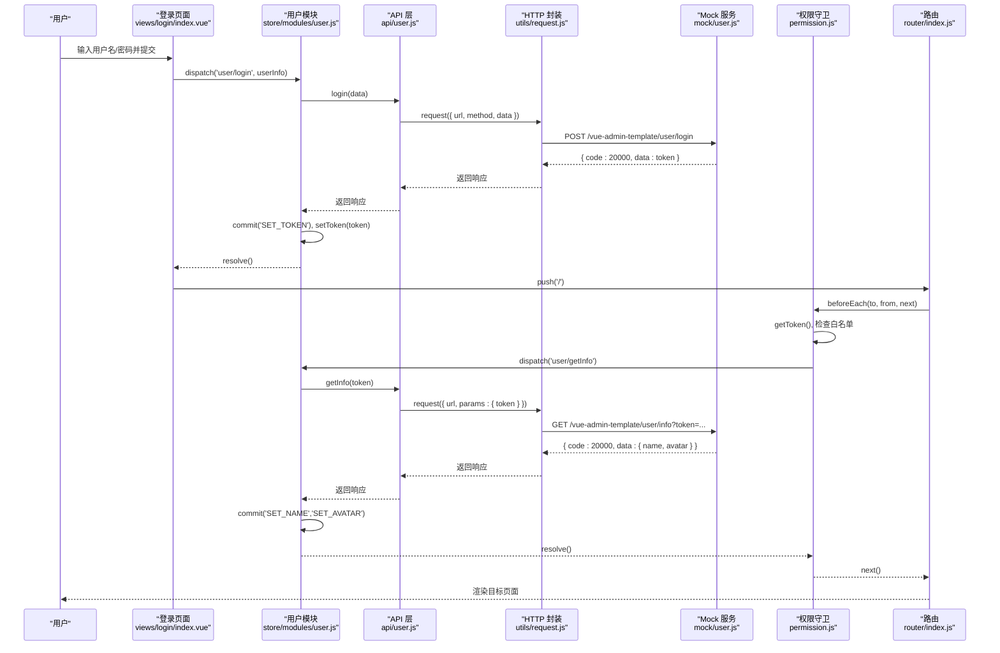
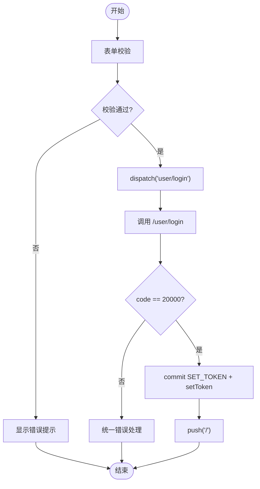
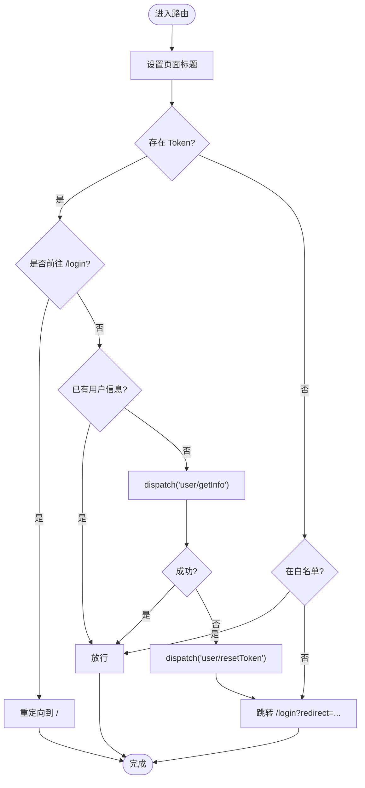
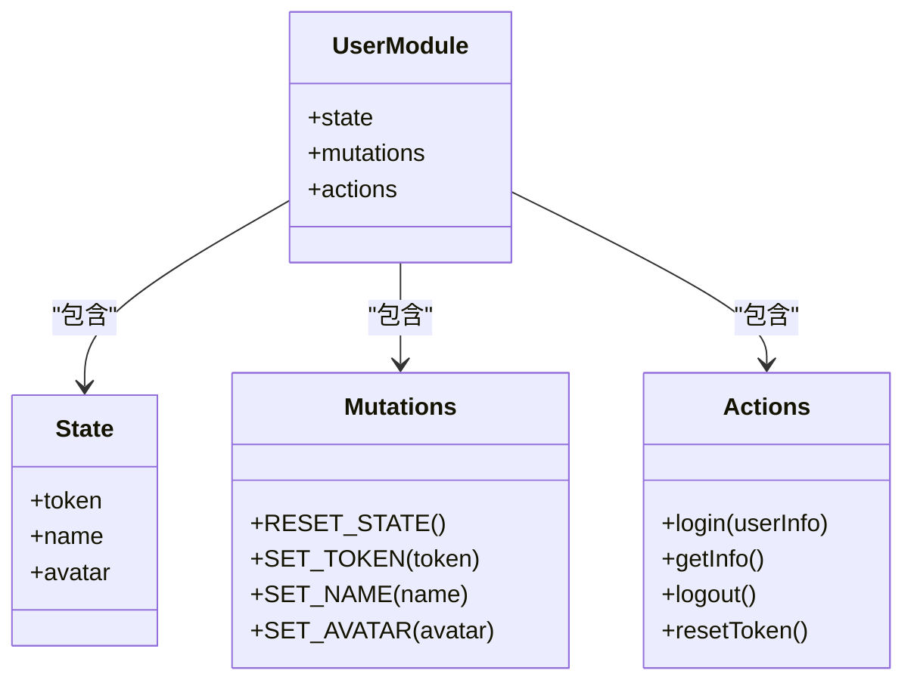
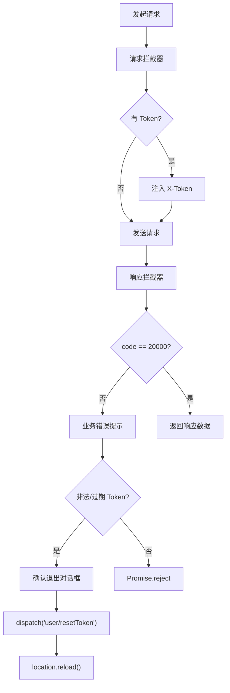
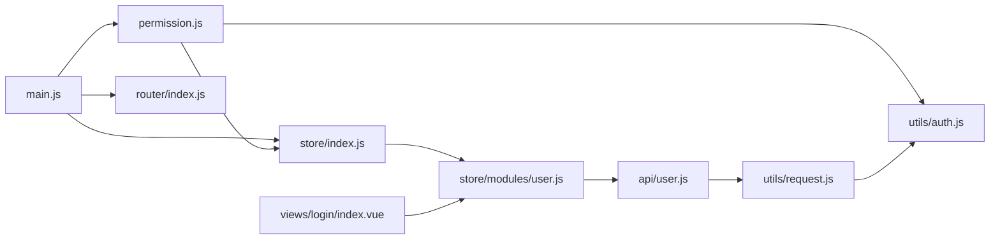

# 核心功能模块

<cite>
**本文引用的文件**   
- [src/main.js](file://src/main.js)
- [src/permission.js](file://src/permission.js)
- [src/router/index.js](file://src/router/index.js)
- [src/store/index.js](file://src/store/index.js)
- [src/store/modules/user.js](file://src/store/modules/user.js)
- [src/api/user.js](file://src/api/user.js)
- [src/utils/request.js](file://src/utils/request.js)
- [src/utils/auth.js](file://src/utils/auth.js)
- [src/views/login/index.vue](file://src/views/login/index.vue)
- [mock/user.js](file://mock/user.js)
</cite>

## 目录
1. [简介](#简介)
2. [项目结构](#项目结构)
3. [核心组件](#核心组件)
4. [架构总览](#架构总览)
5. [详细组件分析](#详细组件分析)
6. [依赖关系分析](#依赖关系分析)
7. [性能与可维护性建议](#性能与可维护性建议)
8. [故障排查指南](#故障排查指南)
9. [结论](#结论)

## 简介
本文件聚焦于该前端管理模板的核心功能模块，包括：
- 用户认证系统（登录、登出、Token 管理）
- 权限控制系统（路由守卫、白名单、页面标题与进度条）
- 状态管理（Vuex 模块 user 的状态、动作与变更）
- 网络请求封装（Axios 拦截器、统一错误处理、自动携带 Token）

文档将说明各模块的设计思路、实现原理、使用方式、模块间协作关系与数据流转，并提供常见问题排查与性能优化建议。

## 项目结构
围绕核心功能的文件组织如下：
- 应用入口与全局初始化：src/main.js
- 路由定义与动态重置：src/router/index.js
- 路由守卫与权限控制：src/permission.js
- 状态管理（Vuex）：src/store/index.js、src/store/modules/user.js
- API 接口层：src/api/user.js
- HTTP 请求封装：src/utils/request.js
- Token 存取工具：src/utils/auth.js
- 登录页面：src/views/login/index.vue
- Mock 服务（开发环境）：mock/user.js

图表来源
- [src/main.js:1-44](file://src/main.js#L1-L44)
- [src/router/index.js:1-182](file://src/router/index.js#L1-L182)
- [src/permission.js:1-65](file://src/permission.js#L1-L65)
- [src/store/index.js:1-20](file://src/store/index.js#L1-L20)
- [src/store/modules/user.js:1-98](file://src/store/modules/user.js#L1-L98)
- [src/api/user.js:1-25](file://src/api/user.js#L1-L25)
- [src/utils/request.js:1-86](file://src/utils/request.js#L1-L86)
- [src/utils/auth.js:1-16](file://src/utils/auth.js#L1-L16)
- [src/views/login/index.vue:1-238](file://src/views/login/index.vue#L1-L238)
- [mock/user.js:1-85](file://mock/user.js#L1-L85)

章节来源
- [src/main.js:1-44](file://src/main.js#L1-L44)
- [src/router/index.js:1-182](file://src/router/index.js#L1-L182)

## 核心组件
本节概述关键模块的职责与交互：
- 用户认证系统
  - 登录：调用 API 获取 Token，持久化到 Cookie，并更新 Vuex 状态
  - 登出：调用后端登出接口，清除本地 Token 与路由表，重置状态
  - Token 管理：通过工具函数在 Cookie 中读写 Token
- 权限控制系统
  - 路由守卫：根据 Token 与白名单决定是否放行或跳转登录页
  - 页面标题与进度条：在进入路由时设置标题与进度条
  - 用户信息预取：首次进入非登录页时拉取用户信息
- 状态管理（Vuex）
  - user 模块：维护 token/name/avatar，提供 login/getInfo/logout/resetToken 等动作
- 网络请求封装
  - Axios 实例：统一 baseURL、超时、请求/响应拦截器
  - 请求拦截：自动注入 X-Token 头
  - 响应拦截：统一业务码判断、错误提示、异常 Token 处理

章节来源
- [src/store/modules/user.js:1-98](file://src/store/modules/user.js#L1-L98)
- [src/permission.js:1-65](file://src/permission.js#L1-L65)
- [src/utils/request.js:1-86](file://src/utils/request.js#L1-L86)
- [src/utils/auth.js:1-16](file://src/utils/auth.js#L1-L16)

## 架构总览
下图展示了从用户操作到数据落盘与页面渲染的完整链路：

图表来源
- [src/views/login/index.vue:108-123](file://src/views/login/index.vue#L108-L123)
- [src/store/modules/user.js:30-44](file://src/store/modules/user.js#L30-L44)
- [src/api/user.js:3-9](file://src/api/user.js#L3-L9)
- [src/utils/request.js:13-31](file://src/utils/request.js#L13-L31)
- [mock/user.js:26-47](file://mock/user.js#L26-L47)
- [src/permission.js:13-45](file://src/permission.js#L13-L45)
- [src/router/index.js:167-181](file://src/router/index.js#L167-L181)

## 详细组件分析

### 用户认证系统
设计要点
- 登录流程：表单校验 -> 调用 store action -> 调用 API -> 写入 Token -> 跳转首页
- 登出流程：调用后端登出 -> 清除 Token -> 重置路由 -> 重置状态
- Token 存储：Cookie，键名固定，便于跨请求携带

实现要点
- 登录动作：提交 username/password，成功后 commit SET_TOKEN 并持久化 Token
- 获取用户信息：使用 Token 拉取用户基本信息，commit SET_NAME/SET_AVATAR
- 登出动作：调用后端登出，removeToken，resetRouter，RESET_STATE
- Token 工具：getToken/setToken/removeToken 基于 js-cookie

图表来源
- [src/views/login/index.vue:108-123](file://src/views/login/index.vue#L108-L123)
- [src/store/modules/user.js:30-44](file://src/store/modules/user.js#L30-L44)
- [src/api/user.js:3-9](file://src/api/user.js#L3-L9)
- [src/utils/auth.js:5-15](file://src/utils/auth.js#L5-L15)

章节来源
- [src/store/modules/user.js:1-98](file://src/store/modules/user.js#L1-L98)
- [src/api/user.js:1-25](file://src/api/user.js#L1-L25)
- [src/utils/auth.js:1-16](file://src/utils/auth.js#L1-L16)
- [src/views/login/index.vue:55-125](file://src/views/login/index.vue#L55-L125)

### 权限控制系统
设计要点
- 白名单机制：仅允许特定路径（如 /login）无需 Token
- 已登录未拉取用户信息：在进入受保护路由前主动拉取用户信息
- 未登录访问受保护路由：重定向至登录页，并附带 redirect 参数
- 页面标题与进度条：在进入路由时设置 document.title 与 NProgress

实现要点
- beforeEach 守卫：读取 Token，判断白名单，必要时 dispatch('user/getInfo')
- afterEach：关闭进度条
- 路由配置：constantRoutes 定义基础路由，meta.title 用于标题

图表来源
- [src/permission.js:11-59](file://src/permission.js#L11-L59)
- [src/router/index.js:33-56](file://src/router/index.js#L33-L56)

章节来源
- [src/permission.js:1-65](file://src/permission.js#L1-L65)
- [src/router/index.js:1-182](file://src/router/index.js#L1-L182)

### 状态管理（Vuex）
设计要点
- namespaced 模块 user，隔离命名空间
- state 默认值由 getDefaultState 生成，便于重置
- mutations 负责同步状态变更
- actions 负责异步逻辑（调用 API），并通过 mutations 更新状态

图表来源
- [src/store/modules/user.js:5-28](file://src/store/modules/user.js#L5-L28)
- [src/store/modules/user.js:30-88](file://src/store/modules/user.js#L30-L88)

章节来源
- [src/store/index.js:1-20](file://src/store/index.js#L1-L20)
- [src/store/modules/user.js:1-98](file://src/store/modules/user.js#L1-L98)

### 网络请求封装
设计要点
- 统一 baseURL、超时时间
- 请求拦截：若 store.getters.token 存在，则注入 X-Token 请求头
- 响应拦截：按业务码判断成功/失败；对非法/过期 Token 触发重新登录流程
- 错误提示：统一 Message 提示

图表来源
- [src/utils/request.js:7-11](file://src/utils/request.js#L7-L11)
- [src/utils/request.js:13-31](file://src/utils/request.js#L13-L31)
- [src/utils/request.js:33-83](file://src/utils/request.js#L33-L83)

章节来源
- [src/utils/request.js:1-86](file://src/utils/request.js#L1-L86)

## 依赖关系分析
- main.js 引入 router、store、permission，完成全局初始化
- permission.js 依赖 router、store、auth、nprogress、page-title
- store/modules/user.js 依赖 api/user、utils/auth、router（resetRouter）
- api/user.js 依赖 utils/request
- utils/request.js 依赖 axios、element-ui、store、utils/auth
- views/login/index.vue 依赖 store、router、validate

图表来源
- [src/main.js:11-16](file://src/main.js#L11-L16)
- [src/permission.js:1-7](file://src/permission.js#L1-L7)
- [src/store/modules/user.js:1-3](file://src/store/modules/user.js#L1-L3)
- [src/api/user.js:1](file://src/api/user.js#L1)
- [src/utils/request.js:1-4](file://src/utils/request.js#L1-L4)
- [src/views/login/index.vue:55-125](file://src/views/login/index.vue#L55-L125)

章节来源
- [src/main.js:1-44](file://src/main.js#L1-L44)
- [src/permission.js:1-65](file://src/permission.js#L1-L65)
- [src/store/modules/user.js:1-98](file://src/store/modules/user.js#L1-L98)
- [src/api/user.js:1-25](file://src/api/user.js#L1-L25)
- [src/utils/request.js:1-86](file://src/utils/request.js#L1-L86)
- [src/views/login/index.vue:1-238](file://src/views/login/index.vue#L1-L238)

## 性能与可维护性建议
- 路由懒加载：当前路由已采用按需加载组件，保持良好首屏性能
- Token 缓存策略：Cookie 存储适合跨请求携带，注意设置合适的过期时间与安全属性
- 请求去重与重试：可在 request.js 中增加请求去重与指数退避重试，提升稳定性
- 错误边界与降级：为关键页面增加错误边界，避免单点崩溃影响整体体验
- 代码分割：进一步拆分大组件，减少包体积
- 日志与监控：在生产环境接入前端监控，记录关键错误与性能指标

[本节为通用建议，不直接分析具体文件]

## 故障排查指南
常见问题与定位思路
- 登录后仍被重定向到登录页
  - 检查 Token 是否正确写入 Cookie（utils/auth.js）
  - 检查请求拦截器是否正确注入 X-Token（utils/request.js）
  - 检查后端返回的业务码是否为 20000（request.js 响应拦截）
- 获取用户信息失败
  - 检查 getInfo 接口是否传入正确 token（api/user.js）
  - 检查 mock/user.js 中 token 映射是否存在（开发环境）
- 页面标题未更新
  - 检查 permission.js 中 getPageTitle 是否生效
- 进度条卡住
  - 检查 beforeEach/afterEach 是否成对调用 NProgress.start/done

相关实现位置
- Token 读写：src/utils/auth.js
- 请求拦截与错误处理：src/utils/request.js
- 路由守卫与重定向：src/permission.js
- 用户信息获取：src/store/modules/user.js、src/api/user.js
- Mock 数据映射：mock/user.js

章节来源
- [src/utils/auth.js:1-16](file://src/utils/auth.js#L1-L16)
- [src/utils/request.js:33-83](file://src/utils/request.js#L33-L83)
- [src/permission.js:13-59](file://src/permission.js#L13-L59)
- [src/store/modules/user.js:46-65](file://src/store/modules/user.js#L46-L65)
- [src/api/user.js:11-17](file://src/api/user.js#L11-L17)
- [mock/user.js:50-70](file://mock/user.js#L50-L70)

## 结论
本项目通过清晰的分层与职责分离，实现了完整的用户认证、权限控制与状态管理：
- 认证流程闭环：登录 -> 写 Token -> 拉取用户信息 -> 路由放行
- 权限控制稳健：白名单 + Token 校验 + 用户信息预取
- 状态管理简洁：Vuex user 模块集中管理认证相关状态
- 网络层健壮：Axios 拦截器统一处理 Token 注入与错误分支

建议在后续迭代中补充更完善的错误监控、请求重试与权限粒度控制，以进一步提升用户体验与系统稳定性。