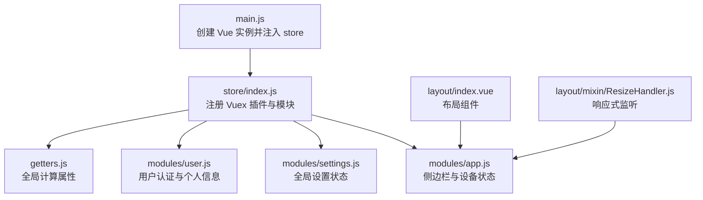
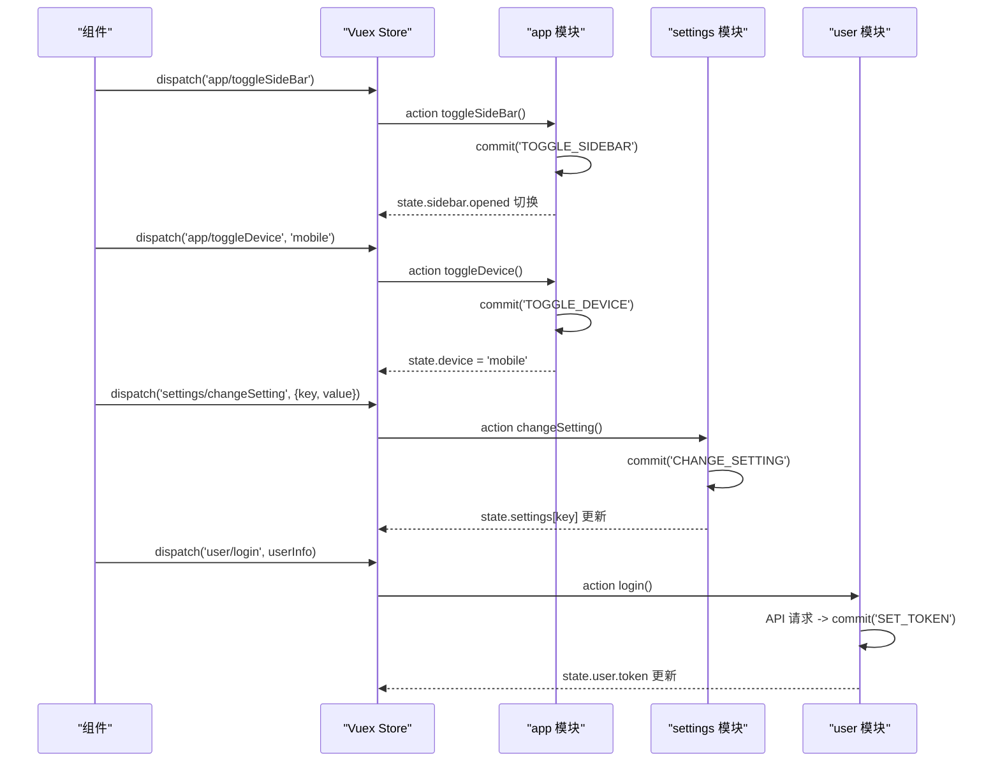
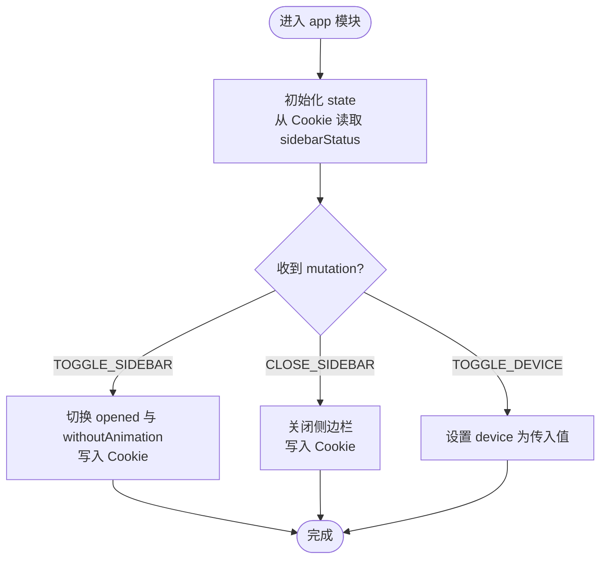
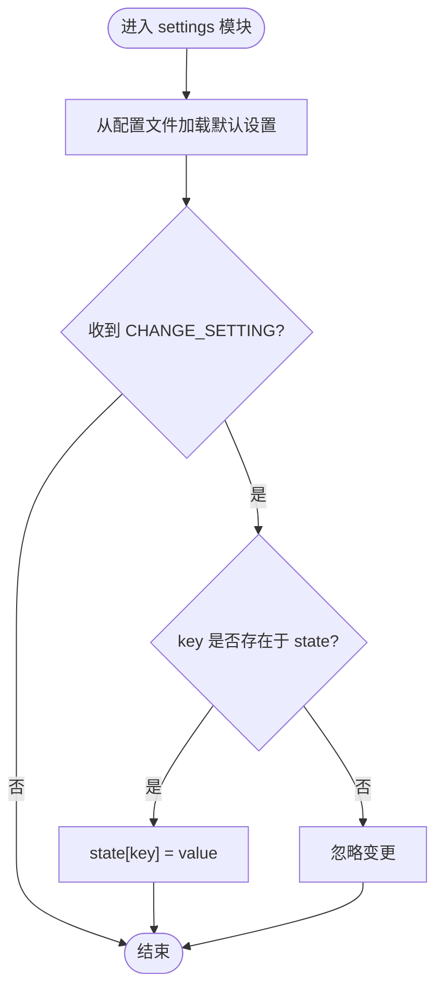
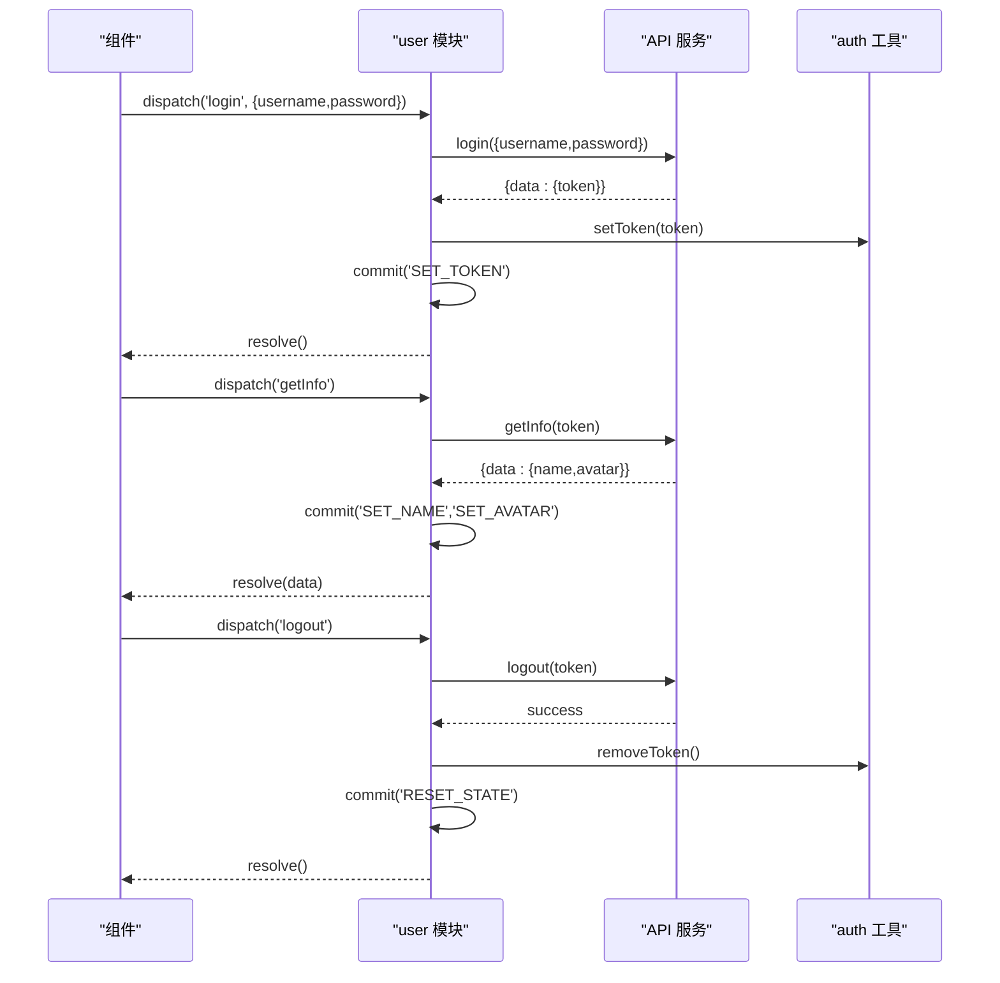
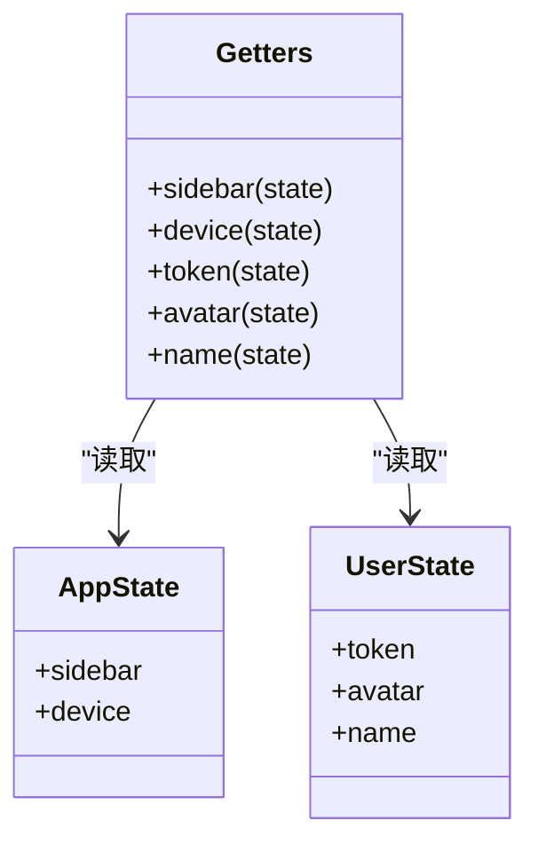
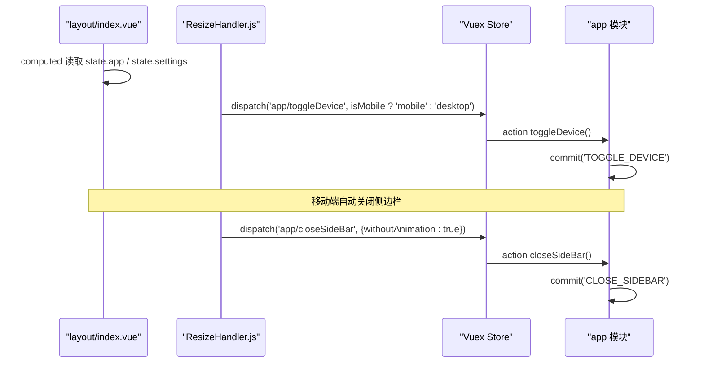
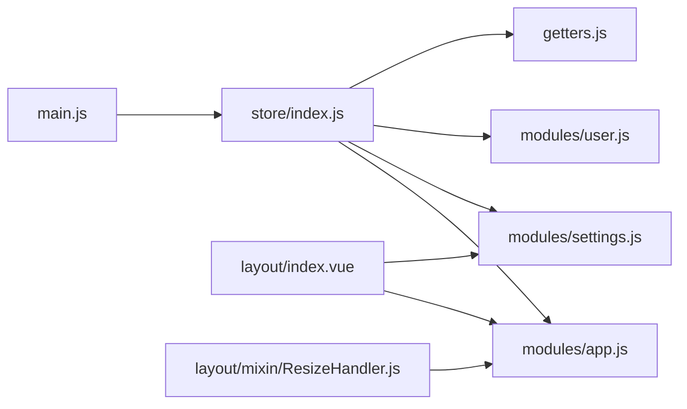

# 状态管理系统

<cite>
**本文引用的文件**   
- [src/store/index.js](file://src/store/index.js)
- [src/store/modules/app.js](file://src/store/modules/app.js)
- [src/store/modules/settings.js](file://src/store/modules/settings.js)
- [src/store/modules/user.js](file://src/store/modules/user.js)
- [src/store/getters.js](file://src/store/getters.js)
- [src/main.js](file://src/main.js)
- [src/layout/index.vue](file://src/layout/index.vue)
- [src/layout/mixin/ResizeHandler.js](file://src/layout/mixin/ResizeHandler.js)
- [src/settings.js](file://src/settings.js)
</cite>

## 目录
1. [简介](#简介)
2. [项目结构](#项目结构)
3. [核心组件](#核心组件)
4. [架构总览](#架构总览)
5. [详细组件分析](#详细组件分析)
6. [依赖关系分析](#依赖关系分析)
7. [性能与优化](#性能与优化)
8. [调试与排错指南](#调试与排错指南)
9. [最佳实践与常见陷阱](#最佳实践与常见陷阱)
10. [结论](#结论)

## 简介
本文件系统化梳理该项目的状态管理方案，围绕 Vuex 的 store 整体结构、模块化设计、数据流向进行深度解析。重点覆盖：
- app.js：侧边栏状态与设备类型检测
- settings.js：设置状态（主题配置、布局选项）
- getters.js：计算属性封装
同时给出扩展新模块、实现状态持久化、处理异步更新的实操指引，并总结与组件交互模式、调试技巧与性能优化策略。

## 项目结构
本项目采用基于功能域的 Vuex 模块化组织方式，store 入口聚合各业务模块，并在根级提供 getters 统一导出。应用启动时通过 main.js 注入 store，布局层根据设备尺寸与侧边栏状态驱动 UI 行为。

图表来源
- [src/main.js:38-43](file://src/main.js#L38-L43)
- [src/store/index.js:10-17](file://src/store/index.js#L10-L17)
- [src/store/modules/app.js:3-28](file://src/store/modules/app.js#L3-L28)
- [src/store/modules/settings.js:5-18](file://src/store/modules/settings.js#L5-L18)
- [src/store/modules/user.js:5-28](file://src/store/modules/user.js#L5-L28)
- [src/store/getters.js:1-7](file://src/store/getters.js#L1-L7)
- [src/layout/index.vue:26-43](file://src/layout/index.vue#L26-L43)
- [src/layout/mixin/ResizeHandler.js:14-43](file://src/layout/mixin/ResizeHandler.js#L14-L43)

章节来源
- [src/main.js:38-43](file://src/main.js#L38-L43)
- [src/store/index.js:10-17](file://src/store/index.js#L10-L17)

## 核心组件
- store 入口：集中注册 modules 与 getters，对外暴露单一 store 实例
- app 模块：维护侧边栏展开/收起与动画开关，以及当前设备类型（mobile/desktop）
- settings 模块：从配置文件加载默认设置，并提供统一的变更接口
- user 模块：负责登录、获取用户信息、登出与 token 清理等异步流程
- getters：对常用 state 片段进行计算属性封装，便于在组件中直接访问

章节来源
- [src/store/index.js:10-17](file://src/store/index.js#L10-L17)
- [src/store/modules/app.js:3-48](file://src/store/modules/app.js#L3-L48)
- [src/store/modules/settings.js:5-30](file://src/store/modules/settings.js#L5-L30)
- [src/store/modules/user.js:5-96](file://src/store/modules/user.js#L5-L96)
- [src/store/getters.js:1-7](file://src/store/getters.js#L1-L7)

## 架构总览
Vuex 在本项目中遵循“单向数据流”原则：
- 组件通过 dispatch 调用 actions
- actions 执行异步逻辑后 commit mutations
- mutations 同步修改 state
- getters 派生计算值供组件读取

图表来源
- [src/store/modules/app.js:31-40](file://src/store/modules/app.js#L31-L40)
- [src/store/modules/settings.js:20-23](file://src/store/modules/settings.js#L20-L23)
- [src/store/modules/user.js:30-44](file://src/store/modules/user.js#L30-L44)

## 详细组件分析

### app 模块：侧边栏与设备类型
职责
- 维护侧边栏 opened/withoutAnimation 状态，并与 Cookie 同步
- 维护设备类型 device（mobile/desktop），用于响应式布局控制

关键实现要点
- 初始化时从 Cookie 恢复侧边栏状态
- mutations 负责状态变更与 Cookie 同步
- actions 暴露简洁的调用接口，供组件或 mixin 触发

图表来源
- [src/store/modules/app.js:3-28](file://src/store/modules/app.js#L3-L28)

章节来源
- [src/store/modules/app.js:3-48](file://src/store/modules/app.js#L3-L48)

### settings 模块：设置状态
职责
- 从项目配置文件中加载默认设置项（如 fixedHeader、sidebarLogo 等）
- 提供统一的变更接口，仅允许修改已存在的 key

关键实现要点
- 使用 CHANGE_SETTING mutation 校验 key 是否存在后再赋值
- actions 将外部传入的数据透传给 mutation

图表来源
- [src/store/modules/settings.js:1-18](file://src/store/modules/settings.js#L1-L18)
- [src/settings.js:1-16](file://src/settings.js#L1-L16)

章节来源
- [src/store/modules/settings.js:1-30](file://src/store/modules/settings.js#L1-L30)
- [src/settings.js:1-16](file://src/settings.js#L1-L16)

### user 模块：用户认证与信息
职责
- 登录：调用后端接口，保存 token 到 state 与本地存储
- 获取用户信息：根据 token 拉取用户资料并更新 name/avatar
- 登出：清除 token、重置路由、清空 state
- 重置 token：移除本地 token 并重置 state

关键实现要点
- 使用 Promise 包装异步操作，便于组件链式调用
- 结合工具函数读写 token，并在登出时清理路由守卫相关状态

图表来源
- [src/store/modules/user.js:30-88](file://src/store/modules/user.js#L30-L88)

章节来源
- [src/store/modules/user.js:5-96](file://src/store/modules/user.js#L5-L96)

### getters：计算属性封装
职责
- 对外暴露常用的派生状态，如 sidebar、device、token、avatar、name
- 简化组件中的取值逻辑，提升可读性与复用性

图表来源
- [src/store/getters.js:1-7](file://src/store/getters.js#L1-L7)

章节来源
- [src/store/getters.js:1-7](file://src/store/getters.js#L1-L7)

### 与组件的交互模式
- 布局组件 layout/index.vue 通过 computed 读取 app 与 settings 的状态，并根据 device 与 sidebar 状态动态绑定类名
- 响应式混入 layout/mixin/ResizeHandler.js 监听窗口 resize，调用 app 模块的 action 更新设备类型与侧边栏状态

图表来源
- [src/layout/index.vue:26-48](file://src/layout/index.vue#L26-L48)
- [src/layout/mixin/ResizeHandler.js:14-43](file://src/layout/mixin/ResizeHandler.js#L14-L43)
- [src/store/modules/app.js:21-40](file://src/store/modules/app.js#L21-L40)

章节来源
- [src/layout/index.vue:26-48](file://src/layout/index.vue#L26-L48)
- [src/layout/mixin/ResizeHandler.js:14-43](file://src/layout/mixin/ResizeHandler.js#L14-L43)

## 依赖关系分析
- main.js 注入 store，使所有组件可通过 this.$store 访问
- store/index.js 聚合 modules 与 getters
- app/settings/user 模块相互独立，通过 namespaced 避免命名冲突
- layout 与 ResizeMixin 作为消费者，依赖 app 与 settings 的状态

图表来源
- [src/main.js:38-43](file://src/main.js#L38-L43)
- [src/store/index.js:10-17](file://src/store/index.js#L10-L17)
- [src/layout/index.vue:26-48](file://src/layout/index.vue#L26-L48)
- [src/layout/mixin/ResizeHandler.js:14-43](file://src/layout/mixin/ResizeHandler.js#L14-L43)

章节来源
- [src/main.js:38-43](file://src/main.js#L38-L43)
- [src/store/index.js:10-17](file://src/store/index.js#L10-L17)

## 性能与优化
- 使用 getters 减少重复计算与深层嵌套访问，降低模板复杂度
- 仅在必要时 dispatch action，避免频繁触发不必要的 re-render
- 对于大型列表或复杂视图，可考虑结合 keep-alive 与按需加载页面组件
- 对高频事件（如 resize）进行防抖/节流处理（可在 ResizeHandler 中补充）
- 合理拆分模块，保持高内聚低耦合，避免单模块过大导致热重载变慢

[本节为通用指导，不直接分析具体文件]

## 调试与排错指南
- 启用浏览器 Vuex Devtools，观察 state 变化、mutation/action 调用栈
- 在 mutation 中添加日志输出，追踪状态变更来源
- 检查 Cookie 是否被正确读写，确保侧边栏状态持久化符合预期
- 若登录后页面白屏或权限异常，检查 user 模块的 resetRouter 与 token 清理逻辑
- 针对移动端侧边栏异常，确认 ResizeHandler 是否正确派发 closeSideBar

章节来源
- [src/store/modules/app.js:11-28](file://src/store/modules/app.js#L11-L28)
- [src/store/modules/user.js:67-88](file://src/store/modules/user.js#L67-L88)
- [src/layout/mixin/ResizeHandler.js:14-43](file://src/layout/mixin/ResizeHandler.js#L14-L43)

## 最佳实践与常见陷阱
- 新增状态模块
  - 在 src/store/modules 下新建模块文件，定义 state/mutations/actions
  - 在 store/index.js 中引入并挂载至 modules
  - 如需全局 getter，在 getters.js 中追加映射
- 状态持久化
  - 参考 app 模块对 Cookie 的使用，在初始化时从持久化存储恢复状态
  - 在 mutation 中同步更新持久化存储，保证状态一致性
- 异步状态更新
  - 使用 actions 包裹异步逻辑，成功后再 commit mutation
  - 返回 Promise，便于组件链式处理成功/失败分支
- 常见陷阱
  - 直接在组件中修改 state，应始终通过 mutation 或 action
  - 跨模块共享状态未使用 namespaced，导致命名冲突
  - 忘记在登出时清理 token 与路由，导致权限状态不一致
  - 在高频事件中无节流/防抖，造成性能抖动

[本节为通用指导，不直接分析具体文件]

## 结论
本项目以 Vuex 为核心构建状态管理体系，采用模块化组织与 getters 封装，清晰分离了侧边栏与设备状态、全局设置与用户认证三大领域。通过明确的单向数据流与规范的 action/mutation 约定，保证了状态变更的可预测性与可调试性。在此基础上，建议持续完善持久化、错误边界与性能优化策略，以提升系统的可维护性与用户体验。