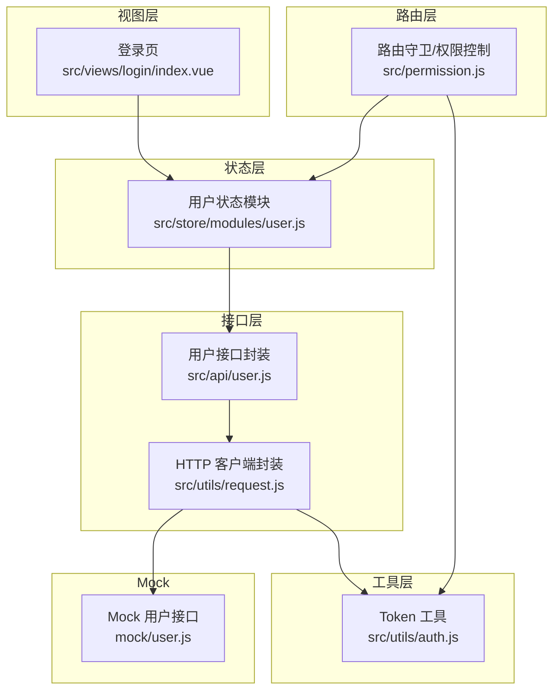
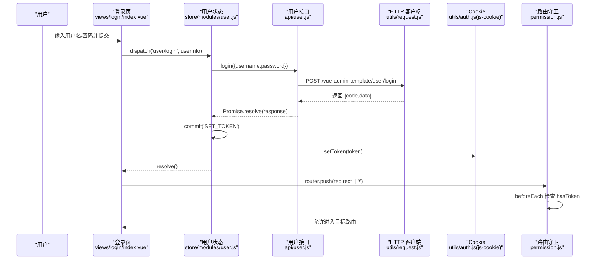
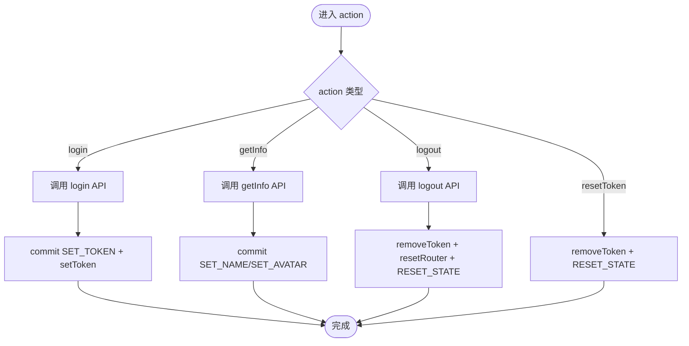
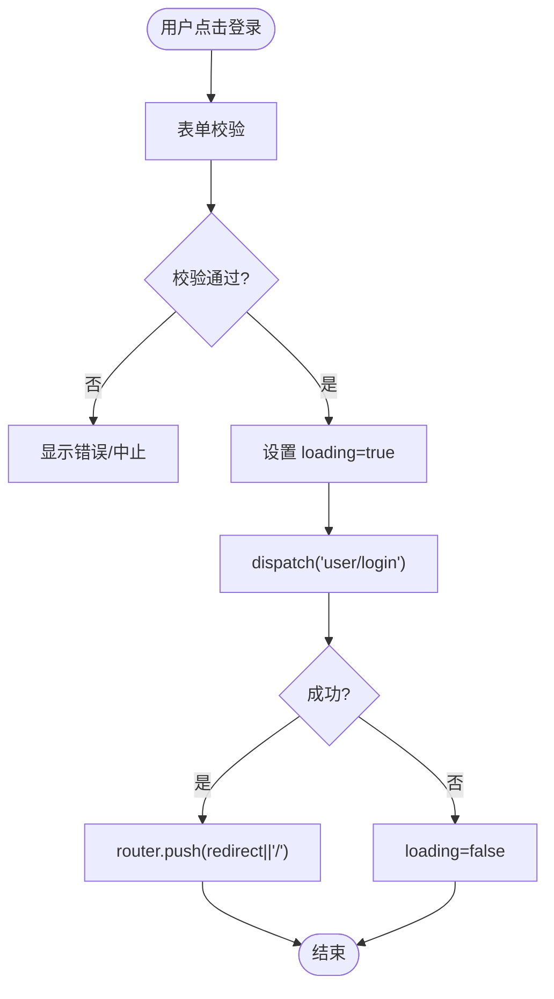
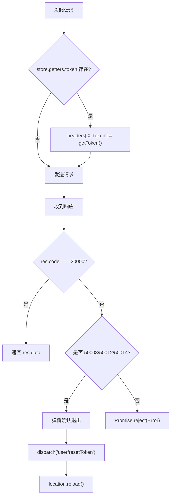
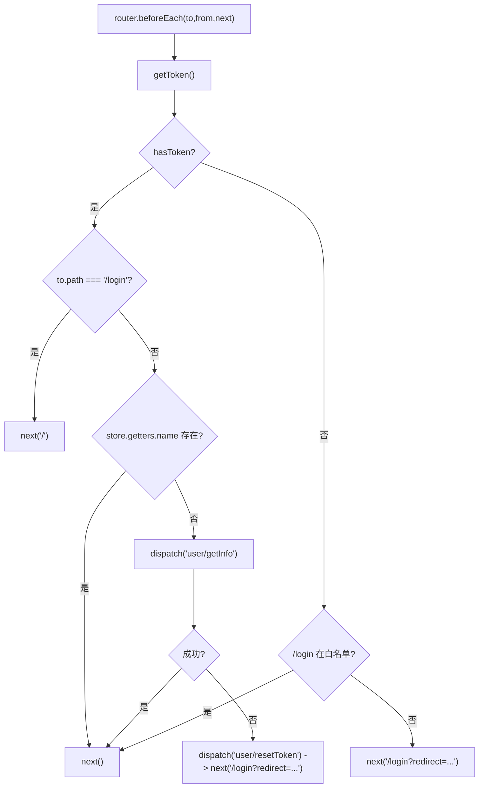
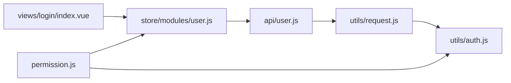

# 用户认证系统

<cite>
**本文引用的文件**   
- [src/utils/auth.js](file://src/utils/auth.js)
- [src/store/modules/user.js](file://src/store/modules/user.js)
- [src/api/user.js](file://src/api/user.js)
- [src/views/login/index.vue](file://src/views/login/index.vue)
- [src/permission.js](file://src/permission.js)
- [src/main.js](file://src/main.js)
- [src/utils/request.js](file://src/utils/request.js)
- [mock/user.js](file://mock/user.js)
</cite>

## 目录
1. [简介](#简介)
2. [项目结构](#项目结构)
3. [核心组件](#核心组件)
4. [架构总览](#架构总览)
5. [详细组件分析](#详细组件分析)
6. [依赖关系分析](#依赖关系分析)
7. [性能与可靠性](#性能与可靠性)
8. [故障排查指南](#故障排查指南)
9. [结论](#结论)
10. [附录：集成与扩展示例](#附录集成与扩展示例)

## 简介
本文件面向“用户认证系统”的实现与使用，围绕登录流程、Token 管理、会话状态、用户信息存储、路由守卫与权限控制进行系统化说明。文档重点覆盖以下文件与模块：
- Token 存取工具：src/utils/auth.js
- 用户状态与动作（Vuex）：src/store/modules/user.js
- 用户相关 API 封装：src/api/user.js
- 登录页面表单处理：src/views/login/index.vue
- 全局请求拦截器（自动携带 Token、统一错误处理）：src/utils/request.js
- 路由守卫与权限控制：src/permission.js
- 应用入口与权限注入：src/main.js
- Mock 数据（开发环境模拟后端接口）：mock/user.js

## 项目结构
认证相关代码分布在 utils、store、api、views、router 与 mock 等目录中，采用“工具层 + 状态层 + 接口层 + 视图层 + 路由守卫”的分层组织方式。

图表来源
- [src/views/login/index.vue:1-126](file://src/views/login/index.vue#L1-L126)
- [src/store/modules/user.js:1-98](file://src/store/modules/user.js#L1-L98)
- [src/api/user.js:1-25](file://src/api/user.js#L1-L25)
- [src/utils/request.js:1-86](file://src/utils/request.js#L1-L86)
- [src/utils/auth.js:1-16](file://src/utils/auth.js#L1-L16)
- [src/permission.js:1-65](file://src/permission.js#L1-L65)
- [mock/user.js:1-85](file://mock/user.js#L1-L85)

章节来源
- [src/main.js:1-44](file://src/main.js#L1-L44)

## 核心组件
- Token 工具（auth.js）
  - 提供 getToken/setToken/removeToken 三个方法，基于 js-cookie 在 Cookie 中读写固定键名的 Token。
- 用户状态模块（user.js）
  - state：token、name、avatar
  - mutations：重置状态、设置 token/name/avatar
  - actions：login/getInfo/logout/resetToken，串联 API 调用与本地状态更新
- 用户接口（user.js）
  - login/getInfo/logout 三个 HTTP 方法，统一通过 request.js 发起
- 登录页（index.vue）
  - 表单校验、提交后 dispatch user/login，成功后跳转目标路由
- 请求拦截器（request.js）
  - 请求拦截：从 store.getters.token 获取 Token 并写入 X-Token 头
  - 响应拦截：统一业务码判断；对非法/过期 Token 提示并引导重新登录
- 路由守卫（permission.js）
  - 白名单放行 /login
  - 有 Token 时若未拉取用户信息则先 getInfo，失败则 resetToken 并跳转登录
  - 无 Token 且非白名单时重定向到 /login

章节来源
- [src/utils/auth.js:1-16](file://src/utils/auth.js#L1-L16)
- [src/store/modules/user.js:1-98](file://src/store/modules/user.js#L1-L98)
- [src/api/user.js:1-25](file://src/api/user.js#L1-L25)
- [src/views/login/index.vue:55-126](file://src/views/login/index.vue#L55-L126)
- [src/utils/request.js:1-86](file://src/utils/request.js#L1-L86)
- [src/permission.js:1-65](file://src/permission.js#L1-L65)

## 架构总览
下图展示一次完整登录的生命周期：从页面输入到 Token 持久化、路由跳转，再到后续受保护页面的访问控制。

图表来源
- [src/views/login/index.vue:108-123](file://src/views/login/index.vue#L108-L123)
- [src/store/modules/user.js:32-44](file://src/store/modules/user.js#L32-L44)
- [src/api/user.js:3-9](file://src/api/user.js#L3-L9)
- [src/utils/request.js:14-31](file://src/utils/request.js#L14-L31)
- [src/utils/auth.js:9-11](file://src/utils/auth.js#L9-L11)
- [src/permission.js:13-58](file://src/permission.js#L13-L58)

## 详细组件分析

### Token 管理机制（src/utils/auth.js）
- 设计要点
  - 使用固定键名 vue_admin_template_token 存取 Token
  - 通过 js-cookie 操作 Cookie，保证跨页面可用
- 复杂度
  - O(1) 时间复杂度，空间开销极小
- 可优化点
  - 可增加 Token 过期时间策略（如 HttpOnly Cookie + Refresh Token）
  - 增加安全属性（secure、sameSite）配置

章节来源
- [src/utils/auth.js:1-16](file://src/utils/auth.js#L1-L16)

### 用户状态管理（src/store/modules/user.js）
- 状态字段
  - token：当前登录凭证
  - name、avatar：用户基本信息
- Mutations
  - RESET_STATE：恢复默认状态
  - SET_TOKEN/SET_NAME/SET_AVATAR：原子性更新字段
- Actions
  - login：调用后端登录接口，成功后写 Token 到状态与 Cookie
  - getInfo：根据 Token 拉取用户信息，失败抛出错误
  - logout：调用后端登出，清理 Token、重置路由与状态
  - resetToken：仅清理 Token 与状态（用于 Token 失效场景）
- 关键流程
  - 登录成功后立即持久化 Token，避免刷新丢失
  - 登出顺序：先移除 Token，再重置路由与状态，确保一致性

图表来源
- [src/store/modules/user.js:30-89](file://src/store/modules/user.js#L30-L89)

章节来源
- [src/store/modules/user.js:1-98](file://src/store/modules/user.js#L1-L98)

### 用户 API 接口（src/api/user.js）
- 暴露 login/getInfo/logout 三个函数
- 统一通过 request.js 发起，遵循统一的 baseURL、超时与拦截器逻辑
- getInfo 以 query 参数传递 token

章节来源
- [src/api/user.js:1-25](file://src/api/user.js#L1-L25)

### 登录页面表单处理（src/views/login/index.vue）
- 表单校验
  - 用户名：自定义校验规则
  - 密码：最小长度校验
- 交互逻辑
  - 点击登录或回车触发 handleLogin
  - 校验通过后 loading=true，dispatch user/login
  - 成功后跳转到 redirect 或首页，loading=false
  - 失败时关闭 loading 并保留表单

图表来源
- [src/views/login/index.vue:108-123](file://src/views/login/index.vue#L108-L123)

章节来源
- [src/views/login/index.vue:55-126](file://src/views/login/index.vue#L55-L126)

### 请求拦截器与 Token 注入（src/utils/request.js）
- 请求拦截
  - 若 store.getters.token 存在，则在请求头添加 X-Token
- 响应拦截
  - 统一业务码判断（res.code !== 20000 视为错误）
  - 针对特定错误码（50008/50012/50014）弹出确认框，确认后执行 resetToken 并刷新页面
- 错误处理
  - 网络错误与业务错误均通过 Message 提示

图表来源
- [src/utils/request.js:14-82](file://src/utils/request.js#L14-L82)

章节来源
- [src/utils/request.js:1-86](file://src/utils/request.js#L1-L86)

### 路由守卫与权限控制（src/permission.js）
- 白名单：/login
- 已登录（hasToken）
  - 访问 /login 直接重定向到首页
  - 若未获取用户信息，先调用 store.dispatch('user/getInfo')
  - 获取失败则 resetToken 并跳转到 /login?redirect=...
- 未登录
  - 白名单内直接放行
  - 其他页面重定向到 /login?redirect=...

图表来源
- [src/permission.js:13-58](file://src/permission.js#L13-L58)

章节来源
- [src/permission.js:1-65](file://src/permission.js#L1-L65)

### 应用生命周期中的认证状态流转
- 启动阶段
  - main.js 引入 permission.js，注册全局路由守卫
  - 首次加载时，路由守卫读取 Cookie 中的 Token
- 登录后
  - 登录成功后，Token 写入 Cookie，Vuex state.token 同步
  - 路由守卫检测到 Token，若未拉取用户信息则调用 getInfo
- 访问受保护页面
  - 每次路由切换都会经过 beforeEach，校验 Token 与用户信息
- 登出/Token 失效
  - 手动登出：清除 Cookie、重置路由与状态
  - 后端返回 Token 异常：响应拦截器提示并强制重新登录

章节来源
- [src/main.js:16-16](file://src/main.js#L16-L16)
- [src/permission.js:13-58](file://src/permission.js#L13-L58)
- [src/store/modules/user.js:67-89](file://src/store/modules/user.js#L67-L89)
- [src/utils/request.js:45-82](file://src/utils/request.js#L45-L82)

## 依赖关系分析
- 组件耦合
  - 登录页依赖 Vuex user 模块与路由
  - user 模块依赖 api/user.js 与 utils/auth.js
  - api/user.js 依赖 utils/request.js
  - request.js 依赖 store 与 auth.js
  - permission.js 依赖 store 与 auth.js
- 外部依赖
  - axios：HTTP 客户端
  - js-cookie：Cookie 操作
  - element-ui：UI 组件与消息提示
  - nprogress：进度条（路由切换体验）

图表来源
- [src/views/login/index.vue:108-123](file://src/views/login/index.vue#L108-L123)
- [src/store/modules/user.js:1-98](file://src/store/modules/user.js#L1-L98)
- [src/api/user.js:1-25](file://src/api/user.js#L1-L25)
- [src/utils/request.js:1-86](file://src/utils/request.js#L1-L86)
- [src/utils/auth.js:1-16](file://src/utils/auth.js#L1-L16)
- [src/permission.js:1-65](file://src/permission.js#L1-L65)

章节来源
- [src/main.js:1-44](file://src/main.js#L1-L44)

## 性能与可靠性
- 性能
  - Token 存取为 O(1)，开销极低
  - 路由守卫仅在导航时执行，避免重复请求
  - 用户信息按需拉取（getInfo），减少首屏负载
- 可靠性
  - 统一业务码判断与错误提示
  - Token 异常时主动清理状态并刷新，避免脏状态
- 可扩展性
  - 通过 request.js 拦截器集中处理鉴权逻辑，便于扩展多端/多 Token 策略

[本节为通用指导，不直接分析具体文件]

## 故障排查指南
- 无法登录
  - 检查表单校验是否通过
  - 查看 network 面板是否请求到 /vue-admin-template/user/login
  - 确认后端返回 code 是否为 20000
- 登录后仍被重定向到登录页
  - 检查 Cookie 中是否存在 vue_admin_template_token
  - 检查 store.getters.token 是否正确
  - 查看路由守卫 beforeEach 的日志与跳转逻辑
- 页面频繁刷新或反复弹窗
  - 检查后端是否返回 50008/50012/50014
  - 确认响应拦截器是否触发 resetToken 与 location.reload
- 用户信息为空
  - 检查 getInfo 是否被调用
  - 检查后端 /vue-admin-template/user/info 是否返回有效 data

章节来源
- [src/views/login/index.vue:108-123](file://src/views/login/index.vue#L108-L123)
- [src/permission.js:20-58](file://src/permission.js#L20-L58)
- [src/utils/request.js:45-82](file://src/utils/request.js#L45-L82)

## 结论
该认证系统通过清晰的职责分层与拦截器机制，实现了 Token 的持久化、用户信息的按需获取以及路由级别的权限控制。结合 Mock 数据可在开发环境快速验证登录流程。建议在真实环境中引入更完善的 Token 策略（如 Refresh Token）、服务端角色/权限模型，并在前端实现细粒度的权限控制。

[本节为总结性内容，不直接分析具体文件]

## 附录：集成与扩展示例

### 集成第三方认证服务（示例思路）
- 替换登录接口
  - 将 src/api/user.js 中的 login 改为调用第三方认证（例如 OAuth2 Authorization Code Flow）
  - 第三方回调中将后端返回的 Token 通过 store.dispatch('user/login') 写入状态与 Cookie
- 注意事项
  - 保持 Token 键名一致，避免破坏现有逻辑
  - 在响应拦截器中兼容第三方服务的错误码映射

章节来源
- [src/api/user.js:3-9](file://src/api/user.js#L3-L9)
- [src/store/modules/user.js:32-44](file://src/store/modules/user.js#L32-L44)

### 实现自动登出功能（示例思路）
- 方案一：基于 Token 过期时间
  - 在 Token 中嵌入过期时间，前端定时检测，到期前提醒或自动登出
- 方案二：后端主动踢人
  - 后端返回 50012（其他设备登录）时，按现有拦截器逻辑自动登出
- 实现要点
  - 复用 user/resetToken 与路由跳转逻辑
  - 在 UI 上给出友好提示

章节来源
- [src/utils/request.js:56-67](file://src/utils/request.js#L56-L67)
- [src/store/modules/user.js:81-89](file://src/store/modules/user.js#L81-L89)

### 处理 Token 过期重试（示例思路）
- 在响应拦截器中识别 50014（Token 过期）
- 尝试刷新 Token（调用 refresh 接口），成功后重试原请求
- 刷新失败则走现有登出流程

章节来源
- [src/utils/request.js:45-82](file://src/utils/request.js#L45-L82)

### 与权限控制系统的协作关系
- 路由守卫负责“能否访问某页面”
- 用户信息（name/avatar/roles）由 getInfo 提供，可作为按钮级权限控制的依据
- 建议在后端返回 roles 列表，在前端根据 roles 控制菜单与操作可见性

章节来源
- [src/permission.js:28-45](file://src/permission.js#L28-L45)
- [mock/user.js:11-24](file://mock/user.js#L11-L24)