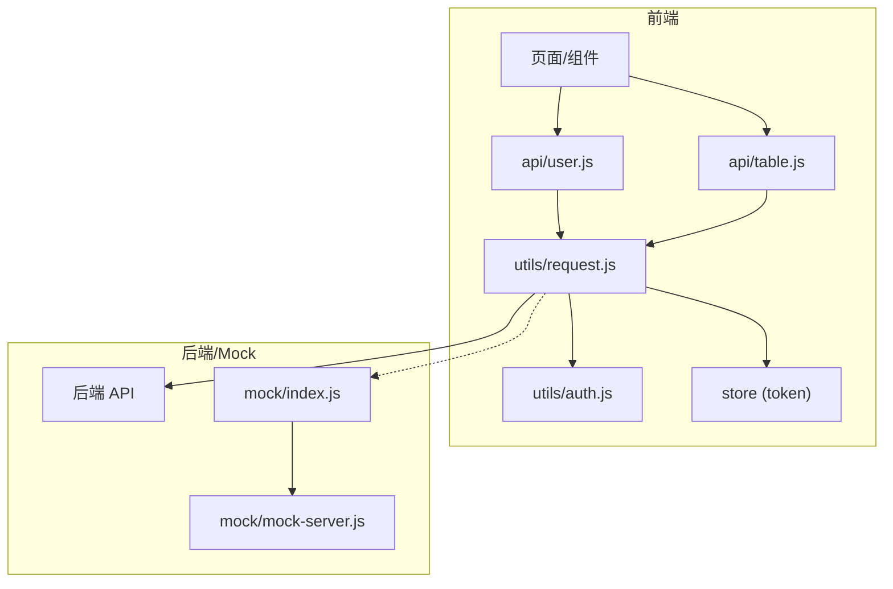
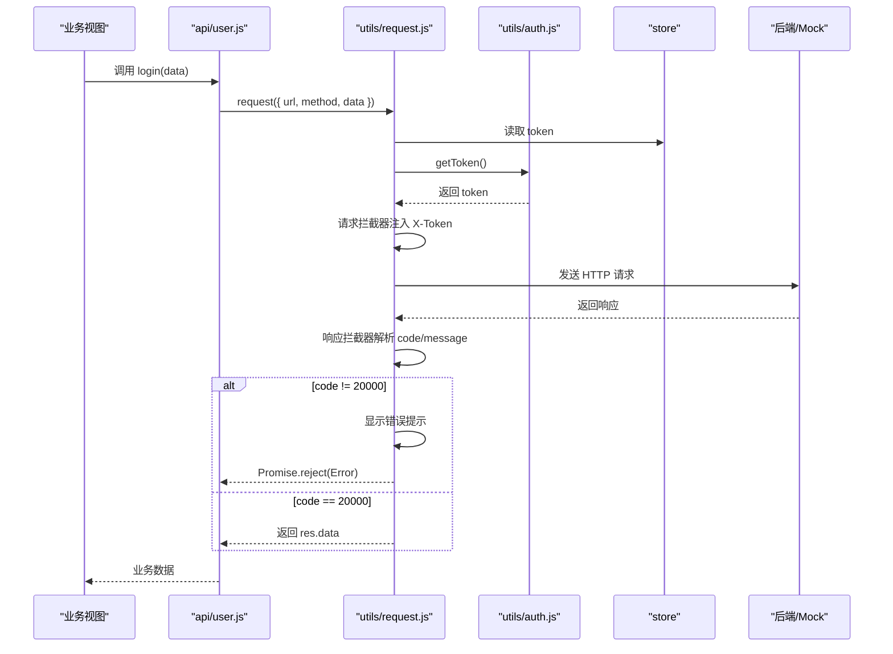
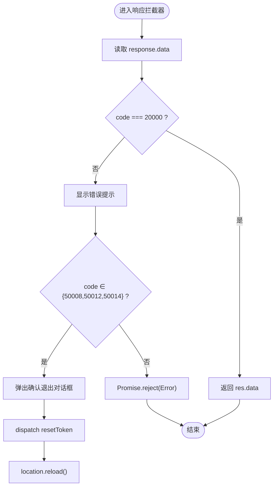
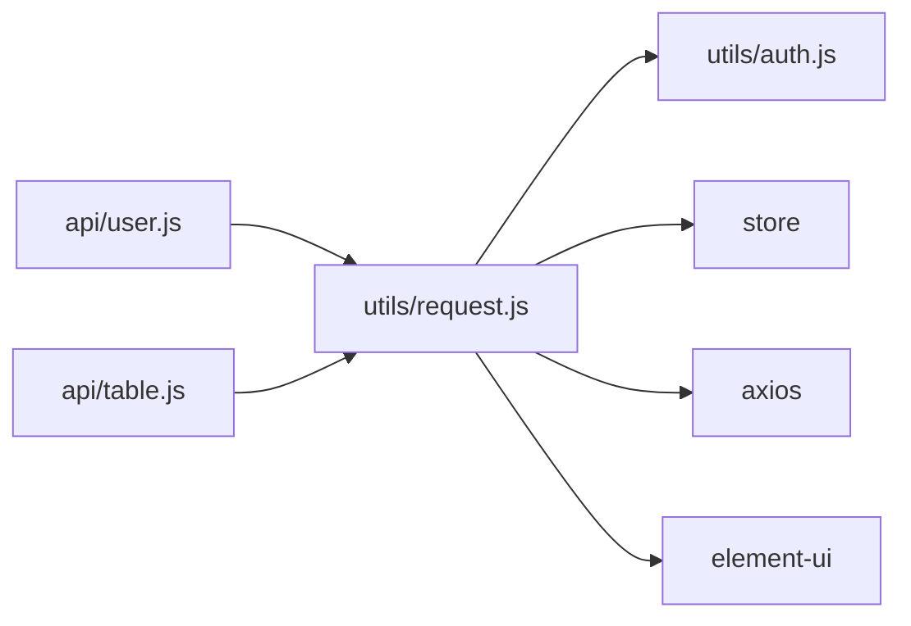

# 网络请求层

<cite>
**本文引用的文件**   
- [src/utils/request.js](file://src/utils/request.js)
- [src/api/user.js](file://src/api/user.js)
- [src/api/table.js](file://src/api/table.js)
- [src/utils/auth.js](file://src/utils/auth.js)
- [mock/index.js](file://mock/index.js)
- [mock/mock-server.js](file://mock/mock-server.js)
</cite>

## 目录
1. [简介](#简介)
2. [项目结构](#项目结构)
3. [核心组件](#核心组件)
4. [架构总览](#架构总览)
5. [详细组件分析](#详细组件分析)
6. [依赖关系分析](#依赖关系分析)
7. [性能与优化](#性能与优化)
8. [调试与排错指南](#调试与排错指南)
9. [结论](#结论)
10. [附录：API 对接规范与示例](#附录api-对接规范与示例)

## 简介
本章节概述网络请求层的职责与目标：基于 Axios 封装统一的 HTTP 客户端，集中处理鉴权、错误码映射、用户提示、超时控制等横切关注点；对外暴露简洁的 API 调用方法，使业务代码无需关心底层网络细节。该实现同时提供 Mock 支持，便于前后端并行开发。

## 项目结构
本项目将网络请求能力集中在 utils/request.js，业务 API 在 api/* 中按领域拆分，认证信息通过 utils/auth.js 管理，Mock 服务位于 mock/*。

图表来源
- [src/utils/request.js:1-85](file://src/utils/request.js#L1-L85)
- [src/api/user.js:1-25](file://src/api/user.js#L1-L25)
- [src/api/table.js:1-10](file://src/api/table.js#L1-L10)
- [src/utils/auth.js:1-16](file://src/utils/auth.js#L1-L16)
- [mock/index.js:1-56](file://mock/index.js#L1-L56)
- [mock/mock-server.js:1-81](file://mock/mock-server.js#L1-L81)

章节来源
- [src/utils/request.js:1-85](file://src/utils/request.js#L1-L85)
- [src/api/user.js:1-25](file://src/api/user.js#L1-L25)
- [src/api/table.js:1-10](file://src/api/table.js#L1-L10)
- [src/utils/auth.js:1-16](file://src/utils/auth.js#L1-L16)
- [mock/index.js:1-56](file://mock/index.js#L1-L56)
- [mock/mock-server.js:1-81](file://mock/mock-server.js#L1-L81)

## 核心组件
- Axios 实例与基础配置：统一 baseURL、超时时间、跨域凭据开关（已注释）。
- 请求拦截器：自动注入鉴权头 X-Token，支持扩展自定义请求头。
- 响应拦截器：根据业务 code 判断成功/失败，统一消息提示，针对特定 token 错误码触发重新登录流程。
- 工具模块：auth.js 提供 Token 存取；store 提供全局 token 状态。
- API 层：user.js、table.js 等按领域组织接口调用。

章节来源
- [src/utils/request.js:1-85](file://src/utils/request.js#L1-L85)
- [src/utils/auth.js:1-16](file://src/utils/auth.js#L1-L16)
- [src/api/user.js:1-25](file://src/api/user.js#L1-L25)
- [src/api/table.js:1-10](file://src/api/table.js#L1-L10)

## 架构总览
下图展示一次典型请求从业务 API 到后端/Mock 的完整链路，以及拦截器的介入点。

图表来源
- [src/api/user.js:3-9](file://src/api/user.js#L3-L9)
- [src/utils/request.js:13-83](file://src/utils/request.js#L13-L83)
- [src/utils/auth.js:5-7](file://src/utils/auth.js#L5-L7)

## 详细组件分析

### Axios 实例与基础配置
- baseURL：由环境变量 VUE_APP_BASE_API 提供，便于多环境切换。
- timeout：默认 5000ms，避免请求长时间挂起。
- withCredentials：跨域携带 Cookie 的开关，当前被注释，可按需开启。

章节来源
- [src/utils/request.js:6-11](file://src/utils/request.js#L6-L11)

### 请求拦截器
- 功能：当 store.getters.token 存在时，向每个请求头注入 X-Token。
- 可扩展点：可在此处添加通用请求头（如语言、设备类型）、签名、防重放参数等。
- 错误处理：请求阶段异常直接打印并拒绝 Promise。

章节来源
- [src/utils/request.js:13-31](file://src/utils/request.js#L13-L31)

### 响应拦截器
- 成功分支：
  - 若业务 code 不等于 20000，视为业务错误：弹出错误提示，并返回 Promise.reject。
  - 对特定 token 错误码（50008、50012、50014）触发“确认退出”对话框，确认后重置 token 并刷新页面。
  - 若 code 为 20000，返回 response.data。
- 失败分支：
  - 捕获网络或服务器异常，弹出错误提示，并返回 Promise.reject。

图表来源
- [src/utils/request.js:45-82](file://src/utils/request.js#L45-L82)

章节来源
- [src/utils/request.js:33-83](file://src/utils/request.js#L33-L83)

### 认证与 Token 管理
- auth.js 提供 getToken/setToken/removeToken，基于 js-cookie 读写 Cookie。
- request.js 在请求拦截器中读取并注入 X-Token。

章节来源
- [src/utils/auth.js:1-16](file://src/utils/auth.js#L1-L16)
- [src/utils/request.js:18-23](file://src/utils/request.js#L18-L23)

### API 层使用示例
- user.js：定义登录、获取用户信息、登出等接口。
- table.js：定义列表查询接口。
- 所有接口均通过统一的 request 发起，保持风格一致。

章节来源
- [src/api/user.js:1-25](file://src/api/user.js#L1-L25)
- [src/api/table.js:1-10](file://src/api/table.js#L1-L10)

### Mock 支持
- mock/index.js：聚合各模块 mock 路由，并提供 mockXHR 以兼容 responseType 等特性。
- mock/mock-server.js：Express 中间件注册 mock 路由，支持热重载。

章节来源
- [mock/index.js:1-56](file://mock/index.js#L1-L56)
- [mock/mock-server.js:1-81](file://mock/mock-server.js#L1-L81)

## 依赖关系分析
- 低耦合：业务 API 仅依赖 request，不感知拦截器与错误处理细节。
- 高内聚：request 集中处理鉴权、错误、提示等横切逻辑。
- 外部依赖：axios、element-ui（Message/MessageBox）、js-cookie、vuex store。

图表来源
- [src/api/user.js:1-25](file://src/api/user.js#L1-L25)
- [src/api/table.js:1-10](file://src/api/table.js#L1-L10)
- [src/utils/request.js:1-85](file://src/utils/request.js#L1-L85)
- [src/utils/auth.js:1-16](file://src/utils/auth.js#L1-L16)

章节来源
- [src/utils/request.js:1-85](file://src/utils/request.js#L1-L85)

## 性能与优化
- 合理设置超时：默认 5000ms，可根据接口耗时调整。
- 取消重复请求：可在请求拦截器中维护 pendingMap，相同 URL+method 的请求进行去重或取消。
- 请求重试：对瞬时网络抖动可结合指数退避策略进行有限次重试。
- 缓存策略：对 GET 请求可实现内存/LocalStorage 缓存，配合 ETag/Last-Modified 或时间戳失效策略。
- 分片与懒加载：大文件上传下载建议分片与断点续传；按需引入 axios 相关插件。
- 压缩与分页：服务端启用 gzip，前端分页减少单次数据量。

[本节为通用指导，不涉及具体文件]

## 调试与排错指南
- 常见问题
  - 未携带 Token：检查 store.getters.token 是否存在，以及请求拦截器是否生效。
  - 跨域问题：确认 baseURL 与代理配置，必要时开启 withCredentials。
  - 业务错误码非 20000：查看后端返回 message，并在响应拦截器中定位。
  - 超时：增大 timeout 或排查后端性能。
- 调试技巧
  - 在请求/响应拦截器中打印 config/response 关键字段。
  - 使用浏览器 Network 面板观察请求头、响应体与状态码。
  - 使用 Mock 快速验证前端逻辑，逐步切换到真实后端。

章节来源
- [src/utils/request.js:13-83](file://src/utils/request.js#L13-L83)

## 结论
该网络请求层通过 Axios 实例化与拦截器机制，实现了统一的鉴权注入、错误码映射与用户提示，降低了业务代码复杂度，提升了可维护性与一致性。配合 Mock 体系，可有效支撑前后端并行开发与联调。

[本节为总结性内容，不涉及具体文件]

## 附录：API 对接规范与示例

### 后端 API 对接规范
- 基础地址：通过环境变量 VUE_APP_BASE_API 配置。
- 鉴权方式：请求头 X-Token 携带 Token。
- 成功标志：response.code === 20000。
- 错误处理：非 20000 时，message 作为错误提示；特定 token 错误码触发重新登录。

章节来源
- [src/utils/request.js:7-11](file://src/utils/request.js#L7-L11)
- [src/utils/request.js:18-23](file://src/utils/request.js#L18-L23)
- [src/utils/request.js:45-82](file://src/utils/request.js#L45-L82)

### 数据格式转换
- 响应数据：拦截器返回 response.data，业务侧直接使用。
- 请求数据：POST 使用 data，GET 使用 params，遵循 Axios 约定。

章节来源
- [src/api/user.js:3-16](file://src/api/user.js#L3-L16)
- [src/api/table.js:3-8](file://src/api/table.js#L3-L8)

### 错误码映射
- 20000：业务成功。
- 50008/50012/50014：Token 非法/其他客户端登录/过期，触发重新登录流程。
- 其他：统一错误提示。

章节来源
- [src/utils/request.js:48-69](file://src/utils/request.js#L48-L69)

### 示例：添加自定义请求头
- 在请求拦截器中追加通用请求头，例如语言、设备标识、时间戳等。
- 参考位置：请求拦截器注入 X-Token 的代码段。

章节来源
- [src/utils/request.js:18-23](file://src/utils/request.js#L18-L23)

### 示例：文件上传与下载
- 上传：使用 FormData 作为 data，确保 Content-Type 由浏览器自动设置。
- 下载：设置 responseType 为 blob，并在响应拦截器后处理二进制流。
- 注意：如需进度条，可结合 axios 的 onUploadProgress/onDownloadProgress。

[本节为概念性示例，不涉及具体文件]

### 示例：请求缓存策略
- 内存缓存：维护 URL -> Promise 的映射，相同请求直接复用结果。
- 本地缓存：对 GET 请求将结果序列化至 localStorage，并设置过期时间。
- 失效策略：时间戳、版本号或 ETag/Last-Modified。

[本节为概念性示例，不涉及具体文件]