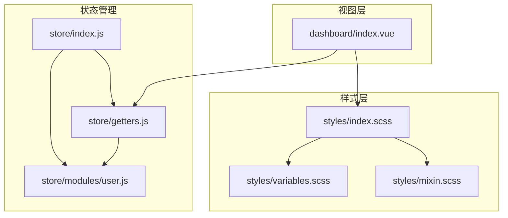
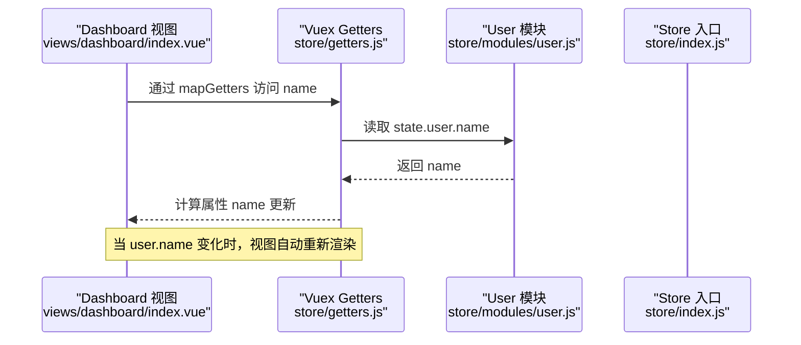
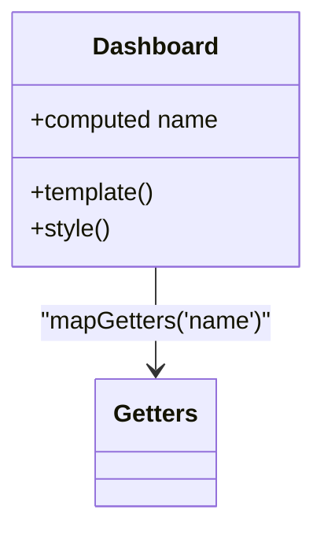
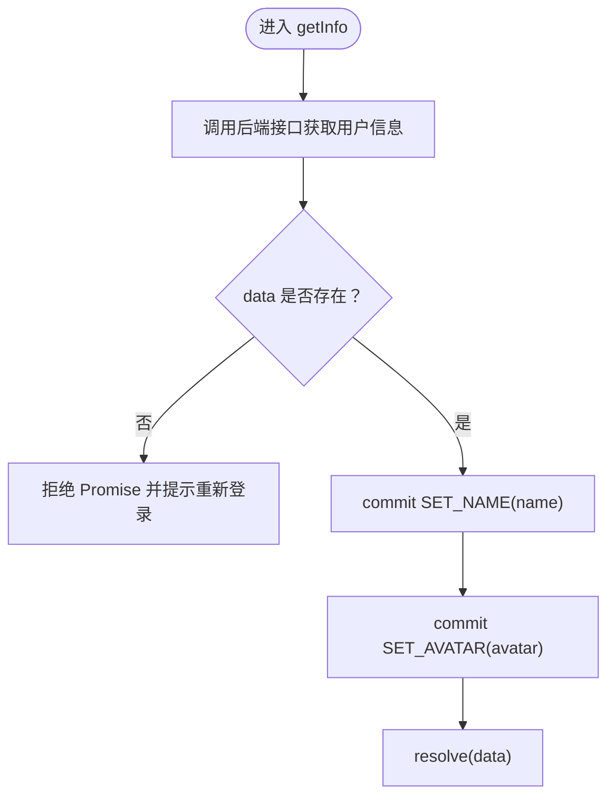
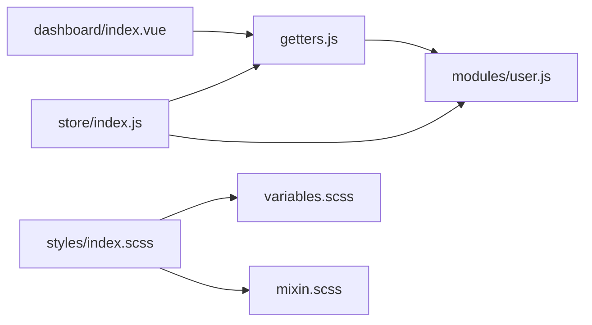

# 仪表盘页面

<cite>
**本文引用的文件**   
- [src/views/dashboard/index.vue](file://src/views/dashboard/index.vue)
- [src/store/modules/user.js](file://src/store/modules/user.js)
- [src/store/getters.js](file://src/store/getters.js)
- [src/store/index.js](file://src/store/index.js)
- [src/styles/index.scss](file://src/styles/index.scss)
- [src/styles/variables.scss](file://src/styles/variables.scss)
- [src/styles/mixin.scss](file://src/styles/mixin.scss)
</cite>

## 目录
1. [简介](#简介)
2. [项目结构](#项目结构)
3. [核心组件](#核心组件)
4. [架构总览](#架构总览)
5. [详细组件分析](#详细组件分析)
6. [依赖关系分析](#依赖关系分析)
7. [性能与优化](#性能与优化)
8. [故障排查指南](#故障排查指南)
9. [结论](#结论)
10. [附录：扩展开发指南](#附录扩展开发指南)

## 简介
本文件面向“仪表盘”页面的实现与扩展，重点说明：
- 如何从 Vuex store 中获取用户数据并在页面展示
- 计算属性与 mapGetters 的使用方式及响应式更新机制
- 页面样式结构与 SCSS 组织方式
- 数据绑定模式与性能优化技巧
- 扩展仪表盘功能的开发建议

## 项目结构
仪表盘相关代码主要分布在以下位置：
- 视图层：views/dashboard/index.vue
- 状态管理：store/modules/user.js、store/getters.js、store/index.js
- 样式层：styles/index.scss、styles/variables.scss、styles/mixin.scss

图表来源
- [src/views/dashboard/index.vue:1-31](file://src/views/dashboard/index.vue#L1-L31)
- [src/store/index.js:1-20](file://src/store/index.js#L1-L20)
- [src/store/getters.js:1-9](file://src/store/getters.js#L1-L9)
- [src/store/modules/user.js:1-98](file://src/store/modules/user.js#L1-L98)
- [src/styles/index.scss:1-66](file://src/styles/index.scss#L1-L66)
- [src/styles/variables.scss:1-26](file://src/styles/variables.scss#L1-L26)
- [src/styles/mixin.scss:1-29](file://src/styles/mixin.scss#L1-L29)

章节来源
- [src/views/dashboard/index.vue:1-31](file://src/views/dashboard/index.vue#L1-L31)
- [src/store/index.js:1-20](file://src/store/index.js#L1-L20)
- [src/store/getters.js:1-9](file://src/store/getters.js#L1-L9)
- [src/store/modules/user.js:1-98](file://src/store/modules/user.js#L1-L98)
- [src/styles/index.scss:1-66](file://src/styles/index.scss#L1-L66)
- [src/styles/variables.scss:1-26](file://src/styles/variables.scss#L1-L26)
- [src/styles/mixin.scss:1-29](file://src/styles/mixin.scss#L1-L29)

## 核心组件
- 仪表盘视图组件：负责渲染用户名称等基础信息，并通过计算属性映射 Vuex getters。
- Vuex user 模块：维护 token、name、avatar 等用户相关状态，提供登录、获取用户信息、登出、重置令牌等异步 action。
- Vuex getters：暴露全局可读的派生状态，如 name、avatar、token 等。
- Store 入口：注册 app、settings、user 模块并挂载 getters。

章节来源
- [src/views/dashboard/index.vue:1-31](file://src/views/dashboard/index.vue#L1-L31)
- [src/store/modules/user.js:1-98](file://src/store/modules/user.js#L1-L98)
- [src/store/getters.js:1-9](file://src/store/getters.js#L1-L9)
- [src/store/index.js:1-20](file://src/store/index.js#L1-L20)

## 架构总览
下图展示了仪表盘页面到 Vuex 的状态读取链路，以及样式文件的组织关系。

图表来源
- [src/views/dashboard/index.vue:8-16](file://src/views/dashboard/index.vue#L8-L16)
- [src/store/getters.js:1-9](file://src/store/getters.js#L1-L9)
- [src/store/modules/user.js:5-13](file://src/store/modules/user.js#L5-L13)
- [src/store/index.js:10-17](file://src/store/index.js#L10-L17)

## 详细组件分析

### 仪表盘视图（Dashboard）
- 模板部分：使用 class 为 dashboard-container 和 dashboard-text 的容器与文本节点，展示 name。
- 脚本部分：引入 vuex 的 mapGetters，将 getters.name 映射为组件的计算属性 name，从而在模板中直接绑定。
- 样式部分：使用 scoped SCSS，基于 BEM 风格命名（dashboard-container、dashboard-text），设置外边距、字号与行高。

图表来源
- [src/views/dashboard/index.vue:1-31](file://src/views/dashboard/index.vue#L1-L31)
- [src/store/getters.js:1-9](file://src/store/getters.js#L1-L9)

章节来源
- [src/views/dashboard/index.vue:1-31](file://src/views/dashboard/index.vue#L1-L31)

### Vuex Getters（getters.js）
- 导出统一的 getters 对象，包含 sidebar、device、token、avatar、name 等派生状态。
- name 对应 state.user.name，供各组件通过 mapGetters 或 this.$store.getters.name 访问。

章节来源
- [src/store/getters.js:1-9](file://src/store/getters.js#L1-L9)

### Vuex User 模块（modules/user.js）
- state：默认包含 token、name、avatar，初始值来自本地存储与空字符串。
- mutations：提供 RESET_STATE、SET_TOKEN、SET_NAME、SET_AVATAR 等同步修改方法。
- actions：
  - login：调用后端接口，成功后写入 token 并持久化。
  - getInfo：根据 token 拉取用户信息，校验 data 存在后提交 SET_NAME、SET_AVATAR。
  - logout：调用后端接口，清除本地 token、重置路由、重置 state。
  - resetToken：仅清理本地 token 并重置 state。

图表来源
- [src/store/modules/user.js:47-65](file://src/store/modules/user.js#L47-L65)

章节来源
- [src/store/modules/user.js:1-98](file://src/store/modules/user.js#L1-L98)

### Store 入口（index.js）
- 注册 app、settings、user 三个模块，并挂载全局 getters。
- 作为应用级唯一状态源，被各组件通过 $store 或辅助函数访问。

章节来源
- [src/store/index.js:1-20](file://src/store/index.js#L1-L20)

### 样式组织（SCSS）
- styles/index.scss：统一导入 variables、mixin、transition、element-ui、sidebar 等样式；定义 body、html、app 容器、通用链接与 clearfix 工具类、主容器 .app-container。
- styles/variables.scss：集中定义菜单颜色、侧边栏宽度等变量，并通过 :export 暴露给 JS 使用。
- styles/mixin.scss：提供 clearfix、scrollBar、relative 等常用 mixin。

章节来源
- [src/styles/index.scss:1-66](file://src/styles/index.scss#L1-L66)
- [src/styles/variables.scss:1-26](file://src/styles/variables.scss#L1-L26)
- [src/styles/mixin.scss:1-29](file://src/styles/mixin.scss#L1-L29)

## 依赖关系分析
- 视图层依赖 getters 提供的派生状态，不直接耦合 user 模块内部实现。
- user 模块依赖 API 与工具函数进行网络请求与本地存储操作。
- 样式层通过 index.scss 聚合变量与 mixin，便于统一管理主题与复用样式片段。

图表来源
- [src/views/dashboard/index.vue:1-31](file://src/views/dashboard/index.vue#L1-L31)
- [src/store/getters.js:1-9](file://src/store/getters.js#L1-L9)
- [src/store/modules/user.js:1-98](file://src/store/modules/user.js#L1-L98)
- [src/store/index.js:1-20](file://src/store/index.js#L1-L20)
- [src/styles/index.scss:1-66](file://src/styles/index.scss#L1-L66)
- [src/styles/variables.scss:1-26](file://src/styles/variables.scss#L1-L26)
- [src/styles/mixin.scss:1-29](file://src/styles/mixin.scss#L1-L29)

## 性能与优化
- 使用 mapGetters 将 getters 映射为计算属性，避免在模板中进行复杂逻辑，提升可读性与可测试性。
- 利用 Vue 的响应式系统：当 user.name 变化时，仅触发依赖该计算属性的组件局部重渲染，减少不必要的 DOM 操作。
- 样式隔离：使用 scoped SCSS 防止样式泄漏，降低选择器冲突风险。
- 按需加载：若后续增加更多仪表盘指标，建议拆分为子组件并按需懒加载，减少首屏体积。
- 缓存策略：对于频繁读取且不变的用户信息，可在组件内做轻量缓存或使用 computed 缓存结果。
- 避免深层嵌套 getter：尽量保持 getters 简单直接，复杂派生逻辑下沉到模块内部或专用计算模块。

[本节为通用指导，不涉及具体文件分析]

## 故障排查指南
- 页面未显示用户名：
  - 检查 store/getters.js 是否正确导出 name。
  - 确认 store/modules/user.js 中 state.name 是否已被正确赋值（例如登录后调用了 getInfo）。
  - 确保组件已通过 mapGetters 正确映射 name。
- 登录后仍为空：
  - 检查 getInfo action 的网络请求与返回值结构是否与 commit 字段一致。
  - 确认 token 已正确设置并用于请求。
- 样式不生效：
  - 确认 SCSS 文件已正确导入至 styles/index.scss。
  - 检查类名拼写与作用域（scoped）是否匹配。

章节来源
- [src/store/getters.js:1-9](file://src/store/getters.js#L1-L9)
- [src/store/modules/user.js:47-65](file://src/store/modules/user.js#L47-L65)
- [src/views/dashboard/index.vue:1-31](file://src/views/dashboard/index.vue#L1-L31)
- [src/styles/index.scss:1-66](file://src/styles/index.scss#L1-L66)

## 结论
仪表盘页面通过简洁的模板与计算属性，结合 Vuex 的 getters 与 user 模块，实现了用户信息的响应式展示。样式采用 SCSS 模块化组织，具备良好的可维护性。在此基础上，可通过拆分子组件、懒加载与更细粒度的状态管理进一步提升性能与可扩展性。

[本节为总结性内容，不涉及具体文件分析]

## 附录：扩展开发指南
- 新增仪表盘指标卡片：
  - 在 views/dashboard 下创建子组件，复用现有布局与样式规范。
  - 如需展示更多用户信息，先在 store/getters.js 中补充派生状态，再在组件中使用 mapGetters 映射。
- 接入真实数据：
  - 在 store/modules/user.js 中扩展 actions，封装业务逻辑与错误处理。
  - 在组件中通过 dispatch 触发异步流程，并在成功回调中更新 UI。
- 主题与样式扩展：
  - 在 styles/variables.scss 中新增主题变量，并在组件中以 SCSS 变量引用。
  - 复用 styles/mixin.scss 中的 mixin 以保持一致的滚动条、定位等样式行为。
- 路由与权限：
  - 若仪表盘需要权限控制，可在路由守卫或导航守卫中校验用户状态，必要时调用 user 模块的 actions 进行鉴权。

[本节为概念性指导，不涉及具体文件分析]