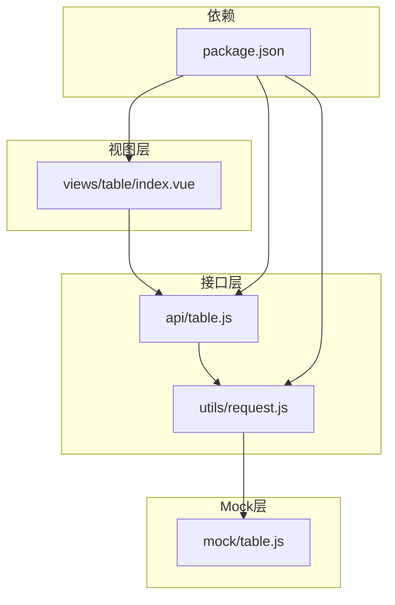
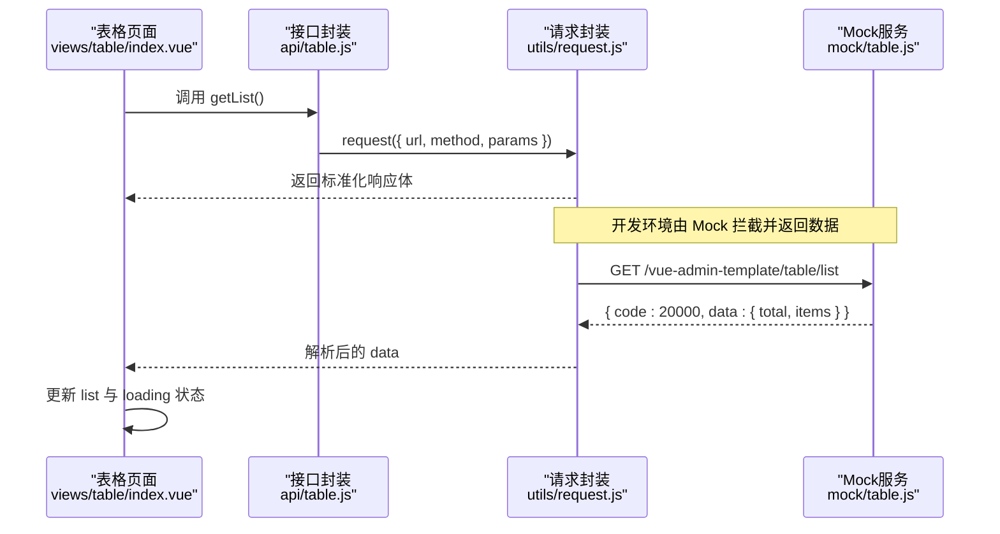
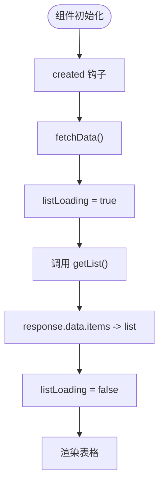
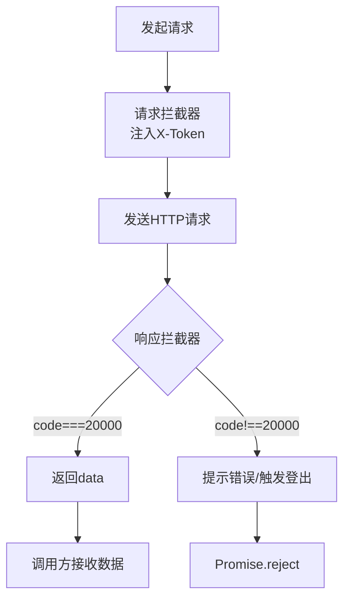
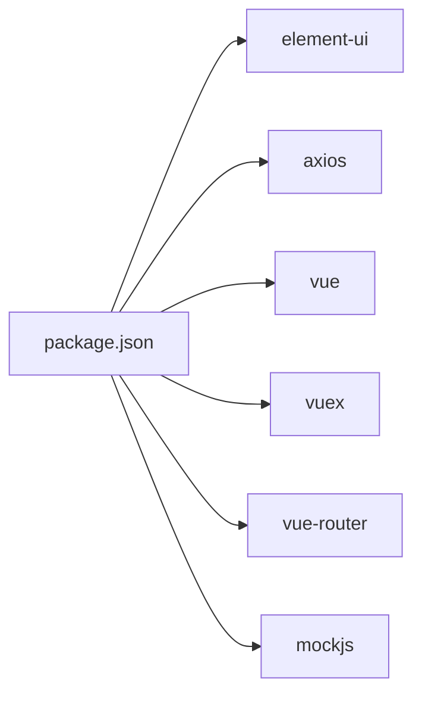

# 数据表格页面

<cite>
**本文引用的文件**   
- [src/views/table/index.vue](file://src/views/table/index.vue)
- [src/api/table.js](file://src/api/table.js)
- [mock/table.js](file://mock/table.js)
- [src/utils/request.js](file://src/utils/request.js)
- [package.json](file://package.json)
</cite>

## 目录
1. [简介](#简介)
2. [项目结构](#项目结构)
3. [核心组件](#核心组件)
4. [架构总览](#架构总览)
5. [详细组件分析](#详细组件分析)
6. [依赖关系分析](#依赖关系分析)
7. [性能与大数据优化](#性能与大数据优化)
8. [样式定制与响应式适配](#样式定制与响应式适配)
9. [故障排查指南](#故障排查指南)
10. [结论](#结论)

## 简介
本文件面向“数据表格页面”的实现与扩展，围绕 Element UI 的 el-table 组件，系统讲解以下主题：
- 表格展示、状态过滤、加载态控制
- 分页、筛选、排序等复杂交互的接入方式
- 数据加载流程、API 调用与 Mock 数据机制
- 状态管理与数据同步策略
- 表格样式定制与响应式适配方案
- 大数据量场景下的性能优化与最佳实践

## 项目结构
该仓库采用典型的前端工程化结构，表格相关代码主要位于 views、api、mock 与 utils 四个层次：
- views/table/index.vue：表格页面视图与业务逻辑
- api/table.js：表格数据的 API 封装
- mock/table.js：本地 Mock 数据与接口模拟
- utils/request.js：统一的 HTTP 请求封装（Axios）
- package.json：依赖声明（Element UI、Axios、MockJS 等）

图表来源
- [src/views/table/index.vue:1-80](file://src/views/table/index.vue#L1-L80)
- [src/api/table.js:1-10](file://src/api/table.js#L1-L10)
- [mock/table.js:1-30](file://mock/table.js#L1-L30)
- [src/utils/request.js:1-86](file://src/utils/request.js#L1-L86)
- [package.json:1-63](file://package.json#L1-L63)

章节来源
- [src/views/table/index.vue:1-80](file://src/views/table/index.vue#L1-L80)
- [src/api/table.js:1-10](file://src/api/table.js#L1-L10)
- [mock/table.js:1-30](file://mock/table.js#L1-L30)
- [src/utils/request.js:1-86](file://src/utils/request.js#L1-L86)
- [package.json:1-63](file://package.json#L1-L63)

## 核心组件
- 表格视图组件：使用 el-table 渲染列表数据，包含列定义、状态标签、时间显示等。
- 数据获取模块：通过 api/table.js 暴露 getList 方法，统一发起 GET 请求。
- 请求封装：utils/request.js 基于 Axios 创建实例，配置基础地址、超时、拦截器（鉴权头、错误处理）。
- Mock 服务：mock/table.js 提供 /vue-admin-template/table/list 的 GET 接口，返回固定结构与数据。

章节来源
- [src/views/table/index.vue:1-80](file://src/views/table/index.vue#L1-L80)
- [src/api/table.js:1-10](file://src/api/table.js#L1-L10)
- [src/utils/request.js:1-86](file://src/utils/request.js#L1-L86)
- [mock/table.js:1-30](file://mock/table.js#L1-L30)

## 架构总览
下图展示了从页面到后端（或 Mock）的数据流与关键节点：

图表来源
- [src/views/table/index.vue:46-77](file://src/views/table/index.vue#L46-L77)
- [src/api/table.js:1-10](file://src/api/table.js#L1-L10)
- [src/utils/request.js:1-86](file://src/utils/request.js#L1-L86)
- [mock/table.js:14-29](file://mock/table.js#L14-L29)

## 详细组件分析

### 表格视图与状态管理（views/table/index.vue）
- 模板层
  - 使用 el-table 绑定数据源 list，开启 v-loading 控制加载态。
  - 列定义包括 ID、标题、作者、浏览量、状态、显示时间等。
  - 状态列通过自定义过滤器将 status 映射为不同颜色的 el-tag。
- 脚本层
  - 引入 getList 进行数据获取。
  - 在 created 生命周期中触发 fetchData。
  - fetchData 设置 listLoading 为 true，调用 API 后赋值 list 并关闭 loading。
- 过滤器
  - statusFilter 将 published/draft/deleted 映射为 success/gray/danger。

图表来源
- [src/views/table/index.vue:46-77](file://src/views/table/index.vue#L46-L77)

章节来源
- [src/views/table/index.vue:1-80](file://src/views/table/index.vue#L1-L80)

### 接口封装（api/table.js）
- 暴露 getList(params)，内部调用 request 发起 GET 请求至 /vue-admin-template/table/list。
- 支持传入查询参数（如分页、筛选、排序），便于后续扩展。

章节来源
- [src/api/table.js:1-10](file://src/api/table.js#L1-L10)

### 请求封装与拦截器（utils/request.js）
- 基于 axios.create 创建实例，配置 baseURL 与 timeout。
- 请求拦截器：若 store.getters.token 存在，则注入 X-Token 请求头。
- 响应拦截器：
  - 当 res.code !== 20000 时，弹出错误提示并根据特定 code 触发登出重登流程。
  - 成功时直接返回 response.data。
- 错误处理：统一捕获网络异常并提示。

图表来源
- [src/utils/request.js:13-83](file://src/utils/request.js#L13-L83)

章节来源
- [src/utils/request.js:1-86](file://src/utils/request.js#L1-L86)

### Mock 数据与接口模拟（mock/table.js）
- 使用 MockJS 生成固定结构的 items 数组，字段包括 id、title、status、author、display_time、pageviews。
- 注册 GET /vue-admin-template/table/list，返回 { code: 20000, data: { total, items } }。

章节来源
- [mock/table.js:1-30](file://mock/table.js#L1-L30)

## 依赖关系分析
- 运行时依赖
  - element-ui：提供 el-table、el-tag、MessageBox、Message 等 UI 能力。
  - axios：HTTP 客户端。
  - vue、vuex、vue-router：框架与状态路由。
- 开发依赖
  - mockjs：本地 Mock 数据生成与拦截。
  - sass/sass-loader：样式预处理。
  - eslint、jest：代码规范与单元测试。

图表来源
- [package.json:16-51](file://package.json#L16-L51)

章节来源
- [package.json:1-63](file://package.json#L1-L63)

## 性能与大数据优化
针对表格大数据量与复杂交互，建议如下优化策略：
- 分页与虚拟滚动
  - 服务端分页：在 getList 中传入 page/pageSize 等参数，仅拉取当前页数据，减少 DOM 压力。
  - 前端虚拟滚动：对超大数据集启用虚拟化渲染（如 el-table-v2 或第三方库），避免一次性渲染大量行。
- 懒加载与增量更新
  - 首屏只加载必要列与字段，其余按需展开或懒加载。
  - 局部更新：对单条记录修改后，仅替换对应行数据，避免全量刷新。
- 计算与过滤优化
  - 将耗时计算（如排序、筛选）移至 Web Worker 或后端。
  - 使用防抖/节流优化搜索与筛选输入。
- 渲染优化
  - 合理设置列宽与固定列，减少重排重绘。
  - 避免在模板中进行复杂表达式运算，必要时使用 computed 缓存。
- 网络优化
  - 合并请求、缓存热点数据（如字典表）。
  - 使用 gzip、CDN 加速静态资源。

[本节为通用指导，不直接分析具体文件]

## 样式定制与响应式适配
- 表格样式
  - 通过 class-name 与全局样式覆盖 el-table 默认样式，实现列高亮、对齐、间距等定制。
  - 状态列使用 el-tag 的 type 属性区分状态，结合过滤器完成动态映射。
- 响应式适配
  - 使用媒体查询调整列宽、字号与内边距，保证在不同屏幕尺寸下可读性。
  - 在小屏设备上可隐藏次要列或启用横向滚动。
- 主题与一致性
  - 复用项目全局变量与 mixin，确保与整体设计语言一致。

章节来源
- [src/views/table/index.vue:1-44](file://src/views/table/index.vue#L1-L44)

## 故障排查指南
- 接口返回非 20000
  - 现象：页面弹出错误提示，可能触发重新登录。
  - 排查：检查后端返回码与 message；确认 token 是否有效。
- 表格无数据或一直 loading
  - 现象：list 为空或 listLoading 始终为 true。
  - 排查：确认 getList 是否被调用；检查 Mock 是否生效；查看网络面板请求是否成功。
- 状态标签颜色不正确
  - 现象：status 未正确映射为 tag type。
  - 排查：检查 statusFilter 映射表与数据字段值是否匹配。
- 鉴权失败
  - 现象：请求被拒绝或跳转登录。
  - 排查：确认 store.getters.token 是否存在；检查请求拦截器是否正确注入 X-Token。

章节来源
- [src/utils/request.js:45-83](file://src/utils/request.js#L45-L83)
- [src/views/table/index.vue:46-77](file://src/views/table/index.vue#L46-L77)

## 结论
本项目以 Element UI 的 el-table 为核心，结合统一的请求封装与 Mock 服务，实现了简洁稳定的数据表格展示。在此基础上，可通过分页、虚拟滚动、懒加载与计算优化等手段，进一步提升大数据量场景下的性能与用户体验。同时，借助全局样式与响应式策略，保障多终端一致的视觉效果。