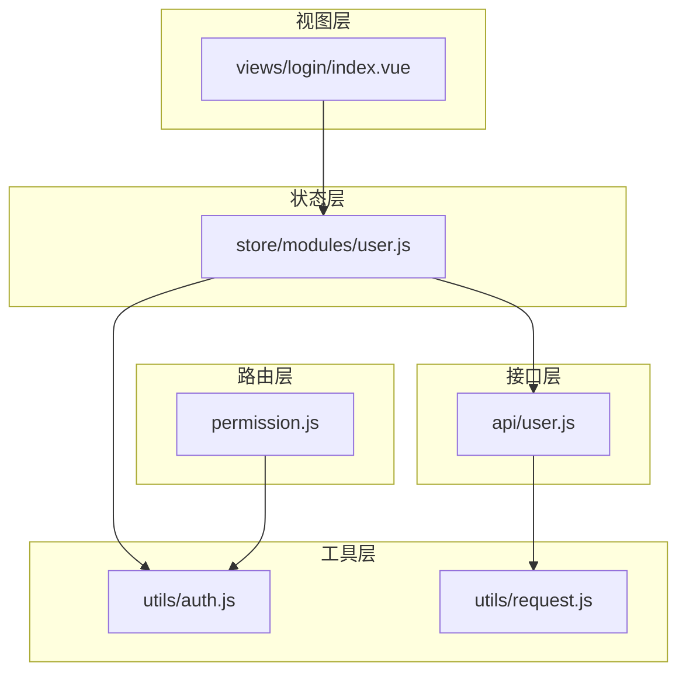
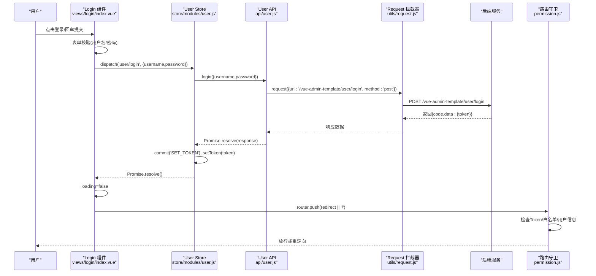
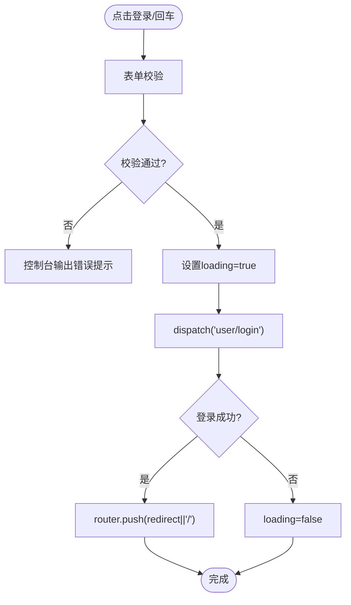
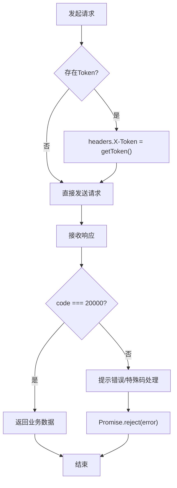
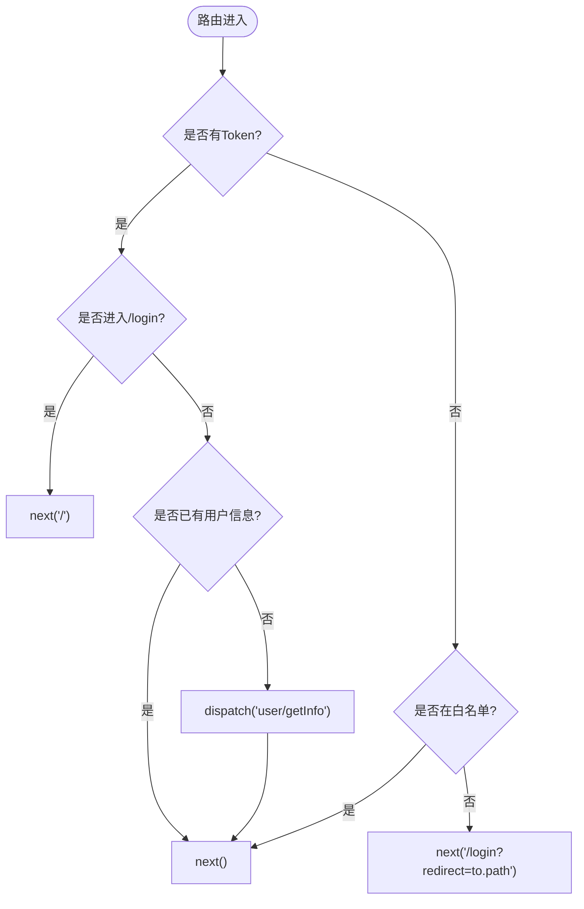
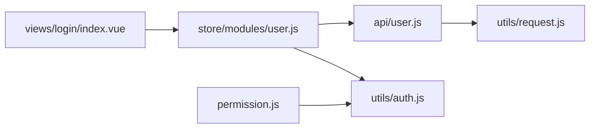

# 登录页面

<cite>
**本文引用的文件**   
- [src/views/login/index.vue](file://src/views/login/index.vue)
- [src/api/user.js](file://src/api/user.js)
- [src/store/modules/user.js](file://src/store/modules/user.js)
- [src/utils/auth.js](file://src/utils/auth.js)
- [src/utils/request.js](file://src/utils/request.js)
- [src/permission.js](file://src/permission.js)
</cite>

## 目录
1. [简介](#简介)
2. [项目结构](#项目结构)
3. [核心组件](#核心组件)
4. [架构总览](#架构总览)
5. [详细组件分析](#详细组件分析)
6. [依赖关系分析](#依赖关系分析)
7. [性能与体验优化](#性能与体验优化)
8. [故障排查指南](#故障排查指南)
9. [结论](#结论)

## 简介
本文围绕登录页面的实现，系统梳理用户认证流程：表单校验、输入处理、登录状态管理、与后端 API 的交互、Token 存储、路由跳转与权限守卫。文档同时给出关键流程图与代码级依赖图，帮助读者快速理解并扩展该模块。

## 项目结构
登录相关的关键文件分布如下：
- 视图层：登录页组件
- 接口层：用户相关 API
- 状态层：用户模块（Vuex）
- 工具层：Token 存取、HTTP 请求封装
- 路由层：全局权限守卫



图表来源
- [src/views/login/index.vue:1-126](file://src/views/login/index.vue#L1-L126)
- [src/api/user.js:1-25](file://src/api/user.js#L1-L25)
- [src/store/modules/user.js:1-98](file://src/store/modules/user.js#L1-L98)
- [src/utils/auth.js:1-16](file://src/utils/auth.js#L1-L16)
- [src/utils/request.js:1-86](file://src/utils/request.js#L1-L86)
- [src/permission.js:1-65](file://src/permission.js#L1-L65)

章节来源
- [src/views/login/index.vue:1-126](file://src/views/login/index.vue#L1-L126)
- [src/api/user.js:1-25](file://src/api/user.js#L1-L25)
- [src/store/modules/user.js:1-98](file://src/store/modules/user.js#L1-L98)
- [src/utils/auth.js:1-16](file://src/utils/auth.js#L1-L16)
- [src/utils/request.js:1-86](file://src/utils/request.js#L1-L86)
- [src/permission.js:1-65](file://src/permission.js#L1-L65)

## 核心组件
- 登录表单组件：负责渲染表单、绑定数据、触发校验与提交、控制加载态与密码可见性、根据路由参数决定登录后跳转目标。
- 用户状态模块：封装登录、获取用户信息、登出、重置 Token 等动作，维护 token/name/avatar 状态。
- 用户 API：封装登录、获取用户信息、登出三个 HTTP 请求。
- 请求拦截器：统一注入 Token、统一错误处理、非法/过期 Token 时提示并引导重新登录。
- Token 工具：基于 Cookie 的 Token 读写。
- 路由守卫：未登录重定向到登录页；已登录访问登录页则跳转到首页；必要时拉取用户信息。

章节来源
- [src/views/login/index.vue:55-126](file://src/views/login/index.vue#L55-L126)
- [src/store/modules/user.js:30-89](file://src/store/modules/user.js#L30-L89)
- [src/api/user.js:1-25](file://src/api/user.js#L1-L25)
- [src/utils/request.js:13-83](file://src/utils/request.js#L13-L83)
- [src/utils/auth.js:1-16](file://src/utils/auth.js#L1-L16)
- [src/permission.js:11-59](file://src/permission.js#L11-L59)

## 架构总览
下图展示从用户点击“登录”到成功进入系统的完整调用链。



图表来源
- [src/views/login/index.vue:108-123](file://src/views/login/index.vue#L108-L123)
- [src/store/modules/user.js:32-43](file://src/store/modules/user.js#L32-L43)
- [src/api/user.js:3-9](file://src/api/user.js#L3-L9)
- [src/utils/request.js:13-31](file://src/utils/request.js#L13-L31)
- [src/permission.js:13-59](file://src/permission.js#L13-L59)

## 详细组件分析

### 登录表单组件（views/login/index.vue）
- 表单字段与校验
  - 用户名：必填，使用自定义校验函数验证格式。
  - 密码：必填，最小长度校验。
  - 校验触发时机：失焦（blur）。
- 交互行为
  - 密码可见切换：点击图标切换明文/密文，并在切换后聚焦密码输入框。
  - 回车提交：在密码输入框监听回车事件触发登录。
  - 加载态：提交前开启 loading，成功后关闭；失败也关闭。
  - 路由跳转：登录成功后跳转到 redirect 参数指定的路径，否则跳转到首页。
- 状态管理
  - 通过 Vuex action 'user/login' 发起登录，成功后由组件自行执行路由跳转。
- 样式与可访问性
  - 表单容器、输入框、按钮、提示文案均有样式定义；支持自动填充背景修复与光标颜色适配。



图表来源
- [src/views/login/index.vue:108-123](file://src/views/login/index.vue#L108-L123)

章节来源
- [src/views/login/index.vue:55-126](file://src/views/login/index.vue#L55-L126)

### 用户状态模块（store/modules/user.js）
- 状态字段
  - token：当前登录令牌，初始化时从 Cookie 读取。
  - name、avatar：用户基本信息，用于后续页面展示。
- Mutations
  - SET_TOKEN、SET_NAME、SET_AVATAR、RESET_STATE。
- Actions
  - login：调用 user API 登录，成功后 commit SET_TOKEN 并持久化 Token。
  - getInfo：根据 token 拉取用户信息，更新 name/avatar。
  - logout：调用登出接口，清除 Token、重置路由、清空状态。
  - resetToken：仅清理本地 Token 与状态。

```mermaid
classDiagram
class UserStore {
+state : {token, name, avatar}
+mutations : SET_TOKEN, SET_NAME, SET_AVATAR, RESET_STATE
+actions : login, getInfo, logout, resetToken
}
class UserAPI {
+login(data)
+getInfo(token)
+logout()
}
class AuthUtil {
+getToken()
+setToken(token)
+removeToken()
}
UserStore --> UserAPI : "调用"
UserStore --> AuthUtil : "读写Token"
```

图表来源
- [src/store/modules/user.js:5-28](file://src/store/modules/user.js#L5-L28)
- [src/store/modules/user.js:30-89](file://src/store/modules/user.js#L30-L89)
- [src/api/user.js:1-25](file://src/api/user.js#L1-L25)
- [src/utils/auth.js:1-16](file://src/utils/auth.js#L1-L16)

章节来源
- [src/store/modules/user.js:1-98](file://src/store/modules/user.js#L1-L98)

### 用户 API（api/user.js）
- 提供三个方法：
  - login：POST /vue-admin-template/user/login
  - getInfo：GET /vue-admin-template/user/info?token=...
  - logout：POST /vue-admin-template/user/logout
- 所有请求均通过统一的 axios 实例发送，携带基础路径与超时配置。

章节来源
- [src/api/user.js:1-25](file://src/api/user.js#L1-L25)

### 请求拦截器（utils/request.js）
- 请求拦截
  - 若 store.getters.token 存在，则在请求头注入 X-Token。
- 响应拦截
  - 业务码非 20000 时弹出错误提示，并对特定错误码（如非法/重复登录/过期）弹窗确认是否重新登录，确认后清理 Token 并刷新页面。
  - 网络错误或业务错误统一抛出，供上层捕获。



图表来源
- [src/utils/request.js:13-31](file://src/utils/request.js#L13-L31)
- [src/utils/request.js:33-83](file://src/utils/request.js#L33-L83)

章节来源
- [src/utils/request.js:1-86](file://src/utils/request.js#L1-86)

### Token 工具（utils/auth.js）
- 基于 js-cookie 封装 Token 的读取、写入、删除操作，键名固定为 vue_admin_template_token。

章节来源
- [src/utils/auth.js:1-16](file://src/utils/auth.js#L1-L16)

### 路由守卫（permission.js）
- 白名单：/login 允许无 Token 访问。
- 有 Token：
  - 访问 /login 则重定向到首页。
  - 若尚未获取用户信息，先调用 user/getInfo，再放行。
- 无 Token：
  - 白名单内直接放行。
  - 其他页面重定向到 /login?redirect=当前路径。



图表来源
- [src/permission.js:11-59](file://src/permission.js#L11-L59)

章节来源
- [src/permission.js:1-65](file://src/permission.js#L1-65)

## 依赖关系分析
- 组件耦合
  - 登录组件依赖 Vuex user 模块进行登录动作，不直接调用 API。
  - user 模块依赖 api/user.js 与 utils/auth.js。
  - api/user.js 依赖 utils/request.js。
- 外部依赖
  - Element UI：表单、消息提示、确认对话框。
  - Axios：HTTP 客户端。
  - js-cookie：Cookie 读写。
  - NProgress：进度条（路由守卫中使用）。



图表来源
- [src/views/login/index.vue:55-126](file://src/views/login/index.vue#L55-L126)
- [src/store/modules/user.js:1-98](file://src/store/modules/user.js#L1-L98)
- [src/api/user.js:1-25](file://src/api/user.js#L1-L25)
- [src/utils/request.js:1-86](file://src/utils/request.js#L1-L86)
- [src/utils/auth.js:1-16](file://src/utils/auth.js#L1-L16)
- [src/permission.js:1-65](file://src/permission.js#L1-L65)

章节来源
- [src/views/login/index.vue:55-126](file://src/views/login/index.vue#L55-L126)
- [src/store/modules/user.js:1-98](file://src/store/modules/user.js#L1-L98)
- [src/api/user.js:1-25](file://src/api/user.js#L1-L25)
- [src/utils/request.js:1-86](file://src/utils/request.js#L1-L86)
- [src/utils/auth.js:1-16](file://src/utils/auth.js#L1-L16)
- [src/permission.js:1-65](file://src/permission.js#L1-L65)

## 性能与体验优化
- 表单校验
  - 使用 Element UI 的异步校验器，避免不必要的请求。
  - 校验触发时机设置为 blur，减少频繁校验带来的抖动。
- 网络请求
  - 统一超时与基础路径，减少重复配置。
  - 请求头自动注入 Token，避免遗漏。
- 用户体验
  - 登录按钮 loading 态防止重复提交。
  - 密码可见切换提升输入效率。
  - 路由守卫配合进度条，提升感知流畅度。
- 安全与健壮性
  - Token 异常时弹窗确认并引导重新登录，避免静默失败。
  - 登出时清理 Token 与路由，确保状态一致。

[本节为通用建议，无需列出具体文件来源]

## 故障排查指南
- 登录失败但前端未提示
  - 检查后端返回的业务码是否为 20000，若非 20000，request 拦截器会弹出错误提示。
  - 确认接口地址与基础路径配置是否正确。
- 登录后仍被重定向到登录页
  - 检查 Token 是否成功写入 Cookie（utils/auth.js）。
  - 检查路由守卫是否因缺少用户信息而触发 getInfo 失败，导致重置 Token 并重定向。
- 页面刷新后丢失登录状态
  - 确认 Token 是否持久化到 Cookie，且应用启动时能从 Cookie 读取。
- 跨域或 Cookie 问题
  - 如需跨域携带 Cookie，可在 axios 实例中启用 withCredentials，并确保后端允许。
- 特殊错误码处理
  - 当后端返回 50008/50012/50014 等错误码时，拦截器会弹窗提示并引导重新登录，确认后会清理 Token 并刷新页面。

章节来源
- [src/utils/request.js:45-83](file://src/utils/request.js#L45-L83)
- [src/permission.js:29-45](file://src/permission.js#L29-L45)
- [src/utils/auth.js:1-16](file://src/utils/auth.js#L1-L16)

## 结论
本登录方案以组件驱动、状态集中、请求统一的方式实现了完整的用户认证流程。通过表单校验、加载态控制、Token 持久化与路由守卫的配合，既保证了安全性，又提供了良好的用户体验。在实际项目中，可根据后端接口规范调整业务码判断与错误提示策略，并在此基础上扩展多因素认证、验证码、第三方登录等功能。