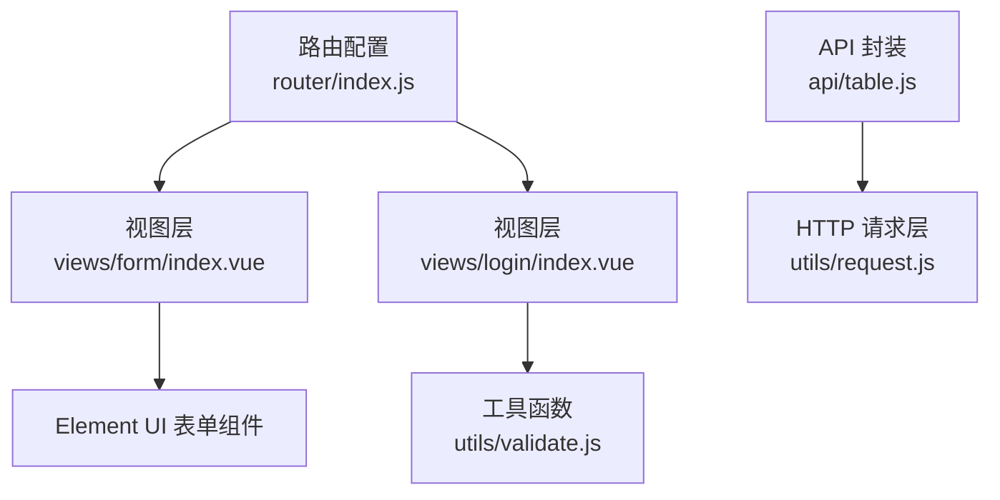
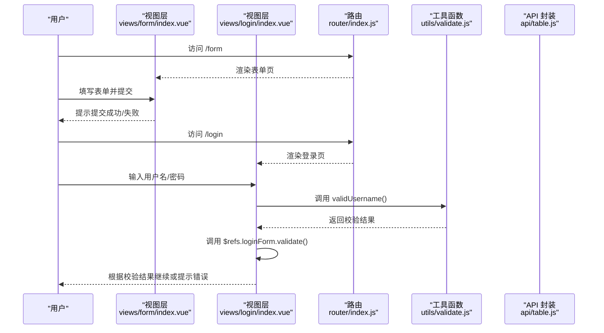
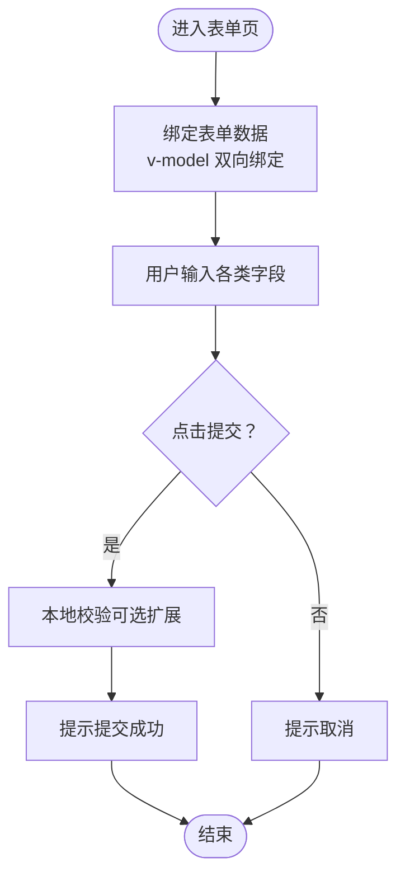
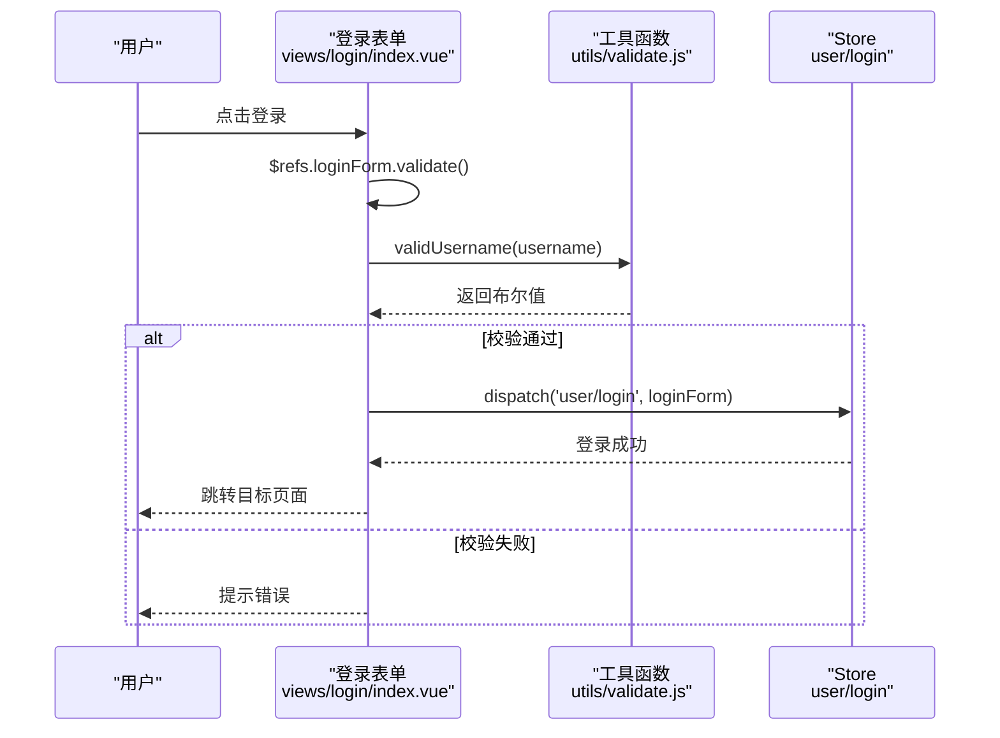
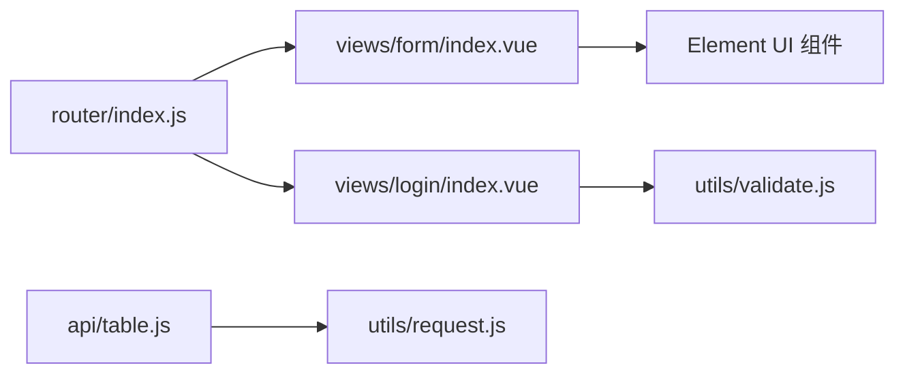

# 表单页面

<cite>
**本文引用的文件**   
- [src/views/form/index.vue](file://src/views/form/index.vue)
- [src/views/login/index.vue](file://src/views/login/index.vue)
- [src/utils/validate.js](file://src/utils/validate.js)
- [src/router/index.js](file://src/router/index.js)
- [src/api/table.js](file://src/api/table.js)
</cite>

## 目录
1. [简介](#简介)
2. [项目结构](#项目结构)
3. [核心组件](#核心组件)
4. [架构总览](#架构总览)
5. [详细组件分析](#详细组件分析)
6. [依赖关系分析](#依赖关系分析)
7. [性能与体验优化](#性能与体验优化)
8. [故障排查指南](#故障排查指南)
9. [结论](#结论)
10. [附录：业务示例与最佳实践](#附录业务示例与最佳实践)

## 简介
本章节面向复杂表单页面的实现，围绕表单组件结构设计、数据绑定、验证规则、提交处理逻辑展开，并补充动态表单生成、字段联动、异步验证等高级特性。同时给出表单状态管理、错误处理机制、样式定制与用户体验优化方案，以及基于仓库现有代码的业务场景示例与最佳实践。

## 项目结构
本项目采用典型的前端工程结构，表单相关能力分布在视图层、工具函数与路由配置中：
- 视图层：包含基础表单页与登录表单页，演示了双向绑定、校验与提交流程
- 工具函数：提供通用校验方法（如用户名合法性判断）
- 路由：定义表单页面路由，便于导航与权限控制
- API：封装请求方法，为表单提交对接后端做准备

图表来源
- [src/views/form/index.vue:1-86](file://src/views/form/index.vue#L1-L86)
- [src/views/login/index.vue:1-126](file://src/views/login/index.vue#L1-L126)
- [src/utils/validate.js:1-21](file://src/utils/validate.js#L1-L21)
- [src/router/index.js:80-91](file://src/router/index.js#L80-L91)
- [src/api/table.js:1-10](file://src/api/table.js#L1-L10)

章节来源
- [src/views/form/index.vue:1-86](file://src/views/form/index.vue#L1-L86)
- [src/views/login/index.vue:1-126](file://src/views/login/index.vue#L1-L126)
- [src/utils/validate.js:1-21](file://src/utils/validate.js#L1-L21)
- [src/router/index.js:80-91](file://src/router/index.js#L80-L91)
- [src/api/table.js:1-10](file://src/api/table.js#L1-L10)

## 核心组件
- 基础表单页（活动信息录入）
  - 使用 Element UI 的 el-form、el-input、el-select、el-date-picker、el-time-picker、el-switch、el-checkbox-group、el-radio-group 组合构建多类型字段
  - 通过 v-model 将表单数据与组件值进行双向绑定
  - 提供“创建”和“取消”按钮，触发提交与取消逻辑
- 登录表单页
  - 使用 el-form 的 rules 属性绑定校验规则
  - 自定义同步校验器（用户名白名单、密码长度）
  - 在提交前调用 validate 方法进行统一校验，通过后发起登录流程

章节来源
- [src/views/form/index.vue:1-86](file://src/views/form/index.vue#L1-L86)
- [src/views/login/index.vue:1-126](file://src/views/login/index.vue#L1-L126)

## 架构总览
表单页面整体遵循“视图层 + 工具函数 + 路由 + API”的分层模式：
- 视图层负责渲染表单、收集用户输入、执行本地校验与交互反馈
- 工具函数提供可复用的校验逻辑
- 路由负责页面导航与元信息展示
- API 层封装 HTTP 请求，为后续表单提交对接后端服务提供基础

图表来源
- [src/router/index.js:80-91](file://src/router/index.js#L80-L91)
- [src/views/form/index.vue:1-86](file://src/views/form/index.vue#L1-L86)
- [src/views/login/index.vue:1-126](file://src/views/login/index.vue#L1-L126)
- [src/utils/validate.js:1-21](file://src/utils/validate.js#L1-L21)
- [src/api/table.js:1-10](file://src/api/table.js#L1-L10)

## 详细组件分析

### 基础表单页（活动信息录入）
- 结构与数据绑定
  - 使用 el-form 作为容器，label-width 统一标签宽度
  - 各字段通过 v-model 绑定到 form 对象的不同属性，包括文本、选择、日期时间、开关、多选、单选、文本域
- 交互与事件
  - “创建”按钮触发 onSubmit，当前仅做消息提示
  - “取消”按钮触发 onCancel，显示警告消息
- 样式
  - 使用 scoped 样式对分隔符“-”进行居中布局

图表来源
- [src/views/form/index.vue:1-86](file://src/views/form/index.vue#L1-L86)

章节来源
- [src/views/form/index.vue:1-86](file://src/views/form/index.vue#L1-L86)

### 登录表单页（含校验与提交流程）
- 校验规则
  - 使用 loginRules 绑定到 el-form，分别对 username 与 password 设置 required 与自定义 validator
  - 用户名校验借助 utils/validate.js 中的 validUsername 方法
  - 密码校验要求最小长度
- 提交流程
  - 点击登录按钮后，调用 $refs.loginForm.validate 进行统一校验
  - 校验通过后，设置 loading 状态，调用 store 的 user/login action 完成登录
  - 成功后跳转至目标页面，失败时关闭 loading

图表来源
- [src/views/login/index.vue:1-126](file://src/views/login/index.vue#L1-L126)
- [src/utils/validate.js:1-21](file://src/utils/validate.js#L1-L21)

章节来源
- [src/views/login/index.vue:1-126](file://src/views/login/index.vue#L1-L126)
- [src/utils/validate.js:1-21](file://src/utils/validate.js#L1-L21)

### 动态表单生成与字段联动（设计建议）
- 动态表单生成
  - 将表单字段描述抽象为 JSON Schema，按 schema 动态渲染 el-form-item 与对应控件
  - 支持条件渲染（根据其他字段值决定字段是否显示）
- 字段联动
  - 使用 watch 监听关键字段变化，动态更新关联字段的 options、disabled、rules 等
  - 对于级联选择，可在父字段变化后重新拉取子选项数据
- 异步验证
  - 在 validator 中发起异步请求（如用户名唯一性检查），通过 callback 返回校验结果
  - 结合防抖与缓存减少重复请求

说明：本节为概念性设计建议，未直接分析具体源码文件，因此不附带“章节来源”。

### 表单状态管理与错误处理机制
- 状态管理
  - 表单数据以组件 data 中的对象形式维护；如需跨组件共享，可接入 Vuex（store/modules/user.js 已存在）
- 错误处理
  - 使用 Element UI 的表单校验错误提示
  - 在异步操作中使用 try/catch 或 Promise.catch 捕获异常，并通过 $message 或全局通知展示错误信息
- 加载状态
  - 在提交过程中设置 loading 标志，禁用提交按钮，避免重复提交

说明：本节为通用实践总结，未直接分析具体源码文件，因此不附带“章节来源”。

## 依赖关系分析
- 视图层依赖 Element UI 组件库
- 登录表单依赖工具函数 validate.js 提供的校验方法
- 路由配置定义了表单与登录页面的路径与元信息
- API 层封装了请求方法，便于后续表单提交对接后端

图表来源
- [src/views/form/index.vue:1-86](file://src/views/form/index.vue#L1-L86)
- [src/views/login/index.vue:1-126](file://src/views/login/index.vue#L1-L126)
- [src/utils/validate.js:1-21](file://src/utils/validate.js#L1-L21)
- [src/router/index.js:80-91](file://src/router/index.js#L80-L91)
- [src/api/table.js:1-10](file://src/api/table.js#L1-L10)

章节来源
- [src/views/form/index.vue:1-86](file://src/views/form/index.vue#L1-L86)
- [src/views/login/index.vue:1-126](file://src/views/login/index.vue#L1-L126)
- [src/utils/validate.js:1-21](file://src/utils/validate.js#L1-L21)
- [src/router/index.js:80-91](file://src/router/index.js#L80-L91)
- [src/api/table.js:1-10](file://src/api/table.js#L1-L10)

## 性能与体验优化
- 表单校验优化
  - 合理设置 trigger（blur/change/input），避免频繁校验
  - 对长列表选项使用虚拟滚动或分页加载
- 网络请求优化
  - 使用防抖与节流减少重复请求
  - 对只读下拉选项进行本地缓存
- 用户体验优化
  - 提交时显示 loading，禁用提交按钮
  - 错误信息明确且定位到具体字段
  - 提供一键清空与重置功能
- 样式定制
  - 使用 scoped 样式覆盖 Element UI 默认样式
  - 统一 label-width、间距与颜色主题

说明：本节为通用优化建议，未直接分析具体源码文件，因此不附带“章节来源”。

## 故障排查指南
- 表单无法提交
  - 检查 el-form 是否正确绑定 model 与 rules
  - 确认 $refs.form.validate 是否被正确调用
- 校验不生效
  - 检查 prop 是否与 model 字段一致
  - 确认 validator 回调是否被调用
- 异步校验卡顿
  - 检查是否存在重复请求，增加防抖与缓存
- 样式错乱
  - 检查 scoped 样式优先级与 Element UI 默认样式冲突

说明：本节为通用排障建议，未直接分析具体源码文件，因此不附带“章节来源”。

## 结论
本项目的基础表单页展示了 Element UI 表单的多字段组合与双向绑定；登录表单页则演示了规则的声明式绑定、自定义校验与提交流程。在此基础上，可通过动态表单生成、字段联动与异步校验进一步提升复杂业务场景下的表单能力。配合合理的状态管理、错误处理与样式定制，可获得更稳定、易维护且用户体验良好的表单实现。

## 附录：业务示例与最佳实践
- 业务示例
  - 活动信息录入：涵盖文本、选择、日期时间、开关、多选、单选、文本域等多类型字段
  - 登录表单：包含用户名白名单校验与密码长度校验，并在提交前统一校验
- 最佳实践
  - 将表单字段描述抽象为 JSON Schema，实现动态渲染
  - 使用 watch 实现字段联动与条件渲染
  - 在 validator 中实现异步校验，并结合防抖与缓存优化性能
  - 使用统一的错误提示与加载状态提升用户体验
  - 通过路由 meta 控制菜单标题与图标，便于导航与权限管理

章节来源
- [src/views/form/index.vue:1-86](file://src/views/form/index.vue#L1-L86)
- [src/views/login/index.vue:1-126](file://src/views/login/index.vue#L1-L126)
- [src/utils/validate.js:1-21](file://src/utils/validate.js#L1-L21)
- [src/router/index.js:80-91](file://src/router/index.js#L80-L91)
- [src/api/table.js:1-10](file://src/api/table.js#L1-L10)