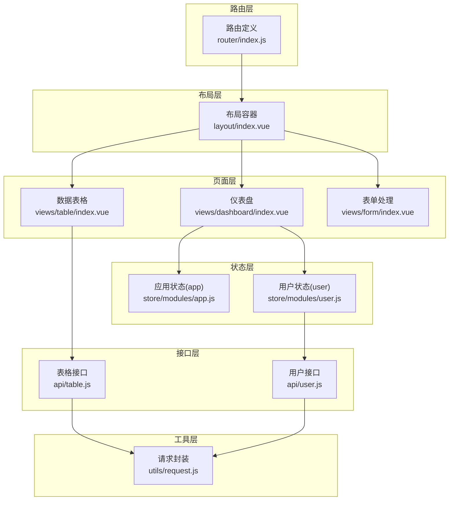
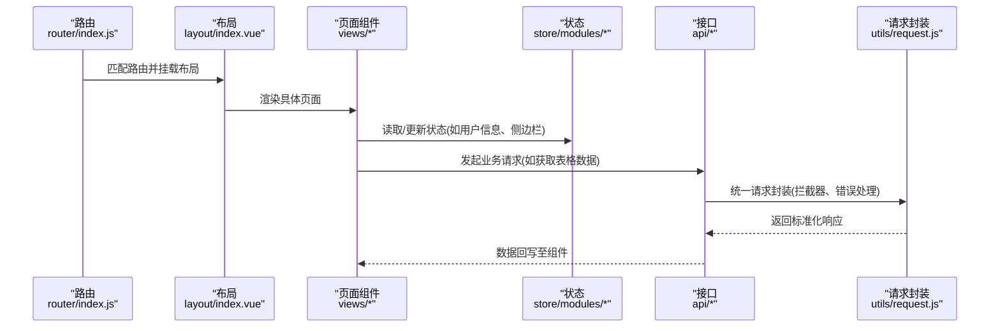
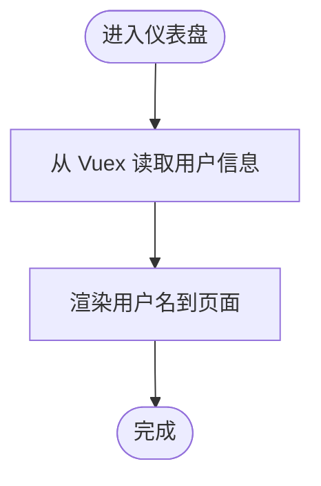
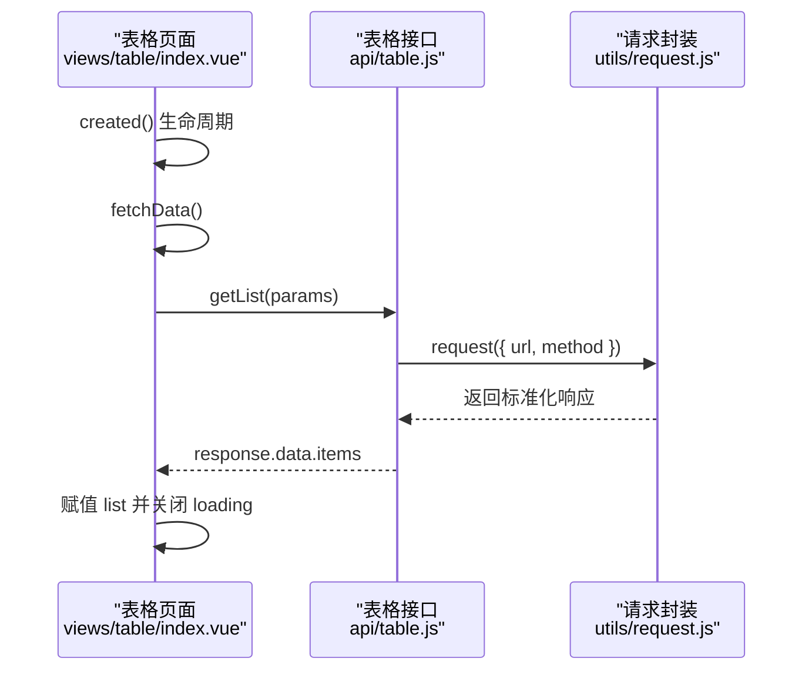
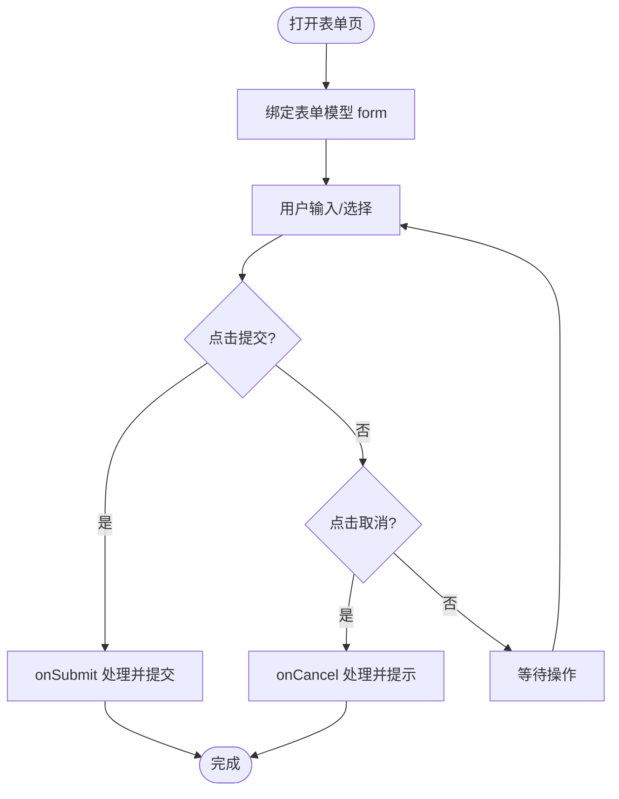
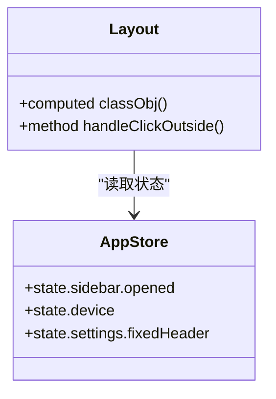
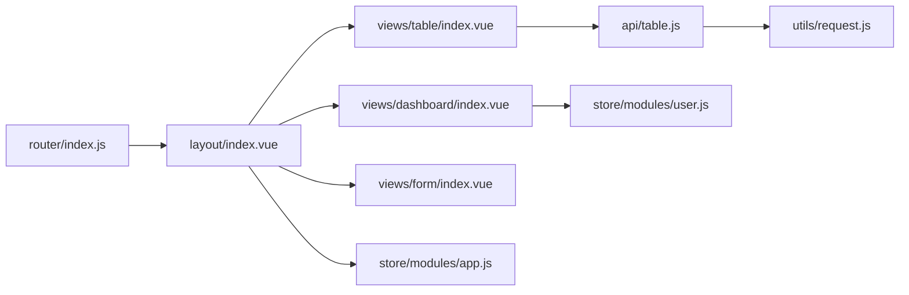

# 页面组件

<cite>
**本文引用的文件**   
- [src/views/dashboard/index.vue](file://src/views/dashboard/index.vue)
- [src/views/table/index.vue](file://src/views/table/index.vue)
- [src/views/form/index.vue](file://src/views/form/index.vue)
- [src/router/index.js](file://src/router/index.js)
- [src/store/modules/app.js](file://src/store/modules/app.js)
- [src/store/modules/user.js](file://src/store/modules/user.js)
- [src/api/table.js](file://src/api/table.js)
- [src/api/user.js](file://src/api/user.js)
- [src/utils/request.js](file://src/utils/request.js)
- [src/layout/index.vue](file://src/layout/index.vue)
</cite>

## 目录
1. [简介](#简介)
2. [项目结构](#项目结构)
3. [核心组件](#核心组件)
4. [架构总览](#架构总览)
5. [详细组件分析](#详细组件分析)
6. [依赖关系分析](#依赖关系分析)
7. [性能与可维护性](#性能与可维护性)
8. [故障排查指南](#故障排查指南)
9. [结论](#结论)

## 简介
本文件面向“页面组件”的文档，聚焦仪表盘、数据表格、表单处理等典型业务页面的实现方式与功能特性。内容涵盖：
- 组件结构与职责划分
- 属性配置、事件处理与样式定制方法
- 页面间的数据传递与状态同步方案（路由、Vuex）
- 实际业务场景示例与代码片段路径

## 项目结构
本项目采用基于视图（views）+ 布局（layout）+ 路由（router）+ 状态管理（store）的典型前端工程结构。关键目录与职责如下：
- views：业务页面组件（仪表盘、表格、表单等）
- layout：全局布局容器（侧边栏、导航、主内容区）
- router：路由表与权限控制入口
- store：应用级状态（app、user）
- api：接口封装
- utils：通用工具（请求封装、鉴权等）

图表来源
- [src/router/index.js:33-90](file://src/router/index.js#L33-L90)
- [src/layout/index.vue:1-50](file://src/layout/index.vue#L1-L50)
- [src/views/dashboard/index.vue:1-31](file://src/views/dashboard/index.vue#L1-L31)
- [src/views/table/index.vue:1-80](file://src/views/table/index.vue#L1-L80)
- [src/views/form/index.vue:1-86](file://src/views/form/index.vue#L1-L86)
- [src/store/modules/app.js:1-49](file://src/store/modules/app.js#L1-L49)
- [src/store/modules/user.js:1-98](file://src/store/modules/user.js#L1-L98)
- [src/api/table.js:1-10](file://src/api/table.js#L1-L10)
- [src/api/user.js:1-25](file://src/api/user.js#L1-L25)
- [src/utils/request.js:1-86](file://src/utils/request.js#L1-L86)

章节来源
- [src/router/index.js:33-90](file://src/router/index.js#L33-L90)
- [src/layout/index.vue:1-50](file://src/layout/index.vue#L1-L50)

## 核心组件
本节概述三个典型页面组件的职责与交互要点：
- 仪表盘：展示基础信息，读取用户信息并渲染到页面
- 数据表格：拉取列表数据，使用 Element UI 表格展示，包含状态过滤与加载态
- 表单处理：提供多种输入控件，演示提交与取消行为

章节来源
- [src/views/dashboard/index.vue:1-31](file://src/views/dashboard/index.vue#L1-L31)
- [src/views/table/index.vue:1-80](file://src/views/table/index.vue#L1-L80)
- [src/views/form/index.vue:1-86](file://src/views/form/index.vue#L1-L86)

## 架构总览
下图展示了从路由到页面、再到状态与接口的整体调用链。

图表来源
- [src/router/index.js:33-90](file://src/router/index.js#L33-L90)
- [src/layout/index.vue:1-50](file://src/layout/index.vue#L1-L50)
- [src/views/table/index.vue:46-78](file://src/views/table/index.vue#L46-L78)
- [src/api/table.js:1-10](file://src/api/table.js#L1-L10)
- [src/utils/request.js:1-86](file://src/utils/request.js#L1-L86)

## 详细组件分析

### 仪表盘（Dashboard）
- 功能要点
  - 通过 Vuex getters 映射用户名称并渲染
  - 样式使用 scoped SCSS 进行局部作用域隔离
- 属性与数据
  - 无 props；数据来源于 store 中的用户信息
- 事件与交互
  - 无直接交互事件
- 样式定制
  - 通过类名 .dashboard-container 和 .dashboard-text 调整间距与字号

图表来源
- [src/views/dashboard/index.vue:1-31](file://src/views/dashboard/index.vue#L1-L31)
- [src/store/modules/user.js:5-27](file://src/store/modules/user.js#L5-L27)

章节来源
- [src/views/dashboard/index.vue:1-31](file://src/views/dashboard/index.vue#L1-L31)
- [src/store/modules/user.js:5-27](file://src/store/modules/user.js#L5-L27)

### 数据表格（Table）
- 功能要点
  - 使用 Element UI el-table 展示列表
  - 支持加载态 v-loading
  - 自定义过滤器 statusFilter 将状态映射为标签类型
  - 在 created 钩子中调用 getList 获取数据
- 属性与数据
  - list：表格数据数组
  - listLoading：加载标志
- 事件与交互
  - 无用户触发事件；自动拉取数据
- 样式定制
  - 列宽、对齐、状态标签样式由 Element 默认样式与少量自定义类控制

图表来源
- [src/views/table/index.vue:46-78](file://src/views/table/index.vue#L46-L78)
- [src/api/table.js:1-10](file://src/api/table.js#L1-L10)
- [src/utils/request.js:1-86](file://src/utils/request.js#L1-L86)

章节来源
- [src/views/table/index.vue:1-80](file://src/views/table/index.vue#L1-L80)
- [src/api/table.js:1-10](file://src/api/table.js#L1-L10)
- [src/utils/request.js:1-86](file://src/utils/request.js#L1-L86)

### 表单处理（Form）
- 功能要点
  - 使用 el-form 绑定 model，包含输入框、选择器、日期时间、开关、复选组、单选组、文本域等
  - 提供“创建”与“取消”按钮，分别触发提交与取消逻辑
- 属性与数据
  - form：表单对象，包含 name、region、date1、date2、delivery、type、resource、desc 等字段
- 事件与交互
  - onSubmit：提交后给出提示
  - onCancel：取消时给出警告提示
- 样式定制
  - 通过 scoped CSS 对分隔符区域进行居中显示

图表来源
- [src/views/form/index.vue:1-86](file://src/views/form/index.vue#L1-L86)

章节来源
- [src/views/form/index.vue:1-86](file://src/views/form/index.vue#L1-L86)

### 布局与导航（Layout）
- 功能要点
  - 组合 Sidebar、Navbar、AppMain 三大子组件
  - 根据设备类型与侧边栏状态动态切换 class
  - 移动端点击遮罩关闭侧边栏
- 状态依赖
  - 读取 app.store 中的 sidebar 与 device
  - 读取 settings 中的 fixedHeader

图表来源
- [src/layout/index.vue:1-50](file://src/layout/index.vue#L1-L50)
- [src/store/modules/app.js:1-49](file://src/store/modules/app.js#L1-L49)

章节来源
- [src/layout/index.vue:1-50](file://src/layout/index.vue#L1-L50)
- [src/store/modules/app.js:1-49](file://src/store/modules/app.js#L1-L49)

## 依赖关系分析
- 路由到页面
  - 路由表定义了 Dashboard、Table、Form 等页面及其元信息，并通过 Layout 包裹
- 页面到状态
  - Dashboard 通过 mapGetters 读取用户信息
  - Layout 读取 app 模块的状态以控制侧边栏与设备模式
- 页面到接口
  - Table 页面通过 api/table.js 调用后端接口
- 接口到工具
  - 所有接口均通过 utils/request.js 统一封装，具备请求拦截、响应拦截与错误处理

图表来源
- [src/router/index.js:33-90](file://src/router/index.js#L33-L90)
- [src/layout/index.vue:1-50](file://src/layout/index.vue#L1-L50)
- [src/views/dashboard/index.vue:1-31](file://src/views/dashboard/index.vue#L1-L31)
- [src/views/table/index.vue:46-78](file://src/views/table/index.vue#L46-L78)
- [src/api/table.js:1-10](file://src/api/table.js#L1-L10)
- [src/utils/request.js:1-86](file://src/utils/request.js#L1-L86)
- [src/store/modules/user.js:1-98](file://src/store/modules/user.js#L1-L98)
- [src/store/modules/app.js:1-49](file://src/store/modules/app.js#L1-L49)

章节来源
- [src/router/index.js:33-90](file://src/router/index.js#L33-L90)
- [src/layout/index.vue:1-50](file://src/layout/index.vue#L1-L50)
- [src/views/table/index.vue:46-78](file://src/views/table/index.vue#L46-L78)
- [src/api/table.js:1-10](file://src/api/table.js#L1-L10)
- [src/utils/request.js:1-86](file://src/utils/request.js#L1-L86)
- [src/store/modules/user.js:1-98](file://src/store/modules/user.js#L1-L98)
- [src/store/modules/app.js:1-49](file://src/store/modules/app.js#L1-L49)

## 性能与可维护性
- 列表渲染优化
  - 表格数据在 created 钩子中一次性拉取，避免频繁重绘；如需分页或搜索，建议结合虚拟滚动与防抖
- 网络请求优化
  - 使用统一的 axios 实例与拦截器，集中处理鉴权头与错误提示，减少重复代码
- 状态管理
  - 将用户信息与侧边栏状态抽离到 store，便于跨组件共享与调试
- 样式组织
  - 使用 scoped 样式与 SCSS 变量，保证样式隔离与主题一致性

[本节为通用指导，不直接分析具体文件]

## 故障排查指南
- 表格数据为空或报错
  - 检查 api/table.js 的请求地址与方法是否正确
  - 查看 utils/request.js 的响应拦截器是否因 code !== 20000 而抛出错误
  - 确认后端返回数据结构是否符合 response.data.items
- 用户信息未显示
  - 检查 store/modules/user.js 是否成功获取并设置 name/avatar
  - 确认 Dashboard 页面是否正确映射 getters.name
- 登录态异常
  - 检查 utils/request.js 是否在请求头注入 X-Token
  - 当后端返回特定错误码（如 50008/50012/50014）时，会触发重新登录流程

章节来源
- [src/api/table.js:1-10](file://src/api/table.js#L1-L10)
- [src/utils/request.js:14-82](file://src/utils/request.js#L14-L82)
- [src/store/modules/user.js:30-88](file://src/store/modules/user.js#L30-L88)
- [src/views/dashboard/index.vue:10-16](file://src/views/dashboard/index.vue#L10-L16)

## 结论
本仓库围绕“仪表盘、数据表格、表单处理”三类典型页面，提供了清晰的组件结构与数据流：
- 页面组件职责单一，易于扩展与维护
- 通过路由与布局统一管理页面挂载与全局样式
- 借助 Vuex 实现跨组件状态共享
- 使用统一的请求封装提升健壮性与可观测性

在实际项目中，可在上述基础上继续扩展：
- 为表格增加分页、筛选与排序
- 为表单增加校验规则与异步提交
- 为仪表盘接入更多可视化图表与实时数据

[本节为总结性内容，不直接分析具体文件]