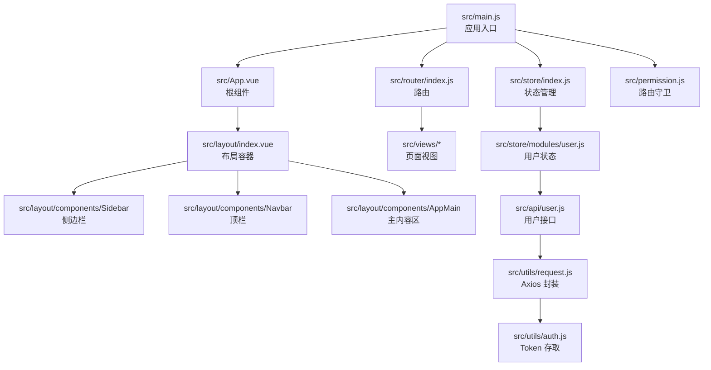
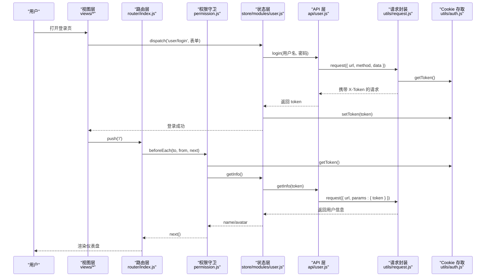
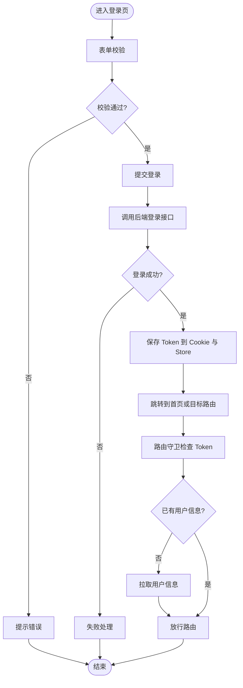
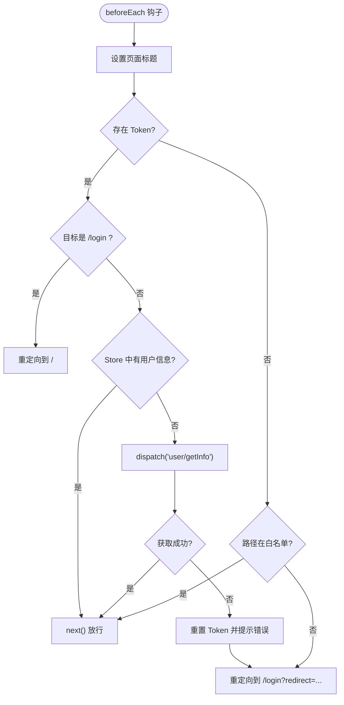
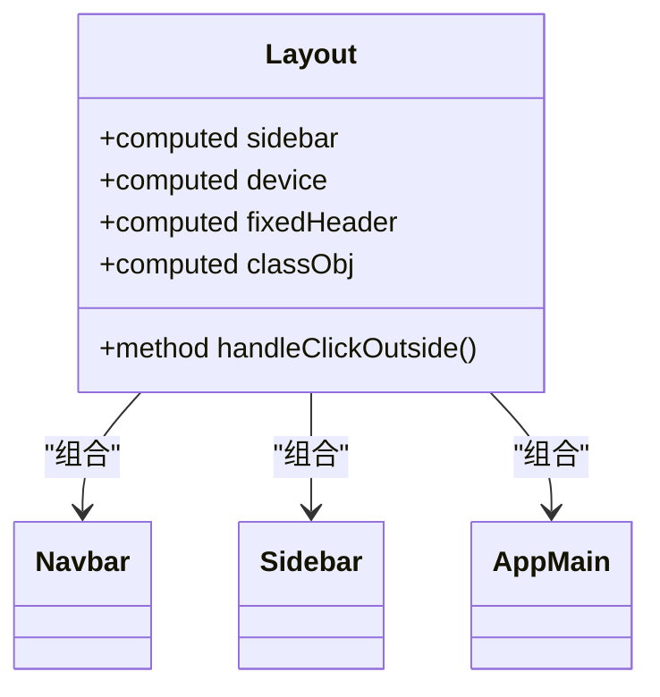
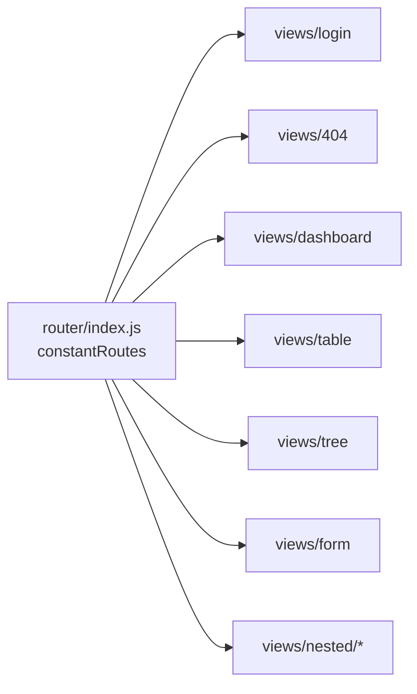
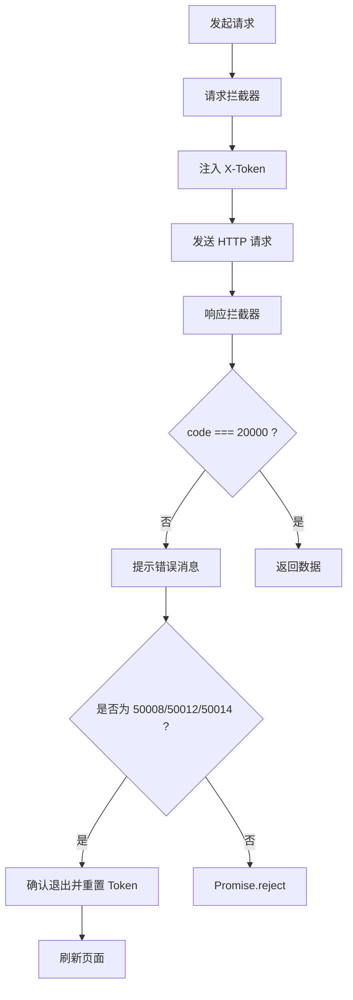
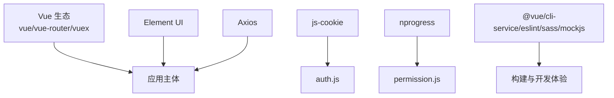

# 项目概述

<cite>
**本文引用的文件**   
- [README.md](file://README.md)
- [package.json](file://package.json)
- [src/main.js](file://src/main.js)
- [src/App.vue](file://src/App.vue)
- [src/settings.js](file://src/settings.js)
- [src/router/index.js](file://src/router/index.js)
- [src/permission.js](file://src/permission.js)
- [src/store/modules/user.js](file://src/store/modules/user.js)
- [src/api/user.js](file://src/api/user.js)
- [src/views/login/index.vue](file://src/views/login/index.vue)
- [src/layout/index.vue](file://src/layout/index.vue)
- [src/utils/request.js](file://src/utils/request.js)
- [src/utils/auth.js](file://src/utils/auth.js)
- [src/views/dashboard/index.vue](file://src/views/dashboard/index.vue)
</cite>

## 目录
1. [简介](#简介)
2. [项目结构](#项目结构)
3. [核心组件](#核心组件)
4. [架构总览](#架构总览)
5. [详细组件分析](#详细组件分析)
6. [依赖关系分析](#依赖关系分析)
7. [性能与可维护性](#性能与可维护性)
8. [快速开始指南](#快速开始指南)
9. [常见问题排查](#常见问题排查)
10. [结论](#结论)

## 简介
本项目是一个基于 Vue.js 2.x 的企业级管理后台模板，内置用户认证、权限控制、响应式布局、动态路由等常用能力，采用 Element UI 作为 UI 框架，Axios 进行网络请求封装，配合 Vuex 进行状态管理。项目遵循清晰的模块化组织方式，便于二次开发与扩展。

主要特性概览：
- 用户认证：登录/登出、Token 持久化、自动刷新与失效处理
- 权限控制：全局路由守卫、白名单机制、登录后获取用户信息并放行
- 响应式布局：侧边栏、顶部导航、移动端抽屉适配
- 动态路由：常量路由 + 懒加载页面，支持多级嵌套菜单
- 统一请求层：Axios 拦截器统一注入 Token、错误提示与异常处理
- 配置中心：站点标题、固定头部、侧边栏 Logo 等开关项集中管理

目标用户群体：
- 需要快速搭建企业后台的开发者
- 希望以最小成本集成认证与权限控制的团队
- 使用 Vue 2.x 生态的技术栈团队

技术栈选择与优势：
- Vue.js 2.x：生态成熟、学习曲线平缓、社区资源丰富
- Element UI：开箱即用的高质量组件库，适合后台场景
- Axios：Promise 风格、拦截器强大，便于统一处理请求/响应
- Vuex：集中式状态管理，清晰的数据流与副作用边界
- vue-router：声明式路由、懒加载、与权限控制天然契合

**章节来源**
- [README.md:1-100](file://README.md#L1-L100)
- [package.json:1-63](file://package.json#L1-L63)

## 项目结构
项目采用按功能域划分的目录组织方式，核心模块职责清晰：
- src/api：API 接口定义（如 user、table）
- src/components：通用业务组件（面包屑、汉堡按钮、图标等）
- src/layout：应用整体布局（侧边栏、顶栏、主内容区）
- src/router：路由表与路由实例
- src/store：Vuex 状态管理（app、settings、user 等模块）
- src/styles：全局样式与主题变量
- src/utils：工具函数（请求封装、鉴权、校验等）
- src/views：页面视图（登录、仪表盘、表单、表格、树、嵌套菜单等）
- mock：本地 Mock 数据与服务（开发阶段）
- public：静态资源入口
- build：构建脚本（可选）

**图表来源**
- [src/main.js:1-44](file://src/main.js#L1-L44)
- [src/App.vue:1-12](file://src/App.vue#L1-L12)
- [src/router/index.js:1-182](file://src/router/index.js#L1-L182)
- [src/permission.js:1-65](file://src/permission.js#L1-L65)
- [src/layout/index.vue:1-94](file://src/layout/index.vue#L1-L94)
- [src/store/modules/user.js:1-98](file://src/store/modules/user.js#L1-L98)
- [src/api/user.js:1-25](file://src/api/user.js#L1-L25)
- [src/utils/request.js:1-86](file://src/utils/request.js#L1-L86)
- [src/utils/auth.js:1-16](file://src/utils/auth.js#L1-L16)

**章节来源**
- [src/main.js:1-44](file://src/main.js#L1-L44)
- [src/App.vue:1-12](file://src/App.vue#L1-L12)
- [src/router/index.js:1-182](file://src/router/index.js#L1-L182)
- [src/layout/index.vue:1-94](file://src/layout/index.vue#L1-L94)

## 核心组件
- 应用入口与初始化
  - 引入 Element UI 与国际化语言包
  - 注册全局样式、图标、权限控制
  - 生产环境启用 Mock XHR（可按需关闭）
  - 挂载 Vue 实例，注入 router 与 store
- 根组件
  - 仅包含 <router-view/>，负责渲染当前路由对应的页面
- 设置中心
  - 站点标题、是否固定头部、侧边栏 Logo 显示等开关项集中管理

关键实现要点：
- 通过环境变量控制 Mock 服务，便于前后端联调与上线切换
- Element UI 的语言包按需切换，便于多语言扩展
- 全局样式与主题变量统一管理，保证视觉一致性

**章节来源**
- [src/main.js:1-44](file://src/main.js#L1-L44)
- [src/App.vue:1-12](file://src/App.vue#L1-L12)
- [src/settings.js:1-17](file://src/settings.js#L1-L17)

## 架构总览
系统采用“视图层 + 路由层 + 状态层 + API 层 + 工具层”的分层架构：
- 视图层：页面组件（登录、仪表盘、表单、表格等）
- 路由层：常量路由 + 懒加载，结合权限守卫控制访问
- 状态层：Vuex 模块化管理用户、应用、设置等状态
- API 层：Axios 封装统一请求、拦截器处理 Token 与错误
- 工具层：鉴权、校验、页面标题生成等通用方法

**图表来源**
- [src/views/login/index.vue:55-126](file://src/views/login/index.vue#L55-L126)
- [src/store/modules/user.js:30-65](file://src/store/modules/user.js#L30-L65)
- [src/api/user.js:1-25](file://src/api/user.js#L1-L25)
- [src/utils/request.js:1-86](file://src/utils/request.js#L1-L86)
- [src/utils/auth.js:1-16](file://src/utils/auth.js#L1-L16)
- [src/permission.js:13-59](file://src/permission.js#L13-L59)
- [src/router/index.js:167-181](file://src/router/index.js#L167-L181)

## 详细组件分析

### 用户认证流程
- 登录页提交表单后，调用 store 的 user/login action
- user/login 调用 api/user.login，经由 request 封装发送请求
- 成功后将 token 写入 Cookie，并在 store 中保存
- 跳转至首页或 redirect 参数指向的路由
- 路由守卫在 beforeEach 中检查 token，若无则重定向到登录页
- 若已登录但无用户信息，则调用 getInfo 拉取用户信息后再放行

**图表来源**
- [src/views/login/index.vue:55-126](file://src/views/login/index.vue#L55-L126)
- [src/store/modules/user.js:30-65](file://src/store/modules/user.js#L30-L65)
- [src/api/user.js:1-25](file://src/api/user.js#L1-L25)
- [src/utils/request.js:1-86](file://src/utils/request.js#L1-L86)
- [src/utils/auth.js:1-16](file://src/utils/auth.js#L1-L16)
- [src/permission.js:13-59](file://src/permission.js#L13-L59)

**章节来源**
- [src/views/login/index.vue:55-126](file://src/views/login/index.vue#L55-L126)
- [src/store/modules/user.js:30-88](file://src/store/modules/user.js#L30-L88)
- [src/api/user.js:1-25](file://src/api/user.js#L1-L25)
- [src/utils/request.js:1-86](file://src/utils/request.js#L1-L86)
- [src/utils/auth.js:1-16](file://src/utils/auth.js#L1-L16)
- [src/permission.js:13-59](file://src/permission.js#L13-L59)

### 权限控制与路由守卫
- 白名单机制：允许无需登录即可访问的路径（如 /login）
- 有 Token 时：
  - 若目标是登录页，直接重定向到首页
  - 若未获取用户信息，先拉取用户信息再放行
- 无 Token 时：
  - 在白名单内则放行
  - 否则重定向到登录页，并附带 redirect 参数以便登录后回跳

**图表来源**
- [src/permission.js:13-59](file://src/permission.js#L13-L59)
- [src/utils/auth.js:1-16](file://src/utils/auth.js#L1-L16)

**章节来源**
- [src/permission.js:1-65](file://src/permission.js#L1-L65)

### 响应式布局与侧边栏
- Layout 组件组合 Sidebar、Navbar、AppMain
- 根据设备类型（mobile/desktop）与侧边栏展开状态动态调整类名与样式
- 移动端点击遮罩关闭侧边栏
- 通过 store.state.app 与 store.state.settings 控制布局行为

**图表来源**
- [src/layout/index.vue:1-94](file://src/layout/index.vue#L1-L94)

**章节来源**
- [src/layout/index.vue:1-94](file://src/layout/index.vue#L1-L94)

### 动态路由与页面组织
- 常量路由 constantRoutes 定义了基础页面（登录、404、仪表盘、示例、表单、嵌套菜单等）
- 使用懒加载 import 减少首屏体积
- 提供 resetRouter 用于登出后重置路由匹配器，避免动态路由污染
- meta 字段承载菜单标题、图标、角色控制等元信息

**图表来源**
- [src/router/index.js:33-165](file://src/router/index.js#L33-L165)

**章节来源**
- [src/router/index.js:1-182](file://src/router/index.js#L1-L182)

### 统一请求封装与错误处理
- 基于 axios.create 创建实例，统一 baseURL 与超时
- 请求拦截器：从 store 读取 token 并注入 X-Token 头
- 响应拦截器：
  - 自定义业务码判断（非 20000 视为错误）
  - 针对特定错误码触发重新登录流程
  - 统一 Message 提示与 Promise reject

**图表来源**
- [src/utils/request.js:1-86](file://src/utils/request.js#L1-L86)

**章节来源**
- [src/utils/request.js:1-86](file://src/utils/request.js#L1-L86)

### 仪表盘与用户信息展示
- 仪表盘页面通过 mapGetters 映射 store.getters.name
- 展示登录后获取的用户名称，验证用户信息流正确性

**章节来源**
- [src/views/dashboard/index.vue:1-31](file://src/views/dashboard/index.vue#L1-L31)
- [src/store/modules/user.js:47-65](file://src/store/modules/user.js#L47-L65)

## 依赖关系分析
- 运行时依赖
  - vue、vue-router、vuex：前端核心框架与状态/路由
  - element-ui：UI 组件库
  - axios：HTTP 客户端
  - js-cookie：Cookie 操作
  - nprogress：进度条
  - path-to-regexp：路径匹配
  - normalize.css：CSS 重置
- 开发依赖
  - @vue/cli-service：构建与开发服务器
  - eslint、babel、sass：代码规范与编译
  - mockjs：Mock 数据
  - svg-sprite-loader/svgo：SVG 图标优化与打包

**图表来源**
- [package.json:16-52](file://package.json#L16-L52)

**章节来源**
- [package.json:16-52](file://package.json#L16-L52)

## 性能与可维护性
- 路由懒加载：按需加载页面组件，降低首屏体积
- 组件拆分：布局、侧边栏、顶栏、主内容区解耦，提升可维护性
- 统一请求层：集中处理 Token、错误提示与异常分支，减少重复逻辑
- 状态管理：按模块划分 store，职责清晰，便于扩展与维护
- 样式管理：SCSS 变量与 mixin 统一主题与复用样式
- 构建优化：SVGO 优化 SVG 图标，减少资源体积

[本节为通用建议，不直接分析具体文件]

## 快速开始指南
- 环境要求
  - Node.js >= 8.9
  - npm >= 3.0.0
- 安装与运行
  - 克隆仓库
  - 进入项目目录
  - 安装依赖
  - 启动开发服务器
- 构建与预览
  - 构建测试环境
  - 构建生产环境
  - 预览发布效果
  - 代码检查与格式化

参考命令与说明见 README。

**章节来源**
- [README.md:21-63](file://README.md#L21-L63)
- [package.json:6-15](file://package.json#L6-L15)
- [package.json:57-60](file://package.json#L57-L60)

## 常见问题排查
- 登录后仍被重定向到登录页
  - 检查 Token 是否正确写入 Cookie
  - 检查路由守卫是否放行
  - 检查 getInfo 是否成功获取用户信息
- 接口报错或 Token 无效
  - 检查请求拦截器是否注入 X-Token
  - 检查后端返回的业务码是否为 20000
  - 关注 50008/50012/50014 等错误码的处理逻辑
- 页面标题未更新
  - 检查 getPageTitle 是否正确使用 to.meta.title
- 侧边栏在移动端异常
  - 检查 ResizeMixin 与设备检测逻辑
  - 确认移动端遮罩点击关闭侧边栏事件绑定

**章节来源**
- [src/utils/request.js:45-82](file://src/utils/request.js#L45-L82)
- [src/permission.js:13-59](file://src/permission.js#L13-L59)
- [src/utils/auth.js:1-16](file://src/utils/auth.js#L1-L16)
- [src/layout/index.vue:1-94](file://src/layout/index.vue#L1-L94)

## 结论
该项目以简洁的结构与成熟的生态为基础，提供了企业后台所需的核心能力：认证、权限、布局、路由与请求封装。通过清晰的模块化设计与统一的工具层，开发者可以快速在此基础上扩展业务功能，同时保持代码的可读性与可维护性。对于需要快速落地管理后台的团队而言，这是一个高效且可靠的起点。

[本节为总结性内容，不直接分析具体文件]